# ARM Cortex MX

<a id="ARM_Cortex_MX_support"></a>

## ARM Cortex MX support

ERIKA Enterprise supports ARM Cortex MX microcontrollers.
The support for RT-Druid is now available.

The Cortex M0 support includes:

1. support for [IAR](http://www.iar.com/) and [ARM KEIL](http://www.keil.com/) compiler toolchains;
2. support for single and multi stack configurations;
3. ISR Type 1 and Type 2 supported;
4. support for [IAR J-Link](http://www.arm.com/community/partners/display_product/rw/ProductId/2653/) and [ARM KEIL ULINK2](http://www.keil.com/ulink2/) Debuggers.

The Cortex M4 support includes:

1. support for [Texas Instruments](http://www.ti.com/) and [ARM KEIL](http://www.keil.com/) compiler toolchains;
2. support for single and multi stack configurations;
3. ISR Type 1 and Type 2 supported;
4. support for [Texas Instruments Stellaris ICDI](http://www.ti.com/tool/stellaris_icdi_drivers) and [ARM KEIL ULINK2](http://www.keil.com/ulink2/) Debuggers.

- Supported IDEs:
  - [IAR Embedded Workbench](http://www.iar.com/en/Products/IAR-Embedded-Workbench/) (Cortex M0)
  - [Texas Instruments Code Composer Studio](http://www.ti.com/tool/ccstudio) (Cortex M4)
  - [ARM KEIL uVision](http://www.keil.com/uvision/) (Cortex M0 and Cortex M4)

- Mode of operation:
  - *Mono-stack*: The Monostack configuration of the ERIKA Kernel models the fact that all tasks and ISRs in the system share the same stack.
  - *Multi-stack*: Every task can have its private stack, or it can share it with other tasks.

<a id="MCUs"></a>

#### MCUs

- The MCUs currently supported are the following:
  - [NXP LPCXpresso LPC12xx](http://www.nxp.com/products/microcontrollers/cortex_m0/lpc1200/) (Cortex M0)
  - [Texas Instruments Stellaris LM4F232xxxx](http://www.ti.com/product/lm4f232h5qd) (Cortex M4)
  - [STMicroelectronics STM32F4xx](http://www.st.com/internet/mcu/subclass/1521.jsp) (Cortex M4)

<a id="Boards"></a>

#### Boards

- The boards currently supported are the following:
  - [NXP LPCXpresso LPC1227 Demo Board](http://www.nxp.com/demoboard/OM13008.html) (Cortex M0)
  - [Texas Instruments Stellaris LM4F232H5QD Evaluation Board](http://www.ti.com/tool/ek-lm4f232) (Cortex M4)
  - [STMicroelectronics STM32F4DISCOVERY Evaluation Board](http://www.st.com/internet/evalboard/product/252419.jsp) (Cortex M4)

- List of functions:
  - Currently the [NXP LPCXpresso LPC1227 Demo Board](http://www.nxp.com/demoboard/OM13008.html) (Cortex M0) is supported through the CMSIS Library.
  - Currently the [Texas Instruments Stellaris LM4F232H5QD Evaluation Board](http://www.ti.com/tool/ek-lm4f232) (Cortex M4) is supported through StellarisWare Libraries or AUTOSAR "Like" Drivers Library.
  - Currently the [STMicroelectronics STM32F4DISCOVERY Evaluation Board](http://www.st.com/internet/evalboard/product/252419.jsp) (Cortex M4) is supported through the SPD Library.

<a id="Download_and_install"></a>

## Download and install

RT-Druid and ERIKA Enterprise RTOS can be freely downloaded from the following web address:

- <http://erika.tuxfamily.org/drupal/download.html>

Once downloaded, extract all the files contained in it and copy the folder named *eclipse* in your preferred directory on your PC (a recommended path is: C:\Evidence\).
Now, launch the program by double-clicking on the executable *eclipse.exe*inside the *C:\Evidence\eclipse* folder and choose the path of your workspace.
The workspace is the default working directory in which the projects will be created.

If you want to download only a selected revision of the kernel, open the Cygwin shell and get an anonymous SVN checkout typing this command:

```
 svn co svn://svn.tuxfamily.org/svnroot/erika/erikae/repos/ee/trunk/ee -r number_of_revision
```

Note:
Cygwin can be downloaded from this web site: <http://www.cygwin.com/>. To use SVN, the Cygwin SVN package must to be installed using the Cygwin Setup utility.

The Cortex MX plug-in for Eclipse is part of the official distribution of RT-Druid.

- The procedure to update Erika and RT-Druid plugins is described at [Tutorial: Update ERIKA and RT-Druid](Tutorial_Update_ERIKA_and_RT-Druid--2049.md "Tutorial: Update ERIKA and RT-Druid").

<a id="Target_Configuration_and_Programming"></a>

## Target Configuration and Programming

ERIKA Enterprise is configured through  [RT-Druid and an OIL file](Tutorial_RT-Druid_and_OIL_basics--1658.md "Tutorial: RT-Druid and OIL basics")

<a id="Compiler_Path"></a>

### Compiler Path

It is possible to choose the path of the compiler in three different ways:

- environment var:
  - IAR compiler toolchain: the IAR\_CCDIR variable is able to override the path compiler set in RT-Druid during the build progress.
  - Texas Instruments compiler toolchain: CCS\_INSTALL\_ROOT variable is able to override the path compiler set in RT-Druid during the build progress.
  - ARM KEIL compiler toolchain: ARM\_ROOT variable is able to override the path compiler set in RT-Druid during the build progress.
- configuration file:
  - see [RT-Druid configuration#Compiler paths](RT-Druid_configuration--2158.md#Compiler_paths "RT-Druid configuration")
- gui:
  - inside eclipse preferences, it is possible to set the paths of above compilers.

<a id="Compiler_Legacy"></a>

### Compiler Legacy

Limited to Texas Instruments (Cortex-M4) and ARM KEIL (Cortex-M0 and Cortex-M4) compiler toolchains, it's possible to select the legacy support by followings `EE_OPT`s in the `OS` object of the OSEK/VDX configuration OIL file.

- Texas Instruments CCSv4 4.2.4.00033 TMS470 Code Composer Tools 4.9.0 and older:

```
 EE_OPT = "__CCS_4_2_4_00033_OLDER__";
```

- Texas Instruments CCSv4 4.2.4.00005 TMS470 Code Composer Tools 4.9.3:

```
 EE_OPT = "__CCS_4_2_5_00005_TMS470_4_9_3__";
```

- ARM KEIL uVision 4.53.00 and older:

```
 EE_OPT = "__KEIL_4_54_OLDER__";
```

<a id="CPU"></a>

### CPU

`CPU_DATA` must be set to `CORTEX_MX`.  
The exact model is specified with the `MODEL` item (supported values are `M0` for Cortex M0 and `M4` for Cortex M4).  
The compiler is specificed with the `COMPILER_TYPE` item (supported values are `IAR` and `KEIL` for `M0` model and `CCS` and `KEIL` for `M4`).  
Example of a CPU\_DATA section:

```
 CPU_DATA = CORTEX_MX {
   MODEL = M4;
   APP_SRC = "code.c";
   COMPILER_TYPE = KEIL;
   MULTI_STACK = TRUE {
     IRQ_STACK = TRUE {
       SYS_SIZE=512;
     };
   };
 };
```

<a id="MCU"></a>

### MCU

`MCU_DATA` must be set to `LPCXPRESSO` for NXP LPCXpresso LPC12xx, to `STM32` for STMicroelectronics STM32F4xx or to `STELLARIS` for Texas Instruments Stellaris LM4F232xxxx.  
The only item supported is `MODEL`, which can be either `LPC12xx` for `LPCXPRESSO`, `STM32F4xx` for `STM32` or `LM4F232xxxx` for `STELLARIS`.  
Example of a MCU\_DATA section:

```
 MCU_DATA = STELLARIS {
   MODEL = LM4F232xxxx;
 };
```

<a id="Interrupt_Handling"></a>

### Interrupt Handling

Interrupts in ERIKA are handled in different manner between NXP LPCXpresso LPC12xx MCU (Cortex M0) and Texas Instruments Stellaris LM4F232xxxx or STMicroelectronics STM32F4xx MCUs (Cortex M4).

<a id="NXP_LPCXpresso_LPC12xx_MCU_.28Cortex_M0.29"></a>

#### NXP LPCXpresso LPC12xx MCU (Cortex M0)

NXP LPC12xx MCU is configured to have a fixed Interrupt Vector Table specified in [pkg/mcu/nxp\_lpcxpresso\_lpc12xx/src/iar/startup\_LPC12xx.s](http://svn.tuxfamily.org/viewvc.cgi/erika_erikae/repos/ee/trunk/ee/pkg/mcu/nxp_lpcxpresso_lpc12xx/src/iar/startup_LPC12xx.s) assembly file. Each entry has a fixed symbol that must be the parameter of `ISR1()` or `ISR2()` ISR signature.

This scheme of ISR handling can be changed by rewriting the startup\_LPC12xx.s changing the Interrupt Vector Table.

<a id="Texas_Instruments_Stellaris_LM4F232xxxx_and_STMicroelectronics_STM32F4xx_MCUs_.28Cortex_M4_.29"></a>

#### Texas Instruments Stellaris LM4F232xxxx and STMicroelectronics STM32F4xx MCUs (Cortex M4 )

Texas Instruments Stellaris LM4F232xxxx and STMicroelectronics STM32F4xx MCUs (Cortex M4) are configured to have a flexible Interrupt Vector Table specified in [pkg/mcu/ti\_stellaris\_lm4f232xxxx/src/ee\_startup\_keil.s](http://svn.tuxfamily.org/viewvc.cgi/erika_erikae/repos/ee/trunk/ee/pkg/mcu/ti_stellaris_lm4f232xxxx/src/ee_startup_keil.s) and in [pkg/mcu/st\_stm32\_stm32f4xx/src/startup\_stm42f4xx\_keil.s](http://svn.tuxfamily.org/viewvc.cgi/erika_erikae/repos/ee/trunk/ee/pkg/mcu/st_stm32_stm32f4xx/src/startup_stm32f4xx_keil.s) for ARM KEIL compiler toolchain and in [pkg/mcu/ti\_stellaris\_lm4f232xxxx/src/ee\_vtable\_ccs.c](http://svn.tuxfamily.org/viewvc.cgi/erika_erikae/repos/ee/trunk/ee/pkg/mcu/ti_stellaris_lm4f232xxxx/src/ee_vtable_ccs.c) for Texas Instruments compiler toolchain. Each entry is specified by the following macro:

```
 EE_<ARCH>_<ENTRY>_ISR
```

Where `<ARCH>` is the architecture depended identifier (E.g. `CORTEX_MX`), and `<ENTRY>` is the fixed Interrupt Vector Table Entry identifier (E.g. `GPIO_A`).

To define each ISR an `ISR` object is needed to be added in the `CPU` object of the OSEK/VDX configuration:

```
 ISR <SYMBOL> {
   CATEGORY = <ISR_TYPE>;
   ENTRY = "<ENTRY>";
 };
```

Where `<ISR_TYPE>` is the type of the ISR (1 or 2), `<SYMBOL>` is the symbol that must be the parameter of `ISR<ISR_TYPE>()` ISR signature, and `<ENTRY>` is the fixed Interrupt Vector Table Entry identifier.

<a id="OSEK.2FVDX_Extensions"></a>

## OSEK/VDX Extensions

This Section contains information about the OSEK/VDX Extensions (or optional features) that have been implemented for the ARM Cortex MX support. All of these features are not yet implemented in Cortex M0 (NXP LPCXpresso LPC12xx MCU) porting of ERIKA Enterprise.

<a id="Resource_Managament_at_ISR_level"></a>

### Resource Managament at ISR level

This feauture is automatically enabled by RT-Druid during the configuration generation step. To specify that a Resource is used by both a Task and a ISR you need to add that respource to the corrisponding ISR object as follows:

```
 TASK Task1 {
   ...
   RESOURCE = "ResourceA";
 };
 
 ISR <SYMBOL> {
   PRIORITY = <PRIORITY_LEVEL>;
   CATEGORY = <ISR_TYPE>;
   ENTRY = "<ENTRY>";
   RESOURCE = "ResourceA";
 };
 
 RESOURCE ResourceA { RESOURCEPROPERTY = STANDARD; };
```

<a id="System_Timer"></a>

### System Timer

The OSEK/VDX standard provides support for a **System Counter** (a counter that is automatically linked to hardware timers). The System Timer is used to give a coherent timing reference across the entire application.

In ERIKA Enterprise, this special counter has been named **System Timer**. To use it, you need to set a specific attribute in a Counter definition. Please note that only one counter can be the System Timer.

A Counter which is not a System Counter must be incremented manually using the primitive IncrementCounter.

The following is an example OIL definition for a System Counter:

```
 CPU_DATA = CORTEX_MX {
   CPU_CLOCK = 16.0;
   ...
 };
 
  COUNTER SystemTimer {
   MINCYCLE = 1;
   MAXALLOWEDVALUE = 2147483647;
   TICKSPERBASE = 1;
   TYPE = HARDWARE {
     DEVICE = "SYSTICK";
     SYSTEM_TIMER = TRUE;
   };
   SECONDSPERTICK = 0.001;
 };
```

The meaning of the various attributes is as follows:

- CPU\_DATA/CPU\_CLOCK is used to declare the clock frequency (in MHZ)
- COUNTER/TYPE must be set to "HARDWARE", and SYSTEM\_TIMER must be set to true.
- COUNTER/TYPE/DEVICE must be a valid device that can be used for a system timer. Currently, for Cortex ARM MX only "SYSTICK" is a valid device for system timer.
- SECONDSPERTICK is used to declare the wanted time duration of one hardware tick in seconds.

The System Timer can be attached to ALARMs as usual, as in the following example:

```
 ALARM AlarmExample {
   COUNTER = SystemTimer;
   ACTION  = ACTIVATETASK{
      TASK = TaskExample;
   };
 };
```

<a id="Libraries"></a>

## Libraries

- The software libraries currently supported are:
  - [Cortex Microcontroller Software Interface Standard (CMSIS) Version 2.1](http://www.arm.com/products/processors/cortex-m/cortex-microcontroller-software-interface-standard.php). NPX LPCXpresso LPC1227 Demo Board (Cortex M0) ONLY
  - [Texas Instruments StellarisWare Libraries Revision 8028](http://www.ti.com/tool/sw-lm3s). Texas Instruments Stellaris LM4F232H5QD Evaluation Board (Cortex M4) ONLY
  - [STM32F4xx Standard Peripherals Library Drivers (SPD) Version 1.0.0](http://svn.tuxfamily.org/viewvc.cgi/erika_erikae/repos/ee/trunk/ee/contrib/st/STM32F4xx_StdPeriph_Driver/Release_Notes.html). STMicroelectronics STM32F4DISCOVERY Evaluation Board (Cortex M4) ONLY

<a id="CMSIS_OIL_file_configuration"></a>

### CMSIS OIL file configuration

To enable CMSIS Library for NPX LPCXpresso LPC1227 demo board, the following code is needed in the `OS` object of the OSEK/VDX configuration:

```
 EE_OPT = "__ADD_LIBS__";
 LIB = ENABLE { NAME = "CMSIS"; };
 EE_OPT = "__USE_LPC12XX_CMSIS_V2__";
```

It's possible to include all library functions by `EE_OPT` attribute in the `OS` object of the OSEK/VDX configuration:

```
 EE_OPT = "__USE_CMSIS_ALL__";
```

It's possibile to include ONLY selected library modules functions by `EE_OPT` attributes in the `OS` object of the OSEK/VDX configuration:

```
 EE_OPT = "__USE_CMSIS_SYSCTRL__";
 EE_OPT = "__USE_CMSIS_GPIO__";
 EE_OPT = "__USE_CMSIS_IOCON__";
 ...
```

<a id="SPD_OIL_file_configuration"></a>

### SPD OIL file configuration

To enable SPD Libraries for STMicroelectronics STM32F4DISCOVERY Evaluation board, the following code is needed in the `OS` object of the OSEK/VDX configuration:

```
 EE_OPT = "__ADD_LIBS__";
 LIB = ENABLE { NAME = "CMSIS"; };
 LIB = ENABLE { NAME = "EVAL"; };
 LIB = ENABLE { NAME = "SPD"; };
 EE_OPT = "__USE_STM32F4XX_CMSIS__";
 EE_OPT = "__USE_STM32F4XX_EVAL__";
 EE_OPT = "__USE_STM32F4XX_SPD__";
```

It's possible to include all libraries functions by `EE_OPT` attribute in the `OS` object of the OSEK/VDX configuration:

```
 EE_OPT = "__USE_SPD_ALL__";
```

It's possibile to include ONLY selected library modules functions by `EE_OPT` attributes in the `OS` object of the OSEK/VDX configuration:

```
 EE_OPT = "__USE_SPD_ADC__";
 EE_OPT = "__USE_SPD_SPI__";
 EE_OPT = "__USE_SPD_TIM__";
 ...
```

<a id="StellarisWare_OIL_file_configuration"></a>

### StellarisWare OIL file configuration

To enable StellarisWare Libraries for Texas Instruments Stellaris LM4F232H5QD Evaluation Board, the following code is needed in the `OS` object of the OSEK/VDX configuration:

```
 EE_OPT = "__ADD_LIBS__";
 LIB = ENABLE { NAME = "STELLARISWARE"; };
 EE_OPT = "__STELLARISWARE_EK_LM4F232__";
 EE_OPT = "__STELLARISWARE_DRIVER_LIB__";
 EE_OPT = "__STELLARISWARE_GRAPHICS_LIB__";
```

It's possible to include all libraries functions by `EE_OPT` attribute in the `OS` object of the OSEK/VDX configuration:

```
 EE_OPT = "__USE_STELLARISWARE_ALL__";
```

It's possibile to include ONLY selected library modules functions by `EE_OPT` attributes in the `OS` object of the OSEK/VDX configuration:

```
 EE_OPT = "__USE_STELLARISWARE_ADC__";
 EE_OPT = "__USE_STELLARISWARE_SSI__";
 EE_OPT = "__USE_STELLARISWARE_TIMER__";
 ...
```

<a id="AUTOSAR_.22Like.22_Drivers"></a>

## AUTOSAR "Like" Drivers

Texas Instruments Stellaris LM4F232H5QD Evaluation Board (Cortex M4) is supported through AUTOSAR "Like" Drivers too. Documentation can be found at [Stellaris AUTOSAR Drivers](Stellaris_AUTOSAR_Drivers--2261.md "Stellaris AUTOSAR Drivers").

<a id="Examples"></a>

## Examples

- The examples and tests are available in this folders:
  - [examples/cortex\_mx/lpc12xx](http://svn.tuxfamily.org/viewvc.cgi/erika_erikae/repos/ee/trunk/ee/examples/cortex_mx/lpc12xx): NXP LPCXpresso LPC1227 Demo Board (Cortex M0) examples.
  - [examples/cortex\_mx/lm4f232xxxx](http://svn.tuxfamily.org/viewvc.cgi/erika_erikae/repos/ee/trunk/ee/examples/cortex_mx/lm4f232xxxx): Texas Instruments Stellaris LM4F232H5QD Evaluation Board (Cortex M4) examples.
  - [examples/cortex\_mx/STM32F4xx](http://svn.tuxfamily.org/viewvc.cgi/erika_erikae/repos/ee/trunk/ee/examples/cortex_mx/STM32F4xx): STMicroelectronics STM32F4DISCOVERY Evaluation Board (Cortex M4) examples.

Inside lm4f232xxxx examples folder you can find a [benchmark project](Erika_Enterprise_Benchmark_for_Cortex_M4--2309.md "Erika Benchmark") too.

<a id="KEIL_uVision_and_RT-Druid_Eclipse"></a>

## KEIL uVision and RT-Druid Eclipse

<a id="MDK-ARM_Plug-in_Configuration"></a>

#### MDK-ARM Plug-in Configuration

KEIL uVision sopport an Eclipse plu-in called MDK-ARM Plug-in.  
The MDK-ARM Plug-in components have the default installation path C:\Keil\Eclipse.  
No additional software is required. However, the MDK-ARM Plug-in must be configured for the Eclipse environment.

- Launch Eclipse and define a workspace (default workspace can be accepted).

[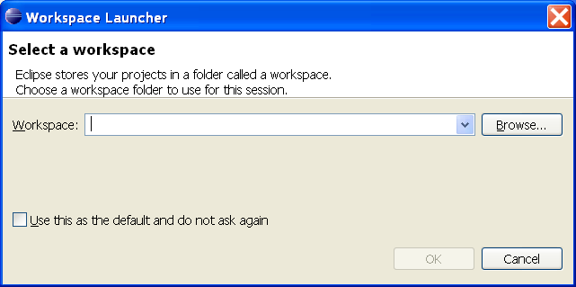](../files/File_Workspace.png--2248.md)

Eclipse Workspace Selection Dialog.

- Open the menu Help - Install New Software.

[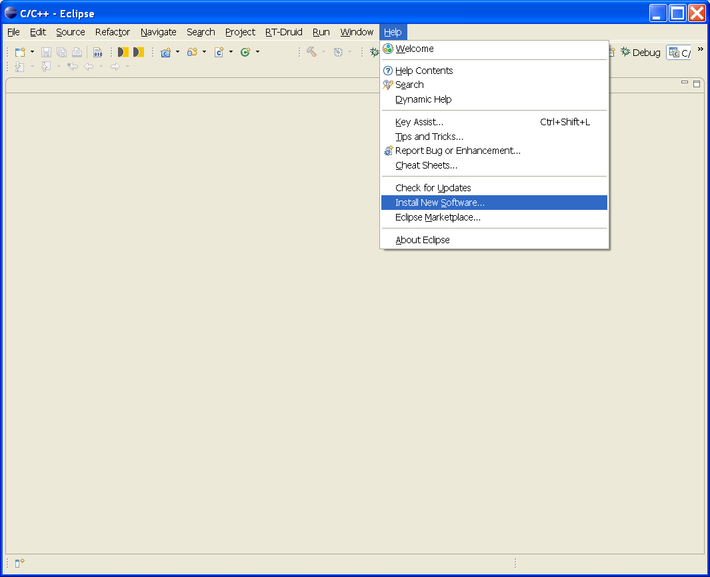](../files/File_Software.png--2249.md)

Eclipse New Software Installation.

- Click Add...

[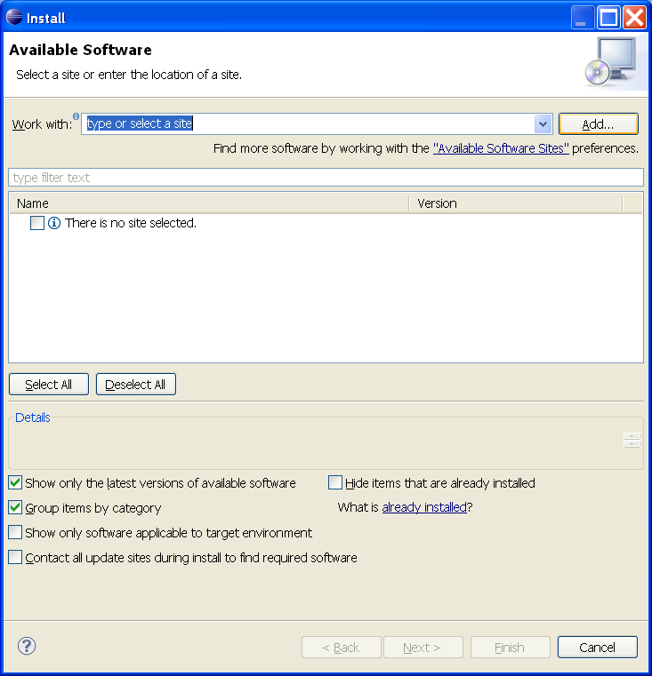](../files/File_Add.png--2250.md)

Eclipse Software Repository Install Dialog.

- Click Local...

[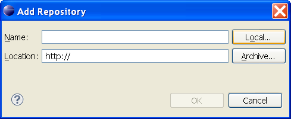](../files/File_Local.png--2251.md)

Eclipse Local Software Repository Selection Dialog.

- Select Disco locale (C:) -> Keil -> Eclipse and Click OK.

[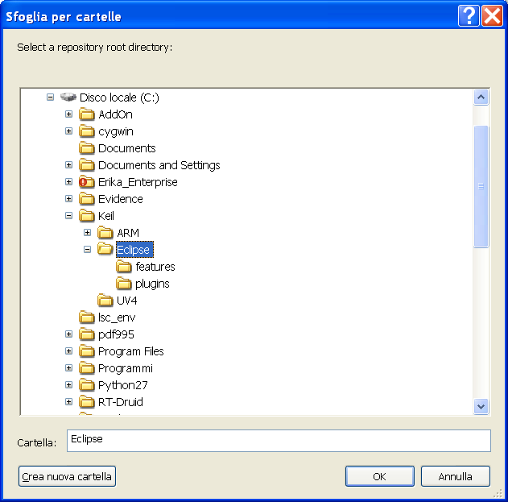](../files/File_Folder.png--2252.md)

Eclipse Local Software Repository Folder Selection Dialog.

- Fill "Name:" (Keil MDK-ARM) and Click OK.

[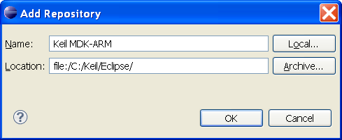](../files/File_Name.png--2253.md)

Eclipse Local Software Repository Selection Dialog.

- Enable "Keil MDK-ARM", Disable "Contact all update sites during install to find required software" and Click Next.

[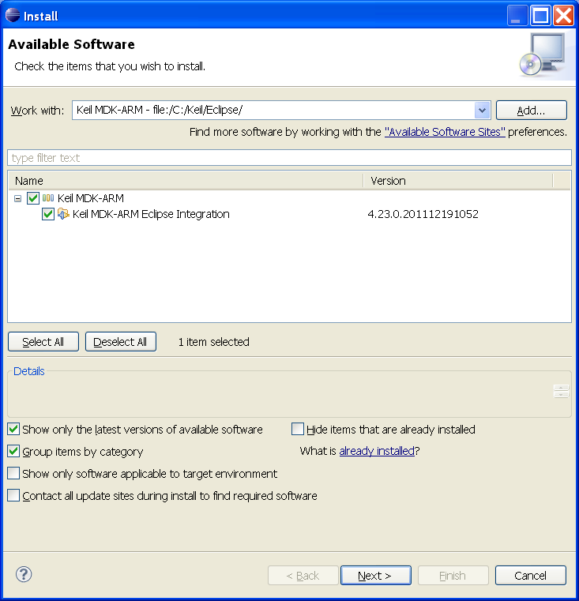](../files/File_Next.png--2254.md)

Eclipse Software Repository Install Dialog.

- On the next screen, Click Finish.

[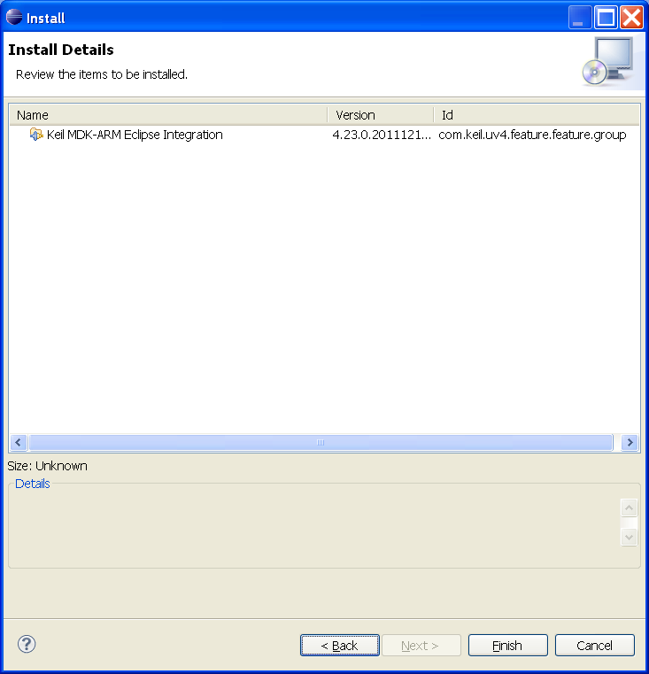](../files/File_Finish.png--2255.md)

Eclipse Software Installation Details Dialog.

- And finally Click Restart Now.

[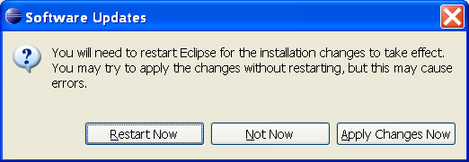](../files/File_Restart.png--2256.md)

Eclipse Software Installation Details Dialog.

- On a successful installation, Eclipse displays a menu µVision and µVision icons in the toolbar.

[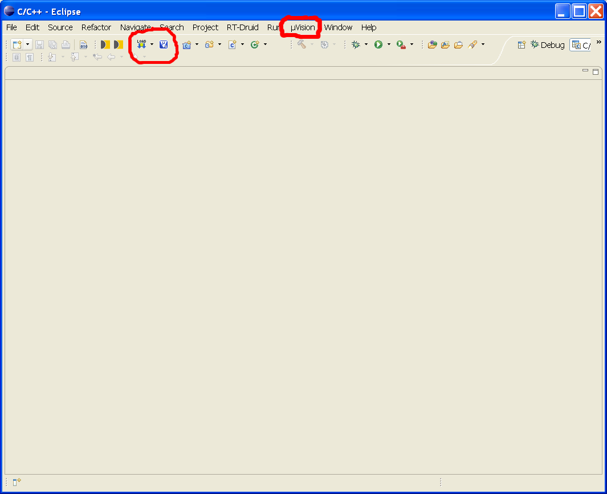](../files/File_Install.png--2257.md)

Eclipse New Software Installation.

To Debug an application see "MDK-ARM Plugin for Eclipse" in Keil uVision Help.

<a id="Building_stand-alone_libee.a_using_RT-Druid_Eclipse"></a>

#### Building stand-alone libee.a using RT-Druid Eclipse

- Launch Eclipse and define a workspace (default workspace can be accepted).

[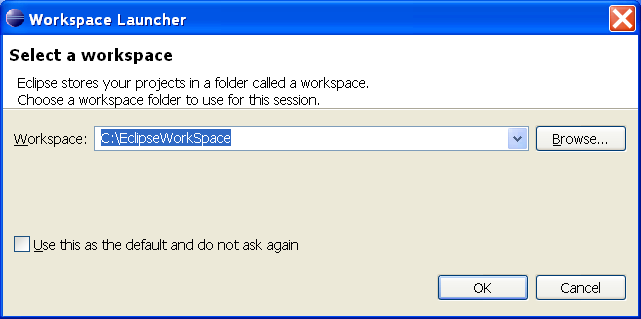](../files/File_Workspace_Launcher.png--2271.md)

Eclipse Workspace Selection Dialog.

- Open the menu File - New - RT-Druid Oil and C/C++ Project.

[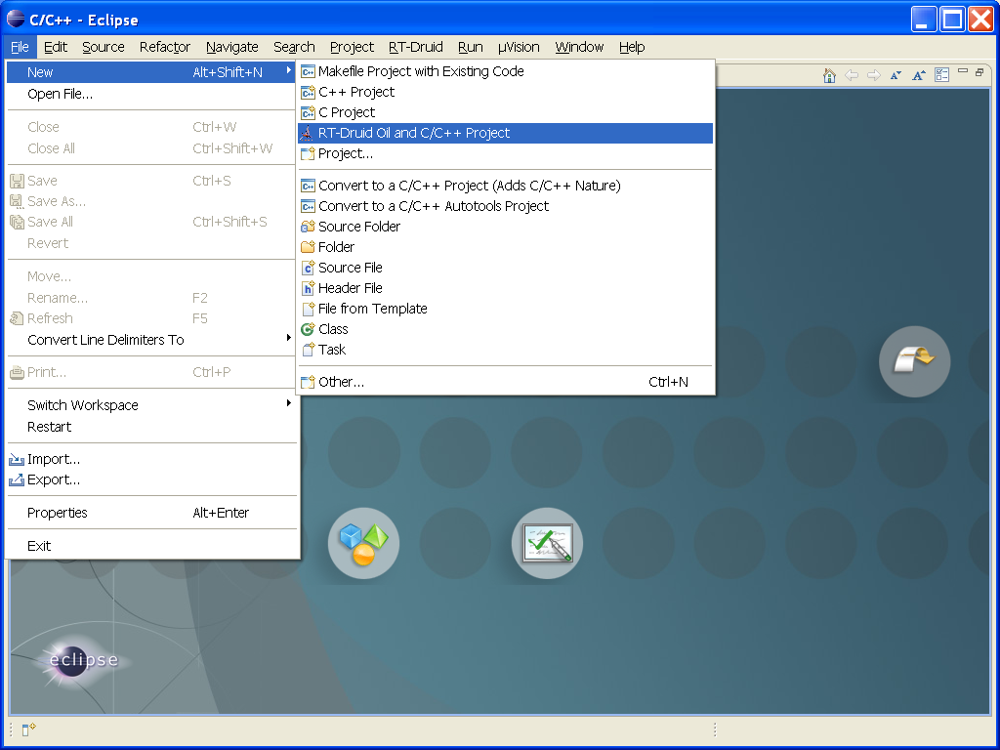](../files/File_RT-Druid_Oil_Project.png--2272.md)

RT-Druid Oil and C/C++ Project Menu Selection.

- Fill "Project name:" (EEApp) and Click Finish.

[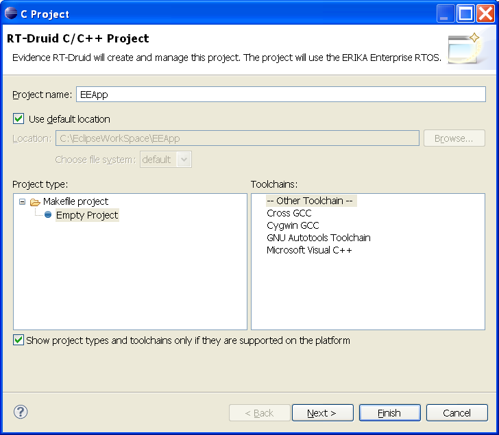](../files/File_C_Project.png--2273.md)

C Project Setting-up.

- Write conf.oil file with `EE_OPT = "__NO_APP__"` attibute in `OS` object and **NO** `APP_SRC` attibutes in `CPU_DATA` object.
- conf.oil file used here can be found in [examples/cortex\_mx/lm4f232xxxx/EElib0/conf.oil](http://svn.tuxfamily.org/viewvc.cgi/erika_erikae/repos/ee/trunk/ee/examples/cortex_mx/lm4f232xxxx/EElib0/conf.oil)

[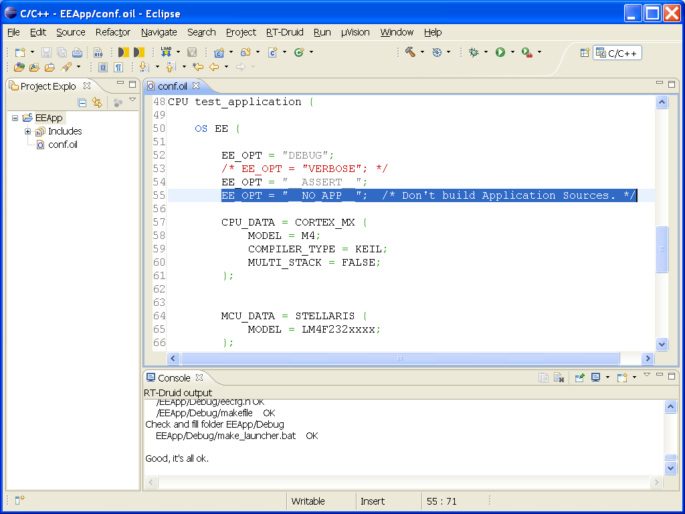](../files/File_EEApp_conf_oil.png--2274.md)

Application Oil file writing.

- Open the menu Project, check that "Build Automatically" is not selected and press "Build Project".

[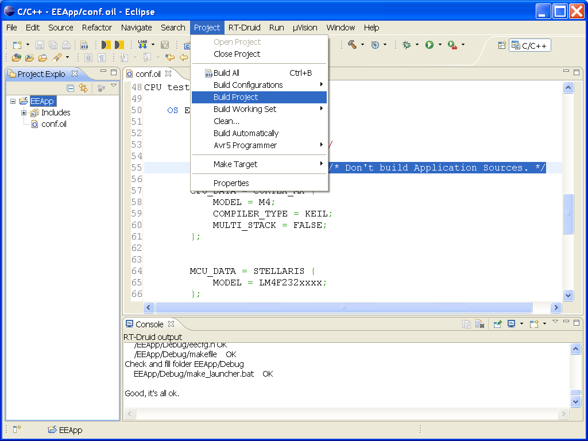](../files/File_EEApp_build_project.png--2275.md)

Application Building.

- Finally stand-alone libee.a is built in Debug directory.

[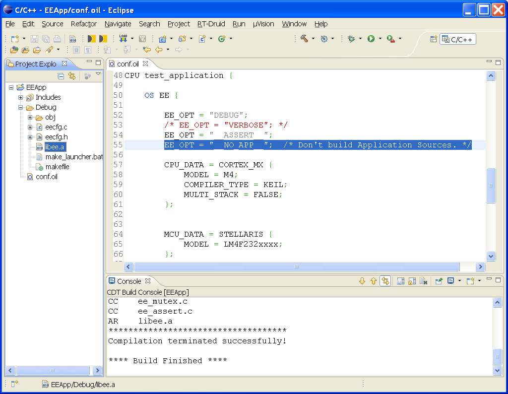](../files/File_EEApp_build_finished.png--2276.md)

Application Build Finished.

<a id="Building_ERIKA_based_application_using_KEIL_uVision"></a>

#### Building ERIKA based application using KEIL uVision

To build an ERIKA based application using KEIL uVision, it needs that a stand-alone libee.a was built previously. See [ARM Cortex MX#Building stand-alone libee.a using RT-Druid Eclipse](ARM_Cortex_MX--2226.md#Building_stand-alone_libee.a_using_RT-Druid_Eclipse "ARM Cortex MX") above.

- Launch Keil uVision.

[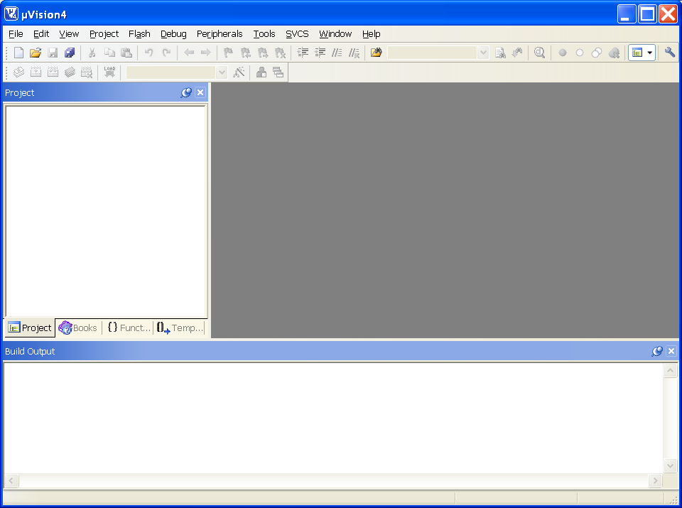](../files/File_Keil.png--2277.md)

Keil uVision Main Window.

- Open the menu Project - New uVision Project...

[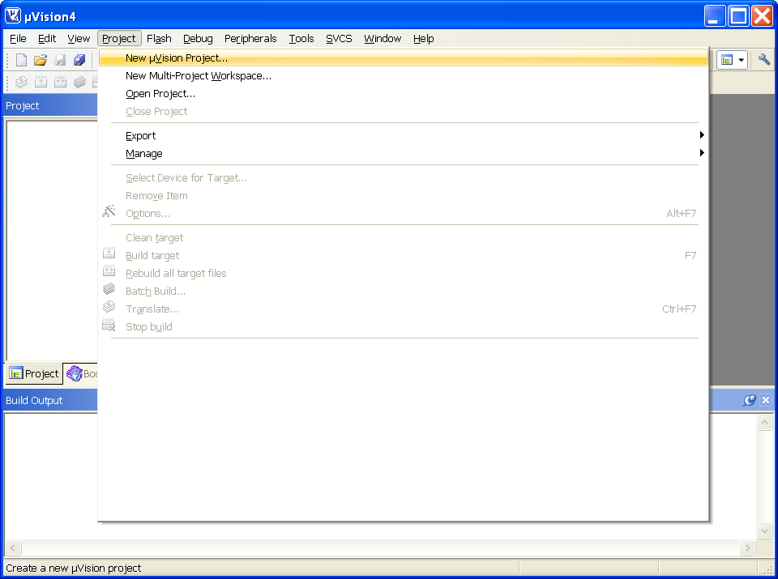](../files/File_Keil_New_project.png--2278.md)

Keil uVision New Project Selection.

- Select project folder, fill "File name:" (KEEApp) then Click Save.

[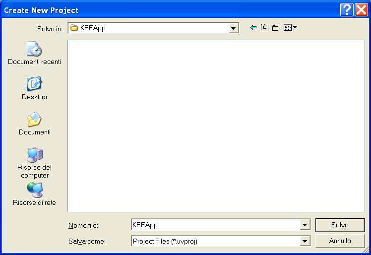](../files/File_KEEApp.png--2279.md)

Keil uVision New Project Creation.

- Select Device (Texas Instruments LM4F232H5DQ) and Click OK.

[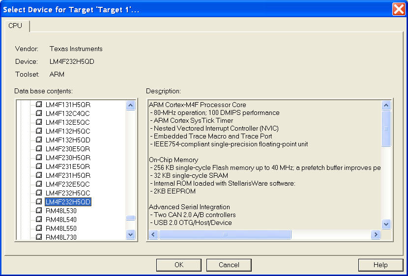](../files/File_KEEApp_LM4F232H5QD.png--2280.md)

Keil uVision Device Selection.

- In the next dialog click No because Erika provides its own startup code.

[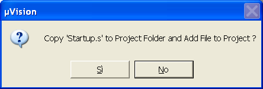](../files/File_KEEApp_Startup_s.png--2281.md)

Keil uVision Device Selection.

- Rename the target (TI Stellaris LM4F232H5QD) and sources group (EE).

[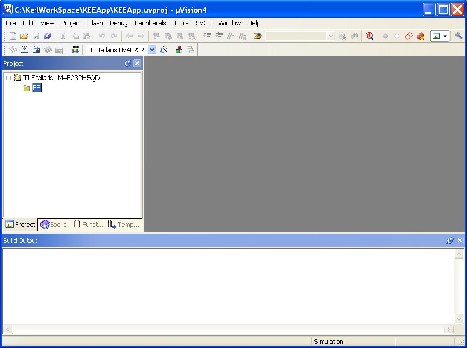](../files/File_KEEApp_Renamed.png--2282.md)

Keil uVision Device Selection.

- Right Click on source group EE and select "Add Files to Group 'EE'".
- Select libee.a built previously, Click Add and then Close.

[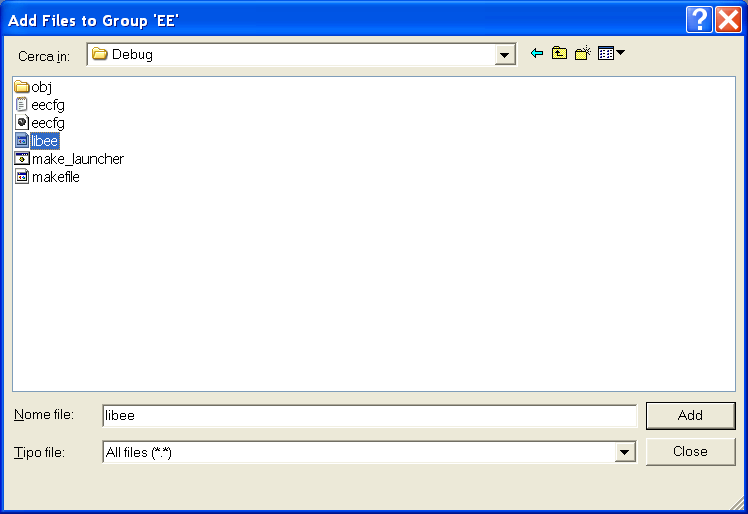](../files/File_KEEApp_Add_Files_Group_EE.png--2283.md)

Keil uVision "Add Files to Group 'EE'".

- Click on added libee.a.
- Open the menu Project - Options for File 'libee.a'...

[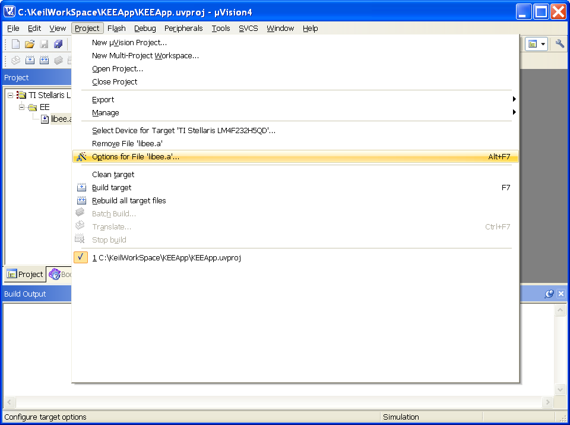](../files/File_KEEApp_Options_for_File_libee_a.png--2284.md)

Keil uVision "Options for File 'libee.a'...".

- Change "File Type:" from "Assembly language file" to "Library file" and Click OK.

[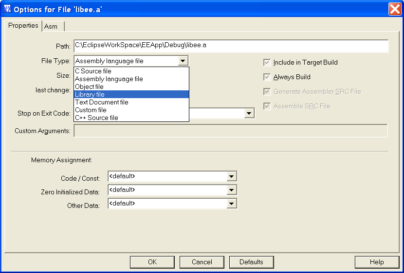](../files/File_KEEApp_libee_a_library.png--2285.md)

Keil uVision "Options for File 'libee.a'...".

- Right Click on "TI Stellaris LM4F232H5QD" target and select "Add Group...".
- Rename the added group to "src".
- Add in the group 'src' the startup assembly file for TI Stellaris LM4F232H5QD provided with Erika Enterprise [pkg/mcu/ti\_stellaris\_lm4f232xxxx/src/ee\_startup\_keil.s](http://svn.tuxfamily.org/viewvc.cgi/erika_erikae/repos/ee/trunk/ee/pkg/mcu/ti_stellaris_lm4f232xxxx/src/ee_startup_keil.s)

[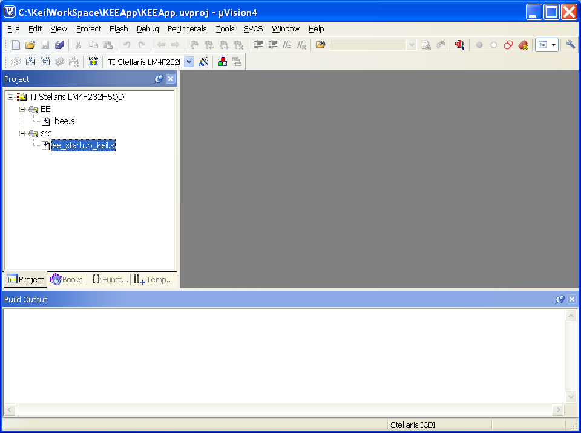](../files/File_KEEApp_ee_startup_keil_s.png--2286.md)

Keil uVision Startup File.

- Add in the gourp 'src' the application source file (E.g. main.c).
- main.c file used here can be found in [examples/cortex\_mx/lm4f232xxxx/EElib0/main.c](http://svn.tuxfamily.org/viewvc.cgi/erika_erikae/repos/ee/trunk/ee/examples/cortex_mx/lm4f232xxxx/EElib0/main.c)

[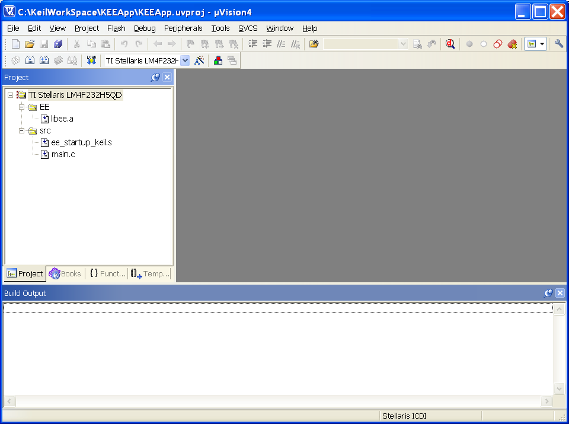](../files/File_KEEApp_main.png--2287.md)

Keil uVision Application Source File.

- Right Click on "TI Stellaris LM4F232H5QD" target and select "Options for Target 'TI Stellaris LM4F232H5QD'..."
- In the Target tab change "Floating Point Hardware:" from "Use FPU" to "Not Used".

[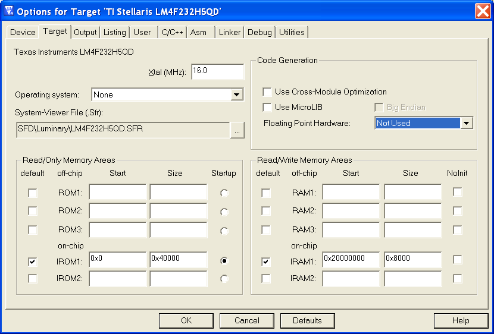](../files/File_KEEApp_Option_No_FPU.png--2290.md)

Keil uVision Taget Setup.

- In the C/C++ tab Click "Include Paths" button "...".

[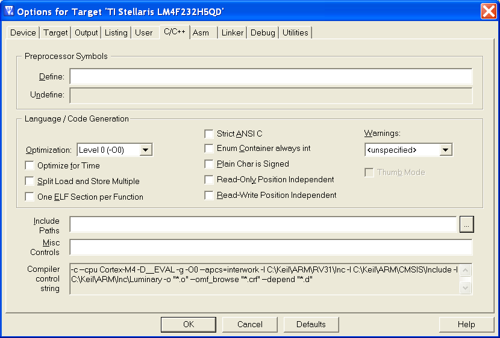](../files/File_KEEApp_Options_C_tab.png--2291.md)

Keil uVision C/C++ Setup.

- Adds Erika Enterprise and eecfg include paths for the application and click OK.

[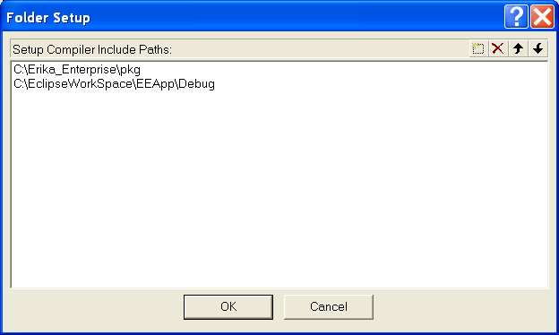](../files/File_KEEApp_compiler_inludes.png--2292.md)

Keil uVision Include Path Folder Setup.

- In the Asm tab adds Erika Enterprise and eecfg include paths for the application (see above) and adds "--cpreproc" in "Misc Controls" input box.

[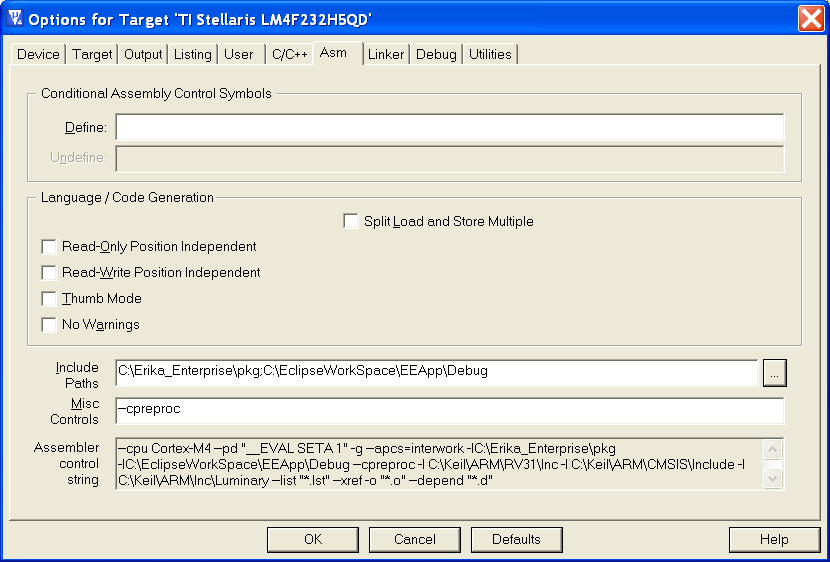](../files/File_KEEApp_asm.png--2293.md)

Keil uVision Assembly Setup.

- In the Linker tab adds "--entry EE\_cortex\_mx\_default\_reset\_ISR --first EE\_cortex\_mx\_vtable" in "Misc Controls" input box.

[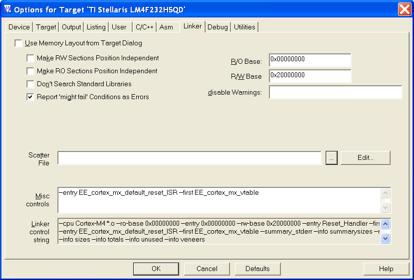](../files/File_KEEApp_link.png--2294.md)

Keil uVision Linker Setup.

- Open the menu Project - Build target

[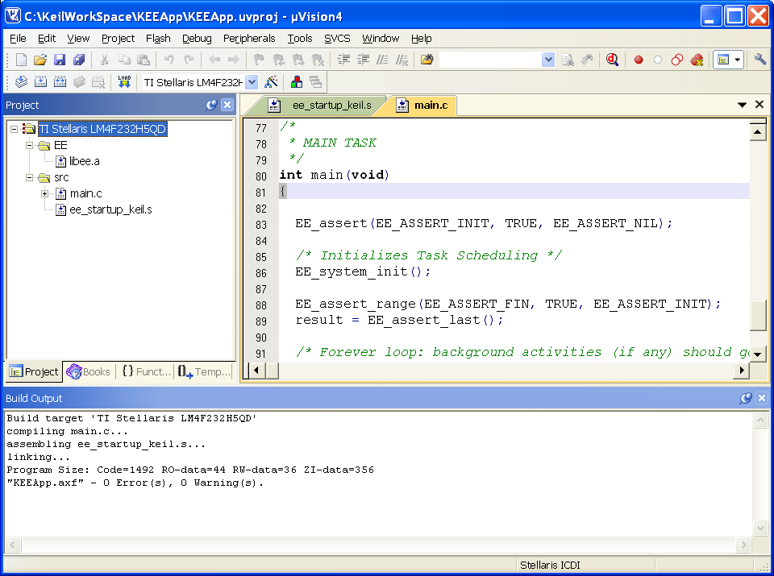](../files/File_KEEApp_build.png--2288.md)

Keil uVision Build Target.

- Open the menu Debug - Start/Stop Debug Session

[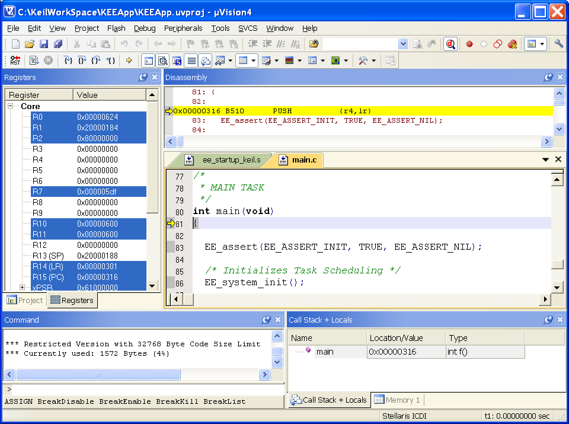](../files/File_KEEApp_debug.png--2289.md)

Keil uVision Debug Session.

<a id="Benchmarks"></a>

## Benchmarks

We run a limited set of benchmarks for the kernel, which are available at the page [Erika Enterprise Benchmark for Cortex M4](Erika_Enterprise_Benchmark_for_Cortex_M4--2309.md "Erika Enterprise Benchmark for Cortex M4"). Other benchmarks are available on the [Category:Benchmarks](../categories/Category_Benchmarks--2311.md "Category:Benchmarks").

<a id="See_also"></a>

## See also

- [Tutorial: Installing ERIKA and RT-Druid, and compile your first application](Tutorial_PIC30_-_Installing_ERIKA_and_RT-Druid_and_compile_your_first_application--1637.md "Tutorial: Installing ERIKA and RT-Druid, and compile your first application")
- [Tutorial: RT-Druid and OIL basics](Tutorial_RT-Druid_and_OIL_basics--1658.md "Tutorial: RT-Druid and OIL basics")
- [NXP Semiconductor - Microcontrollers (LPCXpresso) - Web site](http://ics.nxp.com/lpcxpresso/)
- [Texas Instruments - Stellaris LM4F232 USB+CAN Evaluation Kits - Web site](http://www.ti.com/tool/ek-lm4f232?DCMP=cortexm4f&HQS=ek-lm4f232)
- [IAR Systems Web site](http://www.iar.com/)
- [Keil Embedded Development Tools Web site](http://www.keil.com/)

---

## Archive provenance

- [Original page](http://erika.tuxfamily.org/wiki/index.php?title=ARM_Cortex_MX) · [Archived source revision 5986](http://erika.tuxfamily.org/wiki/index.php?oldid=5986)
- Last source edit: 2015-06-23T07:31:38Z. Source retrieved on 2026-11-06; Markdown conversion completed on 2026-11-07.
- Original contributors recorded in exported history: Salva, Outlawch, Eguidieri, Pj, Giuseppe Serano.
- [Original MediaWiki source](../source/wikitext/2226.mediawiki) · [Original editing history](../source/history/batch-001.xml)
- [Attribution and licensing notice](../NOTICE.md). Original file-specific notices, where present, remain applicable.
