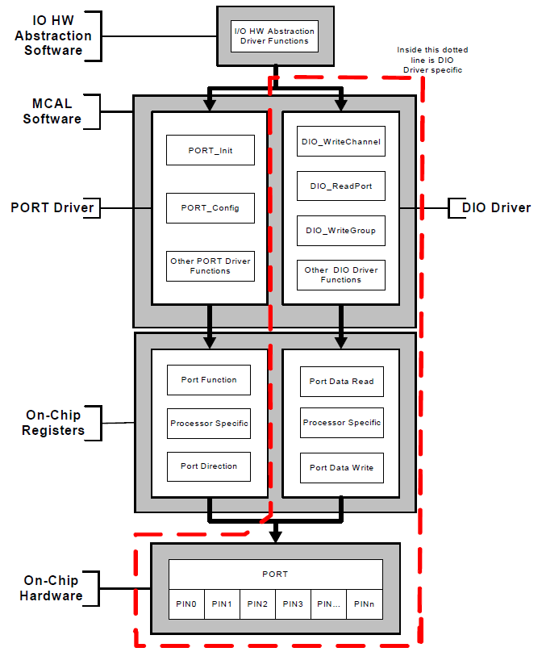
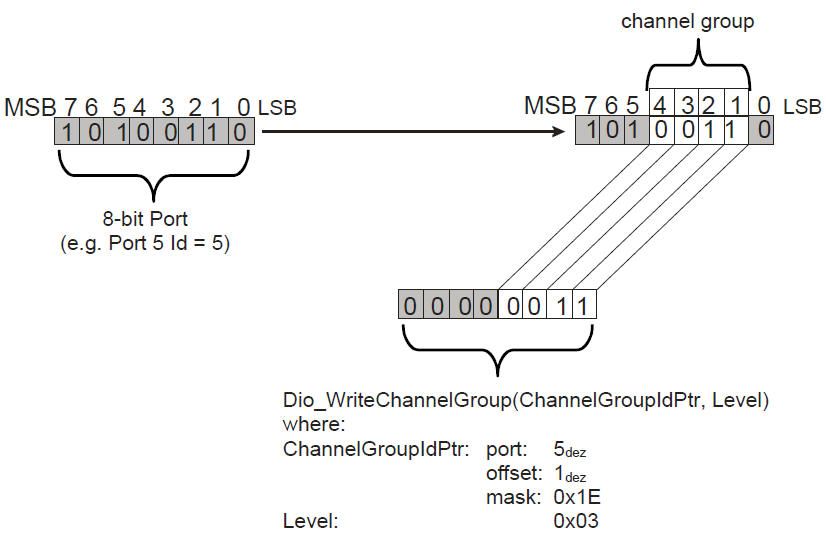
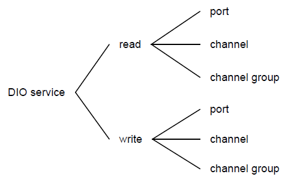
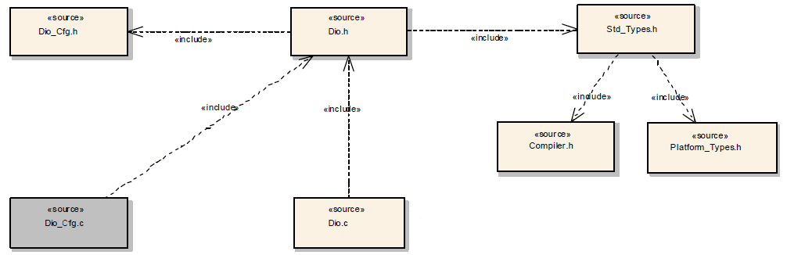
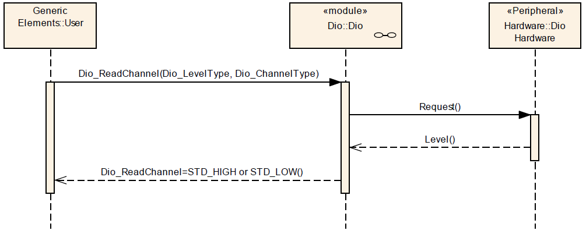
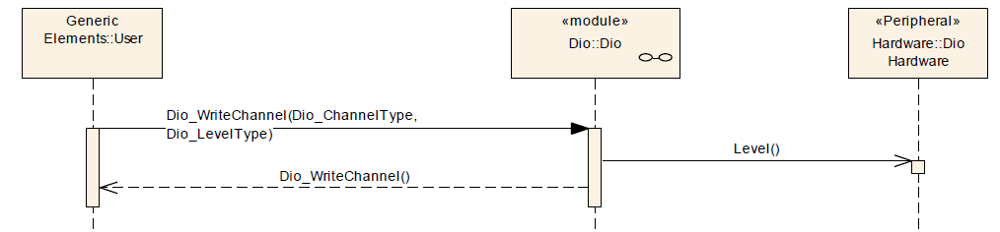
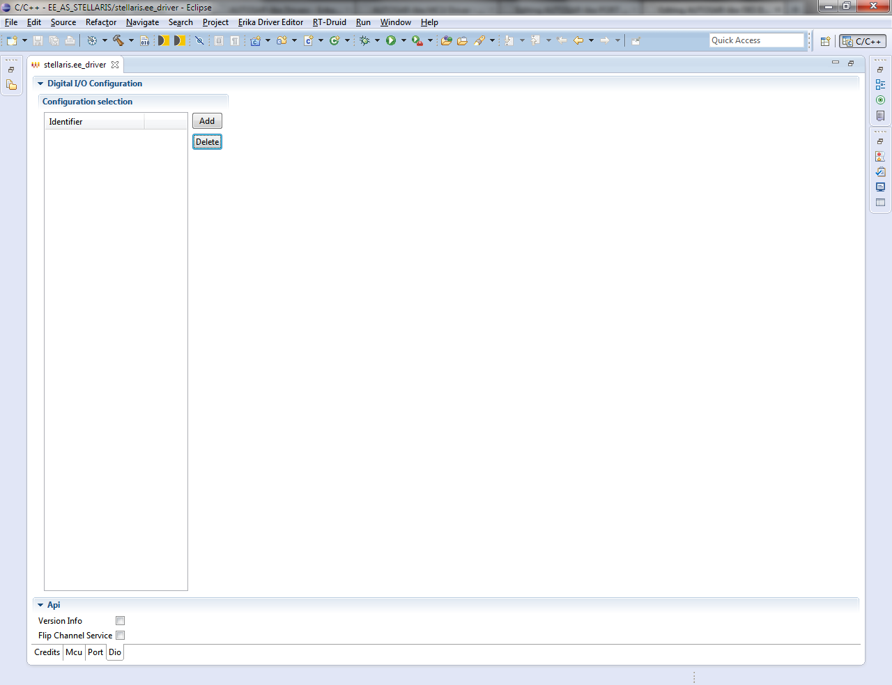
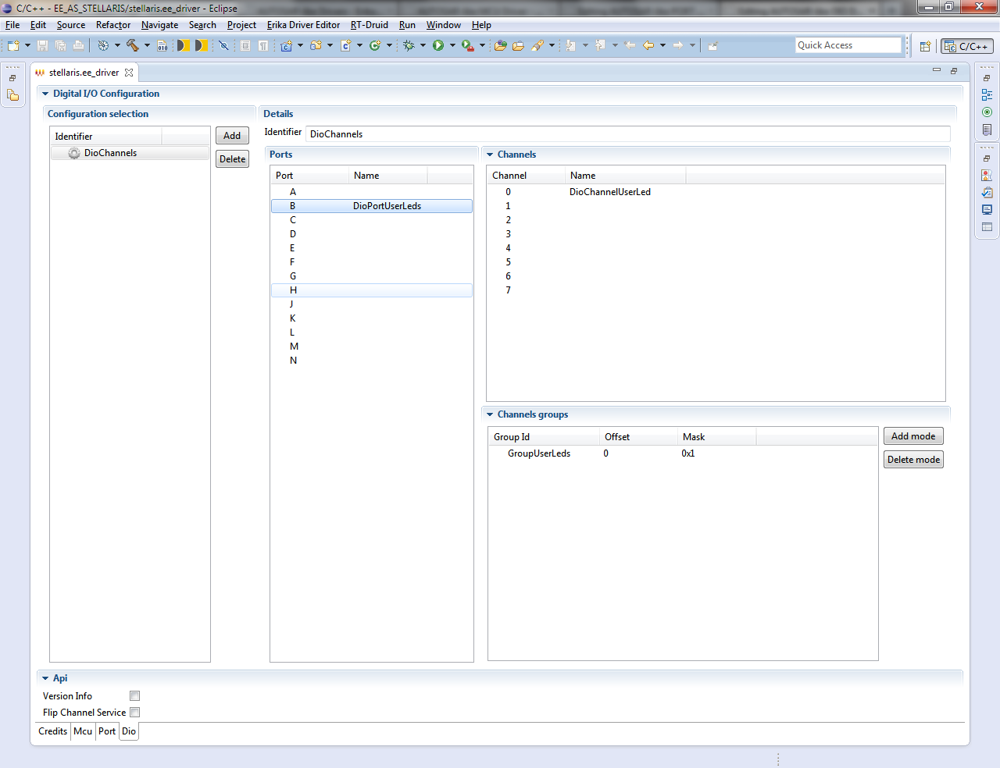

# AUTOSAR-like DIO Driver

<a id="Synopsis"></a>

### Synopsis

The DIO abstracts the access to the microcontroller's hardware pins. Furthermore, it allows the grouping of those pins.

The DIO Driver provides services for reading and writing to/from

- DIO Channels (Pins)
- DIO Ports
- DIO Channel Groups

The behaviour of those services is synchronous.

This module works on pins and ports which are configured by the PORT driver for this purpose. For this reason, there is no configuration and initialization of this port structure in the DIO Driver.

Many ports and port pins are assigned by the PORT Driver Module to various functionalities as for example:

- General purpose I/O
- ADC
- SPI
- PWM
- etc

The Dio module shall not provide APIs for overall configuration and initialization of the port structure which is used in the Dio module. These actions are done by the PORT Driver Module.

The Dio module shall adapt its configuration and usage to the microcontroller and ECU.

The Dio module’s user shall only use the Dio functions after the Port Driver has been initialized. Otherwise the Dio module will exhibit undefined behavior.

The diagram below identifies the DIO Driver functions, and the structure of the PORT Driver and DIO Driver.

[](../files/File_DIO-PORT.png--2390.md)

The Dio module shall not buffer data when providing read and write services.

The Dio module’s read and write services shall ensure for all services, that the data is consistent (Interruptible read-modify-write sequences are not allowed).

Values used by the DIO Driver for the software level of Channels are either *STD\_HIGH* or *STD\_LOW*.

A general-purpose digital IO pin represents a DIO channel.

The Port module shall configure a DIO channel as input or output.

In the DIO Driver, it shall be possible to group several DIO channels by hardware (typically controlled by one hardware register) to represent a DIO port.

**Note**: The single DIO channel levels inside a DIO port represent a bit in the DIO port value, depending on their position inside the port.

A channel group is a formal logical combination of several adjoining DIO channels within a DIO port.

[](../files/File_DIO_Channel_Group.png--2391.md)

The DIO Driver provides the following services:

- The Dio driver shall define functions to modify the levels of output channels individually, for a port or for a channel group.
- The Dio driver shall define functions to read the level of input and output channels individually, for a port or for a channel group.

[](../files/File_DIO_services.png--2392.md)

All read and write functions of the Dio module shall be re-entrant.

**Reason**: The DIO Driver may be accessed by different upper layer handlers or drivers. These upper layer modules may access the driver concurrently.

The configuration process for Dio module shall provide symbolic names for each configured DIO channel, port and group.

The Dio module shall publish the symbolic names which have been created during the configuration process in the file *Dio\_Cfg.h*.

Initialization of the hardware is done by the PORT Driver.

The Dio module shall not provide an interface for initialization of the hardware. The Port Driver performs this.

The PORT driver shall provide the reconfiguration of the port pin direction during runtime.

The DIO Driver provides services to transfer data to the microcontroller's pins

The Dio module’s write functions shall work on input and output channels.

If a Dio write function is used on an input channel, it shall have no effect on the physical output level.

If supported by hardware, the Dio module shall set/clear the output data latch of an input channel so that the required level is output from the pin when the port driver configures the pin as a DIO output pin.

The Dio module’s read functions shall work on input and output channels.

If the microcontroller supports the direct read-back of a pin value, the Dio module’s read functions shall provide the real pin level, when they are used on a channel which is configured as an output channel.

If the microcontroller does not support the direct read-back of a pin value, the Dio module’s read functions shall provide the value of the output register, when they are used on a channel which is configured as an output channel.

<a id="File_Structure"></a>

### File Structure

[](../files/File_DIO_Driver_File_structure.png--2393.md)

<a id="API_Specification"></a>

### API Specification

<a id="Imported_Types"></a>

#### Imported Types

<a id="typedef_uint8_Std_ReturnType"></a>

##### *typedef uint8 Std\_ReturnType*

```
 #include "Std_Types.h"
```

Standard Return Type.

This type can be used as standard API return type which is shared between AUTOSAR-like modules.

The *Std\_ReturnType* shall normally be used with value *E\_OK* or *E\_NOT\_OK*.
If those return values are not sufficient user specific values can be defined by using the 6 least specific bits.

<a id="struct_Std_VersionInfoType"></a>

##### *struct Std\_VersionInfoType*

```
 #include "Std_Types.h"
```

Standard Version Informations Type.

This type shall be used to request the version of a AUTOSAR-like module using the *<Module Name>\_GetVersionInfo()* function.

**Field Documentation:**

```
 uint16 Std_VersionInfoType::moduleID
```

Module Identifier.

```
 uint8 Std_VersionInfoType::sw_major_version
```

Software Version Major Number.

```
 uint8 Std_VersionInfoType::sw_minor_version
```

Software Version Minor Number.

```
 uint8 Std_VersionInfoType::sw_patch_version
```

Software Version Patch Number.

```
 uint16 Std_VersionInfoType::vendorID
```

Vendor Identifier.

<a id="Types_Defintions"></a>

#### Types Defintions

<a id="struct_Dio_ConfigType"></a>

##### *struct Dio\_ConfigType*

```
 #include "Dio.h"
```

DIO Driver Configuration Parameters.

The type *Dio\_ConfigType* is a type for the external data structure containing the initialization data for the DIO Driver.

This structure contains all configurable parameters of the DIO driver. A pointer to this structure is passed to the DIO driver initialization function for configuration.

**Note**: The user shall use the symbolic names defined in the configuration tool.

**Note**: The configuration of each Dio Channel MCU specific. Therefore, it is not possible to include a complete list of different configurations in this specification.

<a id="typedef_uint_Dio_ChannelType"></a>

##### *typedef uint Dio\_ChannelType*

```
 #include "Dio.h"
```

Data type for the symbolic name of a Dio Channel and shall cover all available DIO channels.

Parameters of type *Dio\_ChannelType* contain the numeric ID of a DIO channel.

The mapping of the ID is implementation specific but not configurable.

For parameter values of type *Dio\_ChannelType*, the Dio’s user shall use the symbolic names provided by the configuration description.

<a id="typedef_uint_Dio_PortType"></a>

##### *typedef uint Dio\_PortType*

```
 #include "Dio.h"
```

Data type for the symbolic name of a Dio Port and shall cover all available DIO ports.

Parameters of type *Dio\_PortType* contain the numeric ID of a DIO port.

The mapping of ID is implementation specific but not configurable.

For parameter values of type *Dio\_PortType*, the user shall use the symbolic names provided by the configuration description.

<a id="struct_Dio_ChannelGroupType"></a>

##### *struct Dio\_ChannelGroupType*

```
 #include "Dio.h"
```

Type for the definition of a channel group, which consists of several adjoining channels within a port.

For parameter values of type *Dio\_ChannelGroupType*, the user shall use the symbolic names provided by the configuration description.

**Field Documentation**:

- *uint32 Dio\_ChannelGroupType::mask*:

This element mask which defines the positions of the channel group.

- *uint8 Dio\_ChannelGroupType::offset*:

This element shall be the position of the Channel Group on the port, counted from the LSB.

- *Dio\_PortType Dio\_ChannelGroupType::port*:

This shall be the port on which the Channel group is defined.

<a id="typedef_uint8_Dio_LevelType"></a>

##### *typedef uint8 Dio\_LevelType*

```
 #include "Dio.h"
```

Data type for the for the possible levels that a DIO channel can have (input or output).

**Range**:

- *STD\_LOW*: Physical state 0V
- *STD\_HIGH*: Physical state 5V or 3.3V

<a id="typedef_uint8_Dio_PortLevelType"></a>

##### *typedef uint8 Dio\_PortLevelType*

```
 #include "Dio.h"
```

Data type for the value of a DIO port.

**Note**: If the μC owns ports of different port widths (e.g. 4, 8,16...Bit) *Dio\_PortLevelType* inherits the size of the largest port.

<a id="Functions_Definitions"></a>

#### Functions Definitions

<a id="Dio_LevelType_Dio_ReadChannel.28Dio_ChannelType_ChannelId.29"></a>

##### *Dio\_LevelType Dio\_ReadChannel(Dio\_ChannelType ChannelId)*

```
 #include "Dio.h"
```

Channel Read.

**Parameters**:

- *ChannelId*: ID of DIO Channel

**Returns**:

- *STD\_HIGH* : The physical level of the corresponding Pin is *STD\_HIGH*
- *STD\_LOW* : The physical level of the corresponding Pin is *STD\_LOW*

Returns the value of the specified DIO channel.

Service 0x00

The *Dio\_ReadChannel()* function shall return the value of the specified DIO channel.

<a id="void_Dio_WriteChannel.28Dio_ChannelType_ChannelId.2C.09Dio_LevelType_Level.29"></a>

##### *void Dio\_WriteChannel(Dio\_ChannelType ChannelId, Dio\_LevelType Level)*

```
 #include "Dio.h"
```

Channel Write.

**Parameters**:

- *ChannelId*: ID of DIO Channel
- *Level*: Value to be written

**Returns**:

- *None*.

Service 0x01

Service to set a level of a channel.

If the specified channel is configured as an output channel, the *Dio\_WriteChannel()* function shall set the specified Level for the specified channel.

If the specified channel is configured as an input channel, the *Dio\_WriteChannel()* function shall have no influence on the physical output.

If the specified channel is configured as an input channel, the *Dio\_WriteChannel()* function shall have no influence on the result of the next Read-Service.

<a id="Dio_PortLevelType_Dio_ReadPort.28Dio_PortType_PortId.29"></a>

##### *Dio\_PortLevelType Dio\_ReadPort(Dio\_PortType PortId)*

```
 #include "Dio.h"
```

Port Read.

**Parameters**:

- *PortId*: ID of DIO Port

**Returns**:

- Level of all channels of that port.

Returns the level of all channels of that port.

Service 0x02

The *Dio\_ReadPort()* function shall return the level of all channels of that port.

When reading a port which is smaller than the *Dio\_PortType* using the *Dio\_ReadPort()* function, the function shall set the bits corresponding to undefined port pins to *0*.

<a id="void_Dio_WritePort.28Dio_PortType_PortId.2C_Dio_PortLevelType_Level.29"></a>

##### *void Dio\_WritePort(Dio\_PortType PortId, Dio\_PortLevelType Level)*

```
 #include "Dio.h"
```

Port Write.

**Parameters**:

- *PortId*: ID of DIO Port
- *Level*: Value to be written

**Returns**:

- *None*.

Service 0x03

Service to set a value of a port.

The *Dio\_WritePort()* function shall set the specified value for the specified port.

When the *Dio\_WritePort()* function is called, DIO Channels that are configured as input shall remain unchanged.

When writing a port which is smaller than the Dio\_PortType using the *Dio\_WritePort()* function, the function shall ignore the MSB.

The *Dio\_WritePort()* function shall have no effect on channels within this port which are configured as input channels.

<a id="Dio_PortLevelType_Dio_ReadChannelGroup.28const_Dio_ChannelGroupType_.2AChannelGroupIdPtr.29"></a>

##### *Dio\_PortLevelType Dio\_ReadChannelGroup(const Dio\_ChannelGroupType \*ChannelGroupIdPtr)*

```
 #include "Dio.h"
```

Channel Group Read.

**Parameters**:

- *ChannelGroupIdPtr*: Pointer to Channel Group

**Returns**:

- Level of a subset of the adjoining bits of a port (channel group).

This Service reads a subset of the adjoining bits of a port.

Service 0x04

The *Dio\_ReadChannelGroup()* function shall read a subset of the adjoining bits of a port (channel group).

The *Dio\_ReadChannelGroup()* function shall do the masking of the channel group.

The *Dio\_ReadChannelGroup()* function shall do the shifting so that the values read by the function are aligned to the LSB.

<a id="void_Dio_WriteChannelGroup.28const_Dio_ChannelGroupType_.2AChannelGroupIdPtr.2C_Dio_PortLevelType_Level.29"></a>

##### *void Dio\_WriteChannelGroup(const Dio\_ChannelGroupType \*ChannelGroupIdPtr, Dio\_PortLevelType Level)*

```
 #include "Dio.h"
```

Channel Group Write.

**Parameters**:

- *ChannelGroupIdPtr*: Pointer to Channel Group
- *Level*: Value to be written

**Returns**:

- *None*.

Service 0x05

Service to set a subset of the adjoining bits of a port to a specified level.

The *Dio\_WriteChannelGroup()* function shall set a subset of the adjoining bits of a port (channel group) to a specified level.

The *Dio\_WriteChannelGroup()* shall not change the remaining channels of the port and channels which are configured as input.

The *Dio\_WriteChannelGroup()* function shall do the masking of the channel group.

The function *Dio\_WriteChannelGroup()* shall do the shifting so that the values written by the function are aligned to the LSB.

<a id="void_Dio_Init.28const_Dio_ConfigType_.2AConfigPtr.29"></a>

##### *void Dio\_Init(const Dio\_ConfigType \*ConfigPtr)*

```
 #include "Dio.h"
```

DIO Driver Initialization.

**Parameters**:

- *ConfigPtr*: Pointer to configuration set

**Returns**:

- *None*.

Initializes the DIO Driver module.

Service 0x10

The *Dio\_Init()* function shall initialize all global variables of the DIO module.

<a id="Dio_LevelType_Dio_FlipChannel.28Dio_ChannelType_ChannelId.29"></a>

##### *Dio\_LevelType Dio\_FlipChannel(Dio\_ChannelType ChannelId)*

```
 #include "Dio.h"
```

Channel Flip.

**Parameters**:

- *ChannelId*: ID of DIO Channel

**Returns**:

- *STD\_HIGH*: The physical level of the corresponding Pin is *STD\_HIGH*
- *STD\_LOW*: The physical level of the corresponding Pin is *STD\_LOW*

Service to flip (change from 1 to 0 or from 0 to 1) the level of a channel and return the level of the channel after flip.

Service 0x11

If the specified channel is configured as an output channel, the *Dio\_FlipChannel()* function shall read level of the channel and invert it, then write the inverted level to the channel. The return value shall be the inverted level of the specified channel.

If the specified channel is configured as an input channel, the *Dio\_FlipChannel()* function shall have no influence on the physical output. The return value shall be the level of the specified channel.

If the specified channel is configured as an input channel, the *Dio\_FlipChannel()* function shall have no influence on the result of the next Read-Service.

<a id="void_Dio_GetVersionInfo.28Std_VersionInfoType_.2AVersionInfoPtr.29"></a>

##### *void Dio\_GetVersionInfo(Std\_VersionInfoType \*VersionInfoPtr)*

```
 #include "Dio.h"
```

DIO Driver version informations retrieval.

**Parameters**:

- *VersionInfoPtr*: Pointer to where to store the version information of this module.

**Returns**:

- *None*.

This service retrieves the DIO driver version informations.

Service 0x12

The function *Dio\_GetVersionInfo()* shall return the version information of the DIO module.

The version information includes:

- Module Id
- Vendor Id
- Vendor specific version numbers

The function *Dio\_GetVersionInfo()* shall be configurable On/Off by the configuration parameter *DioVersionInfoApi*.

If source code for caller and callee of the function *Dio\_GetVersionInfo()* is available, the PORT module should realize this function as a macro. The DIO module should define this macro in the module’s header file.

<a id="Usage_Examples"></a>

### Usage Examples

<a id="Read_a_value_from_a_DIO_Channel"></a>

#### Read a value from a DIO Channel

[](../files/File_Dio_Read_1.png--2394.md)

<a id="Write_a_value_to_a_DIO_Channel"></a>

#### Write a value to a DIO Channel

[](../files/File_Dio_Write_1.png--2395.md)

<a id="Build"></a>

### Build

To enable AUTOSAR-like DIO Driver for Texas Instruments Stellaris LM4F232xxxx with ARM KEIL uVision Compiler Toolchain, the following `EE_OPT` attribute is needed in the `OS` object of the OSEK/VDX configuration:

```
 EE_OPT = "__AS_DIO_DRIVER__";
```

The configuration C header file inclusion is done by `CFLAGS` attribute in the `OS` object of the OSEK/VDX configuration:

```
 CFLAGS = "-I<PATH>";
```

Where `<PATH>` is the absolute or relative directory path which configuration C header file is stored.

Instead the configurations C source file is added to the compilation process by `APP_SRC` attribute in the `CPU_DATA` object of the OSEK/VDX configuration:

```
 APP_SRC = "<PATH>/Dio_Cfg.c";
```

Where `<PATH>` is the absolute or relative directory path which configuration C source file is stored.

<a id="Supported_Architectures"></a>

### Supported Architectures

<a id="TI_Stellaris_LM4F232XXXX_with_ARM_KEIL_uVision_Compiler_Toolchain"></a>

#### TI Stellaris LM4F232XXXX with ARM KEIL uVision Compiler Toolchain

<a id="Driver_Configuration"></a>

##### Driver Configuration

In order to configure the AUTOSAR-like DIO Driver for Texas Instruments Stellaris LM4F232xxxx with ARM KEIL uVision Compiler Toolchain, you have to select the "Dio" tab-sheet on driver configuration instance file.

[](../files/File_Erika_Driver_Configurator_DIO.png--2396.md)

<a id="Configuration_Selection"></a>

###### Configuration Selection

In this section you can add/edit/delete configurations in DIO Driver configuration set:

- Each configuration SHALL have an *Identifier* which must be unique inside the configurations set.
- Each configuration, inside the configurations set, has a set of Ports.
  - Each Port SHALL have a *Name* which must be unique inside the Ports.
  - Each Port has a set of Channels and/or Channels Groups.
    - Each Channel SHALL have a *Name* which must be unique inside a Port.
    - Each Channel Group SHALL have a *Name* which must be unique inside a Port.

<a id="API_Selection"></a>

###### API Selection

In this section you can select DIO Driver APIs and features will be included in build process:

- *Flip Channel Service*: *Dio\_FlipChannel()* API
- *Version Info*: *Dio\_GetVersionInfo()* API

[](../files/File_Erika_Driver_Configurator_DIO_set.png--2397.md)

<a id="Implemetations_Demos"></a>

##### Implemetations Demos

Implementation Demos of the AUTOSAR-like DIO Driver can be found at [examples/cortex\_mx/lm4f232xxxx/as](http://svn.tuxfamily.org/viewvc.cgi/erika_erikae/repos/ee/trunk/ee/examples/cortex_mx/lm4f232xxxx/as)

---

## Archive provenance

- [Original page](http://erika.tuxfamily.org/wiki/index.php?title=AUTOSAR-like_DIO_Driver) · [Archived source revision 5247](http://erika.tuxfamily.org/wiki/index.php?oldid=5247)
- Last source edit: 2013-07-16T20:45:18Z. Source retrieved on 2026-11-06; Markdown conversion completed on 2026-11-07.
- Original contributors recorded in exported history: Giuseppe Serano.
- [Original MediaWiki source](../source/wikitext/2389.mediawiki) · [Original editing history](../source/history/batch-001.xml)
- [Attribution and licensing notice](../NOTICE.md). Original file-specific notices, where present, remain applicable.
