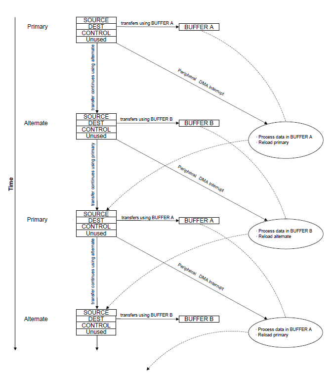
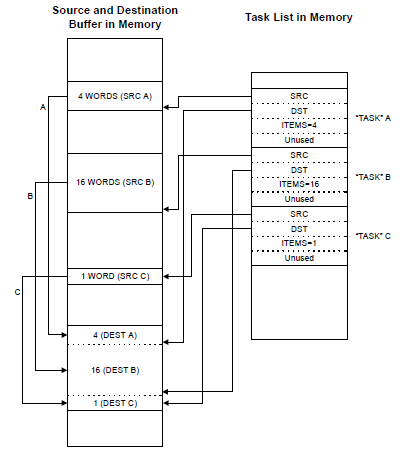
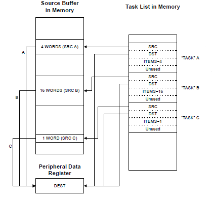
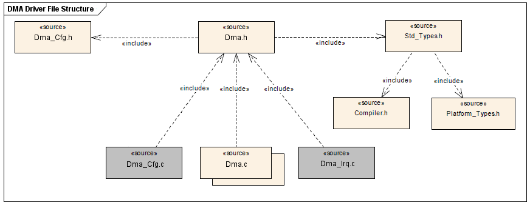
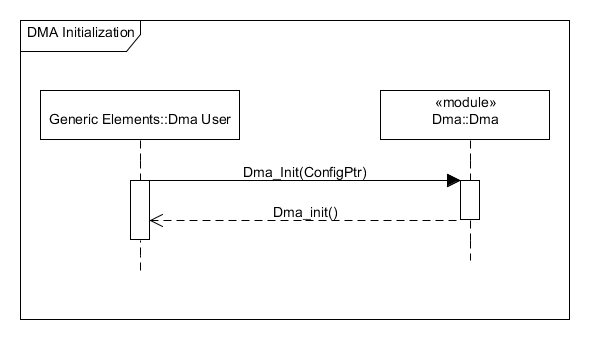
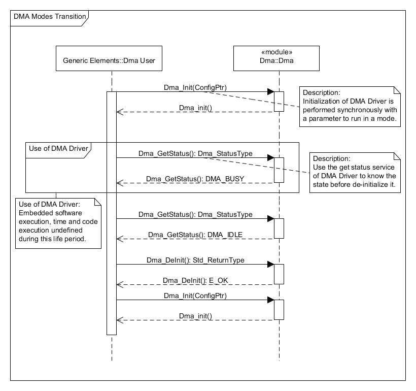
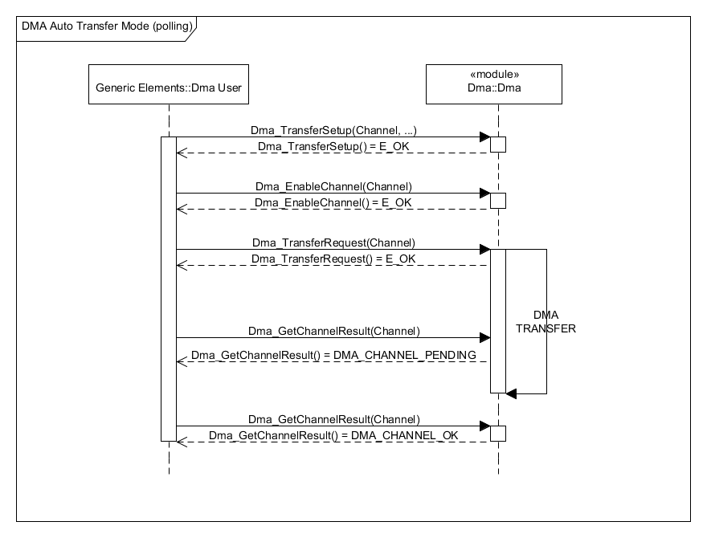
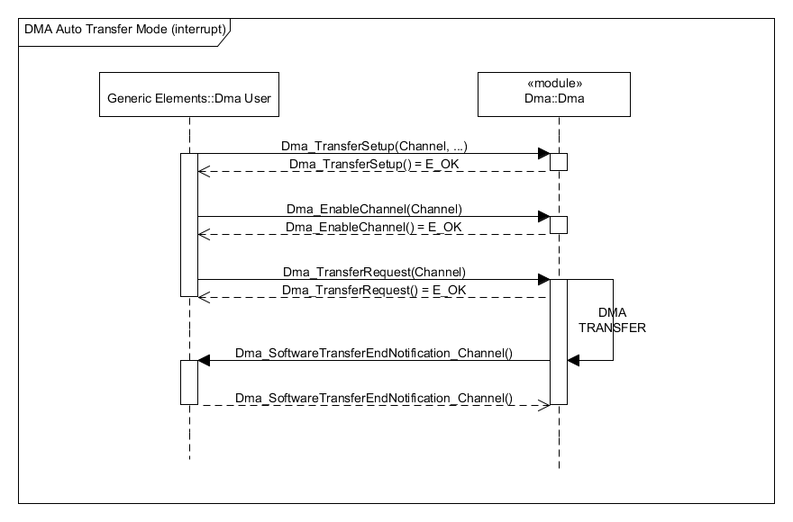
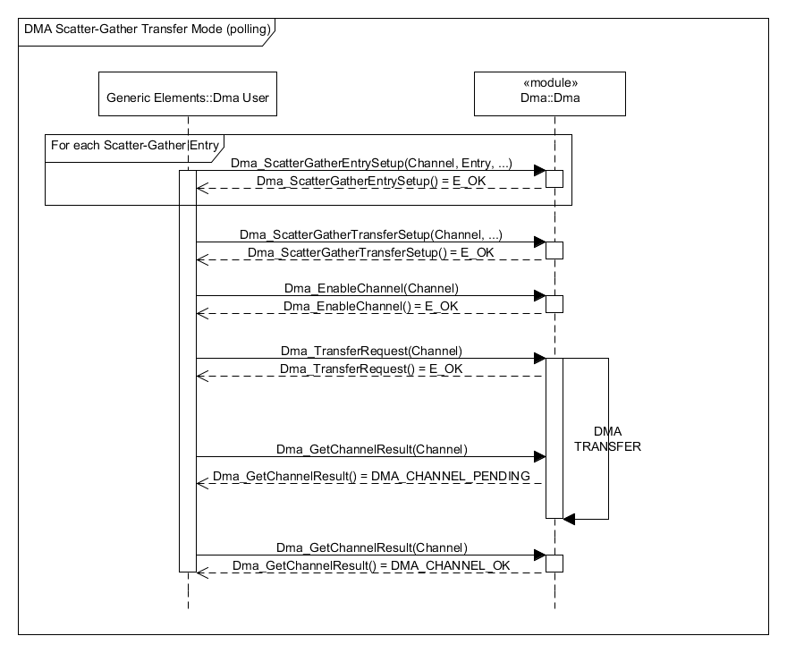
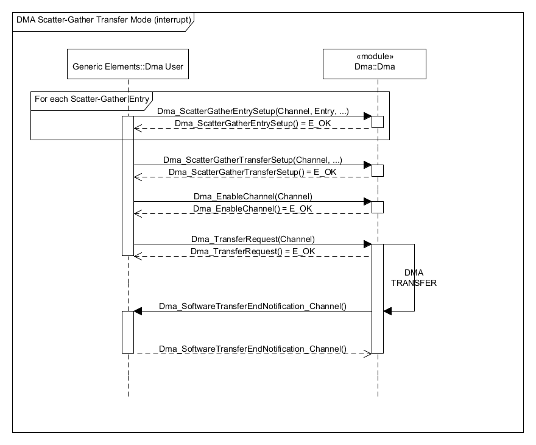

# AUTOSAR-like DMA Driver

<a id="Synopsis"></a>

### Synopsis

The DMA driver is part of the microcontroller abstraction layer (MCAL).

It provides services to offload data transfer tasks from the μC, allowing for more efficient use of the μC and the available bus bandwidth.

The DMA driver can perform transfers between memory and peripherals. It supports dedicated channels for each supported on-chip module and can be programmed to automatically perform transfers between peripherals and memory as the peripheral is ready to transfer more data. It also provides the required mechanism to configure the on-chip DMA peripheral.

The DMA driver supports memory-to-memory, memory-to-peripheral, and peripheral-to-memory in multiple transfer modes:

- **Basic** for simple transfer scenarios
- **Ping-Pong** for continuous data flow
- **Scatter-Gather** for a programmable list of arbitrary transfers initiated from a single request

The DMA driver supports highly flexible and configurable channel operation:

- Independently configured and operated channels
- Dedicated channels for supported on-chip modules
- Flexible channel assignments
- One channel each for receive and transmit path for bidirectional modules
- Dedicated channel for software-initiated transfers
- Per-channel configurable priority scheme
- Optional software-initiated requests for any channel
- Data sizes of 8, 16, and 32 bits
- Transfer size is programmable.
- Source and destination address increment size of byte, half-word, word, or no increment
- Maskable peripheral requests
- Interrupt on transfer completion, with a separate interrupt per channel

<a id="Transfer_Modes"></a>

#### Transfer Modes

The DMA driver supports several transfer modes. Two of the modes support simple one-time transfers. Several complex modes support a continuous flow of data.

The DMA driver transfer mode shall always be statically configurable, i.e. configured at pre-compile time to allow the best source code optimisation.

To improve the scalability, each transfer has optional features which are configurable (ON/OFF) or selectable.

<a id="Basic_Mode"></a>

##### Basic Mode

In Basic mode, the DMA driver performs transfers as long as there are more items to transfer, and a transfer request is present.

This mode is used with peripherals that assert a DMA request signal whenever the peripheral is ready for a data transfer.

Basic mode should not be used in any situation where the request is momentary even though the entire transfer should be completed.

<a id="Auto_Mode"></a>

##### Auto Mode

Auto mode is similar to Basic mode, except that once a transfer request is received, the transfer runs to completion, even if the DMA request is removed.

This mode is suitable for software-transfers. Generally, Auto mode is not used with a peripheral.

<a id="Ping-Pong_Mode"></a>

##### Ping-Pong Mode

Ping-Pong mode is used to support a continuous data flow to or from a peripheral.

To use Ping-Pong mode, the DMA driver user needs to provide two separate data buffers (primary and alternate). Both data buffers are set up by user for data transfer between memory and a peripheral.

The transfer is started using primary data buffer.

When the transfer using primary data buffer is complete, the DMA driver uses alternate data buffer for that channel to continue the transfer.

Each time this happens, an interrupt is generated, and the processor can reload the data buffer for the just-completed transfer.

Data flow can continue indefinitely this way, using primary and alternate data buffers to switch back and forth between buffers as the data flows to or from the peripheral.

[](../files/File_DMA_Ping_Pong.png--2427.md)

<a id="Memory_Scatter-Gather_Mode"></a>

##### Memory Scatter-Gather Mode

Memory Scatter-Gather mode is a complex mode used when data must be transferred to or from varied locations in memory instead of a set of contiguous locations in a memory buffer.

For example, a gather DMA operation could be used to selectively read the payload of several stored packets of a communication protocol and store them together in sequence in a memory buffer.

In Memory Scatter-Gather mode, the DMA driver needs a Scatter-Gather table in memory. The table is set up by the user software and contains a Task List of Scatter-Gather Entries, each containing the source and destination pointers, and the items number for a specific transfer.

The end of the list is marked so once the last transfer is performed, the DMA driver controller stops. A completion interrupt is generated only after the last transfer.

By using the DMA driver in this mode, a set of arbitrary transfers can be performed based on a single DMA request.

[](../files/File_DMA_Memory_Scatter_Gather.png--2428.md)

<a id="Peripheral_Scatter-Gather_Mode"></a>

##### Peripheral Scatter-Gather Mode

Peripheral Scatter-Gather transfer mode is very similar to Memory Scatter-Gather, except that the transfers are controlled by a peripheral making a DMA request.

Upon detecting a request from the peripheral, the DMA driver uses the table containing the Task List of Scatter-Gather Entries to performs the transfers.

At the end of one transfer, the next transfer is started only if the peripheral again asserts a DMA request.

The DMA driver continues to perform transfers from the list only when the peripheral is making a request, until the last transfer is complete.

A completion interrupt is generated only after the last transfer.

By using this method, the DMA driver can transfer data to or from a peripheral from a set of arbitrary locations whenever the peripheral is ready to transfer data.

[](../files/File_DMA_Pheriperal_Scatter_Gather.png--2429.md)

<a id="File_Structure"></a>

### File Structure

[](../files/File_DMA_Driver_File_structure.png--2430.md)

<a id="API_Specification"></a>

### API Specification

<a id="Imported_Types"></a>

#### Imported Types

<a id="typedef_uint8_Std_ReturnType"></a>

##### *typedef uint8 Std\_ReturnType*

```
 #include "Std_Types.h"
```

Standard Return Type.

This type can be used as standard API return type which is shared between AUTOSAR-like modules.

The *Std\_ReturnType* shall normally be used with value *E\_OK* or *E\_NOT\_OK*.
If those return values are not sufficient user specific values can be defined by using the 6 least specific bits.

<a id="struct_Std_VersionInfoType"></a>

##### *struct Std\_VersionInfoType*

```
 #include "Std_Types.h"
```

Standard Version Informations Type.

This type shall be used to request the version of a AUTOSAR-like module using the *<Module Name>\_GetVersionInfo()* function.

**Field Documentation:**

```
 uint16 Std_VersionInfoType::moduleID
```

Module Identifier.

```
 uint8 Std_VersionInfoType::sw_major_version
```

Software Version Major Number.

```
 uint8 Std_VersionInfoType::sw_minor_version
```

Software Version Minor Number.

```
 uint8 Std_VersionInfoType::sw_patch_version
```

Software Version Patch Number.

```
 uint16 Std_VersionInfoType::vendorID
```

Vendor Identifier.

<a id="Types_Defintions"></a>

#### Types Defintions

<a id="struct_Dma_ConfigType"></a>

##### *struct Dma\_ConfigType*

```
 #include "Dma.h"
```

DMA Driver Configuration Parameters.

The description of the type *Dma\_ConfigType* is implementation specific and it shall be provided for external use.

The type *Dma\_ConfigType* is an external data structure and shall contain the initialization data for the DMA Driver.

It shall contain:

- MCU dependent properties for DMA HW units
- Definition of Channels

For the type Dma\_ConfigType, the definition for each Channel shall contain:

- Channel Identifier
- Channel Peripheral Assignment
- Channel Source Address Boudaries
- Channel Destination Address Boudaries
- Channel Notifications Call-Backs
- Channel Harware Specific Configuration

For the type *Dma\_ConfigType*, the configuration will map the Channels to the different DMA hardware units and the devices.

<a id="enum_Dma_StatusType"></a>

##### *enum Dma\_StatusType*

```
 #include "Dma.h"
```

DMA Driver Status Type.

The type *Dma\_StatusType* defines a range of specific status for DMA Driver. It informs about the DMA Driver status or specified DMA Hardware microcontroller peripheral.

The type *Dma\_StatusType* can be obtained calling the API service *Dma\_GetStatus()*.

After reset, the type *Dma\_StatusType* shall have the default value *DMA\_UNINIT* with the numeric value '0'.

API service *Dma\_GetStatus()* shall return *DMA\_UNINIT* when the DMA Driver is not initialized or not usable.

API service *Dma\_GetStatus()* shall return *DMA\_IDLE* when The DMA Driver is not currently performing any transfer.

API service *Dma\_GetStatus()* shall return *DMA\_BUSY* when The DMA Driver is performing a DMA transfer.

**Enumerator**:

- *DMA\_UNINIT*: The DMA Driver is not initialized or not usable.
- *DMA\_IDLE*: The DMA Driver is not currently performing any transfer.
- *DMA\_BUSY*: The DMA Driver is performing a DMA transfer.

<a id="enum_Dma_ChannelResultType"></a>

##### *enum Dma\_ChannelResultType*

```
 #include "Dma.h"
```

DMA Driver Channel Result Type.

The type *Dma\_ChannelResultType* defines a range of specific Channels status for DMA Driver.

The type *Dma\_ChannelResultType* it informs about a DMA Driver Channel status and can be obtained calling the API service *Dma\_GetChannelResult()* with the Channel ID.

After reset, the type *Dma\_ChannelResultType* shall have the default value *DMA\_CHANNEL\_OK with* the numeric value *0*.

The function *Dma\_GetChannelResult()* shall return *DMA\_CHANNEL\_OK* when the last transfer on the Channel has been finished successfully.

**Enumerator**:

- *DMA\_CHANNEL\_OK*: The last transfer on the Channel has been finished successfully.
- *DMA\_CHANNEL\_PENDING*: The DMA Driver is performing a transfer on the DMA Channel. The meaning of this status is equal to *DMA\_BUSY*.
- *DMA\_CHANNEL\_FAILED*: The last transfer on the DMA Channel has failed.
- *DMA\_CHANNEL\_CANCELED*: The last transfer on the DMA Channel has been canceled by user.

<a id="typedef_uint_Dma_DataType"></a>

##### *typedef uint Dma\_DataType*

```
 #include "Dma.h"
```

DMA Driver Data Type.

Dma\_DataType defines the type of application data buffer elements.

Type is *uint8*, *uint16*, *uint32* and Range is 8 to 32 bit. it shall be provided for external use.

This is implementation specific but not all values may be valid within the type.

This type shall be chosen in order to have the most efficient implementation on a specific microcontroller platform.

The type Dma\_DataType refers to application data buffer elements.

<a id="typedef_uint16_Dma_NumberOfElementsType"></a>

##### *typedef uint16 Dma\_NumberOfElementsType*

```
 #include "Dma.h"
```

DMA Driver Number of Elements Type.

The type *Dma\_NumberOfElementsType* is used for defining the number of data elements of the type Dma\_DataType to transfer on a DMA Channel.

Type is *uint8*, *uint16*, *uint32* and Range is 8 to 32 bit.

It shall be provided for external use.

This is implementation specific but not all values may be valid within the type.

This type shall be chosen in order to have the most efficient implementation on a specific microcontroller platform.

<a id="typedef_uint_Dma_ChannelType"></a>

##### *typedef uint Dma\_ChannelType*

```
 #include "Dma.h"
```

DMA Driver Channel Type.

The type *Dma\_ChannelType* specifies the identification (ID) for a Channel.

Type is *uint8*, *uint16*, *uint32* and Range is 8 to 32 bit.

It shall be provided for external use.

This is implementation specific but not all values may be valid within the type.

This type shall be chosen in order to have the most efficient implementation on a specific microcontroller platform.

<a id="typedef_struct_Dma_EntryType"></a>

##### *typedef struct Dma\_EntryType*

```
 #include "Dma.h"
```

DMA Driver Entry Type.

The type *Dma\_EntryType* defines the type for a specific DMA Channel transfer entry when the Channel is configurable for multiple transfers.

Type is struct.

It shall be provided for external use.

This is implementation specific.

This type shall be chosen in order to have the most efficient implementation on a specific microcontroller platform.

<a id="typedef_void_.28.2ADma_SoftwareTransferEndNotification.29.28void.29"></a>

##### *typedef void (\*Dma\_SoftwareTransferEndNotification)(void)*

```
 #include "Dma.h"
```

Call-back routine provided by the user to notify the caller that a software-transfer on a DMA Channel has been finished.

The call-back *Dma\_SoftwareTransferEndNotification()* shall be Re-entrant.

The call-back notifications *Dma\_SoftwareTransferEndNotification()* shall have no parameters and no return value.

For implement the call back function other modules are required to provide the routines in the expected manner as function pointers defined within the initialization data structure.

If the *Dma\_SoftwareTransferEndNotification()* is configured (i.e. not a null pointer), the DMA Driver shall call the configured call-back notification at the end of a DMA Channel software-transfer.

*Note*: This routine might be called on interrupt level, depending on the calling function.

If a callback notification is configured as null pointer, no callback shall be executed.

<a id="typedef_void_.28.2ADma_TransferErrorNotification.29.28void.29"></a>

##### *typedef void (\*Dma\_TransferErrorNotification)(void)*

```
 #include "Dma.h"
```

Call-back routine provided by the user to notify the caller that a transfer on a DMA Channel has not been finished due to a transfer error.

The call-back *Dma\_TransferErrorNotification()* shall be Re-entrant.

The call-back notifications *Dma\_TransferErrorNotification()* shall have no parameters and no return value.

For implement the call-back function other modules are required to provide the routines in the expected manner as function pointers defined within the initialization data structure.

If the *Dma\_TransferErrorNotification()* is configured (i.e. not a null pointer), the DMA Driver shall call the configured call-back notification when an error occurs during a transfer on DMA Channel.

*Note*: This routine might be called on interrupt level, depending on the calling function.

If a callback notification is configured as null pointer, no callback shall be executed.

<a id="Functions_Definitions"></a>

#### Functions Definitions

<a id="void_Dma_Init.28const_Dma_ConfigType_.2AConfigPtr.29"></a>

##### *void Dma\_Init(const Dma\_ConfigType \*ConfigPtr)*

```
 #include "Dma.h"
```

DMA Driver Initialization.

**Parameters**:

- *ConfigPtr*: Pointer to configuration set.

**Returns**:

- *None*.

This service initializes the DMA Driver.

Service 0x00

The function *Dma\_Init()* shall be Non Re-entrant.

The function *Dma\_Init()* provides the service for DMA initialization.

The function *Dma\_Init()* shall initialize all DMA relevant registers with the values of the structure referenced by the parameter *ConfigPtr*.

The function *Dma\_Init()* shall define default values for required parameters of the structure referenced by the ConfigPtr.

After the module initialization using the function *Dma\_Init()*, the DMA Driver shall set its state to *DMA\_IDLE* and all the Channels result to *DMA\_CHANNEL\_OK*.

A re-initialization of a DMA Driver by executing the *Dma\_Init()* function requires a de-initialization before by executing a *Dma\_DeInit()*.

The calling of the routine *DMA\_Init()* while the DMA Driver is already initialized will cause the desired functionality shall be left without any action.

<a id="Std_ReturnType_Dma_DeInit.28void.29"></a>

##### *Std\_ReturnType Dma\_DeInit(void)*

```
 #include "Dma.h"
```

DMA Driver De-Initialization.

**Parameters**:

- *None*.

**Returns**:

- *E\_OK*: De-initialization command has been accepted.
- *E\_NOT\_OK*: De-initialization command has not been accepted.

This service de-initializes the DMA Driver.

Service 0x01

The function *Dma\_DeInit()* shall be Non Re-entrant.

When the API *Dma\_DeInit()* has been accepted the return value of this function shall be *E\_OK*.

When the API *Dma\_DeInit()* has not been accepted the return value of this function shall be *E\_NOT\_OK*.

The function *Dma\_DeInit()* provides the service for DMA de-initialization.

The function *Dma\_DeInit()* shall de-initialize DMA Driver.

In case of the DMA Driver state is not *DMA\_BUSY*, the deInitialization function shall put all already initialized microcontroller DMA peripherals into the same state such as Power On Reset.

The function call *Dma\_DeInit()* shall be rejected if the status of DMA Driver is *DMA\_BUSY*.

After the module de-initialization using the function *Dma\_DeInit()*, the DMA Driver shall set its state to *DMA\_UNINIT*.

The DMA Driver shall have been initialized before the function *Dma\_DeInit()* is called, otherwise *E\_NOT\_OK* shall be returned.

The function *Dma\_DeInit()* shall be configurable ON / OFF by configuration parameter *DMA\_DE\_INIT\_API*.

<a id="Std_ReturnType_Dma_ChannelEnable.28Dma_ChannelType.09Channel.29"></a>

##### *Std\_ReturnType Dma\_ChannelEnable(Dma\_ChannelType Channel)*

```
 #include "Dma.h"
```

DMA Channel Enabling.

**Parameters**:

- *Channel*: Channel ID.

**Returns**:

- *E\_OK*: Enabling command has been accepted
- *E\_NOT\_OK*: Enabling command has not been accepted

The service instructs the driver to enable DMA transfers on the addressed DMA channel.

Service 0x02

The function *Dma\_EnableChannel()* shall be Re-entrant.

When the API *Dma\_EnableChannel()* command has been accepted the function returns the value *E\_OK*.

When the API *Dma\_EnableChannel()* command has not been accepted the function returns the value *E\_NOT\_OK*.

The function *Dma\_EnableChannel()* provides the service to enable DMA transfers on the addressed DMA channel.

The function *Dma\_EnableChannel()* shall enable DMA transfers on the addressed DMA channel.

The DMA Driver shall have been initialized before the function *Dma\_EnableChannel()* is called, otherwise *E\_NOT\_OK* shall be returned.

The API parameters Channel shall have values within the specified range of values of configured DMA Channels otherwise the return value shall be *E\_NOT\_OK*.

<a id="Std_ReturnType_Dma_DisableChannel.28Dma_ChannelType_Channel.29"></a>

##### *Std\_ReturnType Dma\_DisableChannel(Dma\_ChannelType Channel)*

```
 #include "Dma.h"
```

DMA Channel Disabling.

**Parameters**:

- *Sequence*: Sequence ID

**Returns**:

- *E\_OK*: Disabling command has been accepted
- *E\_NOT\_OK*: Disabling command has not been accepted

The service instructs the driver to disable DMA transfers on the addressed DMA channel.

Service 0x03

The function *Dma\_DisableChannel()* shall be Re-entrant.

When the API *Dma\_DisableChannel()* command has been accepted the function shall return the value *E\_OK*.

When the API *Dma\_DisableChannel()* command has not been accepted the function shall return the value *E\_NOT\_OK*.

The function *Dma\_DisableChannel()* provides service to disable DMA transfers on the addressed DMA channel.

The function *Dma\_DisableChannel()* shall disable DMA transfers on the addressed DMA channel.

The DMA Driver shall have been initialized before the function *Dma\_DisableChannel()* is called, otherwise *E\_NOT\_OK* shall be returned.

The API parameters Channel shall have values within the specified range of values of configured DMA Channels otherwise the return value shall be *E\_NOT\_OK*.

The function *Dma\_DisableChannel()* shall terminate ongoing transfers of prior transfer requests, even if the transfer is unsuccessfully completed.

The function *Dma\_DisableChannel()* shall be configurable ON / OFF by configuration parameter *DMA\_DISABLE\_CHANNEL\_API*.

<a id="Dma_StatusType_Dma_GetStatus.28void.29"></a>

##### *Dma\_StatusType Dma\_GetStatus(void)*

```
 #include "Dma.h"
```

DMA Driver Status Retrieval.

**Parameters**:

- *None*.

**Returns**:

- DMA Driver software module status.

This service returns the DMA Driver software module status.

Service 0x04

The function *Dma\_GetStatus()* shall be Re-entrant.

The function *Dma\_GetStatus()* provides the service to return the DMA Driver software module status.

The function *Dma\_GetStatus()* shall return the DMA Driver software module status.

The function *Dma\_GetStatus()* shall be configurable ON / OFF by configuration parameter *DMA\_STATUS\_API*.

<a id="Dma_ChannelResultType_Dma_GetChannelResult.28Dma_ChannelType_Channel.29"></a>

##### *Dma\_ChannelResultType Dma\_GetChannelResult(Dma\_ChannelType Channel)*

```
 #include "Dma.h"
```

DMA Channel Result Retrieval.

**Parameters**:

- *Channel*: Channel ID.

**Returns**:

- Last DMA transfer result on the specified Channel.

This service returns the last DMA transfer result on the addressed DMA Channel.

Service 0x05

The function *Dma\_GetChannelResult()* shall be Re-entrant.

The function *Dma\_GetChannelResult()* provides the service to returns the last DMA transfer result on the addressed DMA Channel.

The function *Dma\_GetChannelResult()* shall returns the last DMA transfer result on the addressed DMA Channel.

The DMA Driver's environment shall call the function *Dma\_GetChannelResult()* to inquire whether the Channel transfer has succeeded (*DMA\_CHANNEL\_OK*) or failed (*DMA\_CHANNEL\_FAILED*).

Every new channel transfer that has been accepted by the DMA Driver overwrites the previous channel result with *DMA\_CHANNEL\_PENDING*.

If the DMA Driver has not been initialized before the function *Dma\_GetChannelResult()* is called or the channel parameter is invalid or not configured, the return value MUST BE *DMA\_CHANNEL\_FAILED*.

The function *Dma\_GetChannelResult()* shall be configurable ON / OFF by configuration parameter *DMA\_CHANNEL\_RESULT\_API*.

<a id="Std_ReturnType_Dma_TransferRequest.28Dma_ChannelType_Channel.29"></a>

##### *Std\_ReturnType Dma\_TransferRequest(Dma\_ChannelType Channel)*

```
 #include "Dma.h"
```

DMA Channel Transfer Request.

**Parameters**:

- *Channel*: Channel ID.

**Returns**:

- *E\_OK*: Transfer Request command has been accepted
- *E\_NOT\_OK*: Transfer Request command has not been accepted

Service to "trigger" a Transfer Request on the addressed DMA Channel.

Service 0x06

The function *Dma\_TransferRequest()* shall be Re-entrant.

When the API *Dma\_TransferRequest()* command has been accepted the function shall return the value *E\_OK*.

When the API *Dma\_TransferRequest()* command has not been accepted the function shall return the value *E\_NOT\_OK*.

The function *Dma\_TransferRequest()* provides service to "trigger" a Tranfer Request on the addressed DMA Channel.

The function *Dma\_TransferRequest()* shall take over the given parameter, trigger a transfer request on a DMA Channel, set the DMA Driver status to *DMA\_BUSY*, set the channel result to *DMA\_CHANNEL\_PENDING* and return.

When the function *Dma\_TransferRequest()* is called, the DMA Driver shall handle the DMA Channel results. Result shall be *DMA\_CHANNEL\_PENDING* when the transfer on the DMA Channel is started.

When the function *Dma\_TransferRequest()* is called, the DMA Driver shall handle the DMA Channel results. Result shall be *DMA\_CHANNEL\_OK* when the transfer on the DMA Channel is success.

When the function *Dma\_TransferRequest()* is called, the DMA Driver shall handle the DMA Channel results. Result shall be *DMA\_CHANNEL\_FAILED* when the transfer on the DMA Channel is failed.

At the end of a transfer initiated by the function *Dma\_TransferRequest()* and if configured, the DMA Driver shall invoke the transfer end notification call-back function after the transfer on DMA Channel ends if this one is also configured.

The DMA Driver shall have been initialized before the function *Dma\_TransferRequest()* is called, otherwise *E\_NOT\_OK* shall be returned.

The API parameters Channel shall have values within the specified range of values of configured DMA Channels otherwise the return value shall be *E\_NOT\_OK*.

When the function *Dma\_TransferRequest()* is called and the requested DMA Channel is disabled, the DMA Driver shall not take in account this new request and this function shall return with value *E\_NOT\_OK*, in this case.

When the function *Dma\_TransferRequest()* is called and and the requested DMA Channel is already in state *DMA\_CHANNEL\_PENDING*, the DMA Driver shall not take in account this new request and this function shall return with value *E\_NOT\_OK*, in this case.

The function *Dma\_TransferRequest()* is pre-compile time selectable by the configuration parameter *DMA\_TRANSFER\_REQUEST\_API*.

<a id="Std_ReturnType_Dma_TransferSetup.28Dma_ChannelType_Channel.2C_const_Dma_DataType_.2A_SrcAddrPtr.2C_const_Dma_DataType_.2A_DstAddrPtr.2C_Dma_NumberOfElementsType_TransferSize.29"></a>

##### *Std\_ReturnType Dma\_TransferSetup(Dma\_ChannelType Channel, const Dma\_DataType \* SrcAddrPtr, const Dma\_DataType \* DstAddrPtr, Dma\_NumberOfElementsType TransferSize)*

```
 #include "Dma.h"
```

DMA Transfer Setup.

**Parameters**:

- *Channel*: Channel ID.
- *SrcAddrPtr*: Source Address Pointer.
- *DstAddrPtr*: Destination Address Pointer.
- *TransferSize*: Number of Elements to transfer.

**Returns**:

- *E\_OK*: Transfer Setup command has been accepted
- *E\_NOT\_OK*: Transfer Setup command has not been accepted

Service to set-up Basic or Auto DMA Transfer on the addressed DMA Channel.

Service 0x07

The function *Dma\_TransferSetup()* shall be Re-entrant.

When the API *Dma\_TransferSetup()* command has been accepted the function shall return the value *E\_OK*.

When the API *Dma\_TransferSetup()* command has not been accepted the function shall return the value *E\_NOT\_OK*.

The function *Dma\_TransferSetup()* provides service to set-up Basic or Auto DMA transfer on addressed DMA Channel.

The function *Dma\_TransferSetup()* shall set-up Basic or Auto DMA transfer on addressed DMA Channel.

The DMA Driver shall have been initialized before the function *Dma\_TransferSetup()* is called, otherwise *E\_NOT\_OK* shall be returned.

The API parameters Channel shall have values within the specified range of values of configured DMA Channels otherwise the return value shall be *E\_NOT\_OK*.

When the function *Dma\_TransferSetup()* is called and the requested DMA Channel is enabled, the DMA Driver shall not take in account this new request and this function shall return with value *E\_NOT\_OK*, in this case.

When the function *Dma\_TransferSetup()* is called and the Number of Elements to transfer is equal to 0 or greater than the addressed channel transfer capability, the DMA Driver shall not take in account this new request and this function shall return with value *E\_NOT\_OK*, in this case.

When the function *Dma\_TransferSetup()* is called and the Address Pointers are *NULL\_PTR*, the DMA Driver shall not take in account this new request and this function shall return with value *E\_NOT\_OK*, in this case.

When the function *Dma\_TransferSetup()* is called and the Address Pointers are out of DMA Channal address boundaries,, the DMA Driver shall not take in account this new request and this function shall return with value *E\_NOT\_OK*, in this case.

<a id="Std_ReturnType_Dma_PingPongTransferSetup.28Dma_ChannelType_Channel.2C_const_Dma_DataType_.2A_PingSrcAddrPtr.2C_const_Dma_DataType_.2A_PingDstAddrPtr.2C_Dma_NumberOfElementsType_PingTransferSize.2C_const_Dma_DataType_.2A_PongSrcAddrPtr.2C_const_Dma_DataType_.2A_PongDstAddrPtr.2C_Dma_NumberOfElementsType_PongTransferSize.29"></a>

##### *Std\_ReturnType Dma\_PingPongTransferSetup(Dma\_ChannelType Channel, const Dma\_DataType \* PingSrcAddrPtr, const Dma\_DataType \* PingDstAddrPtr, Dma\_NumberOfElementsType PingTransferSize, const Dma\_DataType \* PongSrcAddrPtr, const Dma\_DataType \* PongDstAddrPtr, Dma\_NumberOfElementsType PongTransferSize)*

```
 #include "Dma.h"
```

DMA Ping-Pong Transfer Setup.

**Parameters**:

- *Channel*: Channel ID.
- *PingSrcAddrPtr*: Ping Source Address Pointer.
- *PingDstAddrPtr*: Ping Destination Address Pointer.
- *PingTransferSize*: Ping Number of Elements to transfer.
- *PongSrcAddrPtr*: Pong Source Address Pointer.
- *PongDstAddrPtr*: Pong Destination Address Pointer.
- *PongTransferSize*: Pong Number of Elements to transfer.

**Returns**:

- *E\_OK*: Transfer Setup command has been accepted
- *E\_NOT\_OK*: Transfer Setup command has not been accepted

Service to set-up Ping-Pong DMA Transfer on the addressed DMA Channel.

Service 0x08

The function *Dma\_PingPongTransferSetup()* shall be Re-entrant.

When the API *Dma\_PingPongTransferSetup()* command has been accepted the function shall return the value *E\_OK*.

When the API *Dma\_PingPongTransferSetup()* command has not been accepted the function shall return the value *E\_NOT\_OK*.

The function *Dma\_PingPongTransferSetup()* provides service to set-up Ping-Pong DMA transfer on addressed DMA Channel.

The function *Dma\_PingPongTransferSetup()* shall set-up Ping-Pong DMA transfer on addressed DMA Channel.

The DMA Driver shall have been initialized before the function *Dma\_PingPongTransferSetup()* is called, otherwise *E\_NOT\_OK* shall be returned.

The API parameters Channel shall have values within the specified range of values of configured DMA Channels otherwise the return value shall be *E\_NOT\_OK*.

When the function *Dma\_PingPongTransferSetup()* is called and the requested DMA Channel is enabled, the DMA Driver shall not take in account this new request and this function shall return with value *E\_NOT\_OK*, in this case.

When the function *Dma\_PingPongTransferSetup()* is called and the Number of Elements to transfer is equal to *0* or greater than the addressed channel transfer capability, the DMA Driver shall not take in account this new request and this function shall return with value *E\_NOT\_OK*, in this case.

When the function *Dma\_PingPongTransferSetup()* is called and the Address Pointers are *NULL\_PTR*, the DMA Driver shall not take in account this new request and this function shall return with value *E\_NOT\_OK*, in this case.

When the function *Dma\_PingPongTransferSetup()* is called and the Address Pointers are out of DMA Channal address boundaries,, the DMA Driver shall not take in account this new request and this function shall return with value *E\_NOT\_OK*, in this case.

The function *Dma\_PingPongTransferSetup()* is pre-compile time selectable by the configuration parameter *DMA\_PING\_PONG\_API*.

<a id="Std_ReturnType_Dma_PingPongTransferUpdate.28Dma_ChannelType_Channel.2C_const_Dma_DataType_.2A_SrcAddrPtr.2C_const_Dma_DataType_.2A_DstAddrPtr.2C_Dma_NumberOfElementsType_TransferSize.29"></a>

##### *Std\_ReturnType Dma\_PingPongTransferUpdate(Dma\_ChannelType Channel, const Dma\_DataType \* SrcAddrPtr, const Dma\_DataType \* DstAddrPtr, Dma\_NumberOfElementsType TransferSize)*

```
 #include "Dma.h"
```

DMA Ping-Pong Transfer Update.

**Parameters**:

- *Channel*: Channel ID
- *SrcAddrPtr*: Source Address Pointer.
- *DstAddrPtr*: Destination Address Pointer.
- *TransferSize*: Number of Elements to transfer.

**Returns**:

- *E\_OK*: Transfer Update command has been accepted
- *E\_NOT\_OK*: Transfer Update command has not been accepted

Service to Update Ping-Pong DMA Transfer on the addressed DMA Channel.

Service 0x09

The function *Dma\_PingPongTransferUpdate()* shall be Re-entrant.

When the API *Dma\_PingPongTransferUpdate()* command has been accepted the function shall return the value *E\_OK*.

When the API *Dma\_PingPongTransferUpdate()* command has not been accepted the function shall return the value *E\_NOT\_OK*.

The function *Dma\_PingPongTransfeUpdate()* provides service to update Ping-Pong DMA transfer on addressed DMA Channel.

The function *Dma\_PingPongTransferUpdate()* shall update Ping-Pong DMA transfer on addressed DMA Channel.

The DMA Driver shall have been initialized before the function *Dma\_PingPongTransferUpdate()* is called, otherwise *E\_NOT\_OK* shall be returned.

The API parameters Channel shall have values within the specified range of values of configured DMA Channels otherwise the return value shall be *E\_NOT\_OK*.

When the function *Dma\_PingPongTransferUpdate()* is called and the requested DMA Channel is disabled, the DMA Driver shall not take in account this new request and this function shall return with value *E\_NOT\_OK*, in this case.

When the function *Dma\_PingPongTransferUpdate()* is called and the Number of Elements to transfer is equal to *0* or greater than the addressed channel transfer capability, the DMA Driver shall not take in account this new request and this function shall return with value *E\_NOT\_OK*, in this case.

When the function *Dma\_PingPongTransfeUpdate()* is called and the Address Pointers are *NULL\_PTR*, the DMA Driver shall not take in account this new request and this function shall return with value *E\_NOT\_OK*, in this case.

When the function *Dma\_PingPongTransferUpdate()* is called and the Address Pointers are out of DMA Channal address boundaries,, the DMA Driver shall not take in account this new request and this function shall return with value *E\_NOT\_OK*, in this case.

The function *Dma\_PingPongTransferUpdate()* is pre-compile time selectable by the configuration parameter *DMA\_PING\_PONG\_API*.

<a id="Std_ReturnType_Dma_ScatterGatherEntrySetup.28Dma_ChannelType_Channel.2C_Dma_EntryType_.2A_EntryPtr.2C_const_Dma_DataType_.2A_SrcAddrPtr.2C_const_Dma_DataType_.2A_DstAddrPtr.2C_Dma_NumberOfElementsType_TransferSize.2C.09boolean_LastEntry.29"></a>

##### *Std\_ReturnType Dma\_ScatterGatherEntrySetup(Dma\_ChannelType Channel, Dma\_EntryType \* EntryPtr, const Dma\_DataType \* SrcAddrPtr, const Dma\_DataType \* DstAddrPtr, Dma\_NumberOfElementsType TransferSize, boolean LastEntry)*

```
 #include "Dma.h"
```

DMA Scatter-Gather Entry Set-up.

**Parameters**:

- *Channel*: Channel ID
- *EntryPtr*: Pointer of Scatter-Gather Entry to be Setup
- *SrcAddrPtr*: Source Address Pointer
- *DstAddrPtr*: Destination Address Pointer
- *TransferSize*: Number of Elements to transfer
- *LastEntry*:
  - *TRUE*: Scatter-Gather Last Entry
  - *FALSE*: Scatter-Gather Intermediate Entry

**Returns**:

- *E\_OK*: Setup command has been accepted
- *E\_NOT\_OK*: Setup command has not been accepted

Service to set-up a Scatter-Gather Transfer Entry on the addressed DMA Channel.

Service 0x0A

The function *Dma\_ScatterGatherEntrySetup()* shall be Re-entrant.

When the API *Dma\_ScatterGatherEntrySetup()* command has been accepted the function shall return the value *E\_OK*.

When the API *Dma\_ScatterGatherEntrySetup()* command has not been accepted the function shall return the value *E\_NOT\_OK*.

The function *Dma\_ScatterGatherEntrySetup()* provides service to set-up a Scatter-Gather Transfer Entry on addressed DMA Channel.

The function *Dma\_ScatterGatherEntrySetup()* shall set-up a Scatter-Gather Transfer Entry on addressed DMA Channel.

The DMA Driver shall have been initialized before the function Dma\_ScatterGatherEntrySetup() is called, otherwise *E\_NOT\_OK* shall be returned.

The API parameters Channel shall have values within the specified range of values of configured DMA Channels otherwise the return value shall be *E\_NOT\_OK*.

When the function *Dma\_ScatterGatherEntrySetup()* is called and the Number of Elements to transfer is equal to 0 or greater than the addressed channel transfer capability, the DMA Driver shall not take in account this new request and this function shall return with value *E\_NOT\_OK*, in this case.

When the function *Dma\_ScatterGatherEntrySetup()* is called and the Entry or Address Pointers are *NULL\_PTR*, the DMA Driver shall not take in account this new request and this function shall return with value *E\_NOT\_OK*, in this case.

When the function *Dma\_ScatterGatherEntrySetup()* is called and the Address Pointers are out of DMA Channal address boundaries,, the DMA Driver shall not take in account this new request and this function shall return with value *E\_NOT\_OK*, in this case.

The function *Dma\_ScatterGatherEntrySetup()* is pre-compile time selectable by the configuration parameter *DMA\_SCATTER\_GATHER\_API*.

<a id="Std_ReturnType_Dma_ScatterGatherTransferSetup.28Dma_ChannelType_Channel.2C_const_Dma_EntryType_.2A_TablePtr.2C_Dma_NumberOfElementsType_TableSize.29"></a>

##### *Std\_ReturnType Dma\_ScatterGatherTransferSetup(Dma\_ChannelType Channel, const Dma\_EntryType \* TablePtr, Dma\_NumberOfElementsType TableSize)*

1. include "Dma.h"

DMA Scatter-Gather Transfer Setup.

**Parameters**:

- *Channel*: Channel ID.
- *TablePtr*: Pointer of Scatter-Gather Transfer Entries Table.
- *TableSize*: Number of Entry Elements of Scatter-Gather Transfer Table.

**Returns**:

- *E\_OK*: Transfer Setup command has been accepted
- *E\_NOT\_OK*: Transfer Setup command has not been accepted

Service to set-up Scatter-Gather DMA Transfer on the addressed DMA Channel.

Service 0x0B

The function *Dma\_ScatterGatherTransferSetup()* shall be Re-entrant.

When the API *Dma\_ScatterGatherTransferSetup()* command has been accepted the function shall return the value *E\_OK*.

When the API *Dma\_ScatterGatherTransferSetup()* command has not been accepted the function shall return the value *E\_NOT\_OK*.

The function *Dma\_ScatterGatherTransferSetup()* provides service to set-up Scatter-Gather Transfer Entry on addressed DMA Channel.

The function *Dma\_ScatterGatherTransferSetup()* shall set-up Scatter-Gather Transfer on addressed DMA Channel.

The DMA Driver shall have been initialized before the function *Dma\_ScatterGatherTransferSetup()* is called, otherwise *E\_NOT\_OK* shall be returned.

The API parameters Channel shall have values within the specified range of values of configured DMA Channels otherwise the return value shall be *E\_NOT\_OK*.

When the function *Dma\_ScatterGatherTransferSetup()* is called and the requested DMA Channel is enabled, the DMA Driver shall not take in account this new request and this function shall return with value *E\_NOT\_OK*, in this case.

When the function *Dma\_ScatterGatherTransferSetup()* is called and the Number of Entry Elements of Scatter-Gather Transfer Table is equal to *0* or greater than the addressed channel transfer capability, the DMA Driver shall not take in account this new request and this function shall return with value *E\_NOT\_OK*, in this case.

When the function *Dma\_ScatterGatherTransferSetup()* is called and the Pointer of Scatter-Gather Transfer Entries Table is *NULL\_PTR*, the DMA Driver shall not take in account this new request and this function shall return with value *E\_NOT\_OK*, in this case.

The function *Dma\_ScatterGatherTransferSetup()* is pre-compile time selectable by the configuration parameter *DMA\_SCATTER\_GATHER\_API*.

<a id="void_Dma_GetVersionInfo.28Std_VersionInfoType_.2A_versioninfo.29"></a>

##### *void Dma\_GetVersionInfo(Std\_VersionInfoType \* versioninfo)*

```
 #include "Dma.h"
```

Version Informations Retrieval.

**Parameters**:

- *versioninfo*: Pointer to where to store the version information of this module

**Returns**:

- *None*.

This service returns the version information of this module.

Service 0x0C

The function *Dma\_GetVersionInfo()* is Re-entrant.

The function *Dma\_GetVersionInfo()* provides service to return the version information of this module.

The function *Dma\_GetVersionInfo()* shall return the version information of this module according to the definition of *Std\_VersionInfoType*.

If source code for caller and callee of *Dma\_GetVersionInfo()* is available, the DMA Driver should realize *Dma\_GetVersionInfo()* as a macro, defined in the module's header file.

The function *Dma\_GetVersionInfo()* is pre-compile time configurable by the configuration parameter *DMA\_VERSION\_INFO\_API*.

<a id="Usage_Examples"></a>

### Usage Examples

<a id="DMA_Initialization"></a>

#### DMA Initialization

[](../files/File_DMA_Initialization.png--2431.md)

<a id="DMA_Modes_Transitions"></a>

#### DMA Modes Transitions

[](../files/File_DMA_Modes_Transition.png--2432.md)

<a id="DMA_Auto_Transfer_Mode_.28polling.29"></a>

#### DMA Auto Transfer Mode (polling)

[](../files/File_DMA_Auto.png--2433.md)

<a id="DMA_Auto_Transfer_Mode_.28interrupt.29"></a>

#### DMA Auto Transfer Mode (interrupt)

[](../files/File_DMA_Auto_Int.png--2434.md)

<a id="DMA_Scatter-Gather_Transfer_Mode_.28polling.29"></a>

#### DMA Scatter-Gather Transfer Mode (polling)

[](../files/File_DMA_Scatter_Gather.png--2435.md)

<a id="DMA_Scatter-Gather_Transfer_Mode_.28interrupt.29"></a>

#### DMA Scatter-Gather Transfer Mode (interrupt)

[](../files/File_DMA_Scatter_Gather_int.png--2436.md)

<a id="Build"></a>

### Build

To enable AUTOSAR DMA Driver for Texas Instruments Stellaris LM4F232xxxx with ARM KEIL uVision Compiler Toolchain, the following `EE_OPT` attribute is needed in the `OS` object of the OSEK/VDX configuration:

```
 EE_OPT = "__AS_DMA_DRIVER__";
```

The configuration C header file inclusion is done by `CFLAGS` attribute in the `OS` object of the OSEK/VDX configuration:

```
 CFLAGS = "-I<PATH>";
```

Where `<PATH>` is the absolute or relative directory path which configuration C header file is stored.

Instead the configurations C source file is added to the compilation process by `APP_SRC` attribute in the `CPU_DATA` object of the OSEK/VDX configuration:

```
 APP_SRC = "<PATH>/Dma_Cfg.c";
```

Where `<PATH>` is the absolute or relative directory path which configuration C source file is stored.

<a id="Supported_Architectures"></a>

### Supported Architectures

<a id="TI_Stellaris_LM4F232XXXX_with_ARM_KEIL_uVision_Compiler_Toolchain"></a>

#### TI Stellaris LM4F232XXXX with ARM KEIL uVision Compiler Toolchain

<a id="Driver_Configuration"></a>

##### Driver Configuration

In order to configure the AUTOSAR-like DMA Driver for Texas Instruments Stellaris LM4F232xxxx with ARM KEIL uVision Compiler Toolchain, you have to select the "DMA" tab-sheet on driver configuration instance file.

[File:Erika Driver Configurator DMA.png](http://erika.tuxfamily.org/wiki/index.php?title=Special:Upload&wpDestFile=Erika_Driver_Configurator_DMA.png "File:Erika Driver Configurator DMA.png")

<a id="Configuration_Selection"></a>

###### Configuration Selection

In this section you can add/edit/delete configurations in DMA Driver configuration set:

- Each configuration SHALL have an *Identifier* which must be unique inside the configurations set.
- Each configuration, inside the configurations set, has a set of Channels.
  - Each Channel SHALL have a *Name* which must be unique inside the Channels.

<a id="API_Selection"></a>

###### API Selection

In this section you can select DMA Driver APIs and features will be included in build process:

- *Version Info*: *Dma\_GetVersionInfo()* API

[File:Erika Driver Configurator DMA set.png](http://erika.tuxfamily.org/wiki/index.php?title=Special:Upload&wpDestFile=Erika_Driver_Configurator_DMA_set.png "File:Erika Driver Configurator DMA set.png")

<a id="Interrupts"></a>

##### Interrupts

On order to use the DMA driver in interrupt mode, an ISR object must be added to OSEK/VDX configuration for Software DMA Channel Transfer End and another ISR must be added to OSEK/VDX configuration for DMA Transfer Error:

```
 ISR Dma_SoftwareTransferEnd_ISR {
   CATEGORY = 2;
   ENTRY = "UDMA_SOFT_TRANSF";
   PRIORITY = <ISR Priority>;
 }
```

```
 ISR Dma_TransferError_ISR {
   CATEGORY = 2;
   ENTRY = "UDMA_ERR";
   PRIORITY = <ISR Priority>;
 };
```

Where `<ISR Priority>` is a number indicating the level of priority (0: Lowest).

<a id="Implemetations_Demos"></a>

##### Implemetations Demos

Implementation Demos of the AUTOSAR-like DMA Driver can be found at [examples/cortex\_mx/lm4f232xxxx/as](http://svn.tuxfamily.org/viewvc.cgi/erika_erikae/repos/ee/trunk/ee/examples/cortex_mx/lm4f232xxxx/as)

---

## Archive provenance

- [Original page](http://erika.tuxfamily.org/wiki/index.php?title=AUTOSAR-like_DMA_Driver) · [Archived source revision 5300](http://erika.tuxfamily.org/wiki/index.php?oldid=5300)
- Last source edit: 2013-07-17T15:10:20Z. Source retrieved on 2026-11-06; Markdown conversion completed on 2026-11-07.
- Original contributors recorded in exported history: Giuseppe Serano.
- [Original MediaWiki source](../source/wikitext/2400.mediawiki) · [Original editing history](../source/history/batch-001.xml)
- [Attribution and licensing notice](../NOTICE.md). Original file-specific notices, where present, remain applicable.
