# AUTOSAR-like Drivers

<a id="Synopsis"></a>

### Synopsis

The picture in the figure below shows the general architecture of AUTOSAR-like Drivers.

[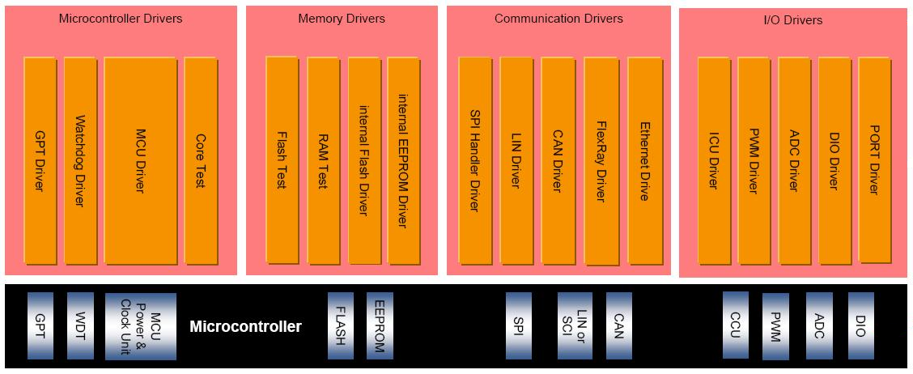](../files/File_AUTOSAR_Device_Drivers.png--2352.md)

AUTOSAR-like Drivers are meant to be used in the context of a process in which static configuration supported by tools is strongly suggested if not implied.

Each driver specification in AUTOSAR-like includes at the very least the following:

- Dependencies from other drivers
- A suggested architecture for the driver files, some of them to be defined with the help of automatic configuration tools
- A set of driver-specific types
- A set of driver-specific constants
- An API consisting of a set of functions, callbacks and notification functions

<a id="Configurator_RT-Druid_Eclipse_Plug-in"></a>

### Configurator RT-Druid Eclipse Plug-in

AUTOSAR-like Drivers need to be statically configured via RT-Druid Eclipse plug-in, available for free download at the [EFORMS web page](http://www.evidence.eu.com/products/eforms.html)

<a id="Plug-in_Installation"></a>

#### Plug-in Installation

In order to install the AUTOSAR-like Drivers Configurator plug-in inside RT-Druid Eclipse, you have to select "Install New Software..." menu voice in "Help" menu.

[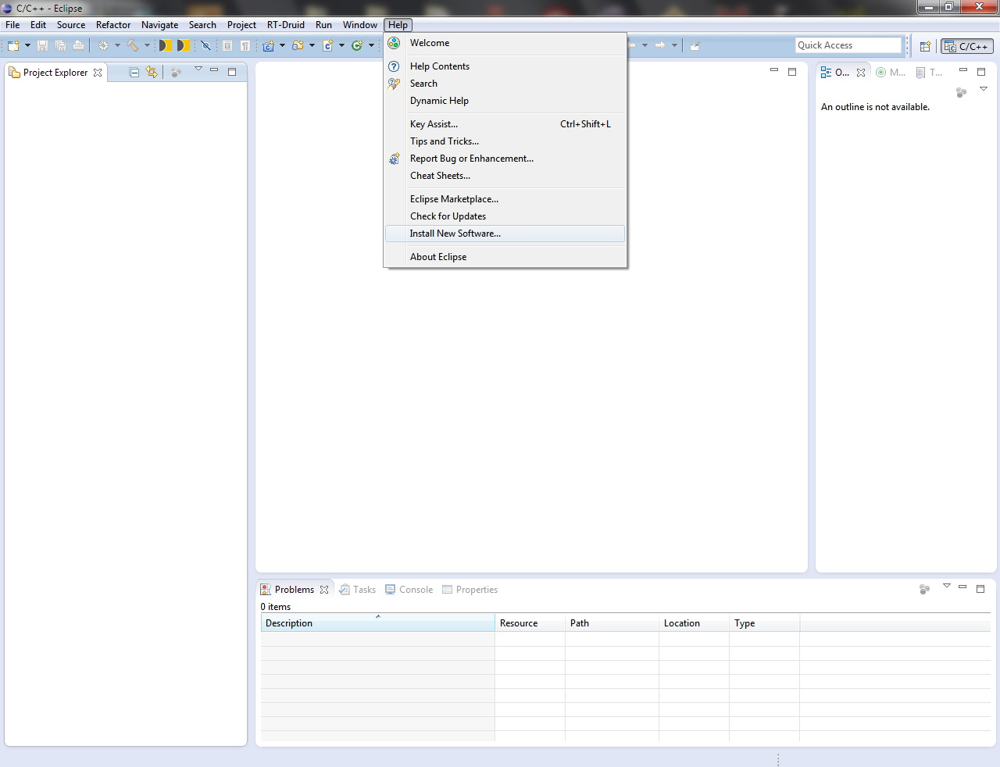](../files/File_Install_New_Software.png--2355.md)

In the "Install" dialog window, you have to push "Add..." button.

[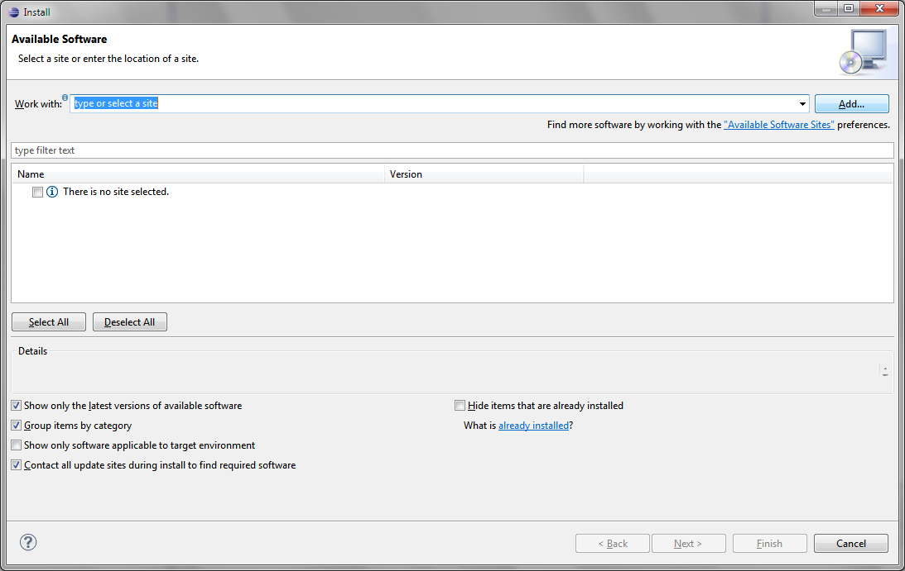](../files/File_Install_Add.png--2356.md)

In the "Add Repository" dialog window, you have to push "Archive..." button.

[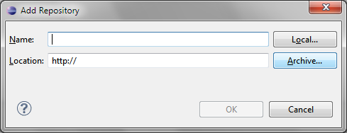](../files/File_Add_Repository_Archive.png--2357.md)

You have to select the "Repository Archive" containig the Plug-in to install and push "Open" button.

[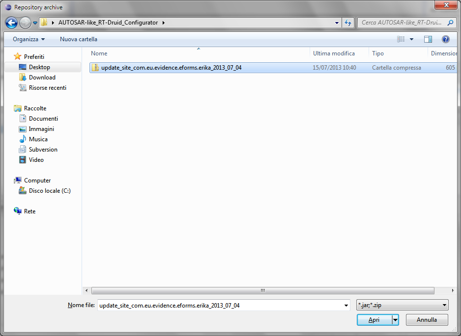](../files/File_Repository_Archive.png--2358.md)

In the "Add Repository" dialog window, you have to push "OK" button.

[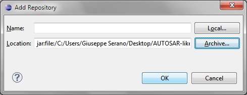](../files/File_Add_Repository_OK.png--2359.md)

In the "Install Details" dialog window, you have to push "Next >" button.

[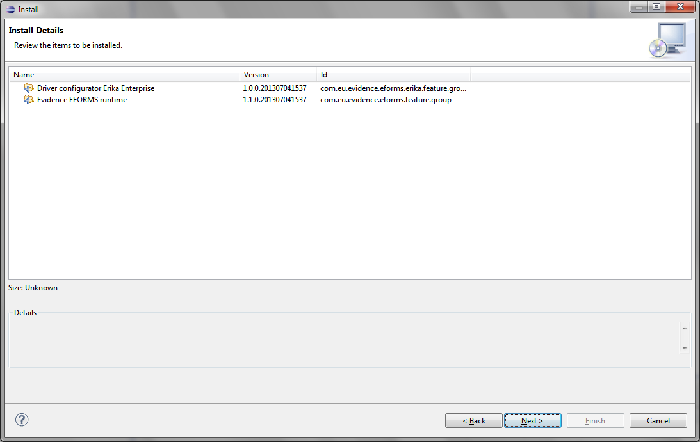](../files/File_Install_Details_Next.png--2365.md)

In the "Install" dialog window, you have to check "Driver configurator Erika Enterprise" and click on the "Next >" button.

[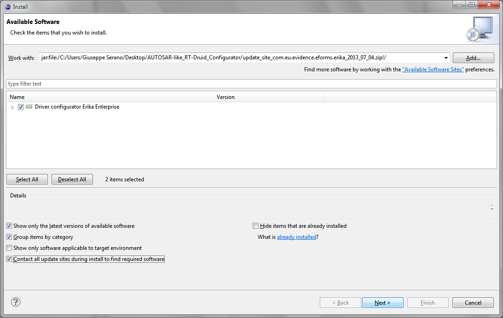](../files/File_Install_Next.png--2360.md)

In the "Install Review License" dialog window, you have to accept the terms of license agreements and push "Finish" button.

[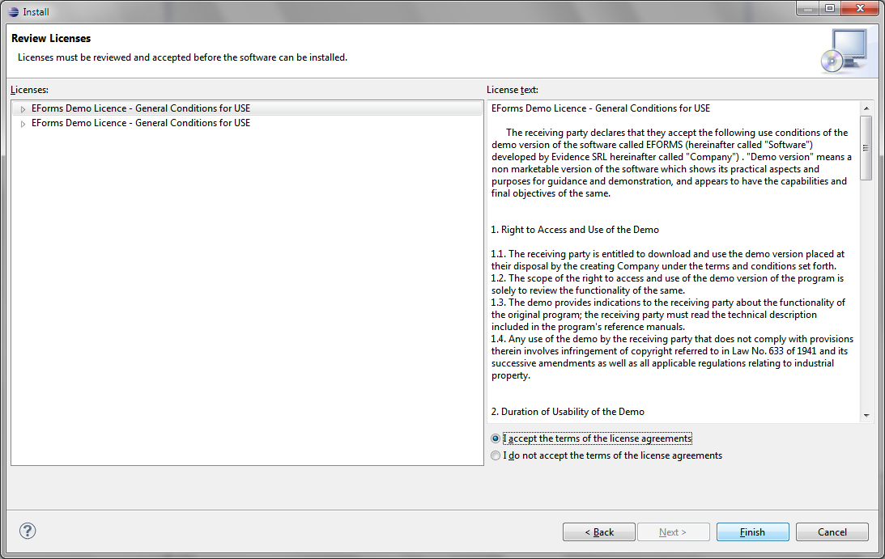](../files/File_Install_Finish.png--2361.md)

Now you have to wait the installation process to finish.

[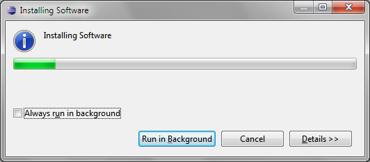](../files/File_Installing_Software_Wait.png--2362.md)

In the "Security Warning" dialog window, you have to push "OK" button.

[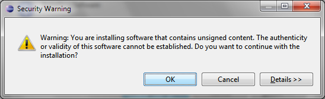](../files/File_Security_Warning.png--2363.md)

In the "Software Updates" dialog window, you have to push "Yes" button to finalize the installation process and restart RT-Druid Eclipse.

[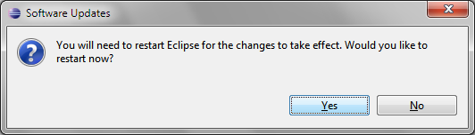](../files/File_Software_Updates.png--2364.md)

Now you have AUTOSAR-like Drivers Configurator plug-in installed in RT-Druid Eclipse.

<a id="Plug-in_Installation_Check"></a>

#### Plug-in Installation Check

In order to check if the AUTOSAR-like Driver Configurator plug-in is installed in RT-Druid Eclipse, you have to select "About Eclipse" menu voice in "Help" menu.

[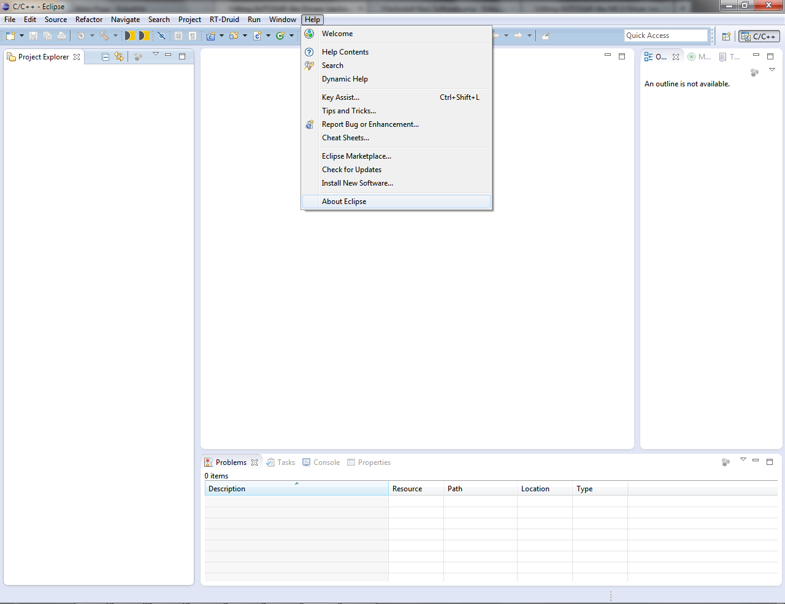](../files/File_Help_About.png--2366.md)

In the "About Eclipse" dialog window, you have to push the "Evidence" button.

[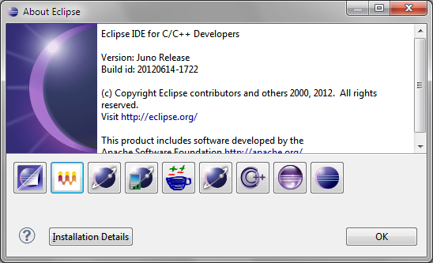](../files/File_About_Eclipse_Evidence.png--2367.md)

In the "About Eclipse Features" dialog window, you have to check "Driver configurator Erika Enterprise (Core)" and "Evidece EFORMS core" are installed.

[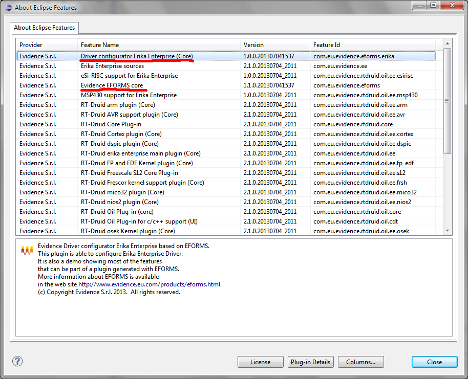](../files/File_About_Eclipse_Features.png--2368.md)

<a id="Plug-in_Installation_Removal"></a>

#### Plug-in Installation Removal

In order to remove the AUTOSAR-like Driver Configurator plug-in installed in RT-Druid Eclipse, you have to select "About Eclipse" menu voice in "Help" menu.

[](../files/File_Help_About.png--2366.md)

In the "About Eclipse" dialog window, you have to push the "Installation Details" button.

[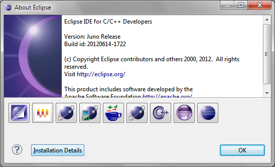](../files/File_About_Eclipse_Installation_Details.png--2403.md)

In the "Eclipse Installation Details" dialog window, you have to select "Driver configurator Erika Enterprise" and "Evidece EFORMS runtime" and then you have to push the "Uninstall..." button.

[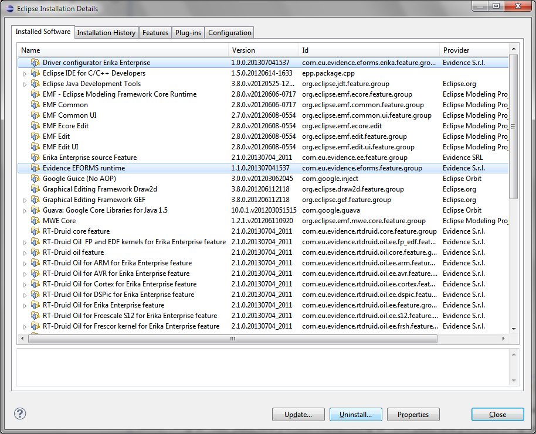](../files/File_Eclipse_Installation_Details_Uninstall.png--2404.md)

In the "Uninstall" dialog window, you have to push "Finish" button.

[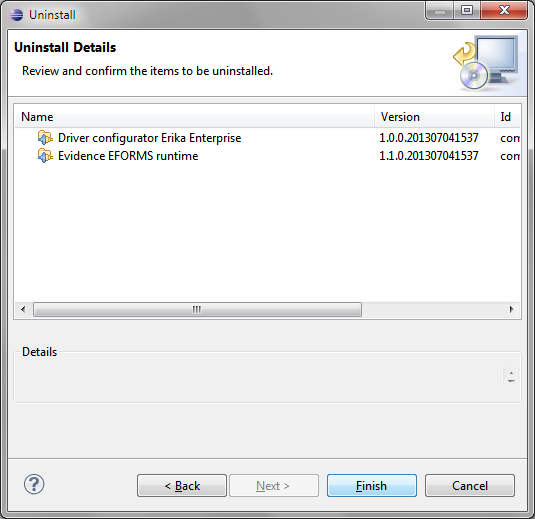](../files/File_Eclipse_Uninstall.png--2405.md)

Now you have to wait the installation removal process to finish.

[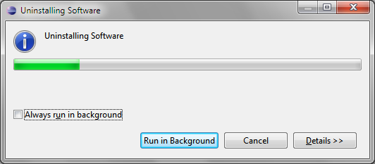](../files/File_Eclipse_Uninstalling_Software.png--2406.md)

In the "Software Updates" dialog window, you have to push "Yes" button to finalize the installation removal process and restart RT-Druid Eclipse.

[](../files/File_Software_Updates.png--2364.md)

Now you have removed AUTOSAR-like Drivers Configurator plug-in from RT-Druid Eclipse.

<a id="Supported_Drivers"></a>

### Supported Drivers

<a id="MCU"></a>

#### [MCU](AUTOSAR-like_MCU_Driver--2350.md)

The MCU driver provides services for basic microcontroller initialization, power down functionality, reset and microcontroller specific functions required by other MCAL [Microcontroller Abstraction Layer] software modules.

<a id="PORT"></a>

#### [PORT](AUTOSAR-like_PORT_Driver--2380.md)

The PORT driver provide services for initializing the whole PORT structure of the microcontroller.

<a id="DIO"></a>

#### [DIO](AUTOSAR-like_DIO_Driver--2389.md)

The DIO Driver abstracts the access to the microcontroller's hardware pins. Furthermore, it allows the grouping of those pins.

<a id="SCI"></a>

#### [SCI](AUTOSAR-like_SCI_Driver--2398.md)

The SCI Driver provides serial communications services.

<a id="GPT"></a>

#### [GPT](AUTOSAR-like_GPT_Driver--2399.md)

The GPT Driver initializes and controls the internal General Purpose Timer(s) of the microcontroller.

<a id="DMA"></a>

#### [DMA](AUTOSAR-like_DMA_Driver--2400.md)

The DMA Driver provides services to offload data transfer tasks from the μC, allowing for more efficient use of the μC and the available bus bandwidth.

<a id="SPI"></a>

#### [SPI](AUTOSAR-like_SPI_Driver--2401.md)

The SPI Driver provides services for reading from and writing to devices connected via SPI busses. It also provides the required mechanism to configure the onchip SPI peripheral.

<a id="WDG"></a>

#### [WDG](AUTOSAR-like_WDG_Driver--2402.md)

The WDG Driver provides services for initialization, changing the operation mode and setting the trigger condition (timeout) of a watchdog device.

<a id="Build"></a>

### Build

To enable AUTOSAR-like Drivers in Erika Enterprise build process, the following `EE_OPT` attribute is needed in the `OS` object of the OSEK/VDX configuration:

```
 EE_OPT = "__AUTOSAR_R4_0__";
```

AUTOSAR-like Drivers need to be statically configured through the configurator described above. The configuration process shall generate configuration header and source C files that shall be added to Erika Enterprise build process.

The configuration C header files inclusion is done by `CFLAGS` attribute in the `OS` object of the OSEK/VDX configuration:

```
 CFLAGS = "-I<PATH>";
```

Where `<PATH>` is the absolute or relative directory path which configuration C header files is stored.

**Note:** Each AUTOSAR-like Driver must be enabled individually.

<a id="Stand-alone_Library"></a>

#### Stand-alone Library

To build a stand-alone library (libas.a) containing build-enabled AUTOSAR-like Drivers, the following code is needed in the `OS` object of the OSEK/VDX configuration:

```
 EE_OPT = "__ADD_LIBS__";
 LIB = ENABLE {
   NAME = "AUTOSAR";
 };
```

It's possible to include into library the drivers configurations by the following `EE_OPT` attribute in the `OS` object of the OSEK/VDX configuration:

```
 EE_OPT = "__NO_APP__";
```

<a id="Supported_Architectures"></a>

### Supported Architectures

<a id="Texas_Instruments_Stellaris_LM4F232xxxx_with_ARM_KEIL_uVision_Compiler_Toolchain"></a>

#### Texas Instruments Stellaris LM4F232xxxx with ARM KEIL uVision Compiler Toolchain

<a id="Configuration_Instatiation"></a>

##### Configuration Instatiation

In order to configure AUTOSAR-like Drivers for Texas Instruments Stellaris LM4F232xxxx with ARM KEIL uVision Compiler Toolchain, you have to create an instance of the drivers configuration inside your RT-Druid Eclipse project.

The first step to do this is to right-click on the project folder in the project explorer.

In the first Context-Menu popped-up, you have to choose the "New" menu voice.

In the next Context-Menu popped-up, you have to select the "Other..." menu voice.

[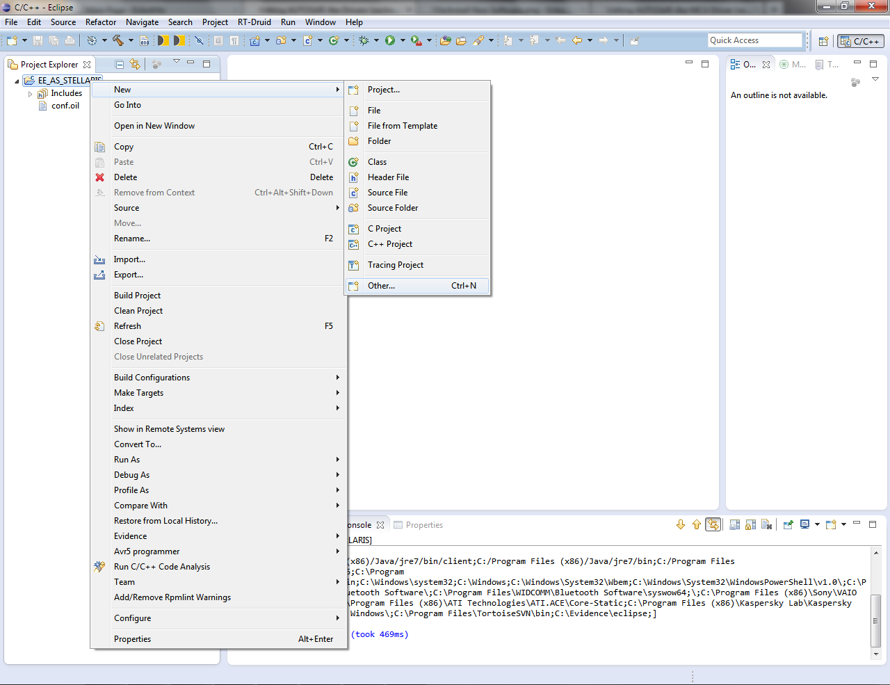](../files/File_Project_New_Other.png--2369.md)

In the "New" dialog window, you have to expand the "Evidence" folder, select "Erika Driver Configurator" and then push "Next >" button.

[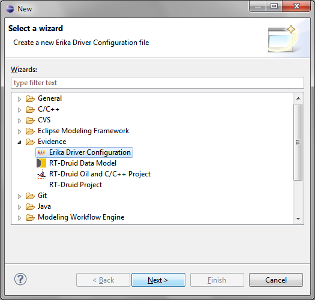](../files/File_New_Evidence_Driver_Configurator.png--2370.md)

In the "Erika Driver Configuration" dialog window, you may change/choose the drivers configuration instance file name and then you have to push "Finish" button.

[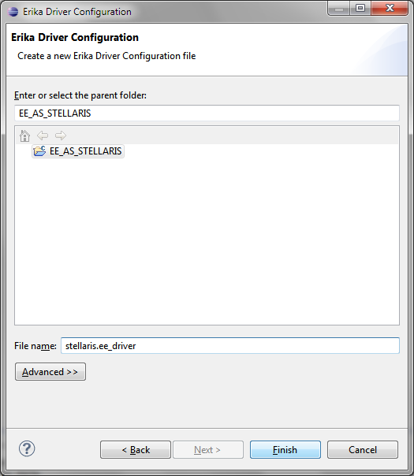](../files/File_Erika_Driver_Configuration_File_Name.png--2371.md)

The AUTOSAR-like Drivers configuration instance file is now created and ready to be edited.

[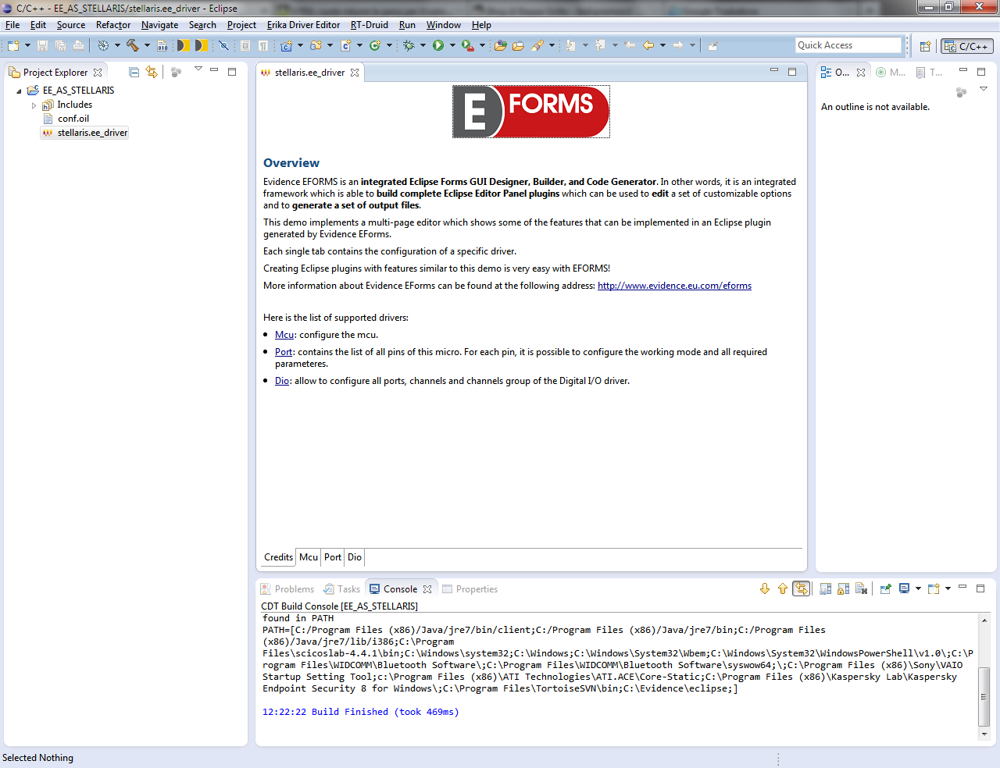](../files/File_Erika_Driver_Configurator_Main.png--2372.md)

<a id="Configuration_Editing"></a>

##### Configuration Editing

The edit process for AUTOSAR-like Drivers configuration file is related to each individual driver.

Please refer to specific driver documentation.

<a id="Configuration_Generation"></a>

##### Configuration Generation

Once you have edited the configuration file for AUTOSAR-like Drivers you wish to use in your application, to generate the configuration header and source C files for all drivers configured, you have to select "Generate Code" menu voice in the "Erika Driver Editor" Menu.

[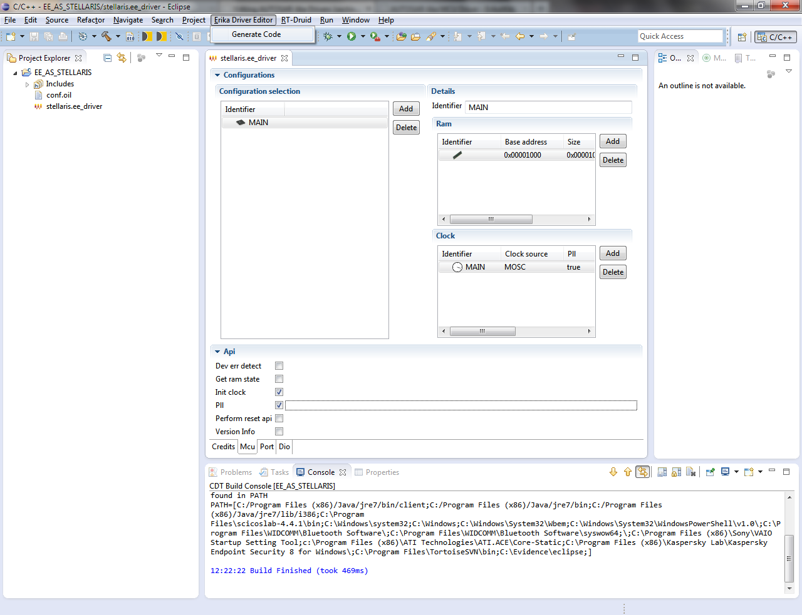](../files/File_Erika_Driver_Editor_Generate_Code.png--2373.md)

The configured AUTOSAR-like drivers configuration header and source C files will be generated in "src-gen" project folder.

[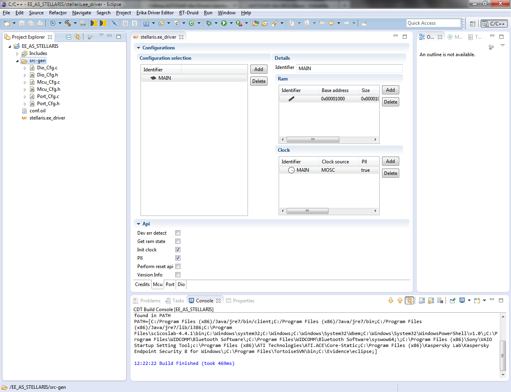](../files/File_Erika_Driver_configuration_Generated.png--2374.md)

<a id="Keil_uVision_Integration"></a>

##### Keil uVision Integration

To integrate AUTOSAR-like Drivers for Texas Instruments Stellaris LM4F232xxxx with ARM KEIL uVision Compiler Toolchain in a ARM KEIL uVision application project, it nees:

- To add a previously builded libas.a (containing drivers configurations) to a Target Sources Group of ARM KEIL uVision Project.
- To add AUTOSAR Drivers include path ([contrib/as/include/](http://svn.tuxfamily.org/viewvc.cgi/erika_erikae/repos/ee/trunk/ee/contrib/as/include/)) to ARM KEIL uVision C/C++ compiler include paths.
- To add AUTOSAR Drivers for Texas Instruments Stellaris LM4F232xxxx with ARM KEIL compiler toolchain [contrib/as/arch/stellaris/keil/include/](http://svn.tuxfamily.org/viewvc.cgi/erika_erikae/repos/ee/trunk/ee/contrib/as/arch/stellaris/keil/include/) to Keil uVision C/C++ compiler include paths.
- To add AUTOSAR Drivers configurations for Texas Instruments Stellaris LM4F232xxxx with ARM KEIL uVision Compiler Toolchain include path to ARM KEIL uVision C/C++ compiler include paths.

<a id="See_also"></a>

##### See also

- [ARM Cortex MX#Building stand-alone libee.a using RT-Druid Eclipse](ARM_Cortex_MX--2226.md#Building_stand-alone_libee.a_using_RT-Druid_Eclipse "ARM Cortex MX")
- [ARM Cortex MX#Building ERIKA based application using KEIL uVision](ARM_Cortex_MX--2226.md#Building_ERIKA_based_application_using_KEIL_uVision "ARM Cortex MX")
- [AUTOSAR - Automotive Open System Architecture - Web site](http://www.autosar.org/)
- [Texas Instruments - Stellaris LM4F232 USB+CAN Evaluation Kits - Web site](http://www.ti.com/tool/ek-lm4f232?DCMP=cortexm4f&HQS=ek-lm4f232)
- [Keil Embedded Development Tools Web site](http://www.keil.com/)

---

## Archive provenance

- [Original page](http://erika.tuxfamily.org/wiki/index.php?title=AUTOSAR-like_Drivers) · [Archived source revision 5240](http://erika.tuxfamily.org/wiki/index.php?oldid=5240)
- Last source edit: 2013-07-16T18:09:00Z. Source retrieved on 2026-11-06; Markdown conversion completed on 2026-11-07.
- Original contributors recorded in exported history: Eguidieri, Giuseppe Serano, Pj.
- [Original MediaWiki source](../source/wikitext/2349.mediawiki) · [Original editing history](../source/history/batch-001.xml)
- [Attribution and licensing notice](../NOTICE.md). Original file-specific notices, where present, remain applicable.
