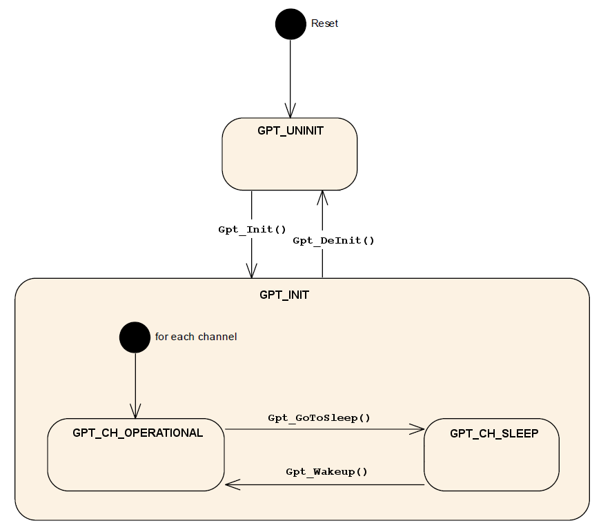
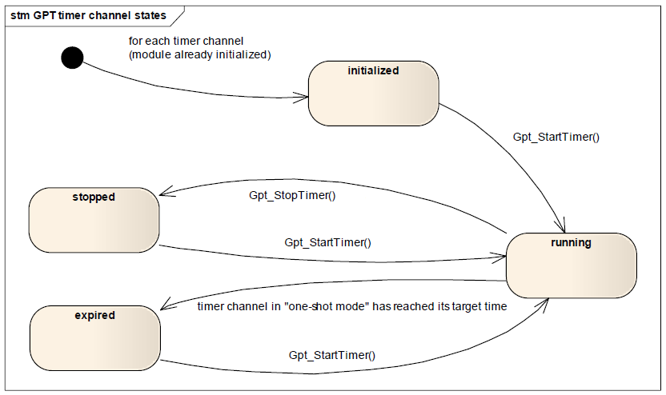
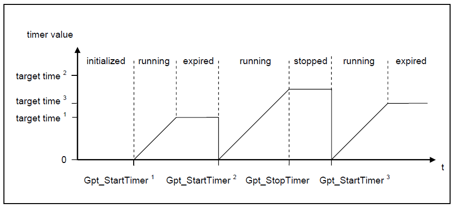
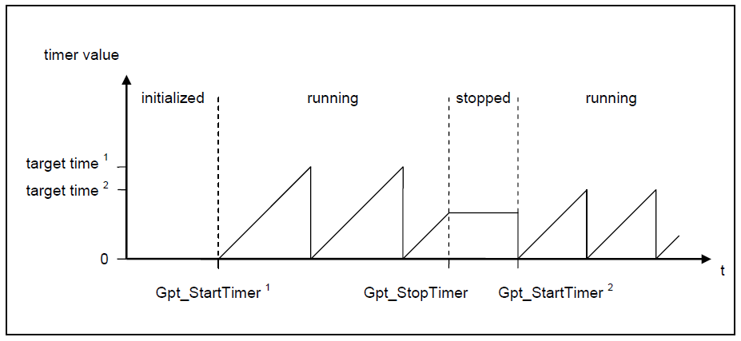
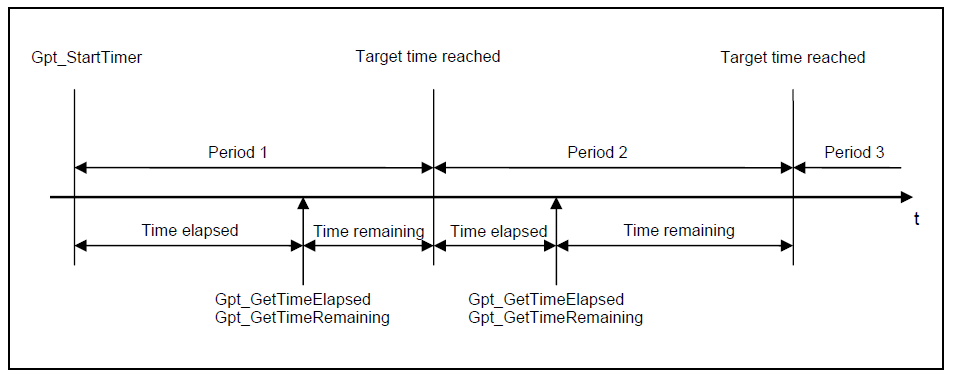
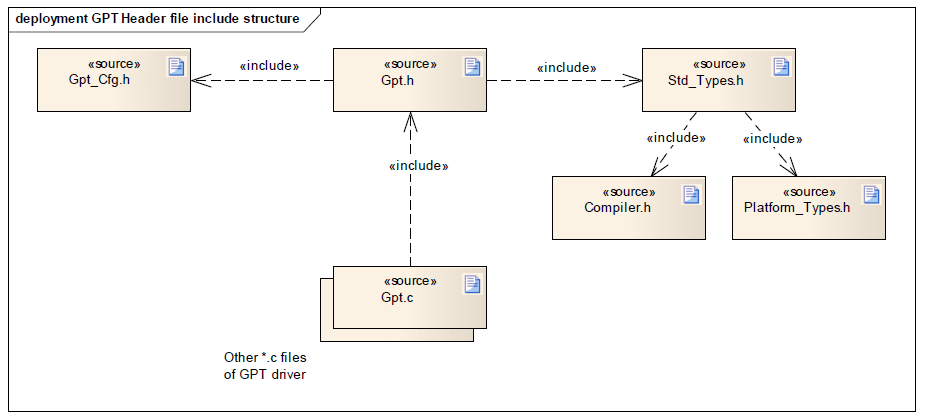
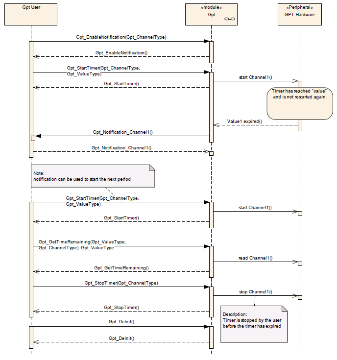
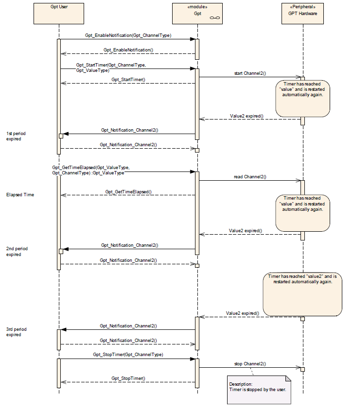
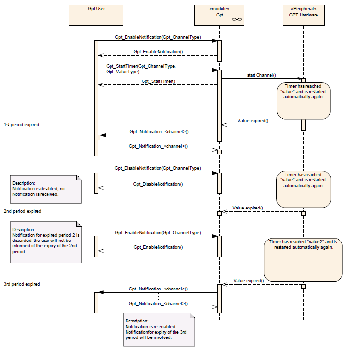

# AUTOSAR-like GPT Driver

<a id="Synopsis"></a>

### Synopsis

The GPT driver is part of the microcontroller abstraction layer (MCAL).

It initializes and controls the internal General Purpose Timer(s) of the microcontroller.

The GPT driver provides services and configuration parameters for

- Starting and stopping hardware timers
- Getting timer values
- Controlling time triggered interrupt notifications

The tick duration of a timer channel depends on channel specific settings (part of GPT driver) as well as on system clock and settings of the clock tree controlled by the MCU module.

The tick duration is not limited by this specification.

Not all hardware timers must be controlled by the GPT module.

The number of timer channels controlled by the GPT driver depends on hardware, implementation and system configuration.

The GPT depends on the system clock, prescaler(s) and PLL. Thus, changes of the system clock (e.g. PLL on → PLL off) also affect the clock settings of the GPT hardware. Module GPT will not take care of settings which configure the clock, prescaler(s) and PLL in its init function. This has to be done by the MCU module. Hence the conversions between time and ticks shall be part of an upper layer.

The GPT driver only generates time bases, and does not serve as an event counter.

This functionality is provided by another driver module.

Each timer channel is able to trigger an interrupt and therefore there is a dependency on the OS, which configures the interrupt sources.

The GPT driver has a state machine that is shown in the figure below.

[](../files/File_GPT_State.png--2418.md)

**Module State**

- *GPT\_UNINIT*: The state *GPT\_UNINIT* means that the Gpt module has not been initialized yet and cannot be used.
- *GPT\_INIT*: The *GPT\_INIT* state indicates that the GPT driver has been initialized, making each available channel ready for service.

**Channel State**

- *GPT\_CH\_OPERATIONAL*: The individual channel has been initialized (using at least one statically configured data set) and is able to communicate.
- *GPT\_CH\_SLEEP*: The GPT hardware is into a low power mode if such a mode is provided by the hardware.

- *Reset* -> *GPT\_UNINIT*: After reset, the Gpt module shall set its state to *GPT\_UNINIT*.
- *GPT\_UNINIT* -> *GPT\_INIT*: The Gpt module shall transition from *GPT\_UNINIT* to *GPT\_INIT* when the function *Gpt\_Init()* is called.
- *GPT\_INIT* -> *GPT\_UNINIT*: The Gpt module shall transition from *GPT\_INIT* to *GPT\_UNINIT* when the function *Gpt\_DeInit()* is called.

On entering the state *GPT\_INIT*, the Gpt module shall set each channel into state *GPT\_CH\_OPERATIONAL*.

- *GPT\_CH\_OPERATIONAL* -> *GPT\_CH\_SLEEP*: If a *Gpt\_GoToSleep()* function is called, the Gpt module enters in the *GPT\_CH\_SLEEP* state.
- *GPT\_CH\_SLEEP* -> *GPT\_CH\_OPERATIONAL*: if a *Gpt\_Wakeup()* functions is called, the Gpt module go back in the state *GPT\_CH\_OPERATIONAL*.

The GPT driver provides services for starting and stopping timer channels (logical timer instances assigned to a timer hardware), individual for each channel by calling of:

- *Gpt\_StartTimer()*
- *Gpt\_StopTimer()*

The "target time" is passed as a parameter to *Gpt\_StartTimer()*. So, for each start of a timer channel, the target time can be set individually.

The states and the state transitions of a timer channel are shown in Figure below:

[](../files/File_GPT_Driver_modes.png--2419.md)

A timer channel can be configured in "one-shot mode" or in "continuous mode".

A timer channel starts counting at value zero.

If a timer channel is configured in "one-shot mode": If the timer has reached the target time (timer value = target time), the timer shall stop automatically and maintain its timer value unchanged. The channel state shall change from "running" to "expired".

[](../files/File_GPT_Driver_one_shot.png--2420.md)

If a timer channel is configured in "continuous mode": If the timer has reached the target time (timer value = target time), the timer shall continue running with the value "0" at next timer tick. So, the time interval of the recurrence is: target time + 1. This interval shall be independently of implementation, e.g. interrupt delays.

[](../files/File_GPT_Driver_continuous.png--2421.md)

If a timer channel is configured in "continuous mode": If supported by hardware, it shall be possible to realize a free running timer. This means: A timer which rolls over automatically by hardware, if the target time is set to the maximum value the timer is able to count (max value = 2n -1, n=number of bits).

Both, the relative time elapsed and the time remaining can be queried by calling:

- *Gpt\_GetTimeElapsed()*
- *Gpt\_GetTimeRemaining()*

[](../files/File_GPT_Driver_elapsed_remaining.png--2422.md)

If supported by hardware, a timer channel shall be able to be configured to call a notification function. If enabled, the function is called when the target time is reached (timer value = target time).

Interrupt notifications can be enabled and disabled at runtime individually for each channel by calling of:

- *Gpt\_EnableNotification()*
- *Gpt\_DisableNotification()*

<a id="File_Structure"></a>

### File Structure

[](../files/File_GPT_Driver_file_structure.png--2423.md)

<a id="API_Specification"></a>

### API Specification

<a id="Imported_Types"></a>

#### Imported Types

<a id="typedef_uint8_Std_ReturnType"></a>

##### *typedef uint8 Std\_ReturnType*

```
 #include "Std_Types.h"
```

Standard Return Type.

This type can be used as standard API return type which is shared between AUTOSAR-like modules.

The *Std\_ReturnType* shall normally be used with value *E\_OK* or *E\_NOT\_OK*.
If those return values are not sufficient user specific values can be defined by using the 6 least specific bits.

<a id="struct_Std_VersionInfoType"></a>

##### *struct Std\_VersionInfoType*

```
 #include "Std_Types.h"
```

Standard Version Informations Type.

This type shall be used to request the version of a AUTOSAR-like module using the *<Module Name>\_GetVersionInfo()* function.

**Field Documentation:**

```
 uint16 Std_VersionInfoType::moduleID
```

Module Identifier.

```
 uint8 Std_VersionInfoType::sw_major_version
```

Software Version Major Number.

```
 uint8 Std_VersionInfoType::sw_minor_version
```

Software Version Minor Number.

```
 uint8 Std_VersionInfoType::sw_patch_version
```

Software Version Patch Number.

```
 uint16 Std_VersionInfoType::vendorID
```

Vendor Identifier.

<a id="Types_Defintions"></a>

#### Types Defintions

<a id="struct_Gpt_ConfigType"></a>

##### *struct Gpt\_ConfigType*

```
 #include "Gpt.h"
```

GPT Configuration Parameters.

This is the type of the data structure including the configuration set required for initializing the GPT timer unit.

The structure *Gpt\_ConfigType* is an external data structure (i.e. implementation specific) and shall contain the initialization data for the GPT module.

It shall contain:

- GPT dependent properties
- GPT hardware units initialization parameters
- SFR's [Special Function Register] settings affecting the GPT channels

<a id="typedef_uint_Gpt_ChannelType"></a>

##### *typedef uint Gpt\_ChannelType*

```
 #include "Gpt.h"
```

Channel Type.

Parameters of type *Gpt\_ChannelType* contain the numeric ID of a GPT channel.

The mapping of the ID is implementation specific but not configurable and not all values may be valid within this type.

For parameter values of type *Gpt\_ChannelType*, the Gpt's user shall use the symbolic names provided by the configuration description.

The type shall be *uint8*, *uint16* or *uint32*, depending on μC platform.

<a id="typedef_uint_Gpt_ValueType"></a>

##### *typedef uint Gpt\_ValueType*

```
 #include "Gpt.h"
```

GPT Value Type.

The type *Gpt\_ValueType* is the type for reading and setting the timer values (in number of ticks).

The range of this type is μC dependent (width of the timer register) and has to be described by the supplier.

<a id="enum_Gpt_StatusType"></a>

##### *enum Gpt\_StatusType*

```
 #include "Gpt.h"
```

GPT Status Type.

The type *Gpt\_StatusType* is the type of the return value of the function *Gpt\_GetStatus()*.

The type of *Gpt\_StatusType* is an enumeration describing the operation states for a GPT channel.

**Enumerator**:

- *GPT\_NOT\_OK*: Development or production error occurred.
- *GPT\_OPERATIONAL*: Normal operation mode of the GPT
- *GPT\_CH\_SLEEP*: Sleep state operation.

<a id="typedef_void_.28.2AGpt_Notification.29.28void.29"></a>

##### *typedef void (\*Gpt\_Notification)(void)*

```
 #include "Gpt.h"
```

GPT Notifications Callback Function Pointer.

The notification prototype *Gpt\_Notification\_<channel>()* is for the notifications callback function and shall be implemented by the user.

The GPT module's environment shall declare a separate notifications callback for each channel to avoid parameters in notification services and to improve run time efficiency.

The notifications callback *Gpt\_Notification\_<channel>()* shall be configurable as pointers to user defined functions within the configuration structure.

Each channel shall provide its own notifications callback if configured.

When disabled, the GPT Driver will send no notifications.

The GPT Driver shall invoke a notification callback whenever the defined target time of the channel is reached.

The ISR's, providing the GPT events, shall be responsible for resetting the interrupt flags (if needed by hardware) and calling the according notification function.

For all available channels, callback functions have to be declared by the configuration tool.

<a id="Functions_Definitions"></a>

#### Functions Definitions

<a id="void_Gpt_GetVersionInfo.28Std_VersionInfoType_.2AVersionInfoPtr.29"></a>

##### *void Gpt\_GetVersionInfo(Std\_VersionInfoType \*VersionInfoPtr)*

```
 #include "Gpt.h"
```

GPT Driver version informations retrieval.

**Parameters**:

- *VersionInfoPtr*: Pointer to where to store the version information of this module.

**Returns**:

- *None*.

This service retrieves the GPT driver version informations.

Service 0x00

The function *Gpt\_GetVersionInfo()* shall return the version information of this module according to the definition of *Std\_VersionInfoType*.

If source code for caller and callee of *Gpt\_GetVersionInfo()* is available, the GPT module should realize *Gpt\_GetVersionInfo()* as a macro, defined in the module’s header file.

The function *Gpt\_GetVersionInfo()* shall be pre compile time configurable On/Off by the configuration parameter: *GptVersionInfoApi*.

<a id="void_Gpt_Init.28const_Gpt_ConfigType_.2AConfigPtr.29"></a>

##### *void Gpt\_Init(const Gpt\_ConfigType \*ConfigPtr)*

```
 #include "Gpt.h"
```

GPT Driver Initialization.

**Parameters**:

- *ConfigPtr*: Pointer to GPT driver configuration set.

**Returns**:

- *None*.

This service initializes the GPT driver.

Service 0x01

The function *Gpt\_Init()* shall initialize the hardware timer module according to a configuration set referenced by *ConfigPtr*.

The function *Gpt\_Init()* shall disable all interrupt notifications, controlled by the GPT driver.

The function *Gpt\_Init()* shall only initialize the configured resources. Resources that are not configured in the configuration file shall not be touched.

The function *Gpt\_Init()* shall set the operation mode of the GPT driver to "normal mode".

A re-initialization of the GPT driver by executing the *Gpt\_Init()* function requires a de-initialization before by executing a *Gpt\_DeInit()*.

<a id="void_Gpt_DeInit.28void.29"></a>

##### *void Gpt\_DeInit(void)*

```
 #include "Gpt.h"
```

Deinitializes all hardware timer channels.

**Parameters**:

- *None*.

**Returns**:

- *None*.

The service deinitializes all hardware timer channels.

Service 0x02

The function *Gpt\_DeInit()* shall deinitialize the hardware used by the GPT driver (depending on configuration) to the power on reset state. Values of registers which are not writeable are excluded. It’s the responsibility of the hardware design that the state does not lead to undefined activities in the μC.

The function *Gpt\_DeInit()* shall disable all interrupt notifications controlled by the GPT driver.

The function *Gpt\_DeInit()* shall influence only the peripherals, which are allocated by the static configuration.

If a postbuild multiple selectable configuration variant was used, the function *Gpt\_DeInit()* shall further influence only the peripherals, which are allocated by the runtime configuration set passed by the previous call of the function *Gpt\_Init()*.

The function *Gpt\_DeInit()* shall be pre compile time configurable On/Off by the configuration parameter: *GptDeInitApi*.

The function *Gpt\_DeInit()* shall set the operation mode of the GPT driver to "uninitialized".

<a id="Gpt_ValueType_Gpt_GetTimeElapsed.28Gpt_ChannelType_Channel.29"></a>

##### *Gpt\_ValueType Gpt\_GetTimeElapsed(Gpt\_ChannelType Channel)*

```
 #include "Gpt.h"
```

Elapsed Time Retrieval.

**Parameters**:

- *Channel*: Numeric identifier of the GPT channel

**Returns**:

- Elapsed timer value (in number of ticks)

The service returns the time already elapsed.

Service 0x03

The function *Gpt\_GetTimeElapsed()* shall return the time already elapsed. When the channel is in mode "one-shot mode", this is the value relative to the point in time, the channel has been started.

When the channel is in mode "continuous mode", the return value of *Gpt\_GetTimeElapsed()* is the value relative to the last recurrence (target time reached) or to the start of the channel before the first recurrence occurs.

If the function *Gpt\_GetTimeElapsed()* is called on a timer channel in state "initialized" (channel started never before), the function shall return the value "0".

If the function *Gpt\_GetTimeElapsed()* is called on a timer channel in state "stopped", the function shall return the time value at the moment of stopping.

If the function *Gpt\_GetTimeElapsed()* is called on a channel configured for "one-shot mode" in state "expired" (timer has reached the target time), the function shall return the target time.

The function *Gpt\_GetTimeElapsed()* shall be reentrant, if the timer channels used in concurrent calls are different.

The function *Gpt\_GetTimeElapsed()* shall be pre compile time configurable On/Off by the configuration parameter: *GptTimeElapsedApi*.

If the driver is not initialized, the function *Gpt\_GetTimeElapsed()* shall return the value "0".

If the parameter Channel is invalid (not within the range specified by configuration), the function *Gpt\_GetTimeElapsed()* shall return the value "0".

<a id="Gpt_ValueType_Gpt_GetTimeRemaining.28Gpt_ChannelType_Channel.29"></a>

##### *Gpt\_ValueType Gpt\_GetTimeRemaining(Gpt\_ChannelType Channel)*

```
 #include "Gpt.h"
```

Remaining Time Retrieval.

**Parameters**:

- *Channel*: Numeric identifier of the GPT channel

**Returns**:

- Remaining timer value (in number of ticks)

The service returns the time remaining until the target time is reached.

Service 0x04

The function *Gpt\_GetTimeRemaining()* shall return the timer value remaining until the target time will be reached next time. The remaining time is the "target time" minus the time already elapsed.

If the function *Gpt\_GetTimeRemaining()* is called on a timer channel in state "initialized" (channel started never before), the function shall return the value "0".

If the function *Gpt\_GetTimeRemaining()* is called on a timer channel in state "stopped", the function shall return the remaining time value at the moment of stopping.

If the function *Gpt\_GetTimeRemaining()* is called on a channel configured for "one-shot mode" in state "expired" (timer has reached the target time), the function shall return the value "0".

The function *Gpt\_GetTimeRemaining()* shall be reentrant, if the timer channels used in concurrent calls are different.

The function *Gpt\_GetTimeRemaining()* shall be pre compile time configurable On/Off by the configuration parameter: *GptTimeRemainingApi*.

If the driver is not initialized, the function *Gpt\_GetTimeRemaining()* shall return the value "0".

If the parameter Channel is invalid (not within the range specified by configuration), the function *Gpt\_GetTimeRemaining()* shall return the value "0".

<a id="void_Gpt_StartTimer.28Gpt_ChannelType_Channel.2C_Gpt_ValueType_Value.29"></a>

##### *void Gpt\_StartTimer(Gpt\_ChannelType Channel, Gpt\_ValueType Value)*

```
 #include "Gpt.h"
```

Timer Start.

**Parameters**:

- *Channel*: Numeric identifier of the GPT channel
- *Value*: Target time in number of ticks.

**Returns**:

- *None*.

The service starts a timer channel.

Service 0x05

The function *Gpt\_StartTimer()* shall start the selected timer channel with a defined target time.

If configured and enabled, an interrupt notification or a wakeup interrupt occurs, when the target time is reached.

The function *Gpt\_StartTimer()* shall be reentrant, if the timer channels used in concurrent calls are different.

The state of the selected timer channel shall be changed to "running" if *Gpt\_StartTimer()* is called.

<a id="void_Gpt_StopTimer.28Gpt_ChannelType_Channel.29"></a>

##### *void Gpt\_StopTimer(Gpt\_ChannelType Channel)*

```
 #include "Gpt.h"
```

Timer Stop.

**Parameters**:

- *Channel*: Numeric identifier of the GPT channel

**Returns**:

- *None*.

The service stops a timer channel.

Service 0x06

The function *Gpt\_StopTimer()* shall stop the selected timer channel.

The state of the selected timer channel shall be changed to "stopped" if *Gpt\_StopTimer()* is called.

If the function *Gpt\_StopTimer()* is called on a channel in state "initialized", "stopped" or "expired", the function shall leave without any action (no change of the channel state).

The function *Gpt\_StopTimer()* shall be reentrant, if the timer channels used in concurrent calls are different.

<a id="void_Gpt_EnableNotification.28Gpt_ChannelType_Channel.29"></a>

##### *void Gpt\_EnableNotification(Gpt\_ChannelType Channel)*

```
 #include "Gpt.h"
```

Channel Notification Enable.

**Parameters**:

- *Channel*: Numeric identifier of the GPT channel.

**Returns**:

- *None*.

The service enables the interrupt notification for a channel relevant in normal mode).

Service 0x07

The function *Gpt\_EnableNotification()* shall enable the interrupt notification of the referenced channel configured for notification.

**Note**: The function shall save an attribute like "notification enabled" of the channel.

**Note** This attribute affects the interrupt notification always when the driver is in "normal mode". In "sleep mode" the attribute has no influence.

The function *Gpt\_EnableNotification()* shall be reentrant, if the timer channels used in concurrent calls are different.

The function *Gpt\_EnableNotification()* shall be pre compile time configurable On/Off by the configuration parameter: *GptEnableDisableNotificationApi*.

<a id="void_Gpt_DisableNotification.28Gpt_ChannelType_Channel.29"></a>

##### *void Gpt\_DisableNotification(Gpt\_ChannelType Channel)*

```
 #include "Gpt.h"
```

Channel Notification Disable.

**Parameters**:

- *Channel*: Numeric identifier of the GPT channel.

**Returns**:

- *None*.

The service disables the interrupt notifications for a channel (relevant in normal mode).

Service 0x08

The function *Gpt\_DisableNotification()* shall disable the interrupt notification of the referenced channel configured for notification.

Note: The function shall save an attribute like "notification disabled" of the channel.

Note: This attribute affects the interrupt notification always when the driver is in "normal mode". In "sleep mode" the attribute has no influence.

The function *Gpt\_DisableNotification()* shall be reentrant, if the timer channels used in concurrent calls are different.

The function *Gpt\_DisableNotification()* shall be pre compile time configurable On/Off by the configuration parameter: *GptEnableDisableNotificationApi*.

<a id="Std_ReturnType_Gpt_GoToSleep.28Gpt_ChannelType_Channel.29"></a>

##### *Std\_ReturnType Gpt\_GoToSleep(Gpt\_ChannelType Channel)*

```
 #include "Gpt.h"
```

Channel Go To Sleep.

**Parameters**:

- *Channel*: Numeric identifier of the GPT channel.

**Returns**:

- *E\_OK*: command has been accepted
- *E\_NOT\_OK*: command has not been accepted

The service instructs the driver to set the addressed GPT channel in the state *GPT\_CH\_SLEEP*.

Service 0x0D

The function *Gpt\_GoToSleep()* shall set the channel state to *GPT\_CH\_SLEEP*.

The function *Gpt\_GoToSleep()* shall optionally set the GPT hardware unit to reduced power operation mode (if supported by HW).

The function *Gpt\_GoToSleep()* shall be pre compile time configurable On/Off by the configuration parameter: *GptChannelWakeupFunctionalityApi*.

<a id="Std_ReturnType_Gpt_Wakeup.28Gpt_ChannelType_Channel.29"></a>

##### *Std\_ReturnType Gpt\_Wakeup(Gpt\_ChannelType Channel)*

```
 #include "Gpt.h"
```

Channel Wake-up.

**Parameters**:

- *Channel*: Numeric identifier of the GPT channel.

**Returns**:

- *E\_OK*: command has been accepted
- *E\_NOT\_OK*: command has not been accepted

The service generates a wake-up pulse on the addressed GPT channel.

Service 0x0E

The function *Gpt\_Wakeup()* shall generate a wake up pulse on the addressed GPT channel.

The GPT driver's environment shall only call Gpt\_Wakeup() when the GPT channel is in state *GPT\_CH\_SLEEP*.

The function *Gpt\_Wakeup()* shall be pre compile time configurable On/Off by the configuration parameter: *GptChannelWakeupFunctionalityApi*.

<a id="Gpt_StatusType_Gpt_GetStatus.28Gpt_ChannelType_Channel.29"></a>

##### *Gpt\_StatusType Gpt\_GetStatus(Gpt\_ChannelType Channel)*

```
 #include "Gpt.h"
```

GPT Channel Status Retrieval.

**Parameters**:

- *Channel*: Numeric identifier of the GPT channel.

**Returns**:

- *GPT\_NOT\_OK*: Development or production error occurred.
- *GPT\_OPERATIONAL*: Normal operation.
- *GPT\_CH\_SLEEP*: Sleep state operation.

The service gets the status of the specified GPT channel.

Service 0x0F

The function *Gpt\_GetStatus()* shall return the current transmission, reception or operation status of the SCI driver.

The function *Gpt\_GetStatus()* shall be pre compile time configurable On/Off by the configuration parameter: *GptChannelWakeupFunctionalityApi*.

<a id="Usage_Examples"></a>

### Usage Examples

<a id="GPT_.E2.80.9Cone-shot_mode.E2.80.9D"></a>

#### GPT “one-shot mode”

[](../files/File_GPT_One_Shot_Seq_Dia.png--2424.md)

<a id="GPT_.E2.80.9Ccontinuous_mode.E2.80.9D"></a>

#### GPT “continuous mode”

[](../files/File_GPT_One_Continuous_Dia.png--2425.md)

<a id="GPT_Notifications"></a>

#### GPT Notifications

[](../files/File_GPT_Notification_Dia.png--2426.md)

<a id="Build"></a>

### Build

To enable AUTOSAR GPT Driver for Texas Instruments Stellaris LM4F232xxxx with ARM KEIL uVision Compiler Toolchain, the following `EE_OPT` attribute is needed in the `OS` object of the OSEK/VDX configuration:

```
 EE_OPT = "__AS_GPT_DRIVER__";
```

The configuration C header file inclusion is done by `CFLAGS` attribute in the `OS` object of the OSEK/VDX configuration:

```
 CFLAGS = "-I<PATH>";
```

Where `<PATH>` is the absolute or relative directory path which configuration C header file is stored.

Instead the configurations C source file is added to the compilation process by `APP_SRC` attribute in the `CPU_DATA` object of the OSEK/VDX configuration:

```
 APP_SRC = "<PATH>/Gpt_Cfg.c";
```

Where `<PATH>` is the absolute or relative directory path which configuration C source file is stored.

<a id="Supported_Architectures"></a>

### Supported Architectures

<a id="TI_Stellaris_LM4F232XXXX_with_ARM_KEIL_uVision_Compiler_Toolchain"></a>

#### TI Stellaris LM4F232XXXX with ARM KEIL uVision Compiler Toolchain

<a id="Driver_Configuration"></a>

##### Driver Configuration

In order to configure the AUTOSAR-like Gpt Driver for Texas Instruments Stellaris LM4F232xxxx with ARM KEIL uVision Compiler Toolchain, you have to select the "Gpt" tab-sheet on driver configuration instance file.

[File:Erika Driver Configurator GPT.png](http://erika.tuxfamily.org/wiki/index.php?title=Special:Upload&wpDestFile=Erika_Driver_Configurator_GPT.png "File:Erika Driver Configurator GPT.png")

<a id="Configuration_Selection"></a>

###### Configuration Selection

In this section you can add/edit/delete configurations in GPT Driver configuration set:

- Each configuration SHALL have an *Identifier* which must be unique inside the configurations set.
- Each configuration, inside the configurations set, has a set of Channels.
  - Each Channel SHALL have a *Name* which must be unique inside the Channels.

<a id="API_Selection"></a>

###### API Selection

In this section you can select GPT Driver APIs and features will be included in build process:

- *Version Info*: *Gpt\_GetVersionInfo()* API

[File:Erika Driver Configurator GPT set.png](http://erika.tuxfamily.org/wiki/index.php?title=Special:Upload&wpDestFile=Erika_Driver_Configurator_GPT_set.png "File:Erika Driver Configurator GPT set.png")

<a id="Gpt_Channels"></a>

###### Gpt Channels

The Stellaris General-Purpose Timer Module (GPTM) contains six 16/32-bit GPTM blocks and six 32/64-bit Wide GPTM blocks.

Each 16/32-bit GPTM block provides two 16-bit timers (referred to as Timer A and Timer B) that can be configured to operate independently (with optional 8-bit prescaler) or concatenated to operate as one 32-bit timer (without prescaler).

Channel Identifiers for 16/32-bit GPTM blocks operating indipendently are the followings:

```
 GPT_CHANNEL_0_A /* block 0 timer A */
 GPT_CHANNEL_0_B /* block 0 timer B */
 GPT_CHANNEL_1_A /* block 1 timer A */
 GPT_CHANNEL_1_B /  block 1 timer B */
 ...
 GPT_CHANNEL_5_A /* block 5 timer A */
 GPT_CHANNEL_5_B /* block 5 timer B */
```

If a timer value can't be translated on 16-bit, the driver enables the 8-bit prescaler extending the timer counter size to 24-bit.

Channel Identifiers for 16/32-bit GPTM blocks concatenated are the followings:

```
 GPT_CHANNEL_J_0 /* block 0 [timer B]:[timer A] */
 GPT_CHANNEL_J_1 /* block 1 [timer B]:[timer A] */
 ...
 GPT_CHANNEL_J_5 /* block 5 [timer B]:[timer A] */
```

The timer counter size is fixed to 32-bit.

Each 32/64-bit Wide GPTM block provides two 32-bit timers (referred to as Timer A and Timer B) that can be configured to operate independently (with optional 16-bit prescaler) or concatenated to operate as one 64-bit timer (without prescaler).

Channel Identifiers for 32/64-bit GPTM blocks operating indipendently are the followings:

```
 GPT_CHANNEL_W_0_A /* block 0 timer A */
 GPT_CHANNEL_W_0_B /* block 0 timer B */
 GPT_CHANNEL_W_1_A /* block 1 timer A */
 GPT_CHANNEL_W_1_B /  block 1 timer B */
 ...
 GPT_CHANNEL_W_5_A /* block 5 timer A */
 GPT_CHANNEL_W_5_B /* block 5 timer B */
```

If a timer value can't be represented on 32-bit, the driver enables the 16-bit prescaler extending the timer counter size to 48-bit.

Channel Identifiers for 32/64-bit GPTM blocks concatenated are the followings:

```
 GPT_CHANNEL_J_W_0 /* block 0 [timer B]:[timer A] */
 GPT_CHANNEL_J_W_1 /* block 1 [timer B]:[timer A] */
 ...
 GPT_CHANNEL_J_W_5 /* block 5 [timer B]:[timer A] */
```

The timer counter size is fixed to 64-bit.

<a id="Interrupts"></a>

##### Interrupts

To use the GPT driver in interrupt mode, an ISR object must be added to OSEK/VDX configuration for every GPT Channel:

```
 ISR Gpt_Channel_<Channel>_ISR {
   CATEGORY = 2;
   ENTRY = "[WIDE_]TIMER_<Channel>";
   PRIORITY = <ISR Priority>;
 };
```

Where `<Channel>` is the "channel identifier" part as stated in the GPT Driver Channel Identifier of the channel and `<ISR Priority>` is a number indicating the level of priority (0: Lowest).

<a id="Examples"></a>

###### Examples

```
 /* GPT_CHANNEL_0_B: 16-bit GPTM block 0 timer B */
 ISR Gpt_Channel_0_B_ISR {
   CATEGORY = 2;
   ENTRY = "TIMER_0_B";
   PRIORITY = 4;
 };
 ...
 /* GPT_CHANNEL_J_1: 32-bit GPTM conactenated GPTM block 1 [timer B]:[timer A] */
 ISR Gpt_Channel_J_1_ISR {
   CATEGORY = 2;
   ENTRY = "TIMER_1_A"; /* Concatenated GPTM blocks ALWAYS refers timer A ENTRY */
   PRIORITY = 3;
 };
 ...
 /* GPT_CHANNEL_W_4_A: 32-bit WIDE GPTM block 4 timer A */
 ISR Gpt_Channel_0_B_ISR {
   CATEGORY = 2;
   ENTRY = "WIDE_TIMER_4_A"; /* WIDE GPTM block */
   PRIORITY = 6;
 };
 ...
 /* GPT_CHANNEL_J_W_3: 64-bit conactenated WIDE GPTM block 3 [timer B]:[timer A] */
 ISR Gpt_Channel_J_W_3_ISR {
   CATEGORY = 2;
   ENTRY = "WIDE_TIMER_3_A"; /* Concatenated WIDE GPTM blocks ALWAYS refers timer A ENTRY */
   PRIORITY = 7;
 };
```

<a id="Implemetations_Demos"></a>

##### Implemetations Demos

Implementation Demos of the AUTOSAR-like GPT Driver can be found at [examples/cortex\_mx/lm4f232xxxx/as](http://svn.tuxfamily.org/viewvc.cgi/erika_erikae/repos/ee/trunk/ee/examples/cortex_mx/lm4f232xxxx/as)

---

## Archive provenance

- [Original page](http://erika.tuxfamily.org/wiki/index.php?title=AUTOSAR-like_GPT_Driver) · [Archived source revision 5297](http://erika.tuxfamily.org/wiki/index.php?oldid=5297)
- Last source edit: 2013-07-17T12:11:11Z. Source retrieved on 2026-11-06; Markdown conversion completed on 2026-11-07.
- Original contributors recorded in exported history: Giuseppe Serano.
- [Original MediaWiki source](../source/wikitext/2399.mediawiki) · [Original editing history](../source/history/batch-001.xml)
- [Attribution and licensing notice](../NOTICE.md). Original file-specific notices, where present, remain applicable.
