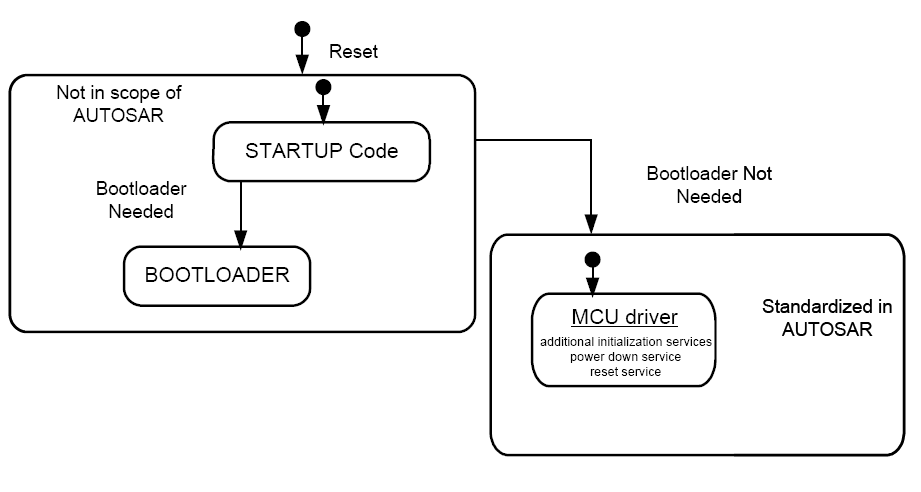
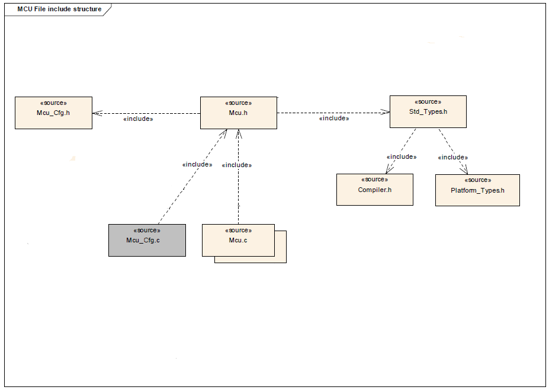
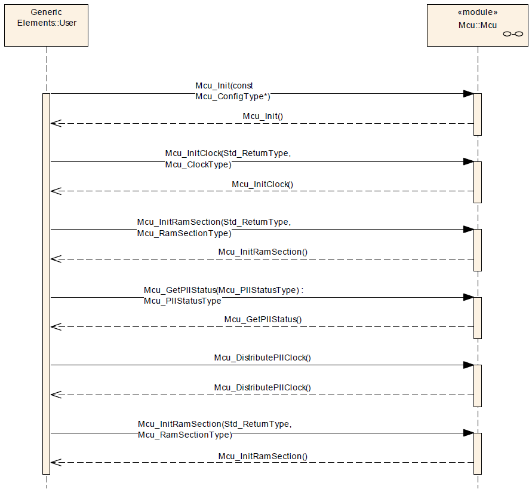
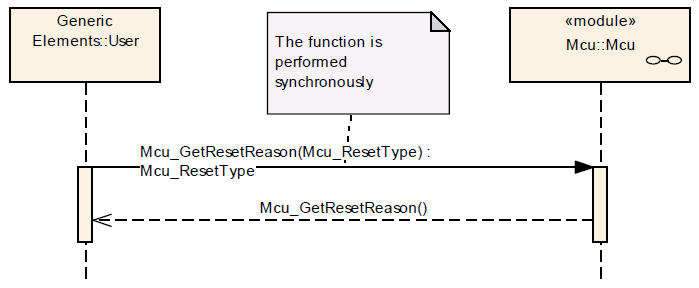
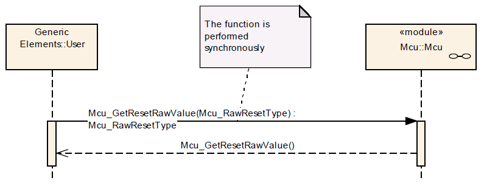
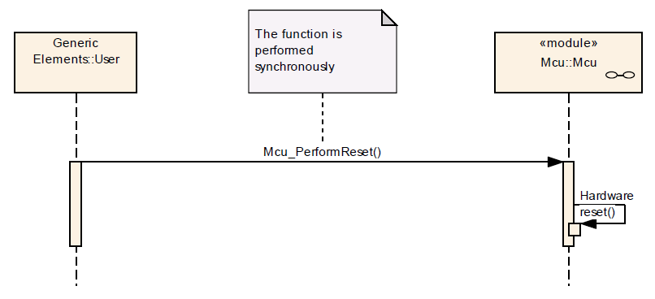
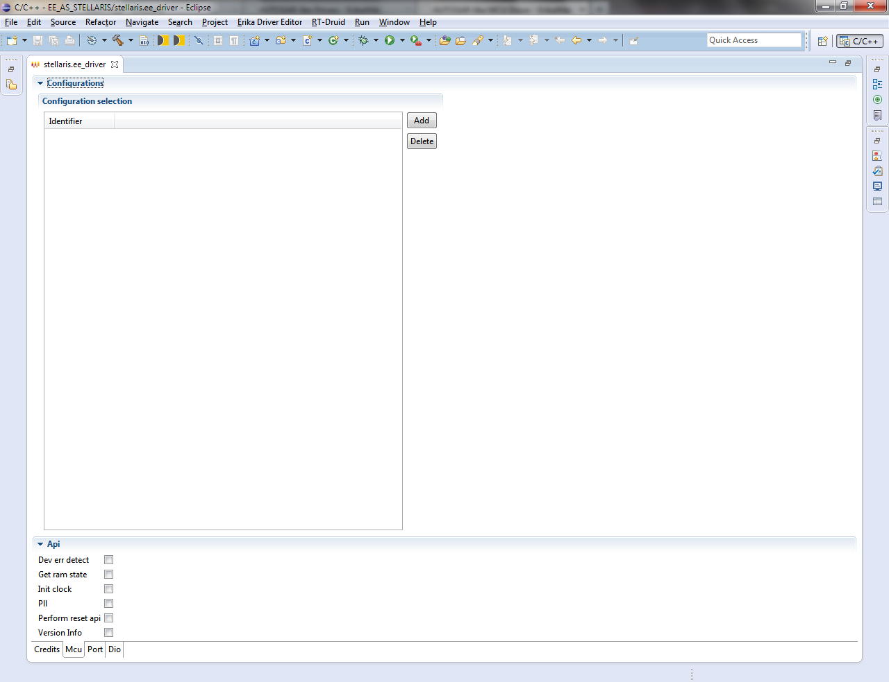
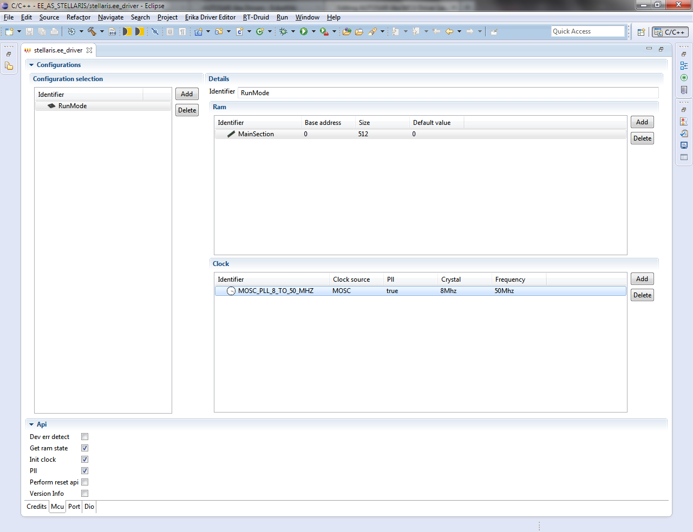

# AUTOSAR-like MCU Driver

<a id="Synopsis"></a>

### Synopsis

The MCU driver provides services for basic microcontroller initialization, power down functionality, reset and microcontroller specific functions required by other MCAL [Microcontroller Abstraction Layer] software modules. The initialization services allow a flexible and application related MCU initialization in addition to the start-up code (see figure below). The start-up code is very MCU specific. The start-up code is provided by Evidence Srl within Erika Enterprise.

[](../files/File_Startup_Code.png--2351.md)

**MCU driver Features**:

- Initialization of MCU clock, PLL, clock prescalers and MCU clock distribution
- Initialization of RAM sections
- Activation of μC reduced power modes
- Activation of a μC reset
- Provides a service to get the reset reason from hardware

The MCU driver accesses the microcontroller hardware directly and is located in the Microcontroller Abstraction Layer.

<a id="File_Structure"></a>

### File Structure

[](../files/File_MCU_Driver_File_structure.png--2353.md)

<a id="API_Specification"></a>

### API Specification

<a id="Imported_Types"></a>

#### Imported Types

<a id="typedef_uint8_Std_ReturnType"></a>

##### *typedef uint8 Std\_ReturnType*

```
 #include "Std_Types.h"
```

Standard Return Type.

This type can be used as standard API return type which is shared between AUTOSAR-like modules.

The *Std\_ReturnType* shall normally be used with value *E\_OK* or *E\_NOT\_OK*.
If those return values are not sufficient user specific values can be defined by using the 6 least specific bits.

<a id="struct_Std_VersionInfoType"></a>

##### *struct Std\_VersionInfoType*

```
 #include "Std_Types.h"
```

Standard Version Informations Type.

This type shall be used to request the version of a AUTOSAR-like module using the *<Module Name>\_GetVersionInfo()* function.

**Field Documentation:**

```
 uint16 Std_VersionInfoType::moduleID
```

Module Identifier.

```
 uint8 Std_VersionInfoType::sw_major_version
```

Software Version Major Number.

```
 uint8 Std_VersionInfoType::sw_minor_version
```

Software Version Minor Number.

```
 uint8 Std_VersionInfoType::sw_patch_version
```

Software Version Patch Number.

```
 uint16 Std_VersionInfoType::vendorID
```

Vendor Identifier.

<a id="Types_Defintions"></a>

#### Types Defintions

<a id="struct_Mcu_ConfigType"></a>

##### *struct Mcu\_ConfigType*

```
 #include "Mcu.h"
```

MCU Configuration Parameters.

The structure *Mcu\_ConfigType* is an external data structure (i.e. implementation specific) and shall contain the initialization data for the MCU module. It shall contain:

- MCU dependent properties
- Reset Configuration
- Definition of MCU modes
- Definition of Clock settings
- Definition of RAM sections

The structure *Mcu\_ConfigType* shall provide a configurable (enable/disable) clock failure notification if the MCU provides an interrupt for such detection. If the clock failure is detected with other HW mechanisms e.g., the generation of a trap, this notification shall be disabled and the failure reporting shall be done outside the MCU driver.

The definitions for each MCU mode within the structure *Mcu\_ConfigType* shall contain: (depending on MCU)

- MCU specific properties
- Change of CPU clock
- Change of Peripheral clock
- Change of PLL settings
- Change of MCU power supply

The definitions for each Clock setting within the structure *Mcu\_ConfigType* shall contain:

- MCU specific properties as, e.g., clock safety features and special clock distribution settings
- PLL settings /start lock options
- Internal oscillator setting

The definitions for each RAM section within the structure *Mcu\_ConfigType* shall contain:

- RAM section base address
- Section size
- Data pre-setting to be initialized

Usage of linker symbols instead of scalar values is allowed.

<a id="enum_Mcu_PllStatusType"></a>

##### *enum Mcu\_PllStatusType*

```
 #include "Mcu.h"
```

PLL Status Type.

The type *Mcu\_PllStatusType* is the type of the return value of the API function *Mcu\_GetPllStatus()*.

The type of *Mcu\_PllStatusType* is an enumeration with the following values: *MCU\_PLL\_LOCKED*, *MCU\_PLL\_UNLOCKED*, *MCU\_PLL\_STATUS\_UNDEFINED*.

**Enumerator:**

- *MCU\_PLL\_LOCKED*: PLL is locked.
- *MCU\_PLL\_UNLOCKED*: PLL is unlocked.
- *MCU\_PLL\_STATUS\_UNDEFINED*: PLL Status is unknown.

<a id="typedef_uint_Mcu_ClockType"></a>

##### *typedef uint Mcu\_ClockType*

```
 #include "Mcu.h"
```

Clock Type.

The type *Mcu\_ClockType* defines the identification (ID) for clock setting configured via the configuration structure.

The type shall be *uint8*, *uint16* or *uint32*, depending on μC platform.

<a id="enum_Mcu_ResetType"></a>

##### *enum Mcu\_ResetType*

```
 #include "Mcu.h"
```

Reset Type.

This type represents the different reset that a specified MCU can have.

The MCU module shall provide at least the values *MCU\_POWER\_ON\_RESET* and *MCU\_RESET\_UNDEFINED*.

**Note**: Additional reset types may be added depending on MCU.

**Enumerator**:

- *MCU\_POWER\_ON\_RESET*: Power On Reset (default)
- *MCU\_WATCHDOG\_RESET*: Internal Watchdog Timer Reset
- *MCU\_SW\_RESET*: Software Reset
- *MCU\_RESET\_UNDEFINED*: Reset is undefined

<a id="typedef_uint_Mcu_RawResetType"></a>

##### *typedef uint Mcu\_RawResetType*

```
 #include "Mcu.h"
```

Raw Reset Type.

The type *Mcu\_RawResetType* specifies the reset reason in raw register format, read from a reset status register.

The type shall be *uint8*, *uint16* or *uint32* based on best performance.

<a id="typedef_uint_Mcu_ModeType"></a>

##### *typedef uint Mcu\_ModeType*

```
 #include "Mcu.h"
```

Mode Type.

The *Mcu\_ModeType* specifies the identification (ID) for a MCU mode, configured via configuration structure.

The type shall be *uint8*, *uint16* or *uint32*.

<a id="typedef_uint_Mcu_RamSectionType"></a>

##### *typedef uint Mcu\_RamSectionType*

```
 #include "Mcu.h"
```

Ram Section Type.

The *Mcu\_RamSectionType* specifies the identification (ID) for a RAM section, configured via the configuration structure.

The type shall be *uint8*, *uint16* or *uint32* , based on best performance.

<a id="enum_Mcu_RamStateType"></a>

##### *enum Mcu\_RamStateType*

```
 #include "Mcu.h"
```

Ram State Type.

This is the Ram State data type returned by the function Mcu\_GetRamState() of the Mcu module. It is not required that all RAM state types are supported by the hardware.

**Enumerator**:

- *MCU\_RAM\_STATE\_INVALID*: Ram content is not valid or unknown (default)
- *MCU\_RAM\_STATE\_VALID*: Ram content is valid

<a id="Functions_Definitions"></a>

#### Functions Definitions

<a id="void_Mcu_Init.28const_Mcu_ConfigType_.2AConfigPtr.29"></a>

##### *void Mcu\_Init(const Mcu\_ConfigType \*ConfigPtr)*

```
 #include "Mcu.h"
```

MCU Driver Initialization.

**Parameters**:

- *ConfigPtr* : Pointer to MCU driver configuration set.

**Returns**:

- None.

This service initializes the MCU driver.

Service 0x00

The function *Mcu\_Init()* shall initialize the MCU module, i.e. make the configuration settings for power down, clock and RAM sections visible within the MCU module.

**Note**: After the execution of the function *Mcu\_Init()*, the configuration data are accessible and can be used by the MCU module functions as, e.g., *Mcu\_InitRamSection()*.

The MCU module's implementer shall apply the following rules regarding initialization of controller registers within the function *Mcu\_Init()*:

- If the hardware allows for only one usage of the register, the driver module implementing that functionality is responsible for initializing the register.
- If the register can affect several hardware modules and if it is an I/O register, it shall be initialised by the **PORT** driver.
- If the register can affect several hardware modules and if it is not an I/O register, it shall be initialised by this **MCU** driver.
- One-time writable registers that require initialisation directly after reset shall be initialised by the startup code.
- All other registers not mentioned before shall be initialised by the start-up code.

If not applicable, the MCU module's environment shall pass a *NULL* pointer to the function *Mcu\_Init()*. In this case the check for this *NULL* pointer has to be omitted.

**Note**: The term 'Hardware Module' refers to internal modules of the MCU.

<a id="Std_returnType_Mcu_InitRamSection.28Mcu_RamSectionType_RamSection.29"></a>

##### *Std\_returnType Mcu\_InitRamSection(Mcu\_RamSectionType RamSection)*

```
 #include "Mcu.h"
```

Ram Section Initialization.

**Parameters**:

- *RamSection*: Selects RAM memory section provided in configuration set

**Returns**:

- *E\_OK*: command has been accepted
- *E\_NOT\_OK*: command has not been accepted e.g. due to parameter error

This service initializes the RAM section wise.

Service 0x01

The function *Mcu\_InitRamSection()* shall fill the memory from address McuRamSectionBaseAddress up to address *McuRamSectionBaseAddress* + *McuRamSectionSize* - *1* with the byte-value contained in *McuRamDefaultValue*, where *McuRamSectionBaseAddress*, *McuRamSectionSize* and *McuRamDefaultValue* are the values of the configuration parameters for each RamSection.

The MCU module's environment shall call the function *Mcu\_InitRamSection()* only after the MCU module has been initialized using the function *Mcu\_Init()*.

<a id="Std_ReturnType_Mcu_InitClock.28Mcu_ClockType_ClockSetting.29"></a>

##### *Std\_ReturnType Mcu\_InitClock(Mcu\_ClockType ClockSetting)*

```
 #include "Mcu.h"
```

Clock Initialization.

**Parameters**:

- *ClockSetting*: Clock Setting

**Returns**:

- *E\_OK*: command has been accepted
- *E\_NOT\_OK*: command has not been accepted

This service initializes the PLL and other Mcu Specific clock options.

Service 0x02

The function *Mcu\_InitClock()* shall initialize the PLL and other MCU specific clock options. The clock configuration parameters are provided via the configuration structure.

The function *Mcu\_InitClock()* shall start the PLL lock procedure (if PLL shall be initialized) and shall return without waiting until the PLL is locked.

The MCU module's environment shall only call the function *Mcu\_InitClock()* after the MCU module has been initialized using the function *Mcu\_Init()*.

The function *Mcu\_InitClock()* shall be disabled if the configuration parameter *McuInitClock* is set to *FALSE*. Instead this function is available if the former parameter is set to *TRUE*.

<a id="void_Mcu_DistributeClock.28void.29"></a>

##### *void Mcu\_DistributeClock(void)*

```
 #include "Mcu.h"
```

PLL Clock Distribution.

**Parameters**:

- None

**Returns**:

- None

This service activates the PLL clock to the MCU clock ditribution.

Service 0x03

The function *Mcu\_DistributePllClock()* shall activate the PLL clock to the MCU clock distribution.

The MCU module's environment shall execute the function *Mcu\_DistributePllClock()* if the MCU module needs a separate request to activate the PLL clock after the PLL is locked. In this case, the function shall remove the current clock source (for example internal oscillator clock) from MCU clock distribution.

The function *Mcu\_DistributePllClock()* shall return without affecting the MCU hardware if the PLL clock has been automatically activated by the MCU hardware.

The MCU module's environment shall only call the function *Mcu\_DistributePllClock()* after the status of the PLL has been detected as locked by the function *Mcu\_GetPllStatus()*.

The function *Mcu\_DistributePllClock()* shall be available if the configuration parameter *McuNoPll* is set to *FALSE*. Otherwise, this API has to be disabled.

<a id="Mcu_PllStatusType_Mcu_GetPllStatus.28void.29"></a>

##### *Mcu\_PllStatusType Mcu\_GetPllStatus(void)*

```
 #include "Mcu.h"
```

PLL Status Retrieval.

**Parameters**:

- None

**Returns**:

- PLL Status.

This service provides the lock status of the PLL.

Service 0x04

The function *Mcu\_GetPllStatus()* shall return the lock status of the PLL.

The function *Mcu\_GetPllStatus()* shall return *MCU\_PLL\_STATUS\_UNDEFINED* if this function is called prior to calling of the function *Mcu\_Init()*.

The function *Mcu\_GetPllStatus()* shall also return *MCU\_PLL\_STATUS\_UNDEFINED* if the pre-compile parameter *McuNoPll* is set to *TRUE*.

<a id="Mcu_ResetType_Mcu_GetResetReason.28void.29"></a>

##### Mcu\_ResetType Mcu\_GetResetReason(void)

```
 #include "Mcu.h"
```

Reset Reason Retrieval.

**Parameters**:

- None

**Returns**:

- Reset Reason.

This service reads the reset type from the hardware, if supported.

Service 0x05

The function *Mcu\_GetResetReason()* shall read the reset reason from the hardware and return this reason if supported by the hardware. If the hardware does not support the hardware detection of the reset reason, the return value from the function *Mcu\_GetResetReason()* shall always be *MCU\_POWER\_ON\_RESET*.

The function *Mcu\_GetResetReason()* shall return *MCU\_RESET\_UNDEFINED* if this function is called prior to calling of the function *Mcu\_Init()*, and if supported by the hardware.

**Note**: The User should ensure that the reset reason is cleared once it has been read out to avoid multiple reset reasons.

<a id="Mcu_RawResetType_Mcu_GetResetRawValue.28void.29"></a>

##### *Mcu\_RawResetType Mcu\_GetResetRawValue(void)*

```
 #include "Mcu.h"
```

Reset Raw Value Retrieval.

**Parameters**:

- None

**Returns**:

- Reset Raw Value.

This service reads the reset type from the hardware, if supported.

Service 0x06

The function *Mcu\_GetResetRawValue()* shall return an implementation specific value which does not correspond to a valid value of the reset status register and is not equal to *0* if this function is called prior to calling of the function *Mcu\_Init()*, and if supported by the hardware.

The function *Mcu\_GetResetRawValue()* shall read the reset raw value from the hardware register if the hardware supports this. If the hardware does not have a reset status register, the return value shall be *0*.

**Note**: The User should ensure that the reset reason is cleared once it has been read out to avoid multiple reset reasons.

<a id="void_Mcu_PerformReset.28void.29"></a>

##### *void Mcu\_PerformReset(void)*

```
 #include "Mcu.h"
```

Microcontroller Reset.

**Parameters**:

- None

**Returns**:

- None.

This service performs a microcontroller reset.

Service 0x07

The function *Mcu\_PerformReset()* shall perform a microcontroller reset by using the hardware feature of the microcontroller.

The function *Mcu\_PerformReset()* shall perform the reset type which is configured in the configuration set.

The MCU module's environment shall only call the function *Mcu\_PerformReset()* after the MCU module has been initialized by the function *Mcu\_Init()*.

The function *Mcu\_PerformReset()* is only available if the configurationparameter *McuPerformResetApi* is set to *TRUE*. If set to *FALSE*, the function *Mcu\_PerformReset()* is not applicable.

<a id="void_Mcu_SetMode.28Mcu_ModeType_McuMode.29"></a>

##### *void Mcu\_SetMode(Mcu\_ModeType McuMode)*

```
 #include "Mcu.h"
```

MCU Mode Setting.

**Parameters**:

- *McuMode*: Set different MCU power modes configured in the configuration set

**Returns**:

- None

This service activates the MCU power modes.

Service 0x08

The function *Mcu\_SetMode()* shall set the MCU power mode. In case of CPU power down mode, the function *Mcu\_SetMode()* returns after it has performed a wake-up.

The MCU module's environment shall only call the function *Mcu\_SetMode()* after the MCU module has been initialized by the function *Mcu\_Init()*.

<a id="void_Mcu_GetVersionInfo.28Std_VersionInfoType_.2AVersionInfoPtr.29"></a>

##### *void Mcu\_GetVersionInfo(Std\_VersionInfoType \*VersionInfoPtr)*

```
 #include "Mcu.h"
```

MCU Driver version informations retrieval.

**Parameters**:

- *VersionInfoPtr*: Pointer to where to store the version information of this module.

**Returns**:

- None

This service retrieves the MCU driver version informations.

Service 0x09

The function *Mcu\_GetVersionInfo()* shall return the version information of the MCU module. The version information includes:

- Module Id
- Vendor Id
- Vendor specific version numbers

The function *Mcu\_GetVersionInfo()* shall be configurable On/Off by the configuration parameter *McuVersionInfoApi*.

If source code for caller and callee of the function *Mcu\_GetVersionInfo()* is available, the MCU module should realize this function as a macro. The MCU module should define this macro in the module’s header file.

<a id="Mcu_RamStateType_Mcu_GetRamState.28void.29"></a>

##### *Mcu\_RamStateType Mcu\_GetRamState(void)*

```
 #include "Mcu.h"
```

RAM State Retrieval.

**Parameters**:

- None

**Returns**:

- Status of the RAM content.

This service provides the actual statusof the microcontroller RAM, if supported.

Service 0x0A

**Note**: Some microcontrollers offer the functionality to check if the RAM Status is valid after a reset. The function *Mcu\_GetRamState()* can be used for this reason.

The MCU module's environment shall call this function only if the MCU module has been already initialized using the function *Mcu\_Init()*.

The function *Mcu\_GetRamState()* shall be available to the user if the configuration parameter *McuGetRamStateApi* is set to *TRUE*. Instead, if the former parameter is set to *FALSE*, this function shall be disabled (e.g. the hardware does not support this functionality).

<a id="Usage_Examples"></a>

### Usage Examples

<a id="MCU_initialization_services"></a>

#### MCU initialization services

[](../files/File_Mcu_Init_Examples.png--2354.md)

The order of services is just an example and might differ depending on the user.
*Mcu\_Init()* shall be executed first after power-up.
The user takes care that the PLL is locked by executing *Mcu\_GetPllStatus()*.

<a id=".CE.BCC_reset_reason_retrieval_service"></a>

#### μC reset reason retrieval service

[](../files/File_Mcu_GetResetReason_Seq_Dia.png--2375.md)

<a id=".CE.BCC_reset_raw_value_retrieval_service"></a>

#### μC reset raw value retrieval service

[](../files/File_Mcu_GetRawResetValue_Seq_Diag.png--2376.md)

<a id=".CE.BCC_reset_service"></a>

#### μC reset service

[](../files/File_Mcu_PerformReset_Seq_Dia.png--2377.md)

<a id="Build"></a>

### Build

To enable AUTOSAR-like MCU Driver in Erika Enterprise build process, the following `EE_OPT` attribute is needed in the `OS` object of the OSEK/VDX configuration:

```
 EE_OPT = "__AS_MCU_DRIVER__";
```

The configuration C header file inclusion is done by `CFLAGS` attribute in the `OS` object of the OSEK/VDX configuration:

```
 CFLAGS = "-I<PATH>";
```

Where `<PATH>` is the absolute or relative directory path which configuration C header file is stored.

Instead the configurations C source file is added to the compilation process by `APP_SRC` attribute in the `CPU_DATA` object of the OSEK/VDX configuration:

```
 APP_SRC = "<PATH>/Mcu_Cfg.c";
```

Where `<PATH>` is the absolute or relative directory path which configuration C source file is stored.

<a id="Supported_Architectures"></a>

### Supported Architectures

<a id="TI_Stellaris_LM4F232XXXX_with_ARM_KEIL_uVision_Compiler_Toolchain"></a>

#### TI Stellaris LM4F232XXXX with ARM KEIL uVision Compiler Toolchain

<a id="Driver_Configuration"></a>

##### Driver Configuration

In order to configure the AUTOSAR-like MCU Driver for Texas Instruments Stellaris LM4F232xxxx with ARM KEIL uVision Compiler Toolchain, you have to select the "Mcu" tab-sheet on driver configuration instance file.

[](../files/File_Erika_Driver_Configurator_MCU.png--2378.md)

<a id="Configuration_Selection"></a>

###### Configuration Selection

In this section you can add/edit/delete configurations in MCU Driver configuration set:

- Each configuration SHALL have an *Identifier* which must be unique inside the configurations set.
- Each configuration, inside the configurations set, has a set of Ram sections and a set of clock configurations.
  - Each Ram section SHALL have an *Identifier* which must be unique inside the Ram sections set.
  - Each clock configuration SHALL have an *Identifier* which must be unique inside the clock configurations set.

<a id="API_Selection"></a>

###### API Selection

In this section you can select MCU Driver APIs and features will be included in build process:

- *Dev err detect*: Development Error Detection features
- *Get ram state*: *Mcu\_GetRam\_state()* API
- *Init clock*: *Mcu\_InitClock()* API
- *Pll*: PLL releated APIs and features
- *Perform reset api*: *Mcu\_PerformReset()* API
- *Version Info*: *Mcu\_GetVersionInfo()* API

[](../files/File_Erika_Driver_Configurator_MCU_set.png--2379.md)

<a id="Implemetations_Demos"></a>

##### Implemetations Demos

Implementation Demos of the AUTOSAR-like MCU Driver for Texas Instruments Stellaris LM4F232xxxx with ARM KEIL uVision Compiler Toolchain can be found at [examples/cortex\_mx/lm4f232xxxx/as](http://svn.tuxfamily.org/viewvc.cgi/erika_erikae/repos/ee/trunk/ee/examples/cortex_mx/lm4f232xxxx/as)

---

## Archive provenance

- [Original page](http://erika.tuxfamily.org/wiki/index.php?title=AUTOSAR-like_MCU_Driver) · [Archived source revision 5249](http://erika.tuxfamily.org/wiki/index.php?oldid=5249)
- Last source edit: 2013-07-16T20:46:05Z. Source retrieved on 2026-11-06; Markdown conversion completed on 2026-11-07.
- Original contributors recorded in exported history: Eguidieri, Giuseppe Serano.
- [Original MediaWiki source](../source/wikitext/2350.mediawiki) · [Original editing history](../source/history/batch-001.xml)
- [Attribution and licensing notice](../NOTICE.md). Original file-specific notices, where present, remain applicable.
