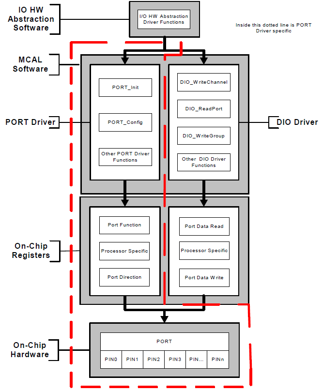
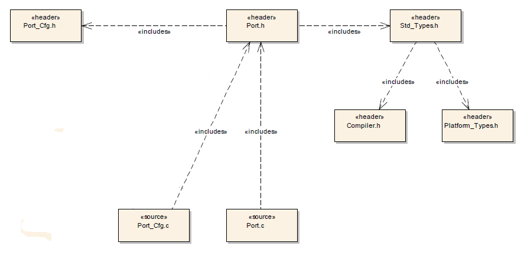
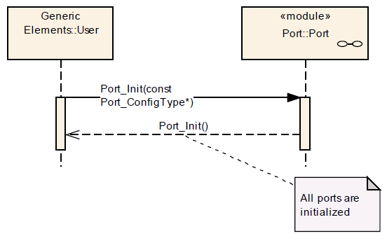
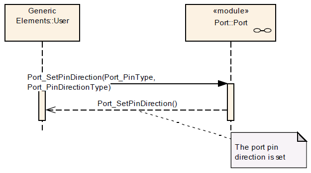
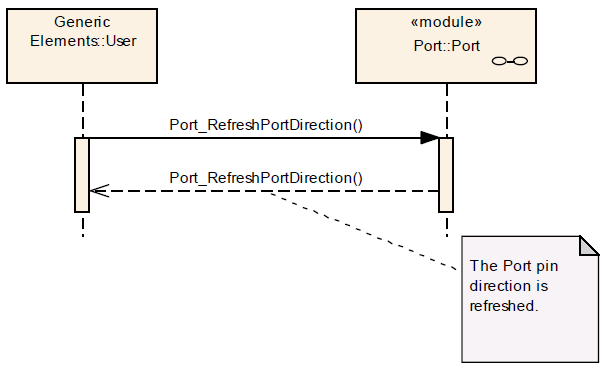
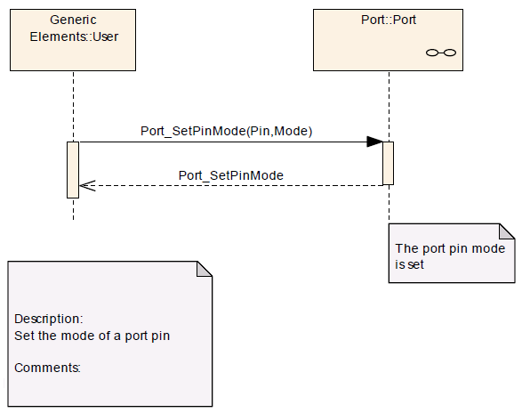
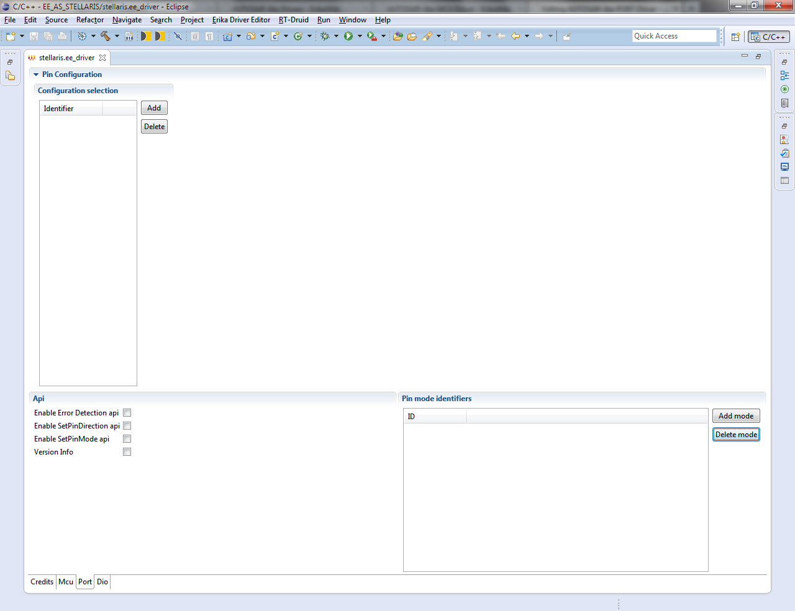
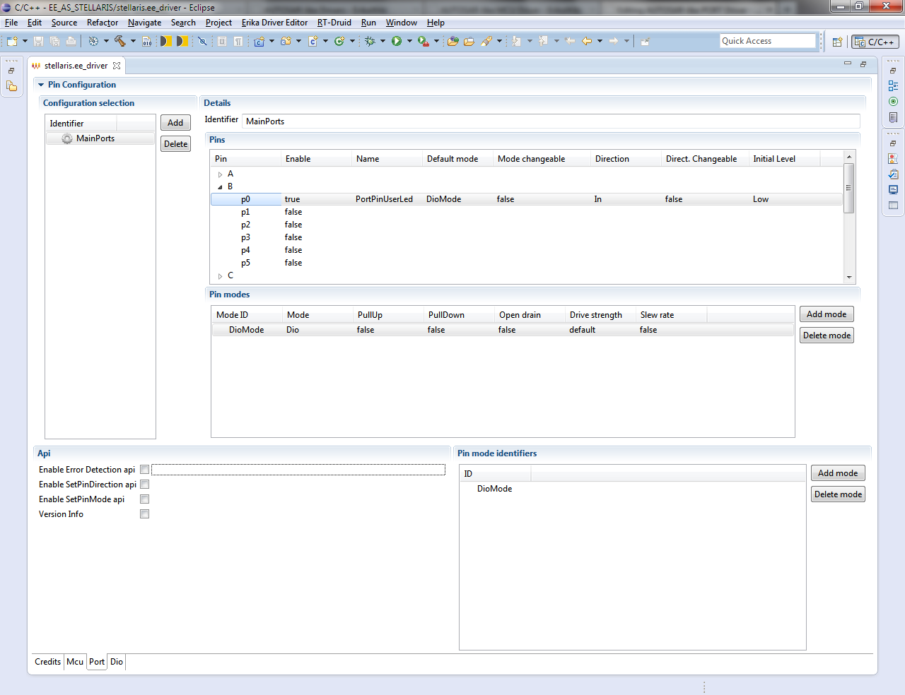

# AUTOSAR-like PORT Driver

<a id="Synopsis"></a>

### Synopsis

The PORT driver provides services for initializing the whole PORT structure of the microcontroller.

Many ports and port pins can be assigned to various functionalities, e.g.

- General purpose I/O
- ADC
- SPI
- SCI
- PWM
- CAN
- etc

For this reason, there shall be an overall configuration and initialization of this port structure.

The configuration and mode of these port pins is microcontroller and ECU [Electronic Control Unit] dependent.

This PORT driver module shall complete the overall configuration and initialisation of the port structure which is used in the DIO driver module. Therefore, the DIO driver works on pins and ports which are configured by the PORT driver.

The PORT driver shall be initialised prior to use of the DIO functions. Otherwise DIO functions will exhibit undefined behaviour.

The diagram below identifies the PORT driver functions, and the structure of the PORT driver and DIO driver.

[](../files/File_PORT-DIO.png--2381.md)

The PORT Driver module shall allow the configuration of different functionality for each port and port pin, e.g. ADC, SPI, DIO etc.

The configuration of the port (i.e. whole port or single port pin) is microcontroller dependent.

The PORT Driver module shall provide additional configurations for the MCU port/port pins:

- Pin direction (input/output).
- Pin level initial value.
- Pin direction changeable during runtime (yes/no).
- Port mode changeable during runtime.

The PORT Driver module shall provide a number of optional configurations for the MCU ports and port pins (if supported by hardware):

- Slew rate control.
- Activation of internal pull-ups.
- Input Thresholds.
- Pin driven mode (push-pull / open drain).
- Type of Readback support (pin level, output register value).

The PORT Driver module shall not provide the facility to configure pin level inversion. The default value shall be set (i.e. not inverted).

**Note**: The IO Hardware Abstraction layer shall carry out level inversion.

For the port pins configured as changeable using the configuration tool, the PORT driver shall allow the user to change the direction of port pins during runtime. If the MCU port control hardware provides an output latch for setting the output level on a port pin, switching the port pin direction shall not alter the level set in this output latch.

For refreshing of the port on the microcontroller, the PORT driver shall allow the user to refresh the direction of those port pins whose direction is set by configuration and cannot be changed dynamically.

The PORT Driver module shall configure all ports and port pins that are not used (neither as GPIO nor special purpose IO) to be set to a defined state by the PORT Driver module configuration.

The user of the PORT Driver module shall configure the symbolic names of the port pins of the MCU. These symbolic names for the individual port pins (e.g. *PORT\_A\_PIN\_0*) shall be defined in the configuration tool.

The PORT Driver module shall provide atomic access to all ports and port pins.

**Note**: An atomic access is a non interruptible access to Microcontroller registers by the use of either atomic instructions or the usage of an exclusive area (interrupt disabling for example) provided by Erika Enterprise.

<a id="File_Structure"></a>

### File Structure

[](../files/File_PORT_Driver_File_structure_2.png--2382.md)

<a id="API_Specification"></a>

### API Specification

<a id="Imported_Types"></a>

#### Imported Types

<a id="typedef_uint8_Std_ReturnType"></a>

##### *typedef uint8 Std\_ReturnType*

```
 #include "Std_Types.h"
```

Standard Return Type.

This type can be used as standard API return type which is shared between AUTOSAR-like modules.

The *Std\_ReturnType* shall normally be used with value *E\_OK* or *E\_NOT\_OK*.
If those return values are not sufficient user specific values can be defined by using the 6 least specific bits.

<a id="struct_Std_VersionInfoType"></a>

##### *struct Std\_VersionInfoType*

```
 #include "Std_Types.h"
```

Standard Version Informations Type.

This type shall be used to request the version of a AUTOSAR-like module using the *<Module Name>\_GetVersionInfo()* function.

**Field Documentation:**

```
 uint16 Std_VersionInfoType::moduleID
```

Module Identifier.

```
 uint8 Std_VersionInfoType::sw_major_version
```

Software Version Major Number.

```
 uint8 Std_VersionInfoType::sw_minor_version
```

Software Version Minor Number.

```
 uint8 Std_VersionInfoType::sw_patch_version
```

Software Version Patch Number.

```
 uint16 Std_VersionInfoType::vendorID
```

Vendor Identifier.

<a id="Types_Defintions"></a>

#### Types Defintions

<a id="struct_Port_ConfigType"></a>

##### *struct Port\_ConfigType*

```
 #include "Port.h"
```

PORT Driver Configuration Parameters.

The type *Port\_ConfigType* is a type for the external data structure containing the initialization data for the PORT Driver.

**Note**: The user shall use the symbolic names defined in the configuration tool.

**Note**: The configuration of each port pin is MCU specific. Therefore, it is not possible to include a complete list of different configurations in this specification.

A list of possible port configurations for the structure *Port\_ConfigType* is given below:

- Pin mode (e.g. DIO, ADC, SPI …) – this port pin configuration is mandatory unless the port pin is configured for DIO.
- Pin direction (input, output) – this port pin configuration is mandatory when the port pin is to be used for DIO.
- Pin level init value – this port pin configuration is mandatory when the port pin is used for DIO.
- Pin direction changeable during runtime (STD\_ON/STD\_OFF) – this port pinconfiguration is MCU dependent.
- Pin mode changeable during runtime (STD\_ON/STD\_OFF) – configuration is MCU dependent.

Optional parameters (if supported by hardware)

- Slew rate control.
- Activation of internal pull-ups.
- Microcontroller specific port pin properties.

<a id="typedef_uint_Port_PinType"></a>

##### *typedef uint Port\_PinType*

```
 #include "Port.h"
```

Data type for the symbolic name of a port pin.

Shall cover all available port pins. The type should be chosen for the specific MCU platform (best performance).

The type *Port\_PinType* shall be used for the symbolic name of a Port Pin.

The type *Port\_PinType* shall be *uint8*, *uint16* or *uint32* based on the specific MCU platform.

**Note**: The user shall use the symbolic names provided by the configuration tool.

<a id="enum_Port_PinDirectionType"></a>

##### *enum Port\_PinDirectionType*

```
 #include "Port.h"
```

Possible directions of a port pin.

The type *Port\_PinDirectionType* is a type for defining the direction of a Port Pin.

The type *Port\_PinDirectionType* shall be of enumeration type having range as *PORT\_PIN\_IN* and *PORT\_PIN\_OUT* .

**Enumerator**:

- *PORT\_PIN\_IN*: Sets port pin as input.
- *PORT\_PIN\_OUT*: Sets port pin as output.

<a id="typedef_uint_Port_PinModeType"></a>

##### *typedef uint Port\_PinModeType*

```
 #include "Port.h"
```

Different port pin modes.

A port pin shall be configurable with a number of port pin modes (type *Port\_PinModeType*).

The type *Port\_PinModeType* shall be used with the function call *Port\_SetPinMode()*.

The type *Port\_PinModeType* shall be *uint8*, *uint16* or *uint32*.

<a id="Functions_Definitions"></a>

#### Functions Definitions

<a id="void_Port_Init.28const_Port_ConfigType_.2AConfigPtr.29"></a>

##### *void Port\_Init(const Port\_ConfigType \*ConfigPtr)*

```
 #include "Port.h"
```

PORT Driver Initialization.

**Parameters**:

- *ConfigPtr*: Pointer to configuration set

**Returns**:

- *None*.

Initializes the Port Driver module.

Service 0x00

The function *Port\_Init()* shall initialize ALL ports and port pins with the configuration set pointed to by the parameter *ConfigPtr*.

The Port Driver module’s environment shall call the function *Port\_Init()* first in order to initialize the port for use.

If *Port\_Init()* function is not called first, then no operation can occur on the MCU ports and port pins.

The function *Port\_Init()* shall initialize all configured resources.

The function *Port\_Init()* shall avoid glitches and spikes on the affected port pins.

The Port Driver module’s environment shall call the function *Port\_Init()* after a reset in order to reconfigure the ports and port pins of the MCU.

The function *Port\_Init()* shall initialize all variables used by the PORT driver module to an initial state.

The function *Port\_Init()* shall apply the following rules regarding initialisation of controller registers.

- If the hardware allows for only one usage of the register, the driver module implementing that functionality is responsible for initializing the register.
- If the register can affect several hardware modules and if it is an I/O register it shall be initialised by this PORT driver.
- If the register can affect several hardware modules and if it is not an I/O register, it shall be initialised by the MCU driver.
- One-time writable registers that require initialisation directly afterreset shall be initialised by the startup code.
- All the other registers not mentioned before, shall be initialised by the start-up code.

The Port Driver module’s environment may also uses the function *Port\_Init()* to initialize the driver software and reinitialize the ports and port pins to another configured state depending on the configuration set passed to this function.

**Note**: In some cases, MCU port control hardware provides an output latch for setting the output level on a port pin that may be used as a DIO port pin.

The function *Port\_Init()* shall set the port pin output latch to a default level (defined during configuration) before setting the port pin direction to output.

**Example**: On some MCU’s, after a power-on-reset, a DIO configurable port pin will be configured as an input pin. If the required configuration of the port pin is an output pin, then the function *Port\_Init()* shall ensure that the default level is set before switching the functionality of the port pin from input to output.

The Port Driver module’s environment shall not call the function *Port\_Init()* during a running operation. This shall only apply if there is more than one caller of the PORT module.

Configuration of *Port\_Init()*: All port pins and their functions, and alternate functions shall be configured by the configuration tool.

<a id="void_Port_SetPinDirection.28Port_PinType_Pin.2C_Port_PinDirectionType_Direction.29"></a>

##### *void Port\_SetPinDirection(Port\_PinType Pin, Port\_PinDirectionType Direction)*

```
 #include "Port.h"
```

Port Pin Direction Setting.

**Parameters**:

- *Pin*: Port Pin ID number
- *Direction*: Port Pin Direction

**Returns**:

- *None*.

Sets the port pin direction.

Service 0x01

The function *Port\_SetPinDirection()* shall set the port pin direction during runtime.

The function *Port\_SetPinDirection()* shall be re-entrant if accessing different pins independent of a port.

The function *Port\_SetPinDirection()* shall only be available to the user if the configuration parameter *PortSetPinDirectionApi* is set to *TRUE*. If set to *FALSE*, the function *Port\_SetPinDirection()* is not available.

Configuration of *Port\_SetPinDirection()*: All ports and port pins shall beconfigured by the configuration tool.

<a id="void_Port_RefreshPortDirection.28void.29"></a>

##### *void Port\_RefreshPortDirection(void)*

```
 #include "Port.h"
```

Port Direction Refresh.

**Parameters**:

- *None*.

**Returns**:

- *None*.

This service refreshes the ports direction.

Service 0x02

The function *Port\_RefreshPortDirection()* shall refresh the direction of all configured ports to the configured direction (PortPinDirection).

The function *Port\_RefreshPortDirection()* shall exclude those port pins from refreshing that are configured as ‘pin direction changeable during runtime‘.

The configuration tool shall provide names for each configured port pin.

<a id="void_Port_GetVersionInfo.28Std_VersionInfoType_.2AVersionInfoPtr.29"></a>

##### *void Port\_GetVersionInfo(Std\_VersionInfoType \*VersionInfoPtr)*

```
 #include "Port.h"
```

PORT Driver version informations retrieval.

**Parameters**:

- *VersionInfoPtr*: Pointer to where to store the version information of this module.

**Returns**:

- *None*.

This service retrieves the PORT driver version informations.

Service 0x03

The function *Port\_GetVersionInfo()* shall return the version information of the PORT module.

The version information includes:

- Module Id
- Vendor Id
- Vendor specific version numbers

The function *Port\_GetVersionInfo()* shall be configurable On/Off by the configuration parameter *PortVersionInfoApi*.

If source code for caller and callee of the function *Port\_GetVersionInfo()* is available, the PORT module should realize this function as a macro. The PORT module should define this macro in the module’s header file.

<a id="void_Port_SetPinMode.28Port_PinType_Pin.2C_Port_PinModeType_Mode.29"></a>

##### *void Port\_SetPinMode(Port\_PinType Pin, Port\_PinModeType Mode)*

```
 #include "Port.h"
```

Port Pin Mode Setting.

**Parameters**:

- *Pin*: Port Pin ID number
- *Mode*: New Port Pin mode to be set on port pin

**Returns**:

- *None*.

Sets the port pin mode.

Service 0x04

The function *Port\_SetPinMode()* shall set the port pin mode of the referenced pin during runtime.

The function *Port\_SetPinMode()* shall be re-entrant if accessing different pins, independent of a port.

Configuration of *Port\_SetPinMode()*: All ports and port pins shall be configured by the configuration tool.

<a id="Usage_Examples"></a>

### Usage Examples

<a id="Overall_Configuration_of_Ports"></a>

#### Overall Configuration of Ports

[](../files/File_Port_Init_Seq_Dia.png--2385.md)

<a id="Set_the_Direction_of_a_Port_Pin"></a>

#### Set the Direction of a Port Pin

[](../files/File_Port_SetPinDirection_Seq_dia.png--2386.md)

<a id="Refresh_the_Direction_of_all_Port_Pins"></a>

#### Refresh the Direction of all Port Pins

[](../files/File_Port_RefreshPortDirection_Seq_Dia.png--2387.md)

<a id="Change_the_Mode_of_a_Port_Pin"></a>

#### Change the Mode of a Port Pin

[](../files/File_Port_SetPinMode_Seq_Dia.png--2388.md)

<a id="Build"></a>

### Build

To enable AUTOSAR-like PORT Driver for Texas Instruments Stellaris LM4F232xxxx with ARM KEIL uVision Compiler Toolchain, the following `EE_OPT` attribute is needed in the `OS` object of the OSEK/VDX configuration:

```
 EE_OPT = "__AS_PORT_DRIVER__";
```

The configuration C header file inclusion is done by `CFLAGS` attribute in the `OS` object of the OSEK/VDX configuration:

```
 CFLAGS = "-I<PATH>";
```

Where `<PATH>` is the absolute or relative directory path which configuration C header file is stored.

Instead the configurations C source file is added to the compilation process by `APP_SRC` attribute in the `CPU_DATA` object of the OSEK/VDX configuration:

```
 APP_SRC = "<PATH>/Port_Cfg.c";
```

Where `<PATH>` is the absolute or relative directory path which configuration C source file is stored.

<a id="Supported_Architectures"></a>

### Supported Architectures

<a id="TI_Stellaris_LM4F232XXXX_with_ARM_KEIL_uVision_Compiler_Toolchain"></a>

#### TI Stellaris LM4F232XXXX with ARM KEIL uVision Compiler Toolchain

<a id="Driver_Configuration"></a>

##### Driver Configuration

In order to configure the AUTOSAR-like PORT Driver for Texas Instruments Stellaris LM4F232xxxx with ARM KEIL uVision Compiler Toolchain, you have to select the "Port" tab-sheet on driver configuration instance file.

[](../files/File_Erika_Driver_Configurator_PORT.png--2383.md)

<a id="Configuration_Selection"></a>

###### Configuration Selection

In this section you can add/edit/delete configurations in PORT Driver configuration set:

- Each configuration SHALL have an *Identifier* which must be unique inside the configurations set.
- Each configuration, inside the configurations set, has a set of Pin Modes and Port Pins.
  - Each Pin mode SHALL have an *Identifier* which must be unique inside the Pin Modes.
  - Each Port Pin SHALL have a *Name* which must be unique inside the Port Pins.

<a id="API_Selection"></a>

###### API Selection

In this section you can select PORT Driver APIs and features will be included in build process:

- *Enable error detection API*: Development Error Detection features
- *Enable SetPinDirection*: *Port\_SetPinDirection()* API
- *Enable SetPinMode*: *Port\_SetPinMode()* API
- *Version Info*: *Port\_GetVersionInfo()* API

[](../files/File_Erika_Driver_Configurator_PORT_set.png--2384.md)

<a id="Implemetations_Demos"></a>

##### Implemetations Demos

Implementation Demos of the AUTOSAR-like PORT Driver can be found at [examples/cortex\_mx/lm4f232xxxx/as](http://svn.tuxfamily.org/viewvc.cgi/erika_erikae/repos/ee/trunk/ee/examples/cortex_mx/lm4f232xxxx/as)

---

## Archive provenance

- [Original page](http://erika.tuxfamily.org/wiki/index.php?title=AUTOSAR-like_PORT_Driver) · [Archived source revision 5248](http://erika.tuxfamily.org/wiki/index.php?oldid=5248)
- Last source edit: 2013-07-16T20:45:38Z. Source retrieved on 2026-11-06; Markdown conversion completed on 2026-11-07.
- Original contributors recorded in exported history: Giuseppe Serano.
- [Original MediaWiki source](../source/wikitext/2380.mediawiki) · [Original editing history](../source/history/batch-001.xml)
- [Attribution and licensing notice](../NOTICE.md). Original file-specific notices, where present, remain applicable.
