# AUTOSAR-like SCI Driver

<a id="Synopsis"></a>

### Synopsis

The SCI [Serial Communication Interface] Driver and provides serial communications services.

The SCI Driver is part of the microcontroller abstraction layer (MCAL), performs the hardware access and offers a
hardware independent API to the upper layer.

The SCI Driver can support more than one channel. This means that the SCI driver can handle one or more SCI channels as long as
they are belonging to the same SCI hardware unit as shown in the figure below.

[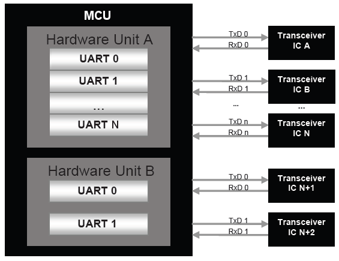](../files/File_SCI_Architecture.png--2407.md)

Only one SCI channel of an ECU is allowed to connect to a particular Transceiver. Unless there are unused (not connected) channels in the ECU, the number of SCI channels is equal to the number of Transceivers the hardware can potentially connects to.

The hardware of the internal SCI hardware unit depends on the system clock, prescaler(s) and PLL. Hence, the length of the SCI bit timing depends on the clock settings made in module SCI. The SCI driver module will not take care of setting the registers that configure the clock, prescaler(s) and PLL (e.g. switching on/off the PLL) in its init functions.

The MCU module must do this.

The Port driver configures the port pins used for the SCI driver as input or output. Hence, the Port driver has to be initialized prior to the use of SCI functions. Otherwise, SCI driver functions will exhibit undefined behavior
.
The SCI driver uses interrupts and therefore there is a dependency on the OS, which configures the interrupt sources.

The SCI driver has a state machine that is shown in the figure below.

[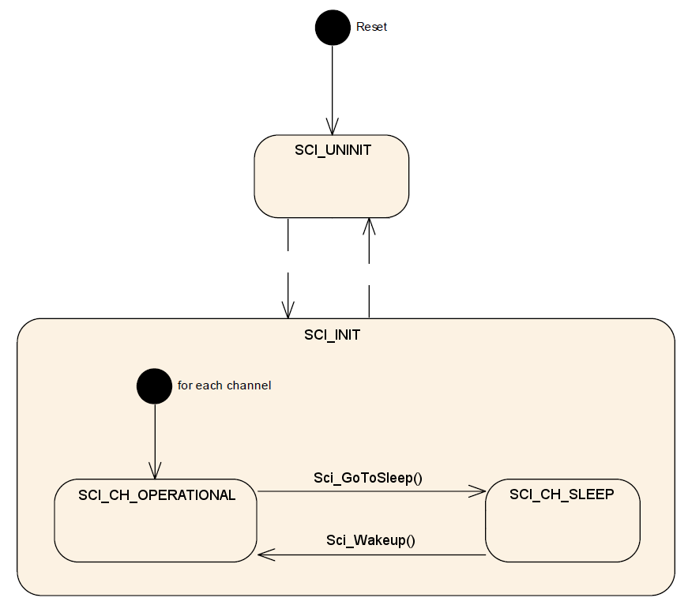](../files/File_SCI_STATE.png--2408.md)

**Module State**

- *SCI\_UNINIT*: The state *SCI\_UNINIT* means that the Sci module has not been initialized yet and cannot be used.
- *SCI\_INIT*: The *SCI\_INIT* state indicates that the SCI driver has been initialized, making each available channel ready for service.

**Channel State**

- *SCI\_CH\_OPERATIONAL*: The individual channel has been initialized (using at least one statically configured data set) and is able to communicate.
- *SCI\_CH\_SLEEP*: The SCI hardware is into a low power mode if such a mode is provided by the hardware.

- *Reset* -> *SCI\_UNINIT*: After reset, the Sci module shall set its state to *SCI\_UNINIT*.
- *SCI\_UNINIT* -> *SCI\_INIT*: The Sci module shall transition from *SCI\_UNINIT* to *SCI\_INIT* when the function *Sci\_Init()* is called.
- *SCI\_INIT* -> *SCI\_UNINIT*: The Sci module shall transition from *SCI\_INIT* to *SCI\_UNINIT* when the function *Sci\_DeInit()* is calle

On entering the state *SCI\_INIT*, the Sci module shall set each channel into state *SCI\_CH\_OPERATIONAL*.

- *SCI\_CH\_OPERATIONAL* -> *SCI\_CH\_SLEEP*: If a *Sci\_GoToSleep()* function is called, the Sci module enters in the *SCI\_CH\_SLEEP* state.
- *SCI\_CH\_SLEEP* -> *SCI\_CH\_OPERATIONAL*: if a *Sci\_Wakeup()* functions is called, the Sci module go back in the state *SCI\_CH\_OPERATIONAL*.

<a id="File_Structure"></a>

### File Structure

[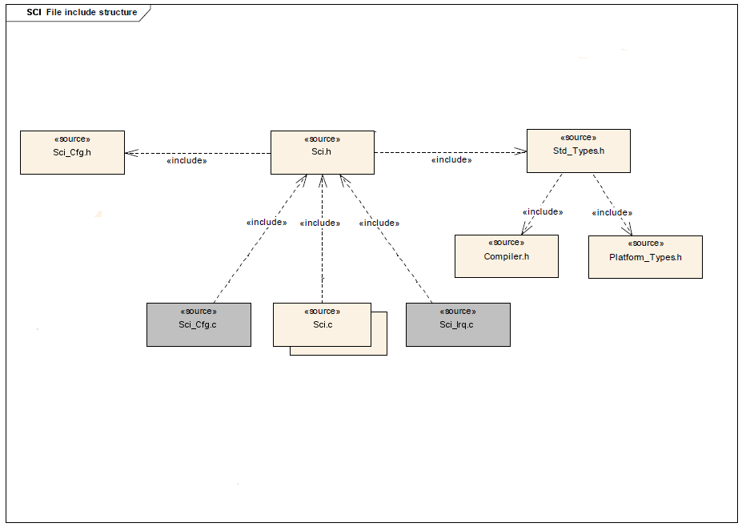](../files/File_SCI_Driver_File_structure.png--2409.md)

<a id="API_Specification"></a>

### API Specification

<a id="Imported_Types"></a>

#### Imported Types

<a id="typedef_uint8_Std_ReturnType"></a>

##### *typedef uint8 Std\_ReturnType*

```
 #include "Std_Types.h"
```

Standard Return Type.

This type can be used as standard API return type which is shared between AUTOSAR-like modules.

The *Std\_ReturnType* shall normally be used with value *E\_OK* or *E\_NOT\_OK*.
If those return values are not sufficient user specific values can be defined by using the 6 least specific bits.

<a id="struct_Std_VersionInfoType"></a>

##### *struct Std\_VersionInfoType*

```
 #include "Std_Types.h"
```

Standard Version Informations Type.

This type shall be used to request the version of a AUTOSAR-like module using the *<Module Name>\_GetVersionInfo()* function.

**Field Documentation:**

```
 uint16 Std_VersionInfoType::moduleID
```

Module Identifier.

```
 uint8 Std_VersionInfoType::sw_major_version
```

Software Version Major Number.

```
 uint8 Std_VersionInfoType::sw_minor_version
```

Software Version Minor Number.

```
 uint8 Std_VersionInfoType::sw_patch_version
```

Software Version Patch Number.

```
 uint16 Std_VersionInfoType::vendorID
```

Vendor Identifier.

<a id="Types_Defintions"></a>

#### Types Defintions

<a id="struct_Sci_ConfigType"></a>

##### *struct Sci\_ConfigType*

```
 #include "Sci.h"
```

SCI Configuration Parameters.

The structure *Sci\_ConfigType* is an external data structure (i.e. implementation specific) and shall contain the initialization data for the SCI module.

It shall contain:

- SCI dependent properties
- SCI hardware units initialization parameters
- SFR's [Special Function Register] settings affecting the SCI channels

<a id="enum_Sci_StatusType"></a>

##### *enum Sci\_StatusType*

```
 #include "Sci.h"
```

SCI Status Type.

The type *Sci\_StatusType* is the type of the return value of the API function *Sci\_GetStatus()*.

The type of *Sci\_StatusType* is an enumeration describing the operation states for a SCI channel or for a SCI communication.

**Enumerator**:

- *SCI\_NOT\_OK*: Development or production error occurred.
- *SCI\_TX\_OK*: Successful transmission.
- *SCI\_TX\_BUSY*: Ongoing transmission.
- *SCI\_TX\_ERROR*: Erroneous transmission such as:
  - Transmission disabled.
  - Physical bus error.
- *SCI\_RX\_OK*: Successful reception.
- *SCI\_RX\_BUSY*: Ongoing reception.
- *SCI\_RX\_ERROR*: Erroneous reception such as:
  - Reception disabled.
  - Parity error.
  - Framing error.
  - Overrun error.
- *SCI\_OPERATIONAL*: Normal operation; the related SCI channel is ready to transmit or receive. No data from previous communication available (e.g. after

initialization).

- *SCI\_CH\_SLEEP*: Sleep state operation; in this state wake-up detection is enabled.

<a id="typedef_uint_Sci_ChannelType"></a>

##### *typedef uint Sci\_ChannelType*

```
 #include "Sci.h"
```

Channel Type.

Parameters of type *Sci\_ChannelType* contain the numeric ID of a SCI channel.

The mapping of the ID is implementation specific but not configurable.

For parameter values of type *Sci\_ChannelType*, the Sci's user shall use the symbolic names provided by the configuration description.

The type shall be *uint8*, *uint16* or *uint32*, depending on μC platform.

<a id="typedef_void_.28.2ASci_TxNotification.29.28void.29"></a>

##### *typedef void (\*Sci\_TxNotification)(void)*

```
 #include "Sci.h"
```

Channel Transmission Notifications Callback.

The notification prototype *Sci\_TxNotification()* is for the transmission notifications callback function and shall be implemented by the user.

The SCI module's environment shall declare a separate transmission notifications callback for each channel to avoid parameters in notification services and to improve run time efficiency
.
The transmission notifications callback *Sci\_TxNotification\_<channel>()* shall be configurable as pointers to user defined functions within the configuration structure.

Each channel shall provide its own transmission notifications callback if configured.

When disabled, the SCI Driver will send no transmission notifications.

The SCI Driver shall invoke a notification callback whenever a transmission event occurred on channel.

The ISR's, providing the SCI events, shall be responsible for resetting the interrupt flags (if needed by hardware) and calling the according notification function.

For all available channels, callback functions have to be declared by the configuration tool.

<a id="typedef_void_.28.2ASci_TxErrNotification.29.28void.29"></a>

##### *typedef void (\*Sci\_TxErrNotification)(void)*

```
 #include "Sci.h"
```

Channel Transmission Errors Notifications Callback.

The notification prototype *Sci\_TxErrNotification()* is for the transmission errors notifications callback function and shall be implemented by the user.

The SCI module's environment shall declare a separate transmission errors notifications callback for each channel to avoid parameters in notification services and to improve run time efficiency.

The transmission errors notifications callback *Sci\_TxErrNotification\_<channel>()* shall be configurable as pointers to user defined functions within the configuration structure.

Each channel shall provide its own transmission errors notifications callback if configured.

When disabled, the SCI Driver will send no transmission errors notifications.

The SCI Driver shall invoke a notification callback whenever a transmission error occurred on channel.

The ISR's, providing the SCI events, shall be responsible for resetting the interrupt flags (if needed by hardware) and calling the according notification function.

For all available channels, callback functions have to be declared by the configuration tool.

<a id="typedef_void_.28.2ASci_RxNotification.29.28void.29"></a>

##### *typedef void (\*Sci\_RxNotification)(void)*

```
 #include "Sci.h"
```

Channel Reception Notifications Callback.

The notification prototype *Sci\_RxNotification()* is for the reception notifications callback function and shall be implemented by the user.

The SCI module's environment shall declare a separate reception notifications callback for each channel to avoid parameters in notification services and to improve run time efficiency
.
The reception notifications callback *Sci\_RxNotification\_<channel>()* shall be configurable as pointers to user defined functions within the configuration structure.

Each channel shall provide its own reception notifications callback if configured.

When disabled, the SCI Driver will send no reception notifications.

The SCI Driver shall invoke a notification callback whenever a reception event occurred on channel.

The ISR's, providing the SCI events, shall be responsible for resetting the interrupt flags (if needed by hardware) and calling the according notification function.

For all available channels, callback functions have to be declared by the configuration tool.

<a id="typedef_void_.28.2ASci_RxErrNotification.29.28void.29"></a>

##### *typedef void (\*Sci\_RxErrNotification)(void)*

```
 #include "Sci.h"
```

Channel Reception Errors Notifications Callback.

The notification prototype *Sci\_RxErrNotification()* is for the reception errors notifications callback function and shall be implemented by the user.

The SCI module's environment shall declare a separate reception errors notifications callback for each channel to avoid parameters in notification services and to improve run time efficiency
.
The reception errors notifications callback *Sci\_RxErrNotification\_<channel>()* shall be configurable as pointers to user defined functions within the configuration structure.

Each channel shall provide its own reception errors notifications callback if configured.

When disabled, the SCI Driver will send no reception errors notifications.

The SCI Driver shall invoke a notification errors callback whenever a reception error event occurred on channel.

The ISR's, providing the SCI events, shall be responsible for resetting the interrupt flags (if needed by hardware) and calling the according notification function.

For all available channels, callback functions have to be declared by the configuration tool.

<a id="Functions_Definitions"></a>

#### Functions Definitions

<a id="void_Sci_Init.28const_Sci_ConfigType_.2AConfigPtr.29"></a>

##### *void Sci\_Init(const Sci\_ConfigType \*ConfigPtr)*

```
 #include "Sci.h"
```

SCI Driver Initialization.

**Parameters**:

- *ConfigPtr*: Pointer to SCI driver configuration set.

**Returns**:

- *None*.

This service initializes the SCI driver.

Service 0x00

The function *Sci\_Init()* shall initialize the Sci module (i.e. static variables, including flags and SCI hardware unit global hardware settings), as well as the SCI channels.

Different sets of static configuration may have been configured.

The function *Sci\_Init()* shall initialize the module according to the configuration set pointed to by the parameter *ConfigPtr*.

The function *Sci\_Init()* shall invoke initializations for relevant hardware register settings common to all channels available on the SCI hardware unit.

The function *Sci\_Init()* shall also invoke initializations for SCI channel specific settings.

The SCI module’s environment shall not call any function of the Sci module before having called *Sci\_Init()* except *Sci\_GetVersionInfo()*.

Symbolic names of the available configuration sets are provided by the configuration description of the SCI driver.

<a id="void_Sci_GetVersionInfo.28Std_VersionInfoType_.2AVersionInfoPtr.29"></a>

##### *void Sci\_GetVersionInfo(Std\_VersionInfoType \*VersionInfoPtr)*

```
 #include "Sci.h"
```

SCI Driver version informations retrieval.

**Parameters**:

- *VersionInfoPtr*: Pointer to where to store the version information of this module.

**Returns**:

- *None*.

This service retrieves the SCI driver version informations.

Service 0x01

The function *Sci\_GetVersionInfo()* shall return the version information of the SCI module.

The version information includes:

- Module Id
- Vendor Id
- Vendor specific version numbers

The function *Sci\_GetVersionInfo()* shall be configurable On/Off by the configuration parameter *SciVersionInfoApi*.

If source code for caller and callee of the function *Sci\_GetVersionInfo()* is available, the SCI module should realize this function as a macro.

The SCI module should define this macro in the module’s header file.

<a id="Std_ReturnType_Sci_WriteTxData.28Sci_ChannelType_Channel.2C_uint8_Data.29"></a>

##### *Std\_ReturnType Sci\_WriteTxData(Sci\_ChannelType Channel, uint8 Data)*

```
 #include "Sci.h"
```

Tx Data Write.

**Parameters**:

- *Channel*: ID of SCI Channel
- *Data*: Data byte to be write

Returns:

- *E\_OK*: Write command has been accepted
- *E\_NOT\_OK*: Write command has not been accepted

The service writes a Data byte into the Tx data register of the SCI HW Unit for the addressed Channel.

Service 0x02

The SCI module's environment shall only call *Sci\_WriteTxData()* on a channel which is in state *SCI\_OPERATIONAL* or in one of the sub-states of *SCI\_OPERATIONAL*.

<a id="Std_ReturnType_Sci_ReadRxData.28Sci_ChannelType_Channel.2C_uint8_.2ADataPtr.29"></a>

##### *Std\_ReturnType Sci\_ReadRxData(Sci\_ChannelType Channel, uint8 \*DataPtr)*

```
 #include "Sci.h"
```

Rx Data Read.

**Parameters**:

- *Channel*: ID of SCI Channel
- *DataPtr*: Buffer pointer for the Data byte to be read

**Returns**:

- *E\_OK*: Read command has been accepted
- *E\_NOT\_OK*: Read command has not been accepted

The service reads a Data byte from the Rx data register of the SCI HW Unit for the addressed Channel.

Service 0x03

The SCI module's environment shall only call *Sci\_ReadRxData()* on a channel which is in state *SCI\_OPERATIONAL* or in one of the sub-states of *SCI\_OPERATIONAL*.

<a id="Sci_StatusType_Sci_GetStatus.28Sci_ChannelType_Channel.29"></a>

##### *Sci\_StatusType Sci\_GetStatus(Sci\_ChannelType Channel)*

```
 #include "Sci.h"
```

SCI Channel Status Retrieval.

**Parameters**:

- *Channel*: ID of SCI Channel

**Returns**:

- *SCI\_NOT\_OK*: Development or production error occurred
- *SCI\_TX\_OK*: Successful transmission.
- *SCI\_TX\_BUSY*: Ongoing transmission.
- *SCI\_TX\_ERROR*: Erroneous transmission such as:
  - Transmission disabled.
  - Physical bus error.
- *SCI\_RX\_OK*: Successful reception.
- *SCI\_RX\_BUSY*: Ongoing reception.
- *SCI\_RX\_ERROR*: Erroneous reception such as:
  - Reception disabled.
  - Parity error.
  - Framing error.
  - Overrun error.
- *SCI\_OPERATIONAL*: Normal operation; the related SCI channel is ready to transmit or receive. No data from previous communication available (e.g. after initialization).
- *SCI\_CH\_SLEEP*: Sleep state operation; in this state wake-up detection is enabled.

The service gets the status of the specified SCI channel.

Service 0x08

The function *Sci\_GetStatus()* shall return the current transmission, reception or operation status of the SCI driver.

The return states *SCI\_TX\_OK*, *SCI\_TX\_BUSY*, *SCI\_TX\_ERROR*, *SCI\_RX\_OK*, *SCI\_RX\_BUSY* and *SCI\_RX\_ERROR* are substates of the channel state *SCI\_CH\_OPERATIONAL*.

<a id="Std_ReturnType_Sci_GoToSleep.28Sci_ChannelType_Channel.29"></a>

##### *Std\_ReturnType Sci\_GoToSleep(Sci\_ChannelType Channel)*

```
 #include "Sci.h"
```

Channel Go To Sleep.

**Parameters**:

- *Channel*: ID of SCI Channel

**Returns**:

- *E\_OK*: command has been accepted
- *E\_NOT\_OK*: command has not been accepted

The service instructs the driver to set the addressed SCI channel in the state *SCI\_CH\_SLEEP*.

Service 0x06

The function *Sci\_GoToSleep()* shall set the channel state to *SCI\_CH\_SLEEP*.

The function *Sci\_GoToSleep()* shall optionally set the SCI hardware unit to reduced power operation mode (if supported by HW).

The SCI channel shall enter *SCI\_CH\_SLEEP* state even in case of an erroneous transmission/reception.

The function *Sci\_GoToSleep()* shall terminate ongoing frame transmission of prior transmission requests, even if the transmission is unsuccessfully completed.

<a id="Std_ReturnType_Sci_Wakeup.28Sci_ChannelType_Channel.29"></a>

##### *Std\_ReturnType Sci\_Wakeup(Sci\_ChannelType Channel)*

```
 #include "Sci.h"
```

Channel Wake-up.

**Parameters**:

- *Channel*: ID of SCI Channel

**Returns**:

- *E\_OK*: command has been accepted
- *E\_NOT\_OK*: command has not been accepted

The service generates a wake-up pulse on the addressed SCI channel.

Service 0x07

The function *Sci\_Wakeup()* shall generate a wake up pulse on the addressed SCI channel.

The SCI driver's environment shall only call *Sci\_Wakeup()* when the SCI channel is in state *SCI\_CH\_SLEEP*.

<a id="Std_ReturnType_Sci_CheckWakeup.28Sci_ChannelType_Channel.29"></a>

##### *Std\_ReturnType Sci\_CheckWakeup(Sci\_ChannelType Channel)*

```
 #include "Sci.h"
```

Channel Wake-up Check.

**Parameters**:

- *Channel*: ID of SCI Channel

**Returns**:

- *E\_OK*: SCI Channel Waked-up
- *E\_NOT\_OK*: SCI Channel Sleep

This service checks if a wake-up has occurred on the addressed SCI channel.

Service 0x0A

The function *Sci\_CheckWakeup()* shall evaluate the wake-up on the addressed SCI channel.

<a id="Std_ReturnType_Sci_DisableTx.28Sci_ChannelType_Channel.29"></a>

##### *Std\_ReturnType Sci\_DisableTx(Sci\_ChannelType Channel)*

```
 #include "Sci.h"
```

Channel Transmission Disable.

**Parameters**:

- *Channel*: ID of SCI Channel

**Returns**:

- *E\_OK*: Command has been accepted
- *E\_NOT\_OK*: Command has not been accepted

The service instructs the driver to disable the transmission for the addressed SCI channel.

Service 0x0B

The function *Sci\_DisableTx()* shall terminate ongoing transmission of prior transmission requests, even if the transmission is unsuccessfully completed.

<a id="Std_ReturnType_Sci_EnableTx.28Sci_ChannelType_Channel.29"></a>

##### *Std\_ReturnType Sci\_EnableTx(Sci\_ChannelType Channel)*

```
 #include "Sci.h"
```

Channel Transmission Enable.

**Parameters**:

- *Channel*: ID of SCI Channel

**Returns**:

- *E\_OK*: Command has been accepted
- *E\_NOT\_OK*: Command has not been accepted

The service instructs the driver to enable the transmission for the addressed SCI channel.

Service 0x0B

<a id="Std_ReturnType_Sci_DisableRx.28Sci_ChannelType_Channel.29"></a>

##### *Std\_ReturnType Sci\_DisableRx(Sci\_ChannelType Channel)*

```
 #include "Sci.h"
```

Channel Reception Disable.

**Parameters**:

- *Channel*: ID of SCI Channel

**Returns**:

- *E\_OK*: Command has been accepted
- *E\_NOT\_OK*: Command has not been accepted

The service instructs the driver to disable the reception for the addressed SCI channel.

Service 0x0C

The function *Sci\_DisableRx()* shall terminate ongoing transmission of prior reception requests, even if the reception is unsuccessfully completed.

<a id="Std_ReturnType_Sci_EnableRx.28Sci_ChannelType_Channel.29"></a>

##### *Std\_ReturnType Sci\_EnableRx(Sci\_ChannelType Channel)*

```
 #include "Sci.h"
```

Channel Reception Enable.

**Parameters**:

- *Channel*: ID of SCI Channel

**Returns**:

- *E\_OK*: Command has been accepted
- *E\_NOT\_OK*: Command has not been accepted

The service instructs the driver to enable the reception for the addressed SCI channel.

Service 0x0D

<a id="void_Sci_EnableNotifications.28Sci_ChannelType_Channel.29"></a>

##### *void Sci\_EnableNotifications(Sci\_ChannelType Channel)*

```
 #include "Sci.h"
```

Channel Notifications Enable.

**Parameters**:

- *Channel*: ID of SCI Channel

**Returns**:

- *None*.

The service enables the interrupt notifications for a channel.

Service 0x04

The function *Sci\_EnableNotifications()* shall enable the interrupt notifications of the referenced channel configured for notifications.

The function shall save an attribute like "notifications enabled" of the channel.

'*Note*: This attribute affects the interrupt notifications always when the channel is in *SCI\_OPERATIONAL* state or substates. In *SCI\_CH\_SLEEP* state the attribute has no influence.

The function *Sci\_EnableNotifications()* shall be reentrant, if the SCI channels used in concurrent calls are different.

The function *Sci\_EnableNotifications()* shall be pre compile time configurable On/Off by the configuration parameter: *SciEnableDisableNotificationsApi*.

<a id="void_Sci_DisableNotifications.28Sci_ChannelType_Channel.29"></a>

##### *void Sci\_DisableNotifications(Sci\_ChannelType Channel)*

```
 #include "Sci.h"
```

Channel Notifications Disable.

**Parameters**:

- *Channel*: ID of SCI Channel

**Returns**:

- *None*.

The service disables the interrupt notifications for a channel.

Service 0x05

The function *Sci\_DisableNotifications()* shall disable the interrupt notifications of the referenced channel configured for notifications.

The function shall save an attribute like "notifications disabled" of the channel.

'*Note*: This attribute affects the interrupt notifications always when the channel is in *SCI\_OPERATIONAL* state or substates. In *SCI\_CH\_SLEEP* state the attribute has no influence.

The function *Sci\_DisableNotifications()* shall be reentrant, if the SCI channels used in concurrent calls are different.

The function *Sci\_DisableNotifications()* shall be pre compile time configurable On/Off by the configuration parameter: *SciDisableDisableNotificationsApi*.

<a id="Usage_Examples"></a>

### Usage Examples

<a id="SCI_Data_byte_transmission_.28polling.29"></a>

#### SCI Data byte transmission (polling)

[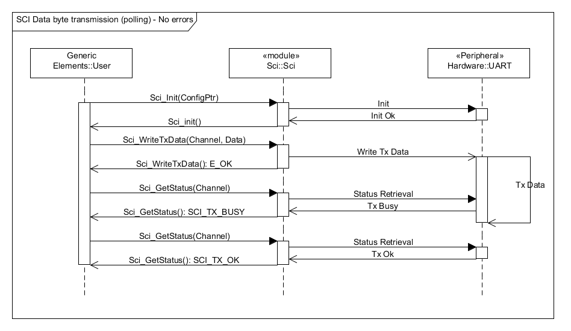](../files/File_Sci_WriteTxData_Seq_Dia.png--2410.md)

<a id="SCI_Data_byte_reception_.28polling.29"></a>

#### SCI Data byte reception (polling)

[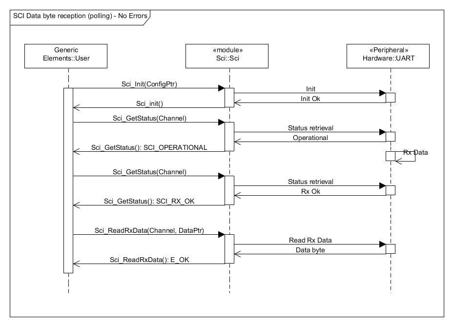](../files/File_Sci_ReadRxData_Seq_Dia.png--2411.md)

<a id="SCI_Data_byte_transmission_.28polling.29_-_Transmission_Error"></a>

#### SCI Data byte transmission (polling) - Transmission Error

[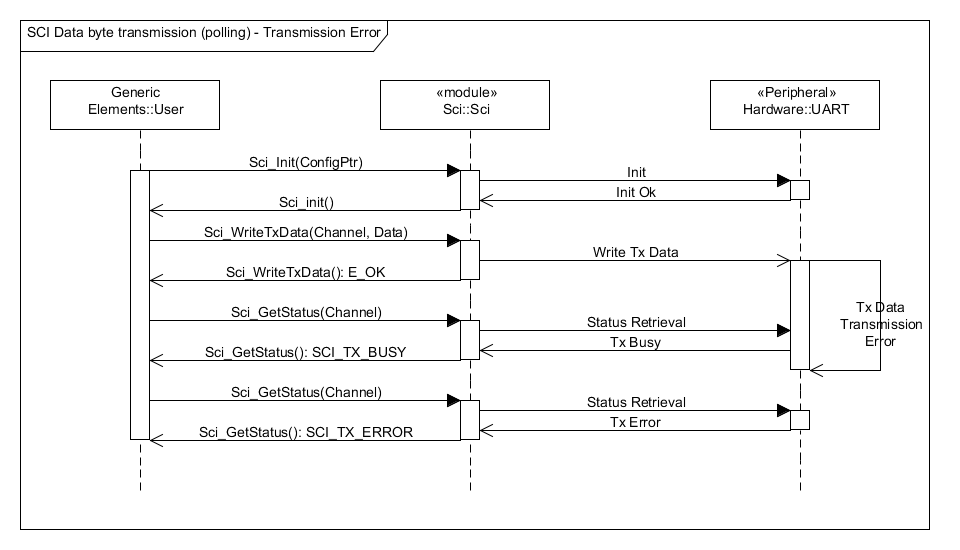](../files/File_Sci_WriteTxData_Err_Seq_Dia.png--2412.md)

<a id="SCI_Data_byte_reception_.28polling.29_-_Reception_Error"></a>

#### SCI Data byte reception (polling) - Reception Error

[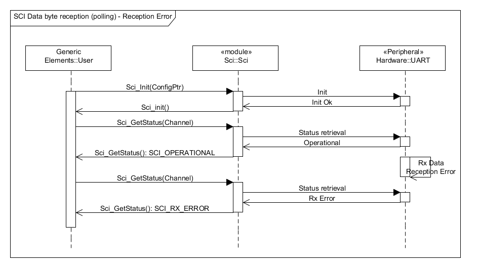](../files/File_Sci_ReadRxData_Err_Seq_Dia.png--2413.md)

<a id="SCI_Data_byte_transmission_.28interrupt.29"></a>

#### SCI Data byte transmission (interrupt)

[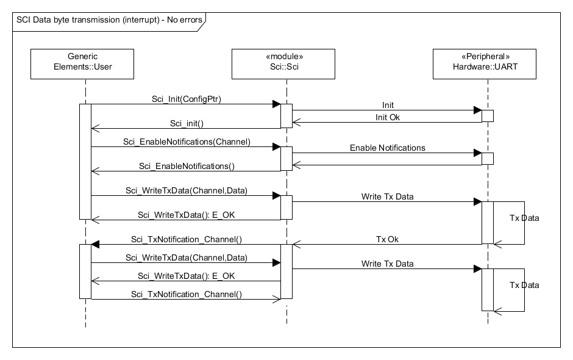](../files/File_Sci_WriteTxData_Int_Seq_Dia.png--2414.md)

<a id="SCI_Data_byte_reception_.28interrupt.29"></a>

#### SCI Data byte reception (interrupt)

[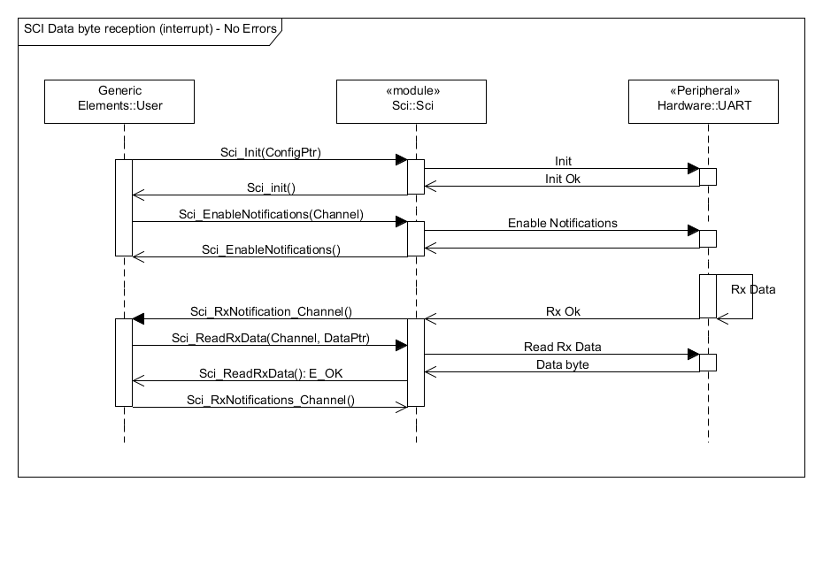](../files/File_Sci_ReadRxData_Int_Seq_Dia.png--2415.md)

<a id="SCI_Data_byte_transmission_.28interrupt.29_-_Transmission_Error"></a>

#### SCI Data byte transmission (interrupt) - Transmission Error

[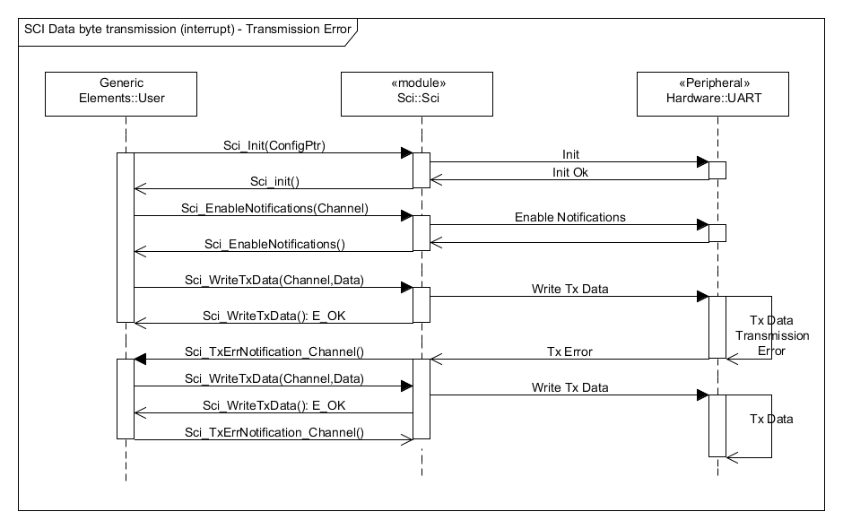](../files/File_Sci_WriteTxData_Int_Err_Seq_Dia.png--2416.md)

<a id="SCI_Data_byte_reception_.28interrupt.29_-_Reception_Error"></a>

#### SCI Data byte reception (interrupt) - Reception Error

[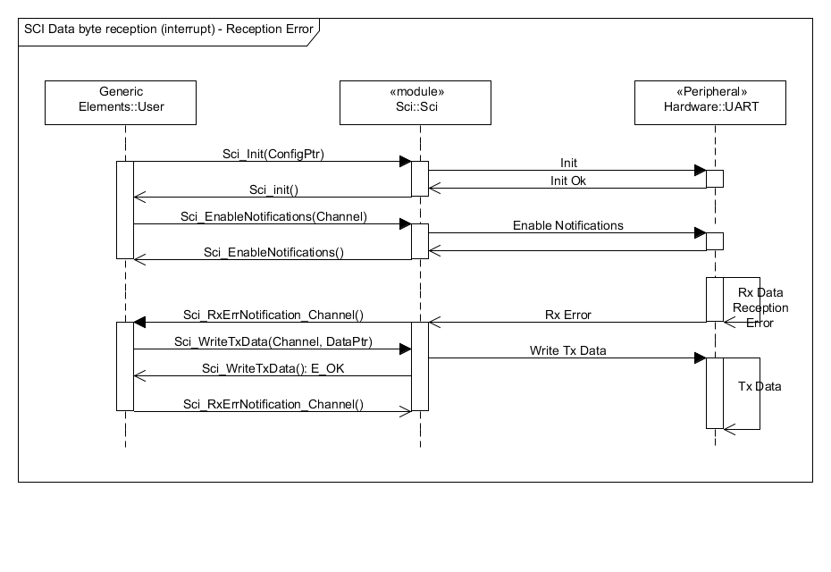](../files/File_Sci_ReadRxData_Int_Err_Seq_Dia.png--2417.md)

<a id="Build"></a>

### Build

To enable AUTOSAR SCI Driver for Texas Instruments Stellaris LM4F232xxxx with ARM KEIL uVision Compiler Toolchain, the following `EE_OPT` attribute is needed in the `OS` object of the OSEK/VDX configuration:

```
 EE_OPT = "__AS_SCI_DRIVER__";
```

The configuration C header file inclusion is done by `CFLAGS` attribute in the `OS` object of the OSEK/VDX configuration:

```
 CFLAGS = "-I<PATH>";
```

Where `<PATH>` is the absolute or relative directory path which configuration C header file is stored.

Instead the configurations C source file is added to the compilation process by `APP_SRC` attribute in the `CPU_DATA` object of the OSEK/VDX configuration:

```
 APP_SRC = "<PATH>/Sci_Cfg.c";
```

Where `<PATH>` is the absolute or relative directory path which configuration C source file is stored.

<a id="Supported_Architectures"></a>

### Supported Architectures

<a id="TI_Stellaris_LM4F232XXXX_with_ARM_KEIL_uVision_Compiler_Toolchain"></a>

#### TI Stellaris LM4F232XXXX with ARM KEIL uVision Compiler Toolchain

<a id="Driver_Configuration"></a>

##### Driver Configuration

In order to configure the AUTOSAR-like SCI Driver for Texas Instruments Stellaris LM4F232xxxx with ARM KEIL uVision Compiler Toolchain, you have to select the "Sci" tab-sheet on driver configuration instance file.

[File:Erika Driver Configurator SCI.png](http://erika.tuxfamily.org/wiki/index.php?title=Special:Upload&wpDestFile=Erika_Driver_Configurator_SCI.png "File:Erika Driver Configurator SCI.png")

<a id="Configuration_Selection"></a>

###### Configuration Selection

In this section you can add/edit/delete configurations in SCI Driver configuration set:

- Each configuration SHALL have an *Identifier* which must be unique inside the configurations set.
- Each configuration, inside the configurations set, has a set of Channels.
  - Each Channel SHALL have a *Name* which must be unique inside the Channels.

<a id="API_Selection"></a>

###### API Selection

In this section you can select SCI Driver APIs and features will be included in build process:

- *Version Info*: *Sci\_GetVersionInfo()* API

[File:Erika Driver Configurator SCI set.png](http://erika.tuxfamily.org/wiki/index.php?title=Special:Upload&wpDestFile=Erika_Driver_Configurator_SCI_set.png "File:Erika Driver Configurator SCI set.png")

<a id="Interrupts"></a>

##### Interrupts

To use the SCI driver in interrupt mode, an ISR object must be added to OSEK/VDX configuration for every SCI Channel:

```
 ISR Sci_Channel_<Channel Number>_ISR {
   CATEGORY = 2;
   ENTRY = "UART_<Channel Number>";
   PRIORITY = <ISR Priority>;
 };
```

Where `<Channel Number>` is the "channel number" as stated in the SCI Driver Channel Identifier of the channel and `<ISR Priority>` is a number indicating the level of priority (0: Lowest).

<a id="Implemetations_Demos"></a>

##### Implemetations Demos

Implementation Demos of the AUTOSAR-like SCI Driver can be found at [examples/cortex\_mx/lm4f232xxxx/as](http://svn.tuxfamily.org/viewvc.cgi/erika_erikae/repos/ee/trunk/ee/examples/cortex_mx/lm4f232xxxx/as)

---

## Archive provenance

- [Original page](http://erika.tuxfamily.org/wiki/index.php?title=AUTOSAR-like_SCI_Driver) · [Archived source revision 5272](http://erika.tuxfamily.org/wiki/index.php?oldid=5272)
- Last source edit: 2013-07-17T05:29:50Z. Source retrieved on 2026-11-06; Markdown conversion completed on 2026-11-07.
- Original contributors recorded in exported history: Giuseppe Serano.
- [Original MediaWiki source](../source/wikitext/2398.mediawiki) · [Original editing history](../source/history/batch-001.xml)
- [Attribution and licensing notice](../NOTICE.md). Original file-specific notices, where present, remain applicable.
