# AUTOSAR-like SPI Driver

<a id="Synopsis"></a>

### Synopsis

The SPI handler/driver provides the functionality and API for a monolithic SPI [Serial Peripheral Interface] handler/driver. This software module includes handling and driving functionalities. Main objectives of this monolithic SPI Handler/Driver are to take the best of each microcontroller features and to allow implementation optimization depending on static configuration to fit as much as possible to ECU needs.

Hence, this specification defines selectable levels of functionalities and configurable features to allow the design of a high scalable module that exploits the peculiarities of the microcontroller.

The SPI handler/driver is part of the microcontroller abstraction layer (MCAL). It provides services for reading from and writing to devices connected via SPI busses. It also provides the required mechanism to configure the onchip SPI peripheral.

The SPI has a 4-wire synchronous serial interface. SPI Communication is enabled with a chip select wire (CS). SPI Communication is performed with a 3-wire interface consisting of wires for serial data Master-Output-Slave-Input (MOSI), serial data Master-Input-Slave-Output (MISO) and serial clock (CLK).

SPI peripherals may depend on the system clock, prescaler(s) and PLL. Thus, changes of the system clock (e.g. PLL on -> PLL off) may also affect the clock settings of the SPI hardware.

The SPI Handler/Driver module does not take care of setting the registers which configure the clock, prescaler(s) and PLL in its init function. This has to be done by the MCU module.

Depending on microcontrollers, the SPI peripheral could share registers with other peripherals. In this typical case, the SPI Handler/Driver has a relationship with MCU module for initialising and de-initialising those registers.

The general behaviour of the SPI Handler/Driver can be asynchronous or synchronous according to the Level of Functionality selected.

<a id="Overall_view_of_functionalities_and_features"></a>

#### Overall view of functionalities and features

There are 3 Levels of Scalable Functionality for the SPI Handler/Driver:

- *LEVEL 0*, **Simple Synchronous SPI Handler/Driver**: the communication is based on synchronous handling with a FIFO policy to handle multiple accesses. Buffer usage is configurable to optimize and/or to take advantage of HW capabilities.
- *LEVEL 1*, **Basic Asynchronous SPI Handler/Driver**: the communication is based on asynchronous behavior and with a Priority policy to handle multiple accesses. Buffer usage is configurable as for “Simple Synchronous” level.
- *LEVEL 2*, **Enhanced (Synchronous/Asynchronous) SPI Handler/Driver**: the communication is based on asynchronous behavior or synchronous handling, using either interrupts or polling mechanism selectable during execution time and with a Priority policy to handle multiple accesses. Buffer usage is configurable as for other levels.

[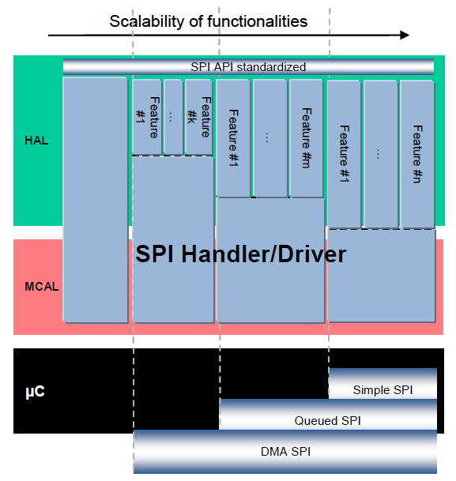](../files/File_SPI_Scalability.png--2437.md)

The SPI Handler/Driver’s level of scalable functionality shall always be statically configurable, i.e. configured at pre-compile time to allow the best source code optimisation.

To improve the scalability, each level has optional features which are configurable (ON/OFF) or selectable.

<a id="General_behaviour"></a>

#### General behaviour

This section, on the one hand, introduces common behaviour and configuration for all levels. On the other, it specifies the behaviour of each level and also the allowed optional features.

The SPI Handler/Driver interface configuration shall be based on Channels, Jobs and Sequences as defined in this document.

A Channel is a software exchange medium for data that are defined with the same criteria: Configuration Parameters, Number of Data elements with same size and data pointers (Source & Destination) or location.

A Job is composed of one or several Channels with the same Chip Select (is not released during the processing of Job). A Job is considered atomic and therefore cannot be interrupted by another Job. A Job has an assigned priority.

A Sequence is a number of consecutive Jobs but it can be rescheduled between Jobs using a priority mechanism. A Sequence communication is interruptible (by another Sequence communication) or not depending on a static configuration.

The SPI Handler/Driver shall support one or more Channels, Jobs and Sequences to drive all kind of SPI compatible HW devices.

SPI communication shall be done according to Channels, Jobs and Sequences configuration parameters.

The Chip Select (CS) is attached to the Job definition.

Chip Select shall be handled during Job and shall be released at the end of it. This Chip Select handling shall be done according to the Job configuration parameters.

It shall be possible to define if the Chip Select handling is managed autonomously by the HW peripheral, without explicit chip select control by the driver, or the SPI driver shall drive the chip select lines explicitly as DIO.

*Example of CS handling*: Set the CS active at the beginning of Job; maintain it until the end of all Channels belonging to this Job afterwards set the CS inactive.

If Chip Selects are done using microcontroller pins the SPI Handler/Driver has a relationship with PORT module. In this case, this specification assumes that these microcontroller pins are directly accessed by the SPI Handler/Driver module without using APIs of DIO module. Anyhow, the SPI depends on ECU hardware design and for that reason it may depend on other modules.

A Channel is defined one time but it could belong to several Jobs according to the user needs and this software specification.

A Job shall contain at least one Channel.

Each Channel shall have an associated index which is used for specifying the order of the Channel within the Job.

If a Job contains more than one Channel, all Channels contained have the same Job properties during communication and shall be linked together statically.

A Job is defined one time but it could belong to several Sequences according to the user needs and this software specification.

A Sequence shall contain at least one Job.

If it contains more than one, all Jobs contained have the same Sequence properties during communication and shall be linked together statically.

A Channel used for a communication should have its parameters configured but it is allowed to pass NULL pointers as source and destination pointers to generate a dummy communication.

Channel data may differ from the hardware handled and user (client application) given. On the client side the data is handled in 8, 16 or 32bits mode. On the microcontroller side, the hardware may handle between 1 and 32bits or may handle a fixed value (8 or 16bits) and this width is configurable for each Channel.

The SPI Handler/Driver shall take care of the differences between the width of channel data handled by the user and those handled by the hardware.

If width of channel data handled by the user 8/16/32 bits and handled by the hardware 8/16/32 bits means the SPI Handler/Driver can send and receive data without any bit changes straightforward.

If width of channel data handled by the hardware is superior to data width handled by the user, means that communication through the SPI Handler/Driver shall send the lower part, ignoring the upper part. Receive the lower part, extended with zero.

If width of channel data handled by the hardware inferior to data width handled by the user means the communication through the SPI Handler/Driver shall be according to the memory alignment separate the data as two part and send and receive one by one.

This ensures that the user always gets the same interface.

[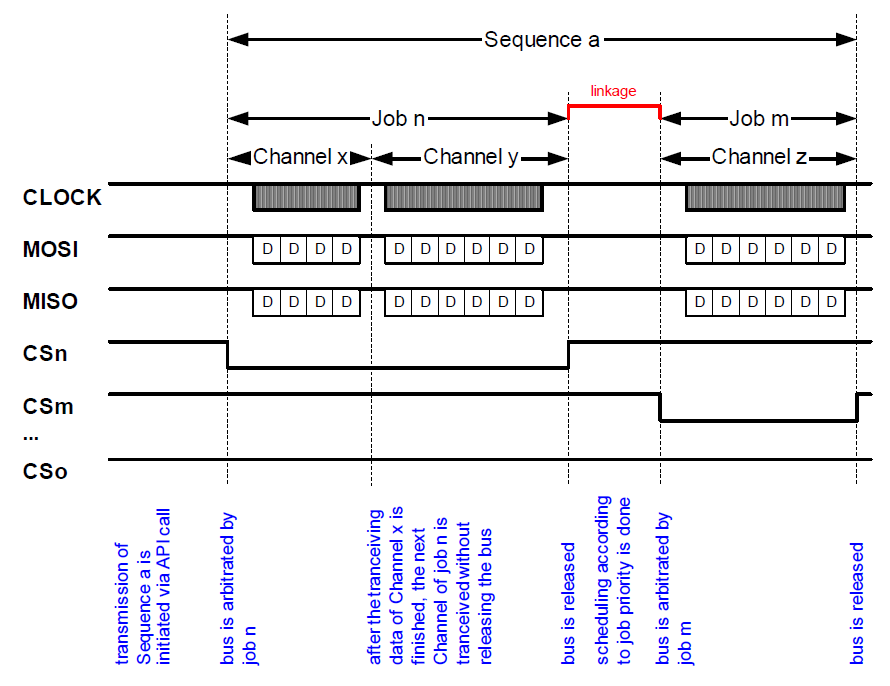](../files/File_SPI_Sequences_Jobs_Channels.png--2438.md)

<a id="Common_configurable_feature:_Allowed_Channel_Buffers"></a>

##### Common configurable feature: Allowed Channel Buffers

In order to allow taking advantages of all microcontroller capabilities but also to allow sending/receiving of data to/from a dedicated memory location, all levels have an optional feature with respect to the location of Channel Buffers.

Hence, two main kinds of channel buffering can be used by configuration:

- *Internally Buffered Channels* (**IB**): The buffer to transmit/receive data is provided by the Handler/Driver.
- *Externally Buffered Channels* (**EB**): The buffer to transmit/receive data is provided by the user (statically and/or dynamically).

Both channel buffering methods may be used depending on the 3 use cases described below:

- *Usage 0*: the SPI Handler/Driver manages only Internal Buffers.
- *Usage 1*: the SPI Handler/Driver manages only External Buffers.
- *Usage 2*: the SPI Handler/Driver manages both buffers types.

<a id="Behaviour_of_IB_channels"></a>

###### Behaviour of IB channels

The intention of Internal Buffer channels is to take advantage of microcontrollers including this feature by hardware. Otherwise, this feature should be simulated by software.

For the IB Channels, the Handler/Driver shall provide the buffering but it is not able to take care of the consistency of the data in the buffer during communication. The size of the Channel buffer is fixed.

The channel data received shall be stored in 1 entry deep internal buffers by channel.

The SPI Handler/Driver shall not take care of the overwriting of these “receive” buffers by another communication on the same channel.

The channel data to be transmitted shall be copied in 1 entry deep internal buffers by channel.

The SPI Handler/Driver is not able to prevent the overwriting of these “transmit” buffers by users during communications.

<a id="Behaviour_of_EB_channels"></a>

###### Behaviour of EB channels

The intention of External Buffer channels is to reuse existing buffers that are located outside. That means the SPI Handler/Driver does not monitor them.

For EB Channels the application shall provide the buffering and shall take care of the consistency of the data in the buffer during communication.

The size of the Channel buffer is either fixed or variable. A maximum size for the Channel buffer shall be defined by the configuration.

The buffer provided by the application for the SPI Handler Driver may have a different size.

<a id="Buffering_channel_usage"></a>

###### Buffering channel usage

The following table provides information about the Channel characteristics:

[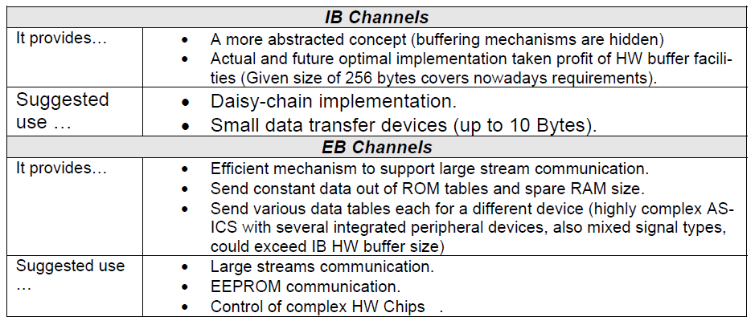](../files/File_SPI_Buffering_Channel_Usage_Table.png--2439.md)

<a id="LEVEL_0.2C_Simple_Synchronous_behaviour"></a>

##### LEVEL 0, Simple Synchronous behaviour

The intention of this functionality level is to provide a Handler/Driver with a reduced set of services to handle only simple synchronous communications. This is often the case for ECU including simple SPI networks but also for ECU using high speed external devices.

A simple synchronous communication means that the user calling the transfer service is blocked during the ongoing communication.

The LEVEL 0 SPI Handler/Driver shall offer a synchronous transfer service for SPI busses.

For an SPI Handler/Driver operating in LEVEL 0, when there is no ongoing Sequence, the SPI Handler/Driver shall be in the idle state (*SPI\_IDLE*).

This monolithic SPI Handler/Driver is able to handle one to n SPI buses according to the microcontroller used.

Then SPI buses are assigned to Jobs and not to Sequences. Consequently, Jobs, on different SPI buses, could belong to the same Sequence. Therefore:

The LEVEL 0 SPI Handler/Driver shall not allow more than one Sequence at the same time. That means during an ongoing Sequence, all requests to transfer another Sequence shall be rejected.

The LEVEL 0 SPI Handler/Driver behaviour shall include the common feature: Allowed Channel Buffers, which is selected.

If different Jobs (and consequently also Sequences) have common Channels, the SPI Handler/Driver’ environment shall ensure that read and/or write functions are not called during an SPI communication.

Read and write functions can not guarantee the data integrity while Channel is communicating.

<a id="LEVEL_1.2C_Basic_Asynchronous_behavior"></a>

##### LEVEL 1, Basic Asynchronous behavior

The intention of this functionality level is to provide a Handler/Driver with a reduced set of services to handle asynchronous communications only. This is often the case for ECU with functions related to SPI networks having different priorities but also for ECU using low speed external devices.

An asynchronous communication means that the user calling the transef service is not blocked when the communication is ongoing. Furthermore, the user can be notified at the end of communication.

The LEVEL 1 SPI Handler/Driver shall offer an asynchronous transef service for SPI buses.

For an SPI Handler/Driver operating in LEVEL 1, when there is no ongoing Sequence, the SPI Handler/Driver shall be in the idle state (*SPI\_IDLE*).

This Handler/Driver will be used by several software modules which may be independent from each other and also may belong to different layers. Therefore, priorities will be assigned to Jobs in order to figure out specific cases of multiple accesses. These cases usually occur within real time systems based on asynchronous mechanisms.

Jobs have priorities assigned. Jobs linked in a Sequence shall have decreasing priorities. That means the first Job shall have the highest priority of all Jobs within the Sequence.

Priority order of jobs shall be from the lower to the higher value defined, higher value higher priority (from 0, the lower to 3, the higher, limited to 4 priority levels).

With reference to Jobs priorities, this Handler/Driver needs rules to make a decision in these specific cases of multiple accesses.

The SPI Handler/Driver scheduling method shall schedule Jobs in order to send the highest priority Job first.

This monolithic SPI Handler/Driver is able to handle 1 to N SPI busses according to the microcontroller used. But SPI busses are assigned to Jobs and not to Sequences.

Consequently, Jobs on different SPI buses could belong to the same Sequence. Therefore:

The LEVEL 1 SPI Handler/Driver may allow more than one Sequence at the same time. That means during a Sequence, all requests to transfer another Sequence shall be evaluated in order to accept to start a new sequence or to reject it accordingly to the lead Job.

The LEVEL 1 SPI Handler/Driver behaviour shall include the common feature: Allowed Channel Buffers, which is selected, and the configured asynchronous feature: Interruptible Sequences (see below).

When a hardware error is detected, the SPI Handler/Driver shall stop the current Sequence and set the state of the Job to *SPI\_JOB\_FAILED* and the state of the Sequence to *SPI\_SEQ\_FAILED*.

If Jobs are configured with a specific end notification function, the SPI Handler/Driver shall call this notification function at the end of the Job.

If Sequences are configured with a specific end notification function, the SPI Handler/Driver shall call this notification function at the end of the Sequence.

When a valid notification function pointer is configured, the SPI Handler/Driver shall call this notification function at the end of a Job regardless of the result of the Job being either SPI\_JOB\_FAILED or SPI\_JOB\_OK (rational: avoid deadlocks or endless loops).

When a valid notification function pointer is configured, the SPI Handler/Driver shall call this notification function at the end of a Sequence regardless of the result of the Sequence being either *SPI\_SEQ\_FAILED*, *SPI\_SEQ\_OK* or *SPI\_SEQ\_CANCELLED* (rational: avoid deadlocks or endless loops).

<a id="Asynchronous_configurable_feature:_Interruptible_Sequences"></a>

##### Asynchronous configurable feature: Interruptible Sequences

In order to allow taking advantages of asynchronous communication mechanism, LEVEL 1 and LEVEL 2 of this SPI Handler/Driver have an optional feature with respect to suspending the Sequences.

Hence two main kinds of sequences can be used by configuration:

- Non-Interruptible Sequences, every Sequence started is not suspended by the Handler/Driver until the end of communication.
- Mixed Sequences, according to its configuration, a Sequence started may be suspended by the Handler/Driver between two of their consecutives Jobs.

<a id="Behavior_of_Non-Interruptible_Sequences"></a>

###### Behavior of Non-Interruptible Sequences

The intention of the Non-Interruptible Sequences feature is to provide a simple software module based on a basic asynchronous mechanism, if only non blocking communications should be used.

Interruptible Sequences are not allowed within LEVEL 1 and LEVEL2 of the SPI Handler/Driver when the configuration parameter is switched off (i.e. configured with value “OFF”).

When the SPI Handler/Driver is configured not allowing interruptible Sequences, all Sequences declared are considered as Non-Interruptible Sequences.

When the SPI Handler/Driver is configured not allowing interruptible Sequences their dedicated configuration parameter can be omitted or the FALSE value should be used as default.

The SPI Handler/Driver is not allowed to suspend a Sequence already started in favour of another Sequence.

<a id="Behavior_of_Mixed_Sequences"></a>

###### Behavior of Mixed Sequences

The intention of the Mixed Sequences feature is to provide a software module with specific asynchronous mechanisms, if, for instance, very long Sequences that could or should be suspended by others with higher priority are used.

Interruptible Sequences are allowed within LEVEL 1 and LEVEL 2 of SPI Handler/Driver when the configuration parameter is switched on (i.e. configured with value “ON”).

When the SPI Handler/Driver is configured allowing interruptible Sequences, all Sequences declared shall have their dedicated configuration parameter to identify whether the Sequence can be suspended during communication.

In case of a Sequence configured as Interruptible Sequence, the SPI Handler/Driver is allowed to suspend an already started Sequence in favour of another Sequence with a higher priority Job. That means, at the end of a Job transmission (that belongs to the interruptible sequence) with another Sequence request pending, the SPI Handler/Driver shall perform a rescheduling in order to elect the next Job to transmit.

In case of a Sequence configured as Non-Interruptible Sequence and according to requirement, the SPI Handler/Driver is not allowed to suspend this already started Sequence in favour of another Sequence.

When using Interruptible Sequences, the caller must be aware that if the multiple Sequences access the same Channels, the data for these Channels may be overwritten by the highest priority Job accessing each Channel.

<a id="LEVEL_2.2C_Enhanced_behaviour"></a>

##### LEVEL 2, Enhanced behaviour

The intention of this functionality level is to provide a Handler/Driver with a complete set of services to handle synchronous and asynchronous communications. This could be the case for ECU with a lot of functions related to SPI networks having different priorities but also for ECU using external devices with different speeds.

Handling asynchronous and synchronous communications means that the microcontroller for which this software module is dedicated has to provide more than one SPI bus In fact, the goal is to support SPI buses using a so-called synchronous driver and to support other SPI buses using a so-called asynchronous driver.

The LEVEL 2 SPI Handler/Driver shall offer a synchronous transfer service for a dedicated SPI bus and it shall also offer an asynchronous transfer service for other SPI buses.

In LEVEL 2 if there is no ongoing Sequence, the SPI Handler/Driver shall be in idle state (*SPI\_IDLE*).

The SPI bus dedicated for synchronous transfers is prearranged. This information shall be published by the supplier of this software module.

This functionality level, based on a mixed usage of synchronous communication on one prearranged SPI bus and asynchronous communication on others, generates restrictions on configuration and usage of Sequences and Jobs.

The so-called synchronous Sequences shall only be composed of Jobs that are associated to the prearranged SPI bus. These Sequences shall be used with synchronous services only.

Jobs associated with the prearranged SPI bus shall not belong to Sequences containing Jobs associated with another SPI bus. In other words, mixed Sequences (synchronous with asynchronous Jobs) shall not be allowed.

Usually, depending on software design, asynchronous end of communication may be detected by polling or interrupt mechanisms. This level of functionality proposes both mechanisms that are selectable during execution time.

The SPI Handler/Driver LEVEL 2 shall implement one polling mechanism mode and one interrupt mechanism mode for SPI busses handled asynchronously.

Both the polling mechanism and interrupt mechanism modes for SPI busses shall be selectable during execution time.

The requirements for LEVEL 0 apply to synchronous behaviour.

The requirements for LEVEL 1 apply to asynchronous behaviour.

<a id="Scheduling_Advices"></a>

#### Scheduling Advices

For asynchronous levels, LEVEL 1 and LEVEL 2, the SPI Handler/Driver can call end notification functions at the end of a Job and/or Sequence. In a second time, in case of interruptible Sequences (that could be suspended), if another Sequence request is pending, a rescheduling is also done by the SPI Handler/Driver in order to elect the next Job.

For asynchronous levels, LEVEL 1 and LEVEL 2, the SPI Handler/Driver can call end notification functions at the end of a Job.

For asynchronous levels, LEVEL 1 and LEVEL 2, the SPI Handler/Driver can call end notification functions at the end of a Sequence.

For asynchronous levels, LEVEL 1 and LEVEL 2 in case of interruptible Sequences, if another Sequence request is pending, a rescheduling is also done by the SPI Handler/Driver in order to elect the next Job.

In case call end notification function and rescheduling are fully done by software, the order between these shall be first scheduling and then the call of end notification function executed.

In case call end notification function and rescheduling are fully done by hardware, the order could not be configured as required; the order shall be completely documented.

<a id="File_Structure"></a>

### File Structure

[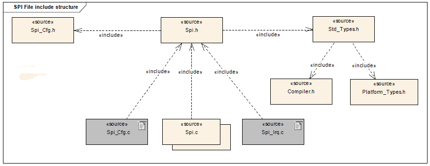](../files/File_SPI_File_Structure.png--2440.md)

<a id="API_Specification"></a>

### API Specification

<a id="Imported_Types"></a>

#### Imported Types

<a id="typedef_uint8_Std_ReturnType"></a>

##### *typedef uint8 Std\_ReturnType*

```
 #include "Std_Types.h"
```

Standard Return Type.

This type can be used as standard API return type which is shared between AUTOSAR-like modules.

The *Std\_ReturnType* shall normally be used with value *E\_OK* or *E\_NOT\_OK*.
If those return values are not sufficient user specific values can be defined by using the 6 least specific bits.

<a id="struct_Std_VersionInfoType"></a>

##### *struct Std\_VersionInfoType*

```
 #include "Std_Types.h"
```

Standard Version Informations Type.

This type shall be used to request the version of a AUTOSAR-like module using the *<Module Name>\_GetVersionInfo()* function.

**Field Documentation:**

```
 uint16 Std_VersionInfoType::moduleID
```

Module Identifier.

```
 uint8 Std_VersionInfoType::sw_major_version
```

Software Version Major Number.

```
 uint8 Std_VersionInfoType::sw_minor_version
```

Software Version Minor Number.

```
 uint8 Std_VersionInfoType::sw_patch_version
```

Software Version Patch Number.

```
 uint16 Std_VersionInfoType::vendorID
```

Vendor Identifier.

<a id="Types_Defintions"></a>

#### Types Defintions

<a id="struct_Spi_ConfigType"></a>

##### *struct Spi\_ConfigType*

```
 #include "Spi.h"
```

SPI Handler/Driver Configuration Parameters.

The description of the type *Spi\_ConfigType* is implementation specific and it shall be provided for external use.

The type *Spi\_ConfigType* is an external data structure and shall contain the initialization data for the SPI Handler/Driver. It shall contain:

- MCU dependent properties for SPI HW units
- Definition of Channels
- Definition of Jobs
- Definition of Sequences

For the type *Spi\_ConfigType*, the definition for each Channel shall contain:

- Buffer usage with EB/IB Channel
- Transmit data width (1 up to 32 bits)
- Number of data buffers for IB Channels (at least 1) or it is the maximum of data for EB Channels (a value of 0 makes no sense)
- Transfer start LSB or MSB
- Default transmit value

For the type *Spi\_ConfigType*, the definition for each Job shall contain:

- Assigned SPI HW Unit
- Assigned Chip Select pin (it is possible to assign no pin)
- Chip select functionality on/off
- Chip select pin polarity high or low
- Baud rate
- Timing between clock and chip select
- Shift clock idle low or idle high
- Data shift with leading or trailing edge
- Priority (4 levels are available from 0, the lower to 3, the higher)
- Job finish end notification function
- MCU dependent properties for the Job (only if needed)
- Fixed link of Channels (at least one)

For the type *Spi\_ConfigType*, the definition for each Sequence shall contain:

- Collection of Jobs (at least one)
- Interruptible or not interruptible after each Job
- Sequence finish end notification function

For the type *Spi\_ConfigType*, the configuration will map the Jobs to the different SPI hardware units and the devices.

<a id="enum_Spi_StatusType"></a>

##### *enum Spi\_StatusType*

```
 #include "Spi.h"
```

SPI Handler/Driver Status Type.

The type *Spi\_StatusType* defines a range of specific status for SPI Handler/Driver. It informs about the SPI Handler/Driver status or specified SPI Hardware microcontroller peripheral.

The type *Spi\_StatusType* can be obtained calling the API service *Spi\_GetStatus()*.

The type *Spi\_StatusType* can be obtained calling the API service *Spi\_GetHWUnitStatus()*.

After reset, the type *Spi\_StatusType* shall have the default value *SPI\_UNINIT* with the numeric value *0*.

API service *Spi\_GetStatus()* shall return *SPI\_UNINIT* when the SPI Handler/Driver is not initialized or not usable.

API service *Spi\_GetStatus()* shall return *SPI\_IDLE* when The SPI Handler/Driver is not currently transmitting any Job.

API service *Spi\_GetStatus()* shall return *SPI\_BUSY* when The SPI Handler/Driver is performing a SPI Job transmit.

*Spi\_GetHWUnitStatus()* function shall return *SPI\_IDLE* when The SPI Hardware microcontroller peripheral is not currently transmitting any Job.

*Spi\_GetHWUnitStatus()* function shall return *SPI\_BUSY* when The SPI Hardware microcontroller peripheral is performing a SPI Job transmit.

**Enumerator**:

- *SPI\_UNINIT*: The SPI Handler/Driver is not initialized or not usable.
- *SPI\_IDLE*: The SPI Handler/Driver is not currently transmitting any Job.
- *SPI\_BUSY*: The SPI Handler/Driver is performing a SPI Job (transmit).

<a id="enum_Spi_JobResultType"></a>

##### *enum Spi\_JobResultType*

```
 #include "Spi.h"
```

SPI Handler/Driver Job Result Type.

The type *Spi\_JobResultType* defines a range of specific Jobs status for SPI Handler/Driver.

The type *Spi\_JobResultType* it informs about a SPI Handler/Driver Job status and can be obtained calling the API service *Spi\_GetJobResult()* with the Job ID.

After reset, the type *Spi\_JobResultType* shall have the default value *SPI\_JOB\_OK* with the numeric value *0*.

The function *Spi\_GetJobResult()* shall return *SPI\_JOB\_OK* when the last transmission of the Job has been finished successfully.

**Enumerator**:

- *SPI\_JOB\_OK*: The last transmission of the Job has been finished successfully.
- *SPI\_JOB\_PENDING*: The SPI Handler/Driver is performing a SPI Job. The meaning of this status is equal to *SPI\_BUSY*.
- *SPI\_JOB\_FAILED*: The last transmission of the Job has failed.

<a id="enum_Spi_SeqResultType"></a>

##### *enum Spi\_SeqResultType*

```
 #include "Spi.h"
```

SPI Handler/Driver Sequence Result Type.

The type *Spi\_SeqResultType* defines a range of specific Sequences status for SPI Handler/Driver and can be obtained calling the API service *Spi\_GetSequenceResult()*, it shall be provided for external use.

The type *Spi\_SeqResultType* defines the range of specific Sequences status for SPI Handler/Driver.

The type *Spi\_SeqResultType* defines about SPI Handler/Driver Sequence status and can be obtained calling the API service *Spi\_GetSequenceResult()* with the Sequence ID.

After reset, the type *Spi\_SeqResultType* shall have the default value SPI\_SEQ\_OK with the numeric value *0*.

*Spi\_GetSequenceResult()* function shall return *SPI\_SEQ\_OK* when the last transmission of the Sequence has been finished successfully.

*Spi\_GetSequenceResult()* function shall return *SPI\_SEQ\_PENDING* when the SPI Handler/Driver is performing a SPI Sequence. The meaning of this status is equal to *SPI\_BUSY*.

*Spi\_GetSequenceResult()* function shall return *SPI\_SEQ\_FAILED* when the last transmission of the Sequence has failed.

**Enumerator**:

- *SPI\_SEQ\_OK*: The last transmission of the Sequence has been finished successfully.
- *SPI\_SEQ\_PENDING*: The SPI Handler/Driver is performing a SPI Sequence. The meaning of this status is equal to *SPI\_BUSY*.
- *SPI\_SEQ\_FAILED*: The last transmission of the Sequence has failed.
- *SPI\_SEQ\_CANCELED*: The last transmission of the Sequence has been canceled by user.

<a id="typedef_uint_Spi_DataType"></a>

##### *typedef uint Spi\_DataType*

```
 #include "Spi.h"
```

SPI Handler/Driver Data Type.

*Spi\_DataType* defines the type of application data buffer elements.

Type is *uint8*, *uint16*, *uint32* and Range is 8 to 32 bit. it shall be provided for external use.

This is implementation specific but not all values may be valid within the type.

This type shall be chosen in order to have the most efficient implementation on a specific microcontroller platform.

The type *Spi\_DataType* refers to application data buffer elements.

<a id="typedef_uint16_Spi_NumberOfDataType"></a>

##### *typedef uint16 Spi\_NumberOfDataType*

```
 #include "Spi.h"
```

SPI Handler/Driver Number of Data Type.

The type *Spi\_NumberOfDataType* is used for defining the number of data elements of the type Spi\_DataType to send and/or receive by Channel.

<a id="typedef_uint8_Spi_ChannelType"></a>

##### *typedef uint8 Spi\_ChannelType*

```
 #include "Spi.h"
```

SPI Handler/Driver Channel Type.

The type *Spi\_ChannelType* specifies the identification (ID) for a Channel.

<a id="typedef_uint16_Spi_JobType"></a>

##### *typedef uint16 Spi\_JobType*

```
 #include "Spi.h"
```

SPI Handler/Driver Job Type.

The type *Spi\_JobType* specifies the identification (ID) for a Job.

<a id="typedef_uint8_Spi_SequenceType"></a>

##### *typedef uint8 Spi\_SequenceType*

```
 #include "Spi.h"
```

SPI Handler/Driver Sequence Type.

The type *Spi\_SequenceType* specifies the identification (ID) for a Sequence.

<a id="typedef_uint8_Spi_HWUnitType"></a>

##### *typedef uint8 Spi\_HWUnitType*

```
 #include "Spi.h"
```

SPI Handler/Driver Hardware Unit Type.

The type *Spi\_HWUnitType* specifies the identification (ID) for a SPI Hardware microcontroller peripheral (unit).

<a id="enum_Spi_AsyncModeType"></a>

##### *enum Spi\_AsyncModeType*

```
 #include "Spi.h"
```

SPI Handler/Driver Asynchronous Mode Type.

The type *Spi\_AsyncModeType* specifies the asynchronous mechanism mode for SPI buses handled asynchronously in LEVEL 2 and obtained by the API *Spi\_SetAsyncMode()*.

The type *Spi\_AsyncModeType* is used for specifying the asynchronous mechanism mode for SPI busses handled asynchronously in LEVEL 2.

The type *Spi\_AsyncModeType* is made available on the pre-compile time and is only relevant for LEVEL 2.

If API *Spi\_SetAsyncMode()* function is called by the parameter value *SPI\_POLLING\_MODE* then asynchronous mechanism is ensured by polling. So interrupts related to SPI buses handled asynchronously are disabled.

If API *Spi\_SetAsyncMode()* function is called by the parameter value *SPI\_INTERRUPT\_MODE* asynchronous mechanism is ensured by interrupt, so interrupts related to SPI buses handled asynchronously are enabled.

**Enumerator**:

- *SPI\_POLLING\_MODE*: The asynchronous mechanism is ensured by polling, so interrupts related to SPI busses handled asynchronously are disabled.
- *SPI\_INTERRUPT\_MODE*: The asynchronous mechanism is ensured by interrupt, so interrupts related to SPI busses handled asynchronously are enabled.

<a id="typedef_void_.28.2ASpi_JobEndNotification.29.28void.29"></a>

##### *typedef void (\*Spi\_JobEndNotification)(void)*

```
 #include "Spi.h"
```

The operation *Spi\_JobEndNotification()* is Re-entrant.

The callback notifications *Spi\_JobEndNotification()* shall have no parameters and no return value.

The SPI Handler/Driver shall use the callback routines *Spi\_JobEndNotification()* to inform other software modules about certain states or state changes.

For implement the call back function other modules are required to provide the routines in the expected manner as function pointers defined within the initialization data structure.

If the *Spi\_JobEndNotification()* is configured (i.e. not a null pointer), the SPI Handler/Driver shall call the configured callback notification at the end of a Job transmission.

**Note**: This routine might be called on interrupt level, depending on the calling function.

If a callback notification is configured as null pointer, no callback shall be executed.

It is allowed to use the following API calls within the SPI callback notifications:

- *Spi\_ReadIB()*
- *Spi\_WriteIB()*
- *Spi\_SetupEB()*
- *Spi\_GetJobResult()*
- *Spi\_GetSequenceResult()*
- *Spi\_GetHWUnitStatus()*
- *Spi\_Cancel()*

All other SPI Handler/Driver API calls are not allowed.

<a id="typedef_void_.28.2ASpi_SeqEndNotification.29.28void.29"></a>

##### *typedef void (\*Spi\_SeqEndNotification)(void)*

```
 #include "Spi.h"
```

The operation *Spi\_SeqEndNotification()* is Re-entrant.

The callback notifications *Spi\_SeqEndNotification()* shall have no parameters and no return value.

The SPI Handler/Driver shall use the callback routines *Spi\_SeqEndNotification()* to inform other software modules about certain states or state changes.

For implement the call back function other modules are required to provide the routines in the expected manner as function pointers defined within the initialization data structure.

If the *Spi\_SeqEndNotification()* is configured (i.e. not a null pointer), the SPI Handler/Driver shall call the configured callback notification at the end of a Sequence transmission.

**Note**: This routine might be called on interrupt level, depending on the calling function.

If a callback notification is configured as null pointer, no callback shall be executed.

It is allowed to use the following API calls within the SPI callback notifications:

- *Spi\_ReadIB()*
- *Spi\_WriteIB()*
- *Spi\_SetupEB()*
- *Spi\_GetJobResult()*
- *Spi\_GetSequenceResult()*
- *Spi\_GetHWUnitStatus()*
- *Spi\_Cancel()*

All other SPI Handler/Driver API calls are not allowed.

<a id="Functions_Definitions"></a>

#### Functions Definitions

<a id="void_Spi_Init.28const_Spi_ConfigType_.2A_ConfigPtr.29"></a>

##### *void Spi\_Init(const Spi\_ConfigType \* ConfigPtr)*

```
 #include "Spi.h"
```

SPI Handler/Driver Initialization.

**Parameters**:

- *ConfigPtr*: Pointer to configuration set.

**Returns**:

- *None*.

This service initializes the SPI handler/driver.

Service 0x00

The operation *Spi\_Init()* is Non Re-entrant.

The function *Spi\_Init()* provides the service for SPI initialization.

The function *Spi\_Init()* shall initialize all SPI relevant registers with the values of the structure referenced by the parameter ConfigPtr.

The function *Spi\_Init()* shall define default values for required parameters of the structure referenced by the ConfigPtr. For example: all buffer pointers shall be initialized as a *NULL\_PTR* value pointer.

After the module initialization using the function *Spi\_Init()*, the SPI Handler/Driver shall set its state to *SPI\_IDLE*, the Sequences result to *SPI\_SEQ\_OK* and the jobs result to *SPI\_JOB\_OK*.

For LEVEL 2, the function *Spi\_Init()* shall set the SPI Handler/Driver asynchronous mechanism mode to *SPI\_POLLING\_MODE* by default. Interrupts related to SPI busses shall be disabled.

A re-initialization of a SPI Handler/Driver by executing the *Spi\_Init()* function requires a de-initialization before by executing a *Spi\_DeInit()*.

The calling of the routine *SPI\_Init()* while the SPI Handler/Driver is already initialized will cause the desired functionality shall be left without any action.

<a id="Std_ReturnType_Spi_DeInit.28void.29"></a>

##### *Std\_ReturnType Spi\_DeInit(void)*

```
 #include "Spi.h"
```

SPI Handler/Driver De-Initialization.

**Parameters**:

- *None*.

**Returns**:

- *E\_OK*: De-initialisation command has been accepted
- *E\_NOT\_OK*: De-initialisation command has not been accepted

This service de-initializes the SPI handler/driver.

Service 0x01

The operation Std\_ReturnType *Spi\_DeInit()* is Non Re-entrant.

When the API *Spi\_DeInit()* has been accepted the return value of this function shall be *E\_OK*.

When the API *Spi\_DeInit()* has not been accepted the return value of this function shall be *E\_NOT\_OK*.

The function *Spi\_DeInit()* provides the service for SPI de-initialization.

The function *Spi\_DeInit()* shall de-initialize SPI Handler/Driver.

In case of the SPI Handler/Driver state is not *SPI\_BUSY*, the deInitialization function shall put all already initialized microcontroller SPI peripherals into the same state such as Power On Reset.

The function call *Spi\_DeInit()* shall be rejected if the status of SPI Handler/Driver is *SPI\_BUSY*.

After the module de-initialization using the function *Spi\_DeInit()*, the SPI Handler/Driver shall set its state to *SPI\_UNINIT*.

The SPI Handler/Driver shall have been initialized before the function *Spi\_DeInit()* is called, otherwise *E\_NOT\_OK* shall be returned.

<a id="Std_ReturnType_Spi_WriteIB.28Spi_ChannelType.09Channel.2C_const_Spi_DataType_.2A_DataBufferPtr.29"></a>

##### *Std\_ReturnType Spi\_WriteIB(Spi\_ChannelType Channel, const Spi\_DataType \* DataBufferPtr)*

```
 #include "Spi.h"
```

Internal Buffer Writing.

**Parameters**:

- *Channel*: Channel ID.
- *DataBufferPtr*: Pointer to source data buffer.

**Returns**:

- *E\_OK*: Write command has been accepted
- *E\_NOT\_OK*: Write command has not been accepted

Service for writing one or more data to an IB SPI Handler/Driver Channel specified by parameter.

Service 0x02

The operation *Spi\_WriteIB()* is Re-entrant.

When the API *Spi\_WriteIB()* command has been accepted the function returns the value *E\_OK*.

When the API *Spi\_WriteIB()* command has not been accepted the function returns the value *E\_NOT\_OK*.

The function *Spi\_WriteIB()* provides the service for writing one or more data to an IB SPI Handler/Driver Channel by the respective parameter.

The function *Spi\_WriteIB()* shall write one or more data to an IB SPI Handler/Driver Channel specified by the respective parameter.

The function *Spi\_WriteIB()* shall take over the given parameters, and save the pointed data to the internal buffer defined with the function *Spi\_Init()*.

If the given parameter *DataBufferPtr* is *NULL\_PTR*, the function *Spi\_WriteIB()* shall assume that the data to be transmitted is not relevant and the default transmit value of the given channel shall be used instead.

The function *Spi\_WriteIB()* shall be pre-compile time configurable.

This function is only relevant for Channels with IB.

The API *Spi\_WriteIB()* parameter Channel shall have a value within the defined channels in the initialization data structure, and the correct type of channel (IB or EB) has to be used with services. Otherwise, the service is not done and the return value shall be *E\_NOT\_OK*.

The Length of data pointed by DataBufferPtr parameter shall have a value within the specified buffer maximum value. Otherwise, the service is not done and the return value shall be *E\_NOT\_OK*.

The SPI Handler/Driver shall have been initialized before the function *Spi\_WriteIB()* is called, otherwise *E\_NOT\_OK* shall be returned.

<a id="Std_ReturnType_Spi_AsyncTransmit.28Spi_SequenceType_Sequence.29"></a>

##### *Std\_ReturnType Spi\_AsyncTransmit(Spi\_SequenceType Sequence)*

```
 #include "Spi.h"
```

Asynchronous Transmission.

**Parameters**:

- *Sequence*: Sequence ID

**Returns**:

- *E\_OK*: Transmission command has been accepted
- *E\_NOT\_OK*: Transmission command has not been accepted

Service to transmit data on the SPI bus.

Service 0x03

The operation *Spi\_AsyncTransmit()* is Re-entrant.

When the API *Spi\_AsyncTransmit()* command has been accepted the function shall return the value *E\_OK*.

When the API *Spi\_AsyncTransmit()* command has not been accepted the function shall return the value *E\_NOT\_OK*.

The function *Spi\_AsyncTransmit()* provides service to transmit data on the SPI bus.

The function *Spi\_AsyncTransmit()' shall take over the given parameter, initiate a transmission, set the SPI Handler/Driver status to* SPI\_BUSY*, set the sequence result to* SPI\_SEQ\_PENDING *and return.*

When the function *Spi\_AsyncTransmit()* is called, the SPI Handler/Driver shall handle the Job results. Result shall be *SPI\_JOB\_PENDING* when the transmission of Jobs is started.

When the function *Spi\_AsyncTransmit()* is called, the SPI Handler/Driver shall handle the Job results. Result shall be *SPI\_JOB\_OK* when the transmission of Jobs is success.

When the function *Spi\_AsyncTransmit()* is called, the SPI Handler/Driver shall handle the Job results. Result shall be *SPI\_JOB\_FAILED* when the transmission of Jobs is failed.

When the function *Spi\_AsyncTransmit()* is called and the requested Sequence is already in state *SPI\_SEQ\_PENDING*, the SPI Handler/Driver shall not take in account this new request and this function shall return with value *E\_NOT\_OK*, in this case.

When the function *Spi\_AsyncTransmit()* is called and the requested Sequence shares Jobs with another sequence that is in the state *SPI\_SEQ\_PENDING*, the SPI Handler/Driver shall not take into account this new request and this function shall return the value *E\_NOT\_OK*.

When the function *Spi\_AsyncTransmit()* is used with EB and the source data pointer has been provided as *NULL\_PTR* using the *Spi\_SetupEB()* method, the default transmit data configured for each channel will be transmitted.

When the function *Spi\_AsyncTransmit()* is used with EB and the destination data pointer has been provided as *NULL\_PTR* using the *Spi\_SetupEB()* method, the SPI Handler/Driver shall ignore receiving data.

When the function *Spi\_AsyncTransmit()* is used for a Sequence with linked Jobs, the function shall transmit from the first Job up to the last Job in the sequence.

At the end of a sequence transmission initiated by the function *Spi\_AsyncTransmit()* and if configured, the SPI Handler/Driver shall invoke the sequence notification call-back function after the last Job end notification if this one is also configured.

The function *Spi\_AsyncTransmit()* is pre-compile time selectable and is only relevant for LEVEL 1 and LEVEL 2.

The SPI Handler/Driver’s environment shall call the function *Spi\_AsyncTransmit()* after a function call of *Spi\_SetupEB()* for EB Channels or a function call of *Spi\_WriteIB()* for IB Channels but before the function call *Spi\_ReadIB()*.

The API parameters Sequence shall have values within the specified range of values otherwise the return value shall be *E\_NOT\_OK*.

The SPI Handler/Driver shall have been initialized before the function Spi\_AsyncTransmit() is called, otherwise *E\_NOT\_OK* shall be returned.

<a id="Std_ReturnType_Spi_ReadIB.28Spi_ChannelType_Channel.2C_Spi_DataType_.2A_DataBufferPtr.29"></a>

##### *Std\_ReturnType Spi\_ReadIB(Spi\_ChannelType Channel, Spi\_DataType \* DataBufferPtr)*

```
 #include "Spi.h"
```

Internal Buffer Reading.

**Parameters**:

- *Channel*: Channel ID.
- *DataBufferPtr*: Pointer to destination data buffer in RAM.

**Returns**:

- *E\_OK*: Read command has been accepted
- *E\_NOT\_OK*: Read command has not been accepted

Service for reading synchronously one or more data from an IB SPI Handler/Driver Channel specified by parameter.

Service 0x04

The operation *Spi\_ReadIB()* is Re-entrant.

When the API *Spi\_ReadIB()* command has been accepted the function returns the value *E\_OK*.

When the API *Spi\_ReadIB()* command has not been accepted the function returns the value *E\_NOT\_OK*.

The function *Spi\_ReadIB()* provides the service for reading synchronously one or more data from an IB SPI Handler/Driver Channel specified by parameter.

The function *Spi\_ReadIB()* shall read synchronously one or more data from an IB SPI Handler/Driver Channel specified by the respective parameter.

If the given parameter *DataBufferPtr* is *NULL\_PTR*, the function *Spi\_ReadIB()* shall returns the value *E\_NOT\_OK*.

The function *Spi\_ReadIB()* shall be pre-compile time configurable.

This function is only relevant for Channels with IB.

The API *Spi\_WriteIB()* parameter Channel shall have a value within the defined channels in the initialization data structure, and the correct type of channel (IB or EB) has to be used with services. Otherwise, the service is not done and the return value shall be *E\_NOT\_OK*.

The Length of data pointed by DataBufferPtr parameter shall have a value within the specified buffer maximum value. Otherwise, the service is not done and the return value shall be *E\_NOT\_OK*.

The SPI Handler/Driver shall have been initialized before the function *Spi\_ReadIB()* is called, otherwise *E\_NOT\_OK* shall be returned.

<a id="Std_ReturnType_Spi_SetupEB.28Spi_ChannelType_Channel.2C_const_Spi_DataType_.2A_SrcDataBufferPtr.2C_Spi_DataType_.2A_DesDataBufferPtr.2C_Spi_NumberOfDataType_Length.29"></a>

##### *Std\_ReturnType Spi\_SetupEB(Spi\_ChannelType Channel, const Spi\_DataType \* SrcDataBufferPtr, Spi\_DataType \* DesDataBufferPtr, Spi\_NumberOfDataType Length)*

```
 #include "Spi.h"
```

External Buffer Setting-up.

**Parameters**:

- *Channel*: Channel ID.
- *SrcDataBufferPtr*: Pointer to source data buffer.
- *DesDataBufferPtr*: Pointer to destination data buffer in RAM.
- *Length*: Length (in bytes) of the data to be transmitted from SrcDataBufferPtr and/or received from DesDataBufferPtr
  - Min.: 1
  - Max.: Max of data specified at configuration for this channel

**Returns**:

- *E\_OK*: Setup command has been accepted
- *E\_NOT\_OK*: Setup command has not been accepted

Service to setup the buffers and the length of data for the EB SPI Handler/Driver Channel specified.

Service 0x05

The operation *Spi\_SetupEB()* is Re-entrant.

Return values of the function *Spi\_SetupEB()* are *E\_OK*: Setup command has been accepted and *E\_NOT\_OK*: Setup command has not been accepted.

The function *Spi\_SetupEB()* provides the service to setup the buffers and the length of data for the EB SPI Handler/Driver Channel specified.

The function *Spi\_SetupEB()* shall set up the buffers and the length of data for the specific EB SPI Handler/Driver Channel.

The function *Spi\_SetupEB()* shall update the buffer pointers and length attributes of the specified Channel with the provided values.

As these attributes are persistent, they will be used for all succeeding calls to a Transmit method (for the specified Channel).

When the SPI Handler/Driver’s environment is calling the function *Spi\_SetupEB()* with the parameter *SrcDataBufferPtr* being a *NULL\_PTR* pointer, the function shall transmit the default transmit value configured for the channel after a Transmit method is requested.

When the function *Spi\_SetupEB()* is called with the parameter *DesDataBufferPtr* being a *NULL\_PTR* pointer, the SPI Handler/Driver shall ignore the received data after a Transmit method is requested.

The SPI Handler/Driver’s environment shall call the *Spi\_SetupEB()* function once for each Channel with EB declared before the SPI Handler/Driver’s environment calls a Transmit method on them.

The function *Spi\_SetupEB()* shall be pre-compile time configurable.

This function is only relevant for Channels with EB.

The API *Spi\_SetupEB()* parameter Channel shall have a value within the defined channels in the initialization data structure, and the correct type of channel (IB or EB) has to be used with services. Otherwise, the service is not done and the return value shall be *E\_NOT\_OK*.

The parameter Length shall have a value within the specified buffer maximum value. Otherwise, the service is not done and the return value shall be *E\_NOT\_OK*.

The SPI Handler/Driver shall have been initialized before the function *Spi\_SetupEB()* is called, otherwise *E\_NOT\_OK* shall be returned.

<a id="Std_StatusType_Spi_GetStatus.28void.29"></a>

##### *Std\_StatusType Spi\_GetStatus(void)*

```
 #include "Spi.h"
```

SPI Handler/Driver Status Retrieval.

**Parameters**:

- *None*.

**Returns**:

- SPI Handler/Driver software module status.

This service returns the SPI Handler/Driver software module status.

Service 0x06

The operation *Spi\_GetStatus()* is Re-entrant.

The function *Spi\_GetStatus()* shall return the SPI Handler/Driver software module status.

<a id="Std_JobResultType_Spi_GetJobResult.28Spi_JobType_Job.29"></a>

##### *Std\_JobResultType Spi\_GetJobResult(Spi\_JobType Job)*

```
 #include "Spi.h"
```

Job Result Retrieval.

**Parameters**:

- *Job*: Job ID.

**Returns**:

- Last transmission result of the specified Job.

This service returns the last transmission result of the specified Job.

Service 0x07

The operation *Spi\_GetJobResult()* is Re-entrant.

The function *Spi\_GetJobResult()* shall return the last transmission result of the specified Job.

The SPI Handler/Driver’s environment shall call the function *Spi\_GetJobResult()* to inquire whether the Job transmission has succeeded (*SPI\_JOB\_OK*) or failed (*SPI\_JOB\_FAILED*).

**Note**: Every new transmit job that has been accepted by the SPI Handler/Driver overwrites the previous job result with *SPI\_JOB\_PENDING*.

The API *Spi\_GetJobResult()* parameter Job shall have a value within the defined jobs in the initialization data structure. Otherwise, the service is not done and the return value shall be *SPI\_JOB\_FAILED*.

If SPI Handler/Driver has not been initialized before the function *Spi\_GetJobResult()* is called, the return value shall be *SPI\_JOB\_FAILED*.

<a id="Std_SeqResultType_Spi_GetSeqResult.28Spi_SequenceType_Sequence.29"></a>

##### *Std\_SeqResultType Spi\_GetSeqResult(Spi\_SequenceType Sequence)*

```
 #include "Spi.h"
```

Sequence Result Retrieval.

**Parameters**:

- *Sequence*: Sequence ID.

**Returns**:

- Last transmission result of the specified Sequence.

This service returns the last transmission result of the specified Sequence.

Service 0x08

The operation *Spi\_GetSeqResult()* is Re-entrant.

The function *Spi\_GetSeqResult()* shall return the last transmission result of the specified Sequence.

The SPI Handler/Driver’s environment shall call the function *Spi\_GetSequenceResult()* to inquire whether the full Sequence transmission has succeeded (*SPI\_SEQ\_OK*) or failed (*SPI\_SEQ\_FAILED*).

**Note**:

- Every new transmit sequence that has been accepted by the SPI Handler/Driver overwrites the previous sequence result with *SPI\_SEQ\_PENDING*.
- If the SPI Handler/Driver has not been initialized before the function Spi\_GetSequenceResult() is called, the return value shall be *SPI\_SEQ\_FAILED*.

The API *Spi\_GetSeqResult()* parameter Sequence shall have a value within the defined jobs in the initialization data structure. Otherwise, the service is not done and the return value shall be *SPI\_SEQ\_FAILED*.

<a id="void_Spi_GetVersionInfo.28Std_VersionInfoType_.2A_VersionInfoPtr.29"></a>

##### *void Spi\_GetVersionInfo(Std\_VersionInfoType \* VersionInfoPtr)*

```
 #include "Spi.h"
```

SPI Handler/Driver version informations retrieval.

**Parameters**:

- *VersionInfoPtr*: Pointer to where to store the version information of this module.

**Returns**:

- *None*.

This service returns the version information of this module.

Service 0x09

The operation *Spi\_GetVersionInfo()* is Non Re-entrant.

The function *Spi\_GetVersionInfo()* shall return the version information of this module according to the definition of *Std\_VersionInfoType*.

If source code for caller and callee of *Spi\_GetVersionInfo()* is available, the SPI Handler/Driver should realize *Spi\_GetVersionInfo()* as a macro, defined in the module’s header file.

The function *Spi\_GetVersionInfo()* is pre compile time configurable.

<a id="Std_ReturnType_Spi_SyncTransmit.28Spi_SequenceType_Sequence.29"></a>

##### *Std\_ReturnType Spi\_SyncTransmit(Spi\_SequenceType Sequence)*

```
 #include "Spi.h"
```

Synchronous Transmission.

**Parameters**:

- *Sequence*: Sequence ID

**Returns**:

- *E\_OK*: Transmission command has been accepted
- *E\_NOT\_OK*: Transmission command has not been accepted

Service to transmit data on the SPI bus.

Service 0x0A

The operation *Spi\_SyncTransmit()* is Re-entrant.

Return value of the function *Spi\_SyncTransmit()* is *E\_OK*: when Transmission command has been accepted.

Return value of the function *Spi\_SyncTransmit()* is *E\_NOT\_OK*: When Transmission command has not been accepted.

The function *Spi\_SyncTransmit()* provides the service to transmit data on the SPI bus.

When the function *Spi\_SyncTransmit()* is called, shall take over the given parameter and set the SPI Handler/Driver status to *SPI\_BUSY* can be obtained calling the API service *SPI\_GetStatus()*.

When the function *Spi\_SyncTransmit()* is called, shall take over the given parameter and set the Sequence status to *SPI\_SEQ\_PENDING* can be obtained calling the API service *Spi\_GetSequenceResult()*.

When the function *Spi\_SyncTransmit()* is called, shall take over the given parameter and set the Job status to *SPI\_JOB\_PENDING* can be obtained calling the API service *Spi\_GetJobResult()*.

When the function *Spi\_SyncTransmit()* is called while a Sequence is on transmission, the SPI Handler/Driver shall not take into account this new transmission request and the function shall return the value *E\_NOT\_OK*.

The function *Spi\_SyncTransmit()* is pre-compile time selectable and is only relevant for LEVEL 0 and LEVEL 2.

The API parameters Sequence shall have values within the specified range of values otherwise the return value shall be *E\_NOT\_OK*.

The SPI Handler/Driver shall have been initialized before the function *Spi\_SyncTransmit()* is called, otherwise *E\_NOT\_OK* shall be returned.

<a id="Std_StatusType_Spi_GetHWUnitStatus.28Spi_HWUnitType_HWUnit.29"></a>

##### *Std\_StatusType Spi\_GetHWUnitStatus(Spi\_HWUnitType HWUnit)*

```
 #include "Spi.h"
```

SPI Hardware Unit Status Retrieval.

**Parameters**:

- *HWUnit*:SPI Hardware microcontroller peripheral (unit) ID.

**Returns**:

- Status of the specified SPI Hardware microcontroller peripheral.

This service returns the status of the specified SPI Hardware microcontroller peripheral.

Service 0x0B

The operation *Spi\_GetHWUnitStatus()* is Re-entrant.

The function *Spi\_GetHWUnitStatus()* service returns the status of the specified SPI Hardware microcontroller peripheral.

The function *Spi\_GetHWUnitStatus()* shall return the status of the specified SPI Hardware microcontroller peripheral.

The SPI Handler/Driver’s environment shall call this function to inquire whether the specified SPI Hardware microcontroller peripheral is *SPI\_IDLE* or *SPI\_BUSY*.

The function *Spi\_GetHWUnitStatus()* is pre-compile time configurable.

The API parameters HWUnit shall have values within the specified range of values otherwise the return value shall be *E\_NOT\_OK*.

The SPI Handler/Driver shall have been initialized before the function *Spi\_SyncTransmit()* is called, otherwise *E\_NOT\_OK* shall be returned.

<a id="void_Spi_Cancel.28Spi_SequenceType_Sequence.29"></a>

##### *void Spi\_Cancel(Spi\_SequenceType Sequence)*

```
 #include "Spi.h"
```

Sequence Transmission Cancellation.

**Parameters**:

- *Sequence*:Sequence ID

**Returns**:

- *None*.

This service cancels the specified on-going sequence transmission.

Service 0x0C

The operation *Spi\_Cancel()* is Re-entrant.

The function *Spi\_Cancel()* service cancels the specified on-going sequence transmission.

The function *Spi\_Cancel()* shall cancel the specified on-going sequence transmission without cancelling any Job transmission and set the sequence result to *SPI\_SEQ\_CANCELLED*.

With other words, the *Spi\_Cancel()* function stops a Sequence transmission after a (possible) on transmission Job ended and before a (potential) next Job transmission starts.

When the sequence is cancelled by the function *Spi\_Cancel()* and if configured, the SPI Handler/Driver shall call the sequence notification call-back function instead of starting a potential next job belonging to it.

The function *Spi\_Cancel()* is pre-compile time configurable.

The SPI Handler/Driver is not responsible on external devices damages or undefined state due to cancelling a sequence transmission. It is up to the SPI Handler/Driver’s environment to be aware to what it is doing!

The API parameters Sequence shall have values within the specified range of values.

The SPI Handler/Driver shall have been initialized before the function *Spi\_Cancel()* is called.

<a id="Std_ReturnType_Spi_SetAsyncMode.28Spi_AsyncModeType_Mode.29"></a>

##### *Std\_ReturnType Spi\_SetAsyncMode(Spi\_AsyncModeType Mode)*

```
 #include "Spi.h"
```

Asyncronous Mode Setting.

**Parameters**:

- *Mode*:New mode required.

**Returns**:

- *E\_OK*: Setting command has been accepted
- *E\_NOT\_OK*: Setting command has not been accepted

Service to set the asynchronous mechanism mode for SPI busses handled asynchronously.

Service 0x0D

The operation *Spi\_SetAsyncMode()* is Non Re-entrant.

Return value of the function *Spi\_SetAsyncMode()* is *E\_OK*: setting command has been done.

Return value of the function *Spi\_SetAsyncMode()* is *E\_NOT\_OK*: setting command has not been accepted.

The function *Spi\_SetAsyncMode()* service to set the asynchronous mechanism mode for SPI buses handled asynchronously.

The function *Spi\_SetAsyncMode()* according to the given parameter shall set the asynchronous mechanism mode for SPI channels configured to behave asynchronously.

When the function *Spi\_SetAsyncMode()* is called in asynchronous mode while the SPI Handler/Driver status is not *SPI\_IDLE*, the SPI Handler/Driver shall not take into account the function call, the mode is kept as it is and the function returns the value *E\_NOT\_OK*.

When the function *Spi\_SetAsyncMode()* is called in synchronous mode, the SPI Handler/Driver shall accept the function call even if the SPI Handler/Driver status is *SPI\_BUSY*.

The function *Spi\_SetAsyncMode()* is pre-compile time selectable and is only relevant for LEVEL 2.

<a id="void_Spi_MainFunction_Handling.28void.29"></a>

##### *void Spi\_MainFunction\_Handling(void)*

```
 #include "Spi.h"
```

SPI Handler/Driver Main Function Handling.

**Parameters**:

- *None*.

**Returns**:

- *None*.

Service 0x10

The SPI Handler/Driver module requires a scheduled function for the management of the asynchronous mode managed with polling.

This function shall polls the SPI interrupts linked to HW Units allocated to the transmission of SPI sequences to enable the evolution of transmission state machine.

<a id="Usage_Examples"></a>

### Usage Examples

<a id="SPI_Initialization"></a>

#### SPI Initialization

[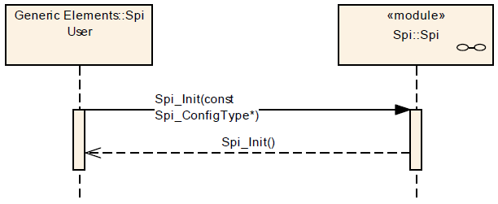](../files/File_Spi_Init_Seq_Dia.png--2441.md)

<a id="SPI_Modes_Transitions"></a>

#### SPI Modes Transitions

[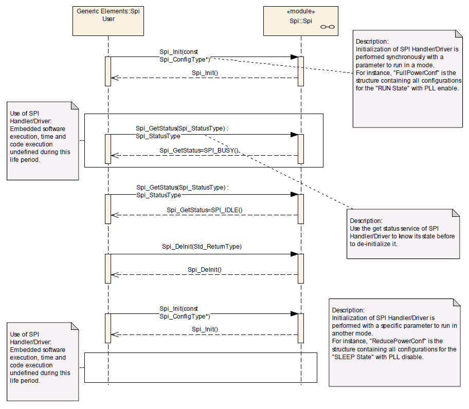](../files/File_Spi_Mode_Trans_Seq_Dia.png--2442.md)

<a id="SPI_Write.2FAsyncTransmit.2FRead_.28IB.29"></a>

#### SPI Write/AsyncTransmit/Read (IB)

<a id="One_Channel.2C_one_Job_then_one_Sequence"></a>

##### One Channel, one Job then one Sequence

The following sequence diagram shows an example of *Spi\_WriteIB()* / *Spi\_AsyncTransmit()* / *Spi\_ReadIB()* calls for a Sequence transmission with only one Job (MASTER or SLAVE) composed of only one Channel. Write or Read step could be skipped when Job is just reading or writing respectively (HALF-DUPLEX).

**Example**: Channel ID 2 belongs to Job ID 1 which belongs to Sequence ID 0.

[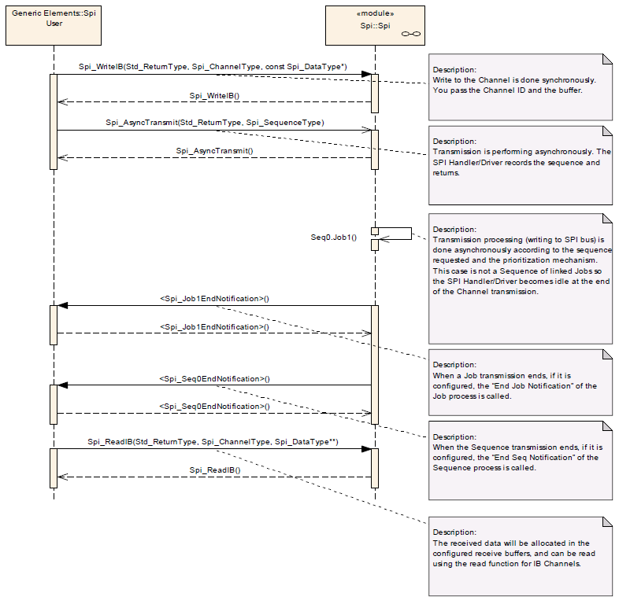](../files/File_Spi_WAR_1C_1J_1S_Seq_Dia.png--2443.md)

<a id="Many_Channels.2C_one_Job_then_one_Sequence"></a>

##### Many Channels, one Job then one Sequence

The following sequence diagram shows an example of *Spi\_WriteIB()* / *Spi\_AsyncTransmit()* / *Spi\_ReadIB()* calls for a Sequence transmission with only one Job (MASTER or SLAVE) composed of many Channels. Write or Read steps could be skipped when Job is just reading or writing respectively (HALF-DUPLEX).

**Example**: Channels ID 2 & 3 belong to Job ID 1 which belongs to Sequence ID 0.

[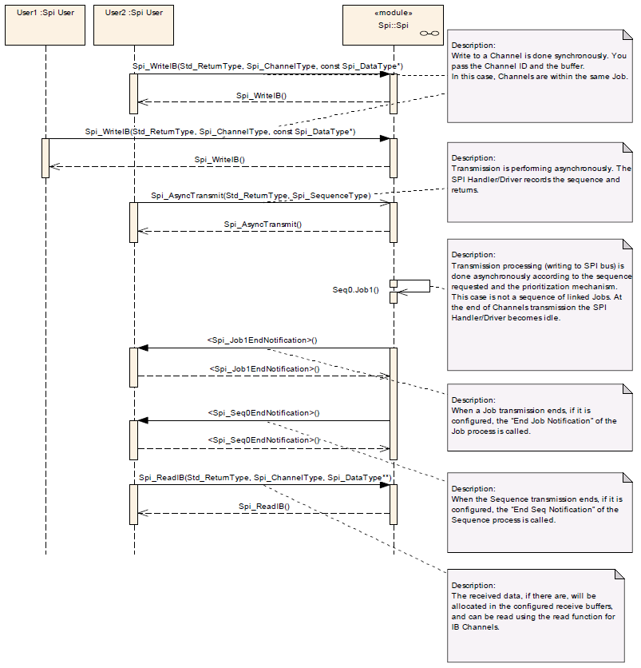](../files/File_Spi_WAR_nC_1J_1S_Seq_Dia.png--2444.md)

<a id="Many_Channels.2C_many_Jobs_and_one_Sequence"></a>

##### Many Channels, many Jobs and one Sequence

The following sequence diagram shows an example of *Spi\_WriteIB()* / *Spi\_AsyncTransmit()* / *Spi\_ReadIB()* calls for a Sequence transmission of linked Jobs. Write or Read steps could be skipped when Jobs are just reading or writing respectively.

Example: Channels ID 0 to 3 belong to Job ID 1 (higher priority), Channels ID 4 to 10 belong to Job ID 2 (Lower priority) which has not an end notification function. These Jobs belong to the same Sequence ID 0.

[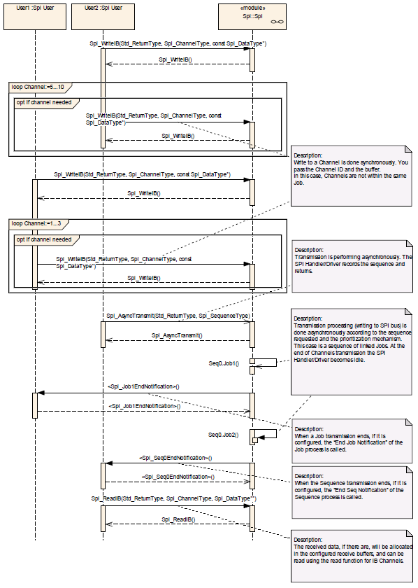](../files/File_Spi_WAR_nC_nJ_1S_Seq_Dia.png--2445.md)

<a id="Many_Channels.2C_many_Jobs_and_many_Sequences"></a>

##### Many Channels, many Jobs and many Sequences

The following sequence diagram shows an example of *Spi\_WriteIB()* / *Spi\_AsyncTransmit()* / *Spi\_ReadIB()* calls for Sequences transmission. Write or Read steps could be skipped when Jobs are just reading or writing respectively.

Example: Channels ID 0 to 3 belong to Job ID 1 (high priority 2), Channels ID 4 to 10 belong to Job ID 2 (Low priority 1) which has not an end notification function. These Jobs belong to the same Sequence ID 0 which is configured as interruptible. Channels ID 11 to 13 belong to Job ID 0 (higher priority 3) which belongs to Sequence ID 1 which is configured as not interruptible.

[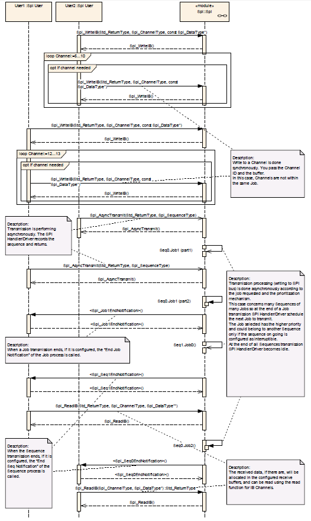](../files/File_Spi_WAR_nC_nJ_nS_Seq_Dia.png--2446.md)

<a id="SPI_Setup.2FAsyncTransmit_.28EB.29"></a>

#### SPI Setup/AsyncTransmit (EB)

<a id="Variable_Number_of_Data_.2F_Constant_Number_of_Data"></a>

##### Variable Number of Data / Constant Number of Data

To transmit a variable number of data, it is mandatory to call the *Spi\_SetupEB()* function to store new parameters within SPI Handler/Driver before each *Spi\_AsyncTransmit()* function call.

To transmit a constant number of data, it is only mandatory to call *the Spi\_SetupEB()* function to store parameters within SPI Handler/Driver before the first *Spi\_AsyncTransmit()* function call.

<a id="One_Channel.2C_one_Job_then_one_Sequence_2"></a>

##### One Channel, one Job then one Sequence

The following sequence diagram shows an example of *Spi\_SetupEB()* / *Spi\_AsyncTransmit()* calls for a Sequence transmission with only one Job (MASTER or SLAVE) composed of only one Channel. Write or Read accesses are “User Dependant” and could be skipped when Job is just reading or writing respectively. (FULL-DUPLEX or HALF-DUPLEX).

**Example**: Channel ID 2 belongs to Job ID 1 which belongs to Sequence ID 0.

[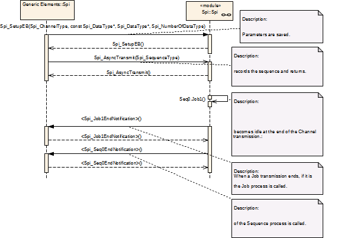](../files/File_Spi_SA_1C_1J_1S_Seq_Dia.png--2447.md)

<a id="Many_Channels.2C_one_Job_then_one_Sequence_2"></a>

##### Many Channels, one Job then one Sequence

The following sequence diagram shows an example of *Spi\_SetupEB()* / *Spi\_AsyncTransmit()* calls for a Sequence transmission with only one Job (MASTER or SLAVE) composed of many Channels. Write or Read accesses are “User Dependant” and could be skipped when Job is just reading or writing respectively (FULL-DUPLEX or HALF-DUPLEX).

**Example**: Channels ID 2 & 3 belong to Job ID 1 which belongs to Sequence ID 0.

[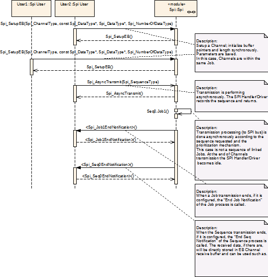](../files/File_Spi_SA_nC_1J_1S_Seq_Dia.png--2448.md)

<a id="Many_Channels.2C_many_Jobs_and_one_Sequence_2"></a>

##### Many Channels, many Jobs and one Sequence

The following sequence diagram shows an example of *Spi\_SetupEB()* / *Spi\_AsyncTransmit()* calls for a Sequence transmission of linked Jobs (MASTER or SLAVE). Write or Read accesses are “User Dependant” and could be skipped when Job is just reading or writing respectively (FULL-DUPLEX or HALF-DUPLEX).

**Example**: Channels ID 0 to 3 belong to Job ID 1 (higher priority), Channels ID 4 to 10 belong to Job ID 2 (Lower priority) which has not an end notification function. These Jobs belong to the same Sequence ID 0.

[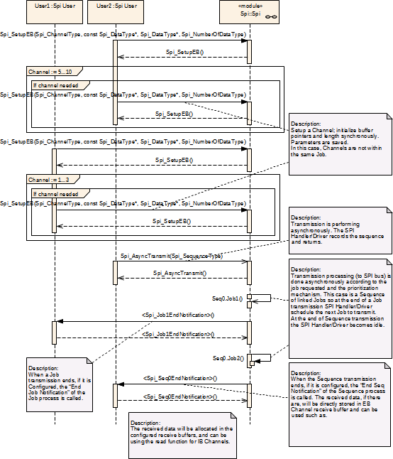](../files/File_Spi_SA_nC_nJ_1S_Seq_Dia.png--2449.md)

<a id="Many_Channels.2C_many_Jobs_and_many_Sequences_2"></a>

##### Many Channels, many Jobs and many Sequences

The following sequence diagram shows an example of *Spi\_SetupEB()* / *Spi\_AsyncTransmit()* calls for Sequences transmission (MASTER or SLAVE). Write or Read accesses are “User Dependant” and could be skipped when Job is just reading or writing respectively (FULL-DUPLEX or HALF-DUPLEX).

**Example**: Channels ID 0 to 3 belong to Job ID 1 (high priority 2), Channels ID 4 to 10 belong to Job ID 2 (Low priority 1) which has not an end notification function. These Jobs belong to the same Sequence ID 0 which is configured as interruptible. Channels ID 11 to 13 belong to Job ID 0 (higher priority 3) which belongs to Sequence ID 1 which is configured as not interruptible.

[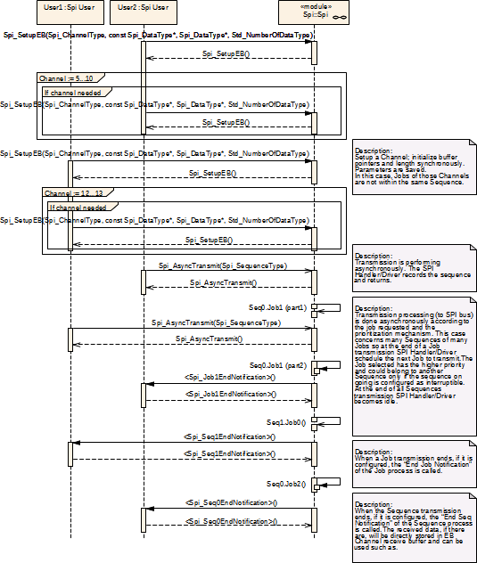](../files/File_Spi_SA_nC_nJ_nS_Seq_Dia.png--2450.md)

<a id="Mixed_Jobs_Transmission"></a>

#### Mixed Jobs Transmission

All kind of mixed Jobs transmission is possible according to the Channels configuration and the priority requirement inside Sequences.

The user knows which Channels are in use. Then, according to the types of these Channels, the appropriate methods shall be called.

<a id="SPI_LEVEL0_SyncTransmit"></a>

#### SPI LEVEL0 SyncTransmit

<a id="Write.2FSyncTransmit.2FRead_.28IB.29:_Many_Channels.2C_many_Jobs_and_one_Sequence"></a>

##### Write/SyncTransmit/Read (IB): Many Channels, many Jobs and one Sequence

The following sequence diagram shows an example of *Spi\_WriteIB()* / *Spi\_SyncTransmit()* / *Spi\_ReadIB()* calls for a Sequence transmission of linked Jobs (MASTER or SLAVE). Write or Read steps could be skipped when Jobs are just reading or writing respectively (HALF-DUPLEX).

**Example**: Channels ID 0 to 3 belong to Job ID 1 (higher priority), Channels ID 4 to 10 belong to Job ID 2 (Lower priority). These Jobs belong to the same Sequence ID 0.

[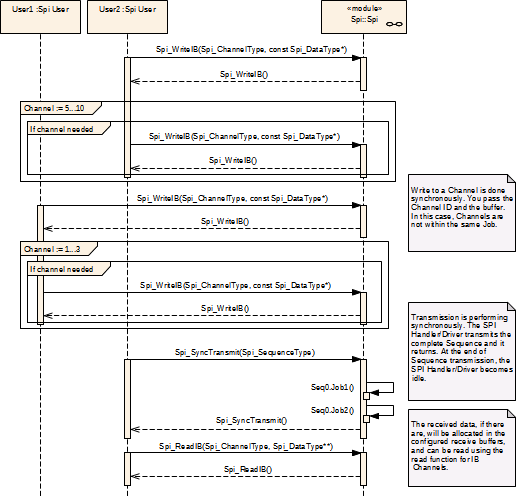](../files/File_Spi_WSR_nC_nJ_1S_Seq_Dia.png--2451.md)

<a id="Setup.2FSyncTransmit_.28EB.29:_Many_Channels.2C_many_Jobs_and_one_Sequence"></a>

##### Setup/SyncTransmit (EB): Many Channels, many Jobs and one Sequence

The following sequence diagram shows an example of *Spi\_SetupEB()* / *Spi\_SyncTransmit()* calls for a Sequence transmission of linked Jobs (MASTER or SLAVE). Write or Read accesses are “User Dependant” and could be skipped when Job is just reading or writing respectively (FULL-DUPLEX or HALF-DUPLEX).

**Example**: Channels ID 0 to 3 belong to Job ID 1 (higher priority), Channels ID 4 to 10 belong to Job ID 2 (Lower priority). These Jobs belong to the same Sequence ID 0.

[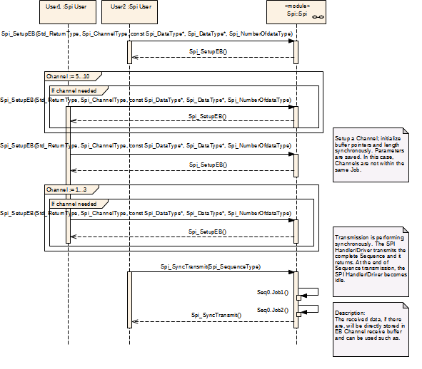](../files/File_Spi_SS_nC_nJ_1S_Seq_Dia.png--2452.md)

<a id="Build"></a>

### Build

To enable AUTOSAR DPI Driver for Texas Instruments Stellaris LM4F232xxxx with ARM KEIL uVision Compiler Toolchain, the following `EE_OPT` attribute is needed in the `OS` object of the OSEK/VDX configuration:

```
 EE_OPT = "__AS_SPI_DRIVER__";
```

The configuration C header file inclusion is done by `CFLAGS` attribute in the `OS` object of the OSEK/VDX configuration:

```
 CFLAGS = "-I<PATH>";
```

Where `<PATH>` is the absolute or relative directory path which configuration C header file is stored.

Instead the configurations C source file is added to the compilation process by `APP_SRC` attribute in the `CPU_DATA` object of the OSEK/VDX configuration:

```
 APP_SRC = "<PATH>/Spi_Cfg.c";
```

Where `<PATH>` is the absolute or relative directory path which configuration C source file is stored.

<a id="Supported_Architectures"></a>

### Supported Architectures

<a id="TI_Stellaris_LM4F232XXXX_with_ARM_KEIL_uVision_Compiler_Toolchain"></a>

#### TI Stellaris LM4F232XXXX with ARM KEIL uVision Compiler Toolchain

<a id="Driver_Configuration"></a>

##### Driver Configuration

In order to configure the AUTOSAR-like SPI Driver for Texas Instruments Stellaris LM4F232xxxx with ARM KEIL uVision Compiler Toolchain, you have to select the "Spi" tab-sheet on driver configuration instance file.

[File:Erika Driver Configurator SPI.png](http://erika.tuxfamily.org/wiki/index.php?title=Special:Upload&wpDestFile=Erika_Driver_Configurator_SPI.png "File:Erika Driver Configurator SPI.png")

<a id="Configuration_Selection"></a>

###### Configuration Selection

In this section you can add/edit/delete configurations in SPI Driver configuration set:

- Each configuration SHALL have an *Identifier* which must be unique inside the configurations set.
- Each configuration, inside the configurations set, has a set of Channels.
  - Each Channel SHALL have a *Name* which must be unique inside the Channels.

<a id="API_Selection"></a>

###### API Selection

In this section you can select SPI Driver APIs and features will be included in build process:

- *Version Info*: *Spi\_GetVersionInfo()* API

[File:Erika Driver Configurator SPI set.png](http://erika.tuxfamily.org/wiki/index.php?title=Special:Upload&wpDestFile=Erika_Driver_Configurator_SPI_set.png "File:Erika Driver Configurator SPI set.png")

<a id="Interrupts"></a>

##### Interrupts

In order to use the AUTOSAR SPI driver, an ISR object must be added to OSEK/VDX configuration for every TI Stellaris SSI harware unit configured and :

```
 ISR Spi_HwUnit_<Hardware Unit Number>_ISR {
   CATEGORY = 2;
   ENTRY = "SSI_<Hardware Unit Number>";
   PRIORITY = <ISR Priority>;
 }
```

Where `<Hardware Unit Number>` is the TI Stellaris SSI hardware unit number (from 0 to 3) and `<ISR Priority>` is a number indicating the level of priority (0: Lowest).

<a id="Implemetations_Demos"></a>

##### Implemetations Demos

Implementation Demos of the AUTOSAR-like SPI Driver can be found at [examples/cortex\_mx/lm4f232xxxx/as](http://svn.tuxfamily.org/viewvc.cgi/erika_erikae/repos/ee/trunk/ee/examples/cortex_mx/lm4f232xxxx/as)

---

## Archive provenance

- [Original page](http://erika.tuxfamily.org/wiki/index.php?title=AUTOSAR-like_SPI_Driver) · [Archived source revision 5335](http://erika.tuxfamily.org/wiki/index.php?oldid=5335)
- Last source edit: 2013-07-18T10:43:49Z. Source retrieved on 2026-11-06; Markdown conversion completed on 2026-11-07.
- Original contributors recorded in exported history: Giuseppe Serano.
- [Original MediaWiki source](../source/wikitext/2401.mediawiki) · [Original editing history](../source/history/batch-001.xml)
- [Attribution and licensing notice](../NOTICE.md). Original file-specific notices, where present, remain applicable.
