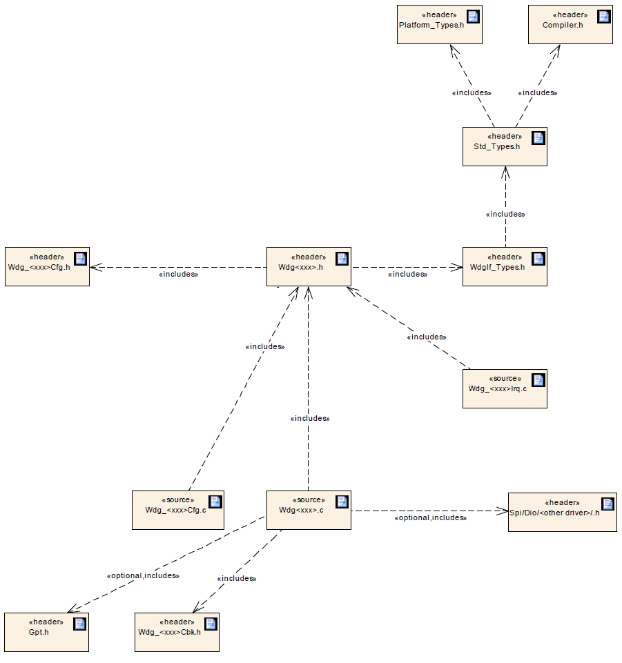
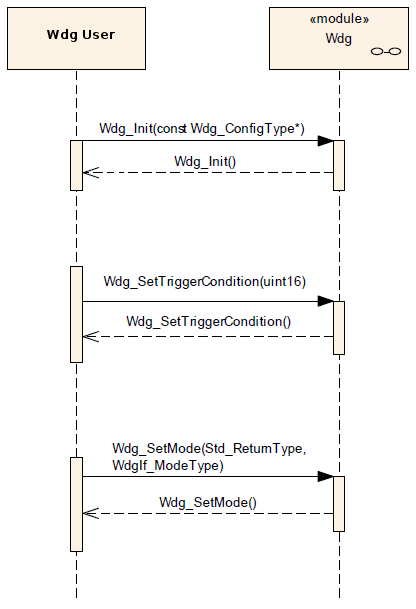
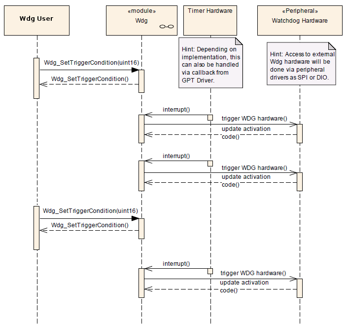

# AUTOSAR-like WDG Driver

<a id="Synopsis"></a>

### Synopsis

The WDG driver provides the functionality and API for a WDG [WatchDoG] driver and provides services for initialization, changing the operation mode and setting the trigger condition (timeout) of a watchdog device.

The functional requirements and the functional scope are the same for both internal and external watchdog drivers. Hence the API is semantically identical.

An internal watchdog driver belongs to the Microcontroller Abstraction Layer (MCAL), whereas an external watchdog driver belongs to the Onboard Device Abstraction Layer. Therefore, an external watchdog driver needs other drivers (in MCAL) in order to access the microcontroller hardware.

The Wdg module for an external watchdog driver shall have source code that is independent of the microcontroller platform.

If the hardware of the internal watchdog depends on the system clock, changes to the system clock (e.g. PLL on → PLL off) may also affect the clock settings of the watchdog hardware.

A Wdg module for an external watchdog device depends on the API and capabilities of the used onboard communication handlers or drivers (e.g. SPI handler).

<a id="Internal_watchdog_driver"></a>

#### Internal watchdog driver

To access the internal watchdog hardware, the corresponding Wdg module instance shall access the hardware for watchdog servicing directly.

**Hint**: An internal watchdog driver is part of the Microcontroller Abstraction Layer, which allows direct hardware access.

The routine servicing an internal watchdog shall be implemented either as an interrupt routine driven by a hardware timer or as a GPT driver callback.

**Note**: In both cases, the watchdog servicing routine runs in interrupt context.

<a id="External_watchdog_driver"></a>

#### External watchdog driver

To access the external watchdog hardware, the corresponding Wdg module instance shall use the functionality and API of the corresponding handler or driver, e.g. the SPI handler or DIO driver.

The routine servicing an external watchdog shall be implemented as a GPT driver callback.

**Hint**: An external watchdog driver is part of the Onboard Device Abstraction Layer, which excludes direct hardware access.

A Wdg module for an external watchdog shall satisfy the same functional requirements and offer the same functional scope as a Wdg module for an internal watchdog. Hence their respective APIs are semantically identical.

The Wdg module shall add all parameters required for accessing the external watchdog hardware, e.g. the used SPI channel or DIO port, to the module’s published parameters and to the module’s configuration parameters.

<a id="Operational_Modes"></a>

#### Operational Modes

The Wdg module shall support the following operational mode for a watchdog hardware:

- **Off-Mode**: The watchdog hardware is disabled / shut down. This might be necessary in order to shut down the complete ECU and not get cyclic resets from a still running external watchdog. This mode might not be allowed for safety critical systems. In this case, the Wdg module has to be configured to prevent switching to this mode.

- **Slow-Mode**: Triggering the watchdog hardware can be done with a long timeout period. This mode can e.g. be used during system startup / initialization phase. E.g. The watchdog hardware is configured for toggle mode (no constraints on the point in time at which the triggering is done) and a timeout period of 20 milliseconds.

- **Fast-Mode**: Triggering the watchdog hardware has to be done with a short timeout period. This mode can e.g. be used during normal operations of the ECU. E.g. The watchdog hardware is configured for window mode (triggering the watchdog has to occur within certain minimum / maximum boundaries within the timeout period) and a timeout period of 5 milliseconds.

<a id="Triggering_concept_to_support_windowed_watchdogs"></a>

#### Triggering concept to support windowed watchdogs

The watchdog servicing routine is called from an upper layer of the software which made it difficult to guarantee timing constraints namely for windowed watchdog conditions. This concept will be changed leading to the requirements explained in this chapter.

The basic idea of this concept is to decouple the timing for servicing the watchdog hardware from the logical control.

The time base for triggering the watchdog shall be provided by means of a hardware timer or via the GPT driver. This ensures minimum timing jitter. This also imply that servicing of the watchdog hardware is done directly from a timer ISR. This ensures minimum latencies. These two conditions – minimum jitter and latencies - ensure that the time window of a windowed watchdog can be met.

The Wdg Driver expects, that the logical control of the watchdog (whether the watchdog shall be triggered or not) shall be the responsibility of the environment, e.g. A Wdg Manager, so that the basic concepts of the Wdg Manager (alive supervision) shall remain unchanged.

A Wdg Manager (or other entities) shall control the watchdog driver via a so called trigger condition: as long as the trigger condition is valid the Wdg Driver services the watchdog hardware, if the trigger condition becomes invalid the Wdg Driver stops triggering and the watchdog expires.

The semantics of the trigger condition can be interpreted as a “permission to service the watchdog for the next n milliseconds”. Within this time frame the trigger condition has to be updated by the controlling entity else the watchdog will expire. Handover of the watchdog control logic is simply done by shared usage of the trigger condition (e.g. during startup / shutdown).

If the trigger counter is greater than zero, the watchdog servicing routine shall decrement the trigger counter and trigger the hardware watchdog.

If the trigger counter has reached zero, the watchdog servicing routine shall do nothing (i.e. the watchdog is not triggered and will therefore expire).

If the watchdog hardware requires an activation code which can be configured or changed, the Wdg Driver shall handle the activation code internally. In this case, the Wdg Driver shall pass the correct activation code to the watchdog hardware and the watchdog hardware in turn shall update the Wdg module’s internal variable where the next expected access code is stored.

If the watchdog hardware requires an activation code which can be configured or changed, the trigger cycle of the Wdg Driver shall be defined with a value so that updating the activation code by the watchdog hardware can be guaranteed.

If the watchdog hardware requires an activation code which can be configured or changed and the initial activation code can be configured, the activation code shall be provided in the Wdg Driver’s configuration set. If the activation code is fixed for a particular hardware the above requirement can be ignored.

**Hint**: The Wdg module’s environment shall make sure that the Wdg Driver module has been initialized before watchdog servicing routine is called.

<a id="File_Structure"></a>

### File Structure

[](../files/File_Wdg_File_Structure.png--2453.md)

The possible name expansion for multiple driver modules are indicated as *<xxx>*.

If more than one watchdog driver instance exists on an ECU (namely an external and an internal one) the implementer shall provide unique header file names.

Since the API names are also to be expanded, the header *Wdg<xxx>.h* will become instance specific.

The need to include headers from GPT-, SPI-, DIO- or other drivers depends on how the watchdog is serviced and the watchdog hardware is accessed.

<a id="API_Specification"></a>

### API Specification

<a id="Imported_Types"></a>

#### Imported Types

<a id="typedef_uint8_Std_ReturnType"></a>

##### *typedef uint8 Std\_ReturnType*

```
 #include "Std_Types.h"
```

Standard Return Type.

This type can be used as standard API return type which is shared between AUTOSAR-like modules.

The *Std\_ReturnType* shall normally be used with value *E\_OK* or *E\_NOT\_OK*.
If those return values are not sufficient user specific values can be defined by using the 6 least specific bits.

<a id="struct_Std_VersionInfoType"></a>

##### *struct Std\_VersionInfoType*

```
 #include "Std_Types.h"
```

Standard Version Informations Type.

This type shall be used to request the version of a AUTOSAR-like module using the *<Module Name>\_GetVersionInfo()* function.

**Field Documentation:**

```
 uint16 Std_VersionInfoType::moduleID
```

Module Identifier.

```
 uint8 Std_VersionInfoType::sw_major_version
```

Software Version Major Number.

```
 uint8 Std_VersionInfoType::sw_minor_version
```

Software Version Minor Number.

```
 uint8 Std_VersionInfoType::sw_patch_version
```

Software Version Patch Number.

```
 uint16 Std_VersionInfoType::vendorID
```

Vendor Identifier.

<a id="enum_WdgIf_ModeType"></a>

#### *enum WdgIf\_ModeType*

```
 #include "WdgIf_Types.h"
```

Watchdog Driver Mode Type.

The *WdgIf\_ModeType* values shall be passed as parameters to the watchdog drivers mode switching function (*Wdg\_SetMode()*).

**Enumerator**:

- *WDGIF\_OFF\_MODE*: In this mode, the watchdog driver is disabled (switched off).
- *WDGIF\_SLOW\_MODE*: In this mode, the watchdog driver is set up for a long timeout period (slow triggering).
- *WDGIF\_FAST\_MODE*: In this mode, the watchdog driver is set up for a short timeout period (fast triggering).

**Note**: The hardware specific settings behind these modes are given in the watchdog drivers configuration set.

<a id="Types_Defintions"></a>

#### Types Defintions

<a id="struct_Wdg_.3Cxxx.3E_ConfigType"></a>

##### *struct Wdg\_<xxx>\_ConfigType*

```
 #include "Wdg<xxx>.h"
```

Wdg<xxx> Module Configuration Parameters.

Structure to hold the watchdog driver configuration set.

Used for pointers to structures holding configuration data provided to the Wdg<xxx> module initialization routine for configuration of the module and watchdog hardware.

<a id="typedef_void_.28.2AWdg_.3Cxxx.3E_Notification.29.28void.29"></a>

##### *typedef void (\*Wdg\_<xxx>\_Notification)(void)*

```
 #include "Wdg<xxx>.h"
```

Watchdog Notifications Callback.

The notification prototype *Wdg\_<xxx>\_Notification()* is for the notifications callback function and shall be implemented by the user.

Each watchdog mode shall provide its own notifications callback if configured.

The notifications callback *Wdg\_<xxx>\_Notification\_<mode>()* shall be configurable as pointers to user defined functions within the configuration structure.

When disabled, the WDG Driver will send no notifications.

The WDG Driver shall invoke a notification callback whenever the defined target time of the watchdog is reached.

For all available watchdog modes, callback functions have to be declared by the configuration tool.

<a id="Functions_Definitions"></a>

#### Functions Definitions

<a id="void_Wdg_.3Cxxx.3E_Init.28const_Wdg_.3Cxxx.3EConfigType_.2AConfigPtr.29"></a>

##### *void Wdg\_<xxx>\_Init(const Wdg\_<xxx>ConfigType \*ConfigPtr)*

```
 #include "Wdg<xxx>.h"
```

Wdg<xxx> Module Initialization.

**Parameters**:

- *ConfigPtr*: Pointer to Wdg<xxx> module configuration set.

**Returns**:

- *None*.

Initializes the module.

Service 0x00

The *Wdg\_<xxx>\_Init()* function shall initialize the Wdg<xxx> module and the watchdog hardware, i.e. it shall set the default watchdog mode and timeout period as provided in the configuration set.

**Note**: Via configuration, the user can choose the configuration set to be used with the *Wdg\_<xxx>\_Init()* function from a limited number of statically configured sets.

The *Wdg\_<xxx>\_Init()* function shall initialize all global variables of the Wdg<xxx> module and set the default watchdog mode and initial timeout period.

The *Wdg\_<xxx>\_Init()* function shall initialize those controller registers that are needed for controlling the watchdog hardware and that do not influence/depend on other (hardware) modules.

Registers that can influence or depend on other modules are initialized by a common system module.

If disabling the watchdog is not allowed (because pre-compile configuration parameter (*WDG\_DISABLE\_ALLOWED* == *OFF*) and if the default mode given in the provided configuration set disables the watchdog, the *Wdg\_<xxx>\_Init()* function shall not execute the initialization.

If switching the Wdg<xxx> module and the watchdog hardware into the default mode is not possible, e.g. because of inconsistent mode settings or because some timing constraints have not been met, the *Wdg\_<xxx>\_Init()* function shall not execute the initialization.

The function *Wdg\_<xxx>\_Init()* shall check that the parameter *ConfigPtr* is not *NULL\_PTR*. If this error is detected, the function *Wdg\_<xxx>\_Init()* shall not execute the initialization.

The *Wdg\_<xxx>\_Init()* function shall check that the (hardware specific) contents of the given configuration set is within the allowed boundaries. If this error is detected, the function *Wdg\_<xxx>\_Init()* shall not execute the initialization.

The *Wdg\_<xxx>\_Init()* function shall set the Wdg<xxx> module's internal state from *WDG\_UNINIT* (the default state indicating a non-initialized module) to *WDG\_IDLE* if the initialization was successful.

**Note**: This specification prescribes the symbols *WDG\_IDLE* and *WDG\_UNINIT* only, if they are externally visible, e.g. for debugging. Choosing the data type for the status variable is up to the implementation.

<a id="Std_ReturnType_Wdg_.3Cxxx.3E_SetMode.28WdgIf_ModeType_Mode.29"></a>

##### *Std\_ReturnType Wdg\_<xxx>\_SetMode(WdgIf\_ModeType Mode)*

```
 #include "Wdg<xxx>.h"
```

Watchdog Mode Switching.

**Parameters**:

- *Mode*: One of the following statically configured modes:
  - *WDGIF\_OFF\_MODE*
  - *WDGIF\_SLOW\_MODE*
  - *WDGIF\_FAST\_MODE*

**Returns**:

- *E\_OK*: Mode switching command has been accepted
- *E\_NOT\_OK*: Mode switching command has not been accepted

Switches the watchdog into the mode Mode.

Service 0x01

The function *Wdg\_<xxx>\_SetMode()* shall switch the watchdog driver from the current watchdog mode into the mode given by the argument Mode.

This means: By choosing one of a limited number of statically configured settings (e.g. toggle or window watchdog, different timeout periods) the Wdg<xxx> module and the watchdog hardware are switched to one of the following three different modes:

- *WDGIF\_OFF\_MODE*

- *WDGIF\_SLOW\_MODE*

- *WDGIF\_FAST\_MODE*

The configuration set provided to the Wdg<xxx> module's initialization routine shall contain the hardware / driver specific parameters to be used in the different watchdog modes.

**Hint**: This may, for example, include mode-dependent settings for the GPT timer, if GPT callbacks are used.

The *Wdg\_<xxx>\_SetMode()* function shall reset the watchdog timeout counter based on the new watchdog mode i.e. the timeout frame remaining shall be recalculated based on a changed trigger period.

The *Wdg\_<xxx>\_SetMode()* function shall return E\_OK if the mode switch has been executed completely and successfully, i.e. all parameters of the Wdg<xxx> module and the watchdog hardware have been set to the new values.

If switching the Wdg<xxx> module and the watchdog hardware into the requested mode is not possible, e.g. because of inconsistent mode settings or because some timing constraints have not been met, the Wdg\_<xxx>\_SetMode()function shall return the value *E\_NOT\_OK*.

If disabling the watchdog is not allowed (e.g. in safety relevant systems) the *Wdg\_<xxx>\_SetMode()* function shall check whether the settings for the requested mode would disable the watchdog. In this case, the function shall return with the value *E\_NOT\_OK*.

The *Wdg\_<xxx>\_SetMode()* function shall check that the parameter Mode is within the allowed range. If this is not the case, the function shall not execute the mode switch but return with the value *E\_NOT\_OK*.

The *Wdg\_<xxx>\_SetMode()* function shall check that the (hardware specific) settings for the requested mode are within the allowed boundaries. If this is not the case, the function shall not execute the mode switch but return with the value *E\_NOT\_OK*.

The *Wdg\_<xxx>\_SetMode()* function shall check that the Wdg<xxx> module's state is *WDG\_IDLE* (meaning the Wdg<xxx> module and the watchdog hardware are initialized and the watchdog is currently not being triggered or switched). If this is not the case, the function shall not execute the mode switch but return with the value *E\_NOT\_OK*.

The *Wdg\_<xxx>\_SetMode()* function shall set the Wdg<xxx> module's state to *WDG\_BUSY* during its execution (indicating, that the module is busy) and shall reset the Wdg<xxx> module's state to *WDG\_IDLE* as last operation before it returns to the caller.

**Note**: This specification prescribes the symbols *WDG\_IDLE* and *WDG\_BUSY* only, if they are externally visible, e.g. For debugging. Choosing the data type for the status variable is up to the implementation.

<a id="void_Wdg_.3Cxxx.3E_SetTriggerCondition.28uint16_Timeout.29"></a>

##### *void Wdg\_<xxx>\_SetTriggerCondition(uint16 Timeout)*

```
 #include "Wdg<xxx>.h"
```

Channel Notifications Enable.

**Parameters**:

- *Timeout*: Timeout value (milliseconds) for setting the trigger counter.

**Returns**:

- *None*.

Sets the timeout value for the trigger counter.

Service 0x03

The function *Wdg\_<xxx>\_SetTriggerCondition()* shall reset the watchdog timeout counter according to the Timeout value passed.

The Timeout value passed shall be interpreted as 'milliseconds'. The conversion from milliseconds to the corresponding counter value shall be done internally by the Wdg<xxx> module.

The current watchdog mode shall be taken into account when calculating the counter value from the Timeout parameter.

This function shall also allow to set *0* as the time frame for triggering which will result in an (almost) immediate stop of the watchdog triggering and an (almost) instantaneous watchdog reset of the ECU.

The function *Wdg\_<xxx>\_SetTriggerCondition()* shall check that the Timeout parameter given is less or equal to the maximum timeout value. If this is not the case the function shall not reload the timeout counter and return to the caller.

<a id="void_Wdg_.3Cxxx.3E_GetVersionInfo.28Std_VersionInfoType_.2AVersionInfoPtr.29"></a>

##### *void Wdg\_<xxx>\_GetVersionInfo(Std\_VersionInfoType \*VersionInfoPtr)*

```
 #include "Spi.h"
```

1. include "Wdg<xxx>.h"

Version informations retrieval.

**Parameters**:

- *VersionInfoPtr*: Pointer to where to store the version information of this module.

**Returns**:

- *None*.

Returns the version information of the module.

Service 0x04

The function *Wdg\_<xxx>\_GetVersionInfo()* shall return the version information of the Wdg module. The version information includes:

- Module Id
- Vendor Id
- Vendor specific version numbers

The function *Wdg\_<xxx>\_GetVersionInfo()* shall be configurable On/Off by configuration.

If source code for caller and callee of the function *Wdg\_<xxx>\_GetVersionInfo()* is available, the Wdg module should realize this function as a macro. The Wdg module should define this macro in the module’s header file.

If the *VersionInfoPtr* argument is a *NULL\_PTR* pointer, the function *Wdg\_<xxx>\_GetVersionInfo()* shall return without any action.

<a id="Usage_Examples"></a>

### Usage Examples

<a id="Watchdog_initialization.2C_setting_trigger_condition_and_mode"></a>

#### Watchdog initialization, setting trigger condition and mode

[](../files/File_Wdg_Init_Seq_Dia.png--2454.md)

<a id="Data_exchange_between_watchdog_driver_and_hardware"></a>

#### Data exchange between watchdog driver and hardware

Depending on the implementation, the interrupt routine for servicing the watchdog could also come via a GPT Driver callback. For an external watchdog, the watchdog hardware cannot be accessed directly, but only via drivers of the MCAL layer, like SPI or DIO.

[](../files/File_Wdg_Trigger_Seq_Dia.png--2455.md)

<a id="Supported_Architectures"></a>

### Supported Architectures

<a id="TI_Stellaris_LM4F232XXXX_with_ARM_KEIL_uVision_Compiler_Toolchain"></a>

#### TI Stellaris LM4F232XXXX with ARM KEIL uVision Compiler Toolchain

Texas Instruments Stellaris LM4F232 MCU provides two watchdog peripherals: one clocked by Precision Internal Oscillator (PIOsc) with a fixed frequency of 16MHz and the other clocked System Clock (SysClk) which frequency is configurable by AUTOSAR MCU Driver.

Each watchdog is driven by a separate driver.

<a id="WDG_PIOSC"></a>

##### WDG PIOSC

<a id="Driver_Configuration"></a>

###### Driver Configuration

In order to configure the AUTOSAR-like PIOSC WDG Driver for Texas Instruments Stellaris LM4F232xxxx with ARM KEIL uVision Compiler Toolchain, you have to select the "Wdg PIOSC" tab-sheet on driver configuration instance file.

[File:Erika Driver Configurator PIOSC WDG.png](http://erika.tuxfamily.org/wiki/index.php?title=Special:Upload&wpDestFile=Erika_Driver_Configurator_PIOSC_WDG.png "File:Erika Driver Configurator PIOSC WDG.png")

<a id="Configuration_Selection"></a>

###### Configuration Selection

In this section you can add/edit/delete configurations in WDG PIOSC Driver configuration set:

- Each configuration SHALL have an *Identifier* which must be unique inside the configurations set.

<a id="API_Selection"></a>

###### API Selection

In this section you can select PIOSC WDG Driver APIs and features will be included in build process:

- *Version Info*: *Wdg\_PIOsc\_GetVersionInfo()* API

[File:Erika Driver Configurator WDG PIOSC set.png](http://erika.tuxfamily.org/wiki/index.php?title=Special:Upload&wpDestFile=Erika_Driver_Configurator_WDG_PIOSC_set.png "File:Erika Driver Configurator WDG PIOSC set.png")

<a id="Build"></a>

###### Build

In order to enable AUTOSAR PIOSC WDG Driver for Texas Instruments Stellaris LM4F232xxxx with ARM KEIL uVision Compiler Toolchain, the following `EE_OPT` attribute is needed in the `OS` object of the OSEK/VDX configuration:

```
 EE_OPT = "__AS_WDG_PIOSC_DRIVER__";
```

The configuration C header file inclusion is done by `CFLAGS` attribute in the `OS` object of the OSEK/VDX configuration:

```
 CFLAGS = "-I<PATH>";
```

Where `<PATH>` is the absolute or relative directory path which configuration C header file is stored.

Instead the configurations C source file is added to the compilation process by `APP_SRC` attribute in the `CPU_DATA` object of the OSEK/VDX configuration:

```
 APP_SRC = "<PATH>/Wdg_PIOscCfg.c";
```

Where `<PATH>` is the absolute or relative directory path which configuration C source file is stored.

<a id="Interrupts"></a>

###### Interrupts

In order to use the AUTOSAR-like PIOSC WDG driver, almost another pheriperal must be configured and initialized to be clocked by PIOsc (eg. Adc, Spi, Sci, ...). Moreover an ISR object must be added to OSEK/VDX configuration:

```
 ISR Wdg_PIOsc_ISR {
   CATEGORY = 2;
   ENTRY = "WATCHDOG_TIMER";
   PRIORITY = <ISR Priority>;
 }
```

Where `<ISR Priority>` is a number indicating the level of priority (0: Lowest); if the driver is configured to fire "Standard" Interrupts, or:

```
 ISR Wdg_PIOsc_ISR {
   CATEGORY = 2;
   ENTRY = "NMI";
 }
```

If the driver is configured to fire Non-Maskable Interrupts with a fixed priority higher than "standard".

<a id="Implemetations_Demos"></a>

###### Implemetations Demos

Implementation Demos of the AUTOSAR-like PIOSC WDG Driver can be found at [examples/cortex\_mx/lm4f232xxxx/as](http://svn.tuxfamily.org/viewvc.cgi/erika_erikae/repos/ee/trunk/ee/examples/cortex_mx/lm4f232xxxx/as)

<a id="WDG_SYSCLK"></a>

##### WDG SYSCLK

<a id="Driver_Configuration_2"></a>

###### Driver Configuration

In order to configure the AUTOSAR-like SYSCLK WDG Driver for Texas Instruments Stellaris LM4F232xxxx with ARM KEIL uVision Compiler Toolchain, you have to select the "Wdg SYSCLK" tab-sheet on driver configuration instance file.

[File:Erika Driver Configurator SYSCLK WDG.png](http://erika.tuxfamily.org/wiki/index.php?title=Special:Upload&wpDestFile=Erika_Driver_Configurator_SYSCLK_WDG.png "File:Erika Driver Configurator SYSCLK WDG.png")

<a id="Configuration_Selection_2"></a>

###### Configuration Selection

In this section you can add/edit/delete configurations in WDG SYSCLK Driver configuration set:

- Each configuration SHALL have an *Identifier* which must be unique inside the configurations set.

<a id="API_Selection_2"></a>

###### API Selection

In this section you can select SYSCLK WDG Driver APIs and features will be included in build process:

- *Version Info*: *Wdg\_SysClk\_GetVersionInfo()* API

[File:Erika Driver Configurator WDG SYSCLK set.png](http://erika.tuxfamily.org/wiki/index.php?title=Special:Upload&wpDestFile=Erika_Driver_Configurator_WDG_SYSCLK_set.png "File:Erika Driver Configurator WDG SYSCLK set.png")

<a id="Build_2"></a>

###### Build

In order to enable AUTOSAR SYSCLK WDG Driver for Texas Instruments Stellaris LM4F232xxxx with ARM KEIL uVision Compiler Toolchain, the following `EE_OPT` attribute is needed in the `OS` object of the OSEK/VDX configuration:

```
 EE_OPT = "__AS_WDG_SYSCLK_DRIVER__";
```

The configuration C header file inclusion is done by `CFLAGS` attribute in the `OS` object of the OSEK/VDX configuration:

```
 CFLAGS = "-I<PATH>";
```

Where `<PATH>` is the absolute or relative directory path which configuration C header file is stored.

Instead the configurations C source file is added to the compilation process by `APP_SRC` attribute in the `CPU_DATA` object of the OSEK/VDX configuration:

```
 APP_SRC = "<PATH>/Wdg_SysClkCfg.c";
```

Where `<PATH>` is the absolute or relative directory path which configuration C source file is stored.

<a id="Interrupts_2"></a>

###### Interrupts

In order to use the AUTOSAR SYSCLK WDG driver an ISR object must be added to OSEK/VDX configuration:

```
 ISR Wdg_SysClk_ISR {
   CATEGORY = 2;
   ENTRY = "WATCHDOG_TIMER";
   PRIORITY = <ISR Priority>;
 }
```

Where `<ISR Priority>` is a number indicating the level of priority (0: Lowest); if the driver is configured to fire "Standard" Interrupts, or:

```
 ISR Wdg_SysClk_ISR {
   CATEGORY = 2;
   ENTRY = "NMI";
 }
```

If the driver is configured to fire Non-Maskable Interrupts with a fixed priority higher than "standard".

<a id="Implemetations_Demos_2"></a>

###### Implemetations Demos

Implementation Demos of the AUTOSAR-like SYSCLK WDG Driver can be found at [examples/cortex\_mx/lm4f232xxxx/as](http://svn.tuxfamily.org/viewvc.cgi/erika_erikae/repos/ee/trunk/ee/examples/cortex_mx/lm4f232xxxx/as)

---

## Archive provenance

- [Original page](http://erika.tuxfamily.org/wiki/index.php?title=AUTOSAR-like_WDG_Driver) · [Archived source revision 5342](http://erika.tuxfamily.org/wiki/index.php?oldid=5342)
- Last source edit: 2013-07-18T11:08:58Z. Source retrieved on 2026-11-06; Markdown conversion completed on 2026-11-07.
- Original contributors recorded in exported history: Giuseppe Serano.
- [Original MediaWiki source](../source/wikitext/2402.mediawiki) · [Original editing history](../source/history/batch-001.xml)
- [Attribution and licensing notice](../NOTICE.md). Original file-specific notices, where present, remain applicable.
