# A quick tutorial on how to create, compile and debug an application for Freescale S12G

Requirements:

- Install the Freescale CodeWarrior IDE and the compiler **CWS12v5.1**
  - The Windows version of the IDE (that ocntains the compiler) can be downloaded from the following site (please note that the site requires registration): [HCS12\_CODEWARRIOR\_V5.1](http://www.freescale.com/webapp/sps/site/prod_summary.jsp?code=CW-SUITE-SPECIAL&fpsp=1&tab=Design_Tools_Tab)
  - Install the software in your desired location (every path without blank spaces is a recommended path, for example: *C:\Programmi\Freescale\CWS12v5.1*).
- Create a project for RT-Druid.
  - First enter the compiler path in RT-Druid. In the menu at the top, under *Windows - Preferences - RT-Druid - Oil - Freescale S12*, enter the path where you installed the compiler as shown in the figure.

[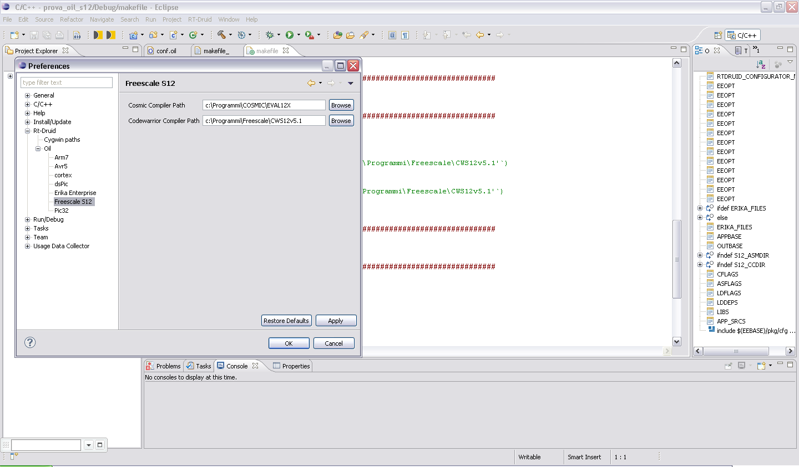](../files/File_Compiler_preferences.PNG--2204.md)

- Then, select *File - New - RT\_Druid ILO and C / C + + project* to create a new project.

[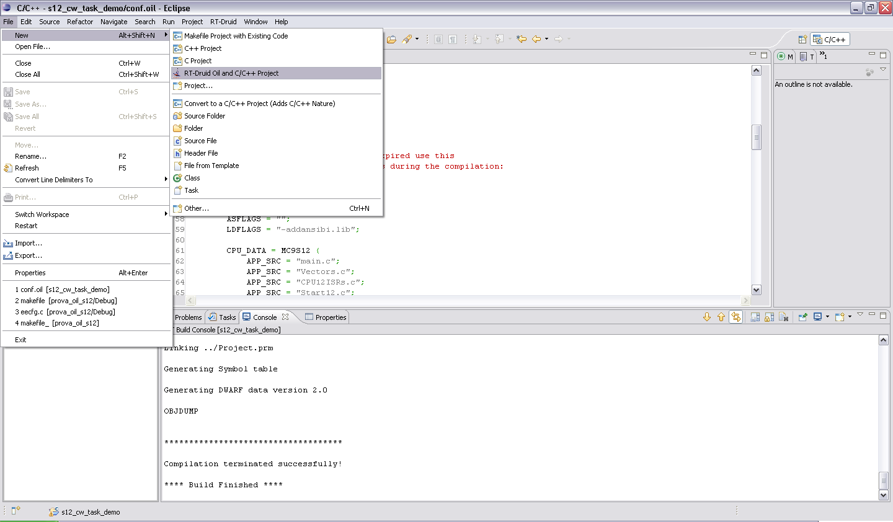](../files/File_New_s12g_project.PNG--2205.md)

- Enter the name of the project (for example: *s12\_cw\_task\_demo*) and click on *Next* to specify a template.

[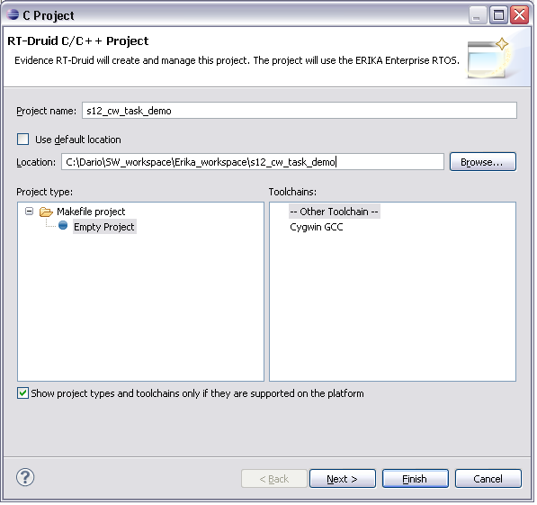](../files/File_Project_name.PNG--2206.md)

- Choose the *Monostack TASK demo* as shown in the figure and click on the *Finish* button.

[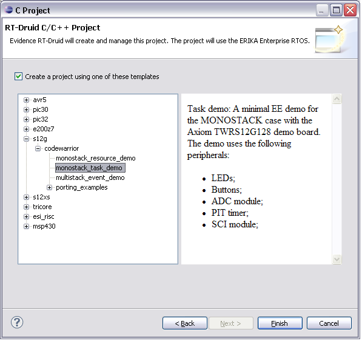](../files/File_Task_demo.PNG--2207.md)

- To use a selected revision of the kernel for project building, right-click on the project name and open the *Properties* window. Then select *Erika files location* and click to *Configure workspace Settings* to set the EE kernel location path for the IDE or choose another option.

[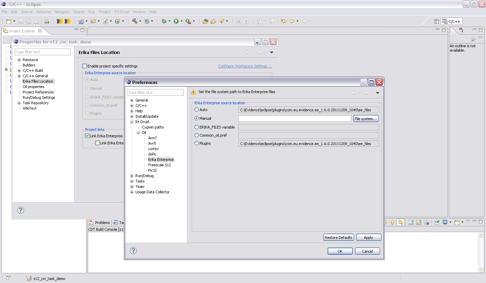](../files/File_Ee_path.PNG--2208.md)

- Now you can compile all the files of the project. To do this, simply right-click on the project name and select *Build Project*.

[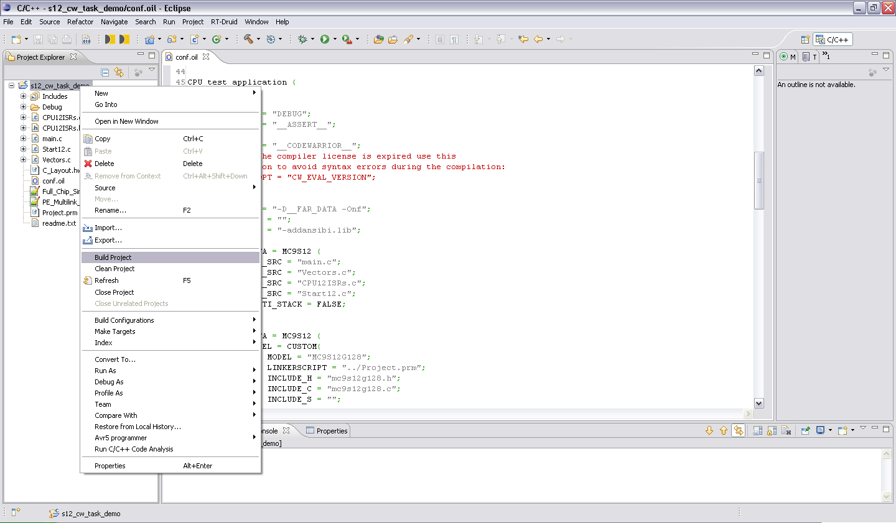](../files/File_Build_s12g.PNG--2209.md)

- If the compilation has been successfully completed the executable file, named “s12.elf”, should be present inside the Debug folder in the project tree.

[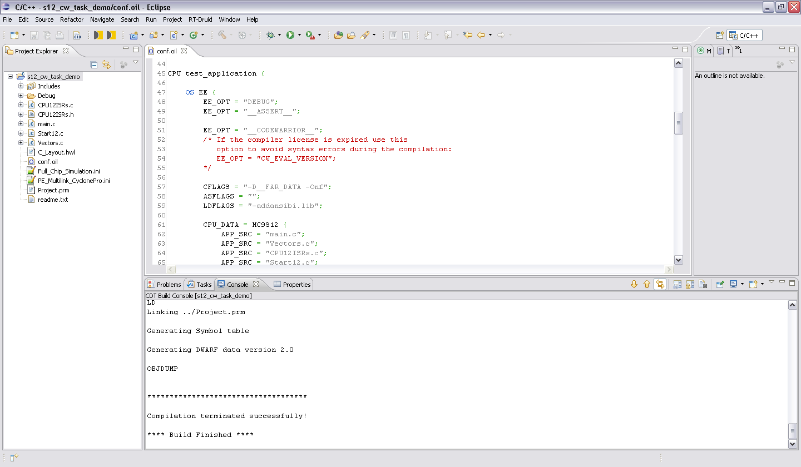](../files/File_Build_success.PNG--2210.md)

- Execute the application on the S12G micro-controller. The USB drivers for the **TWRS12G128** board should be already installed, otherwise follow the installation procedure described in the user manual of the board. Move the power jumpers in the right position and connect the board with the USB cable (for more info see the manual of the board). Then connect the board and your PC using a serial communication cable (please note that you may need a USB-serial converter if your PC hasn't a DB9 connector).
  - Copy the project path from the project properties as shown in the figure (the project path is needed to upload the executable file *s12.elf* in the debugger).

[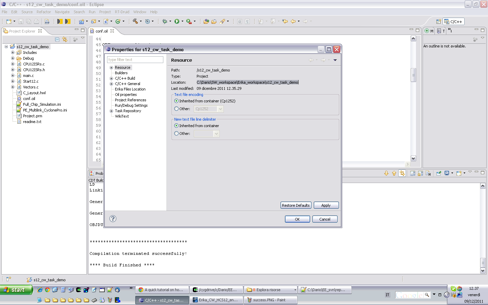](../files/File_Project_path.PNG--2211.md)

- Open the Freescale debugger named HIWAVE, launching the executable “hiwave.exe” located in the “Prog” folder under the installation directory of the compiler (for example: C:\Programmi\Freescale\CWS12v5.1\Prog).

[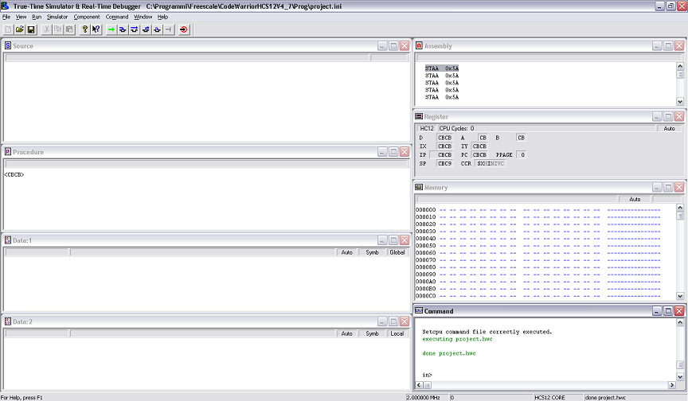](../files/File_Hiwave.PNG--1502.md)

- Board selection. Under the menu “Component” select *Set Connection*. In the menu choose *HC12*, *P&E Multilink/Cyclone Pro* in the combo boxes and click OK.

[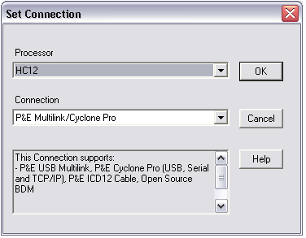](../files/File_Pe.PNG--2212.md)

- From the HC12MultilinkCyclonePro menu, choose *Load ...* and upload the executable file *s12.elf* located in the Debug folder inside the project.

Check the box *Automatically erase and program into FLASH and EEPROM* and click *Open* (see image below).

[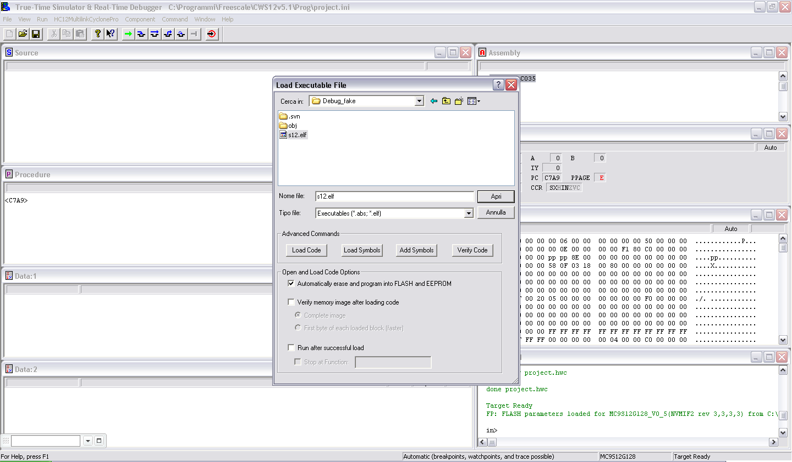](../files/File_Hiwave_s12_elf.PNG--2213.md)

- A message of warning will appear, don't worry and click OK. If the source files are not displayed correctly open the configuration file (*PE\_Multilink\_CyclonePro.ini*) before loading the file s12.elf. Push Run (or press F5 on the keyboard) to start the application.

Note: If your version of HIWAVE does not recognize the board is likely that the problem is related to the version of the dll *peosbdmv1.dll", in the folder* C:\Programmi\Freescale\CWS12v5.1\Prog*. Please, update the dll installing the service pack named* CW12\_V5\_1\_HCS12\_G240\_SP.exe *or replacing the old dll with the new one provided by the latest P&E drivers.*

---

## Archive provenance

- [Original page](http://erika.tuxfamily.org/wiki/index.php?title=A_quick_tutorial_on_how_to_create%2C_compile_and_debug_an_application_for_Freescale_S12G) · [Archived source revision 4219](http://erika.tuxfamily.org/wiki/index.php?oldid=4219)
- Last source edit: 2011-12-12T17:33:32Z. Source retrieved on 2026-11-06; Markdown conversion completed on 2026-11-07.
- Original contributors recorded in exported history: Erikadds.
- [Original MediaWiki source](../source/wikitext/2203.mediawiki) · [Original editing history](../source/history/batch-001.xml)
- [Attribution and licensing notice](../NOTICE.md). Original file-specific notices, where present, remain applicable.
