# A quick tutorial on how to create, compile and debug an application for Freescale S12XS

## How to build a project in RT-DRUID

This page contains a description of how to install the necessary software to develop an Erika application for a Freescale HCS12 microcontroller.

RT-Druid/Erika, version 1.5.1:

- Download the installer from the web site of [Erika old versions](http://erika.tuxfamily.org/erika-for-multiple-devices/oldversions.html) and update the software as shown [here](Tutorial_Update_ERIKA_and_RT-Druid--2049.md).

RT-Druid/Erika, version 1.6.0:

- Erika Enterprise 1.6.0 can be freely downloaded from [EE\_160\_Win.zip here](http://erika.tuxfamily.org/erika-for-multiple-devices.html).
- Extract all the files contained in the zip and copy the folder named “eclipse” in your preferred directory on your PC (a recommended path is: C:\Evidence\).
- To update the software just clicking on the “Help” menu item and selecting “Install New Software”. Then click on “ADD” to add the night builds address for update: "<http://download.tuxfamily.org/erika/webdownload/rtdruid_160_nb/>"

1. In RT-Druid environment, create a new RT-Druid project as shown in the following picture.

   **[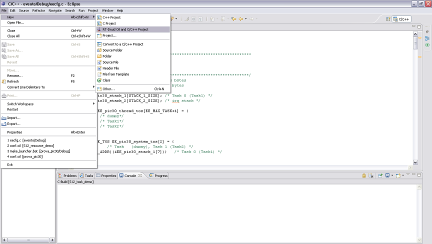](../files/File_Druid.PNG--1495.md)**
2. Select a template from the *s12xs* menu.

   **[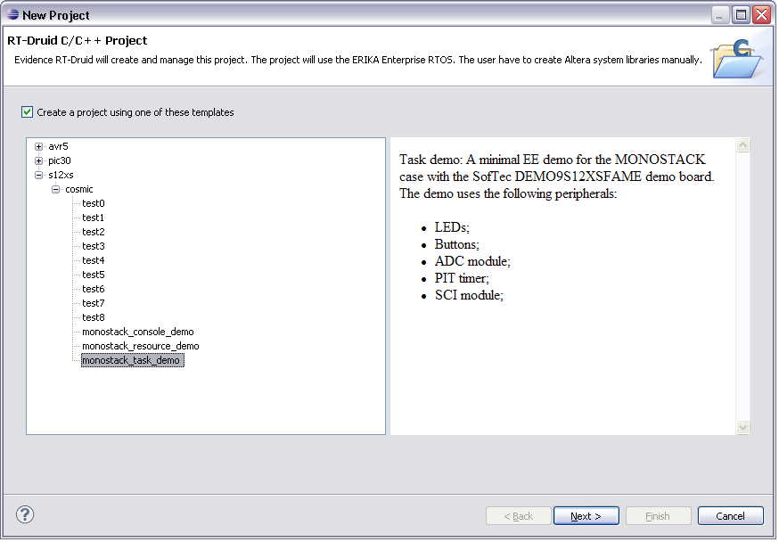](../files/File_Task.PNG--1496.md)**
3. Give a name to your project.

   **[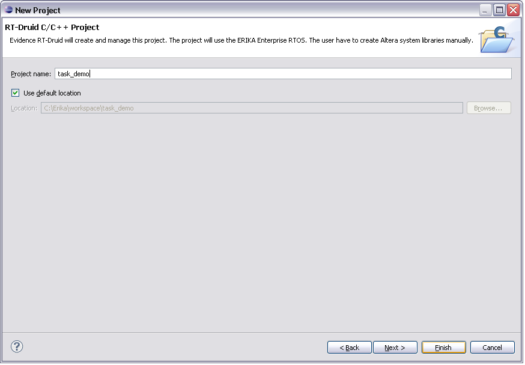](../files/File_Name.PNG--1497.md)**

   - The new project folder appears in the *Project Explorer*;

   **[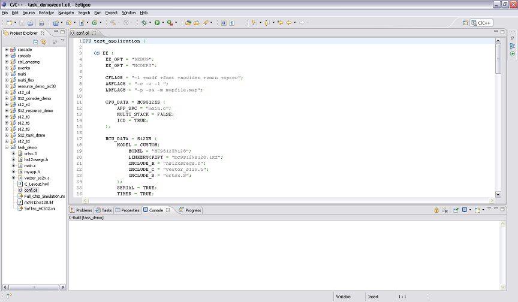](../files/File_Oil.PNG--1498.md)**
4. Enter the compiler path in RT-Druid. In the menu at the top, under Windows - Preferences - RT-Druid - Oil - Freescale S12, enter the path where you installed the compiler. Then build the project (right-click on the project name, as shown in the picture below).

   **[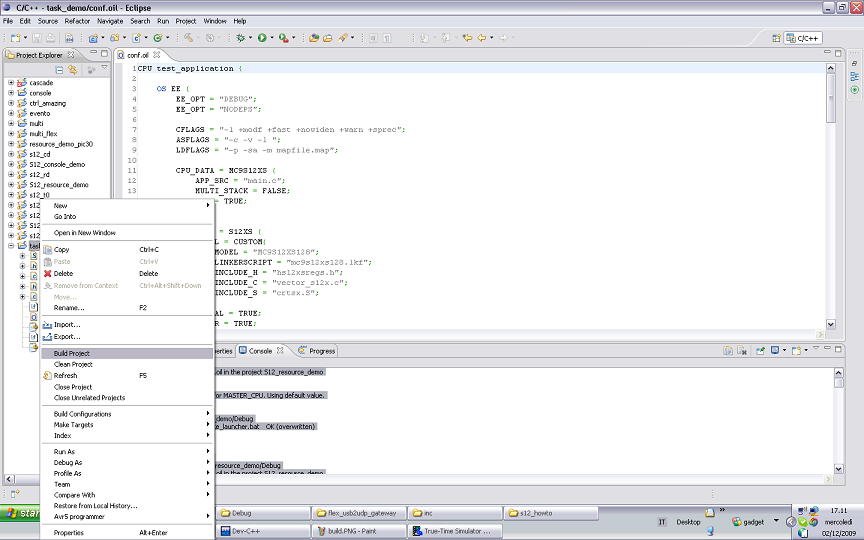](../files/File_Build.PNG--1499.md)**

   - the compilation starts;

   **[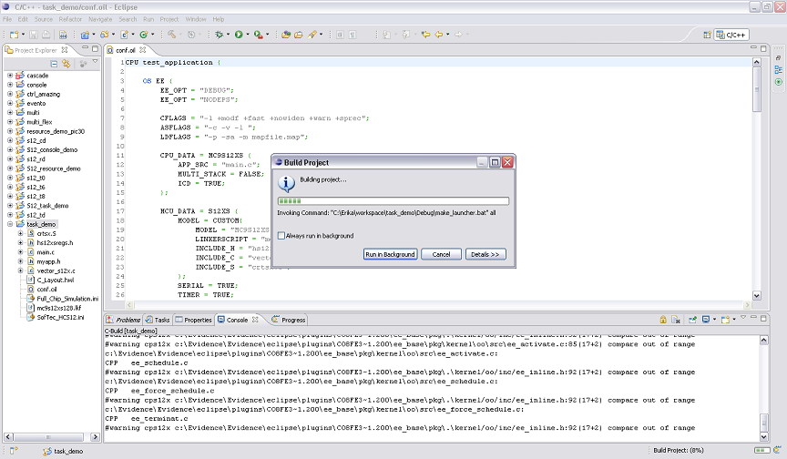](../files/File_Progress.PNG--1500.md)**

   - the executable file appear in the *Debug* folder inside the project.

   **[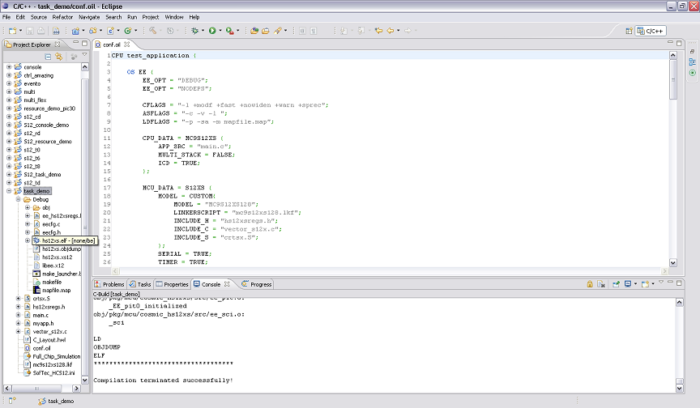](../files/File_Elf.PNG--1501.md)**
5. Open the RT-debugger.

   **[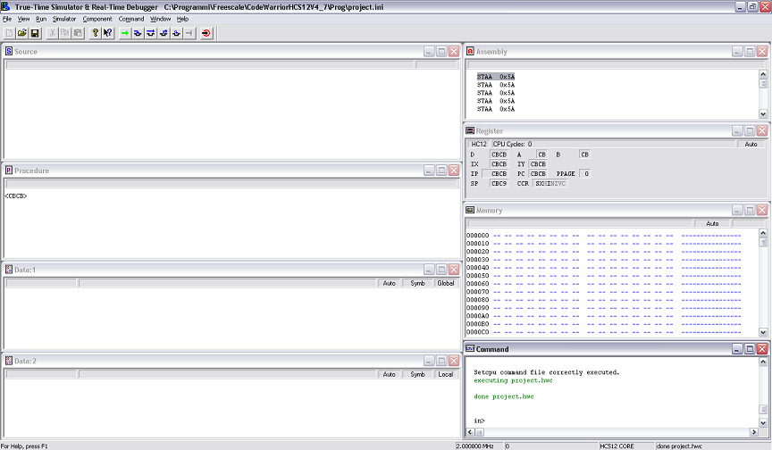](../files/File_Hiwave.PNG--1502.md)**
6. From the menu *File* choose *Open Configuration...*;

   **[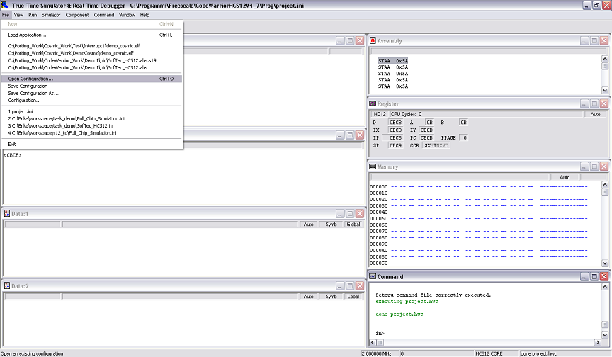](../files/File_Conf.PNG--1503.md)**

   - and load the debugger environment configuration:

   **[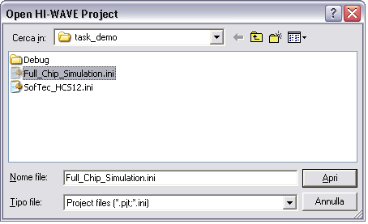](../files/File_Fullchip.PNG--1504.md)**

   - Full\_Chip\_Simulation.ini: for a simple simulation running on the PC
   - SofTec\_HCS12.ini to flash the board. To select the board click on the menu “Component” and select “Set Connection”.
7. From the menu *HCS12XS* click on *Load...*.

   **[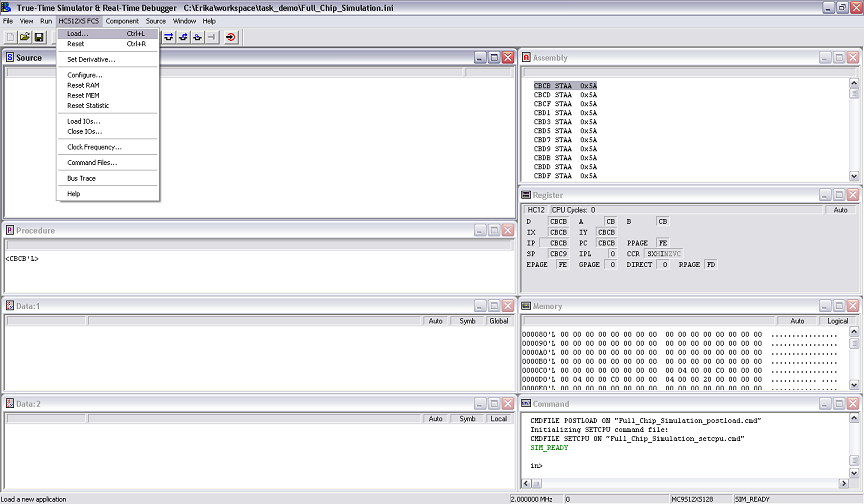](../files/File_Load.PNG--1505.md)**

   - and load the executable of your application;

   **[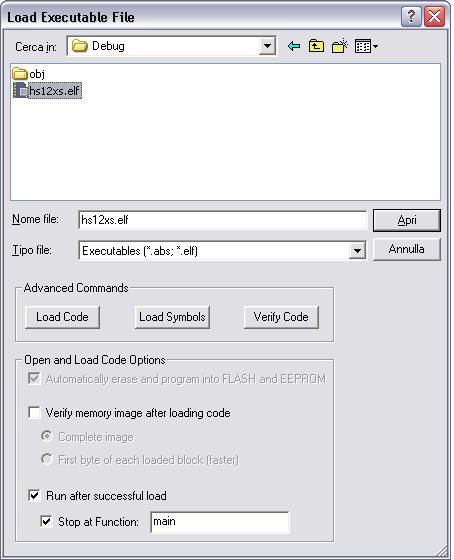](../files/File_Load_exe.PNG--1506.md)**
8. Then starts the simulation and enjoy!!!.

   **[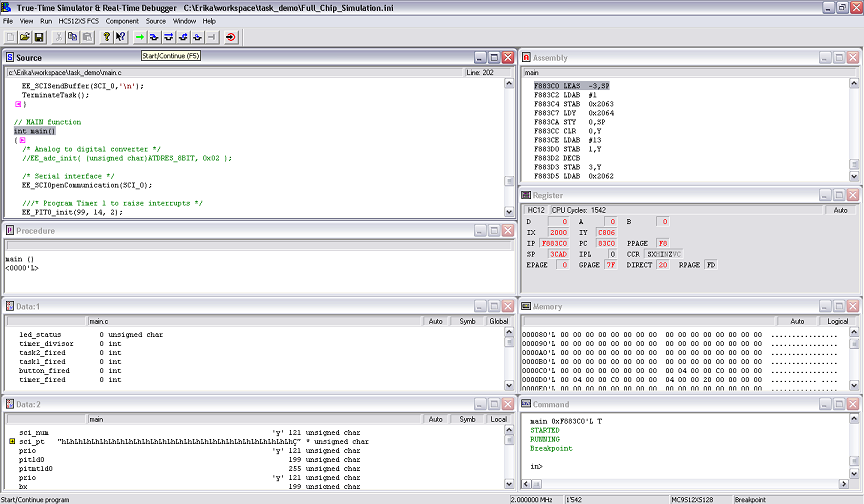](../files/File_Start.PNG--1507.md)**

---

## Archive provenance

- [Original page](http://erika.tuxfamily.org/wiki/index.php?title=A_quick_tutorial_on_how_to_create%2C_compile_and_debug_an_application_for_Freescale_S12XS) · [Archived source revision 3215](http://erika.tuxfamily.org/wiki/index.php?oldid=3215)
- Last source edit: 2011-08-24T15:04:54Z. Source retrieved on 2026-11-06; Markdown conversion completed on 2026-11-07.
- Original contributors recorded in exported history: Erikadds.
- [Original MediaWiki source](../source/wikitext/1520.mediawiki) · [Original editing history](../source/history/batch-001.xml)
- [Attribution and licensing notice](../NOTICE.md). Original file-specific notices, where present, remain applicable.
