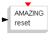
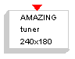
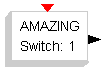
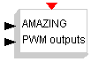
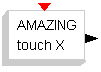
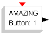
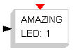

# Amazing Ball

The **Amazing Ball** palette:

| Symbol | Description |
| --- | --- |
|  | This block controls the reset procedure of the Amazing Ball System. |
|  | This block controls the calibration procedure of the Amazing Ball System. The internal parameters specifie the touch panel resolution. |
|  | This block reads the switches values of the Amazing Ball Motion board. The internal parameter specifies the button number(from 1 to 8). |
|  | This block controls the PWM channel of the Amazing Ball Motion board. The block accepts two inputs in degrees. |
|  | This block controls the touch panel data acquisition for the Amazing Ball. The internal parameter specifies the axis ('X' or 'Y'). The block provides the ball coordinate in signed pixel (example: if the touch panel resolution is 240x180 the coordinate for X will be in the range:-120,119 and for Y:-90,89). |
|  | This block controls the buttons of the Amazing Ball Motion Board. The internal parameter specifies button number(from 1 to 2). |
|  | This block controls the LED 1 of the Flex daughter board. |

---

## Archive provenance

- [Original page](http://erika.tuxfamily.org/wiki/index.php?title=Amazing_Ball) · [Archived source revision 3443](http://erika.tuxfamily.org/wiki/index.php?oldid=3443)
- Last source edit: 2011-09-28T11:04:04Z. Source retrieved on 2026-11-06; Markdown conversion completed on 2026-11-07.
- Original contributors recorded in exported history: WikiSysop, Erikadds.
- [Original MediaWiki source](../source/wikitext/1531.mediawiki) · [Original editing history](../source/history/batch-002.xml)
- [Attribution and licensing notice](../NOTICE.md). Original file-specific notices, where present, remain applicable.
