# Amazing Ball Control System: An application with the FLEX FULL Motion board and the Scilab/Scicos code generator

## Amazing Ball Control Application

**AMAZING BALL: An example of PID control and USB-UDP communication with the FLEX Motion Daughter Board**

Step 1:

- Open Scilab 4.1.2, the Scicos-FLEX pack is recognized by Scilab (refer Fig. 1).

Change the working directory to “C:\Programmi\scilab-4.1.2\contrib\dspic”.

Type exec builder.sce to build any application of the pack.

[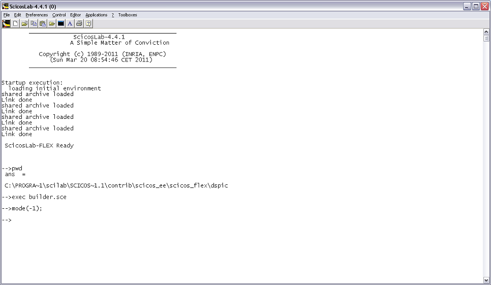](../files/File_Scilab.png--1571.md)

Figure 1 – Scilab

Step 2:

- Open file “pid\_ctrl\_codegen\_usbudp\_tuning\_square\_circle.cos” (refer Fig. 2) in

Scicos.

The .cos file contains the schematic for the generation (with SCICOS) of the FLEX

FULL board program.

This application is for tuning coefficients of the PID control for improving

system performance.

[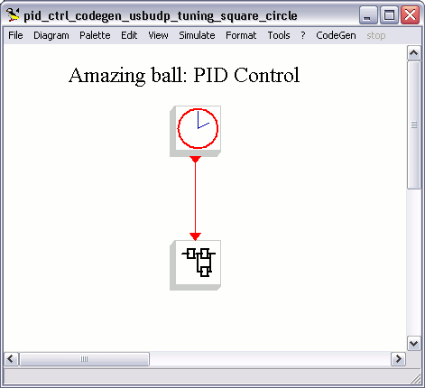](../files/File_Flexside_schematic.png--1586.md)

Figure 2 – Control system schematic

Step 3:

- Click menu CodeGen and select FlexCodeGen.

Click on the super-block, the Embedded Code Generator's block property settings

window will appear (refer Fig. 3)

Provide path name and then press OK for code generation (refer Fig. 4)

[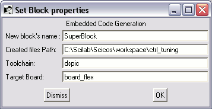](../files/File_Generator_window.png--1587.md)

Figure 3 – Embedded Code Generator window

[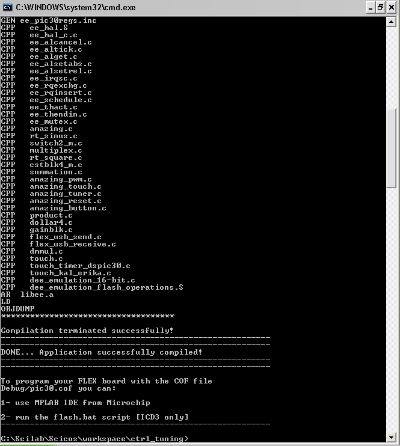](../files/File_Generator_results.png--1588.md)

Figure 4 – Code Generator results

Step 4:

- Open MPLAB IDE and import “pic30.cof” file created by the code generator in Step 3.

Connect the FLEX003 (FLEX Full Base Board) to ICD for programming the dsPic

(refer Fig. 5). The board is programmed and set in reset mode.

[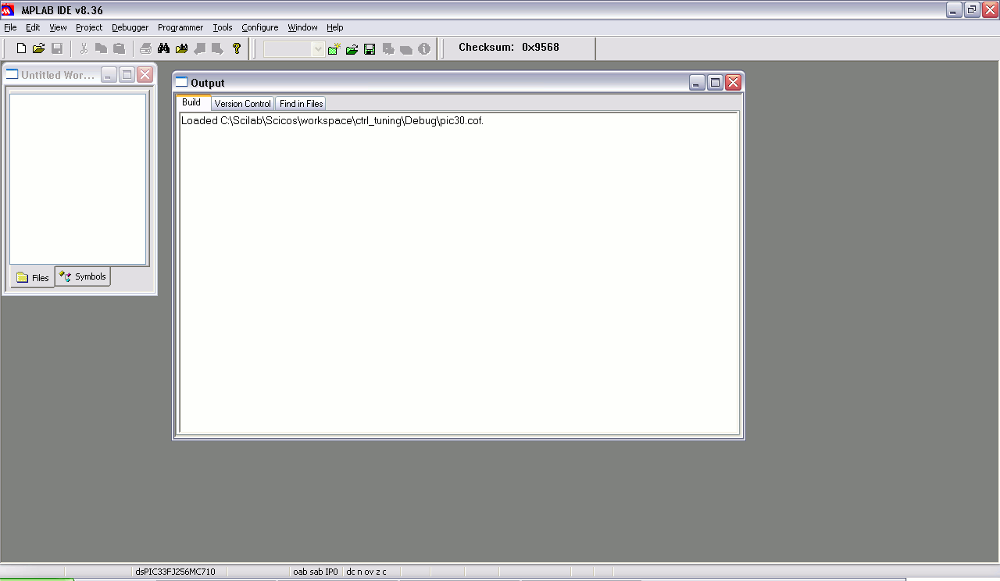](../files/File_Cof_ide1.png--1589.md)
[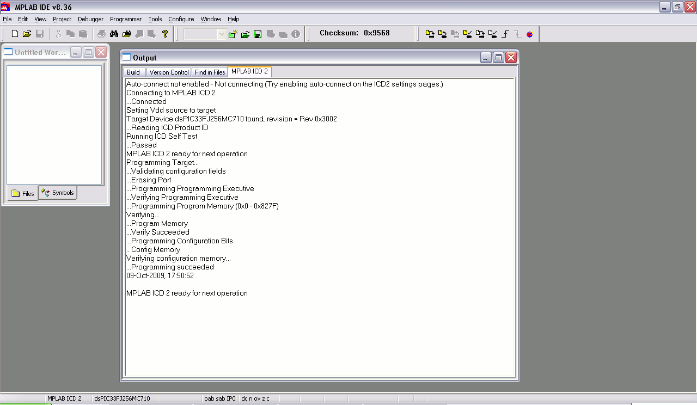](../files/File_Cof_ide2.png--1590.md)

Figure 5 - MPLAB IDE: COF file importing and target programming

Step 5:

- Check the USB device recognition in the peripherals window (refer Fig. 6) and

execute the program app\_flex\_scicos.exe (refer Fig. 7)

Note1: The program needs CygWin Win32 usb library and is compiled using make

command.

Note2: Download the FLEX USB drivers for Windows and the PIC18 firmware at:

[FLEX usb data communication using Scilab and Scicos](FLEX_usb_data_communication_using_Scilab_and_Scicos--1398.md "FLEX usb data communication using Scilab and Scicos")

[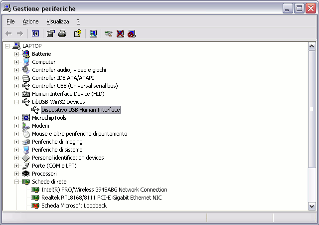](../files/File_Usb_recognition.png--1582.md)

Figure 6 – Check the USB device recognition

[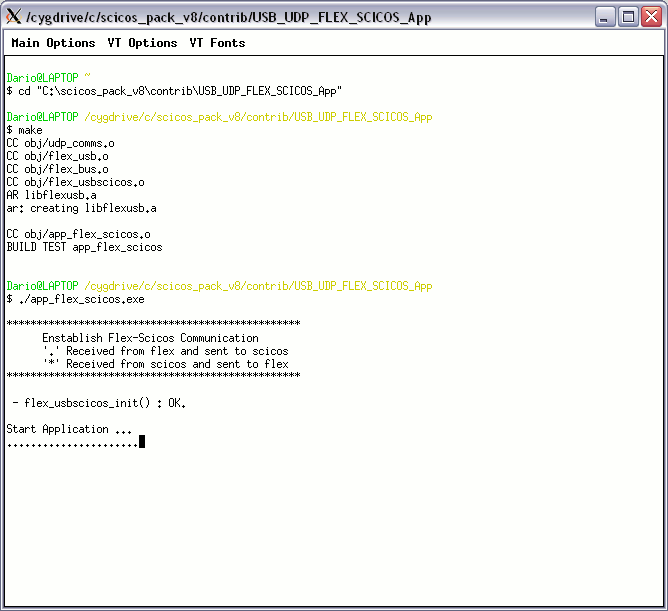](../files/File_Compilation_gateway.png--1591.md)

Figure 7 – Compilation and start of the program

Step 6:

- Open the PC-side file “pc\_pid\_tuning.cos” in Scicos;

The .cos file contains the schematic for the PC-side (refer Fig. 8).

The almost-real-time simulation runs in SCICOS environment. The application

shows the received USB data on the multiple scope and sends other data to the

FLEX FULL board (refer Fig. 9).

[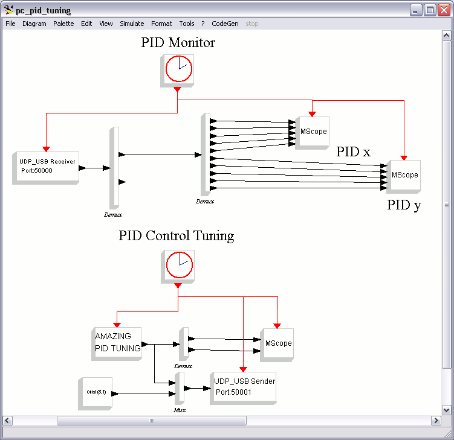](../files/File_Pcside_schematic.png--1592.md)

Figure 8 – PC-side schematic

[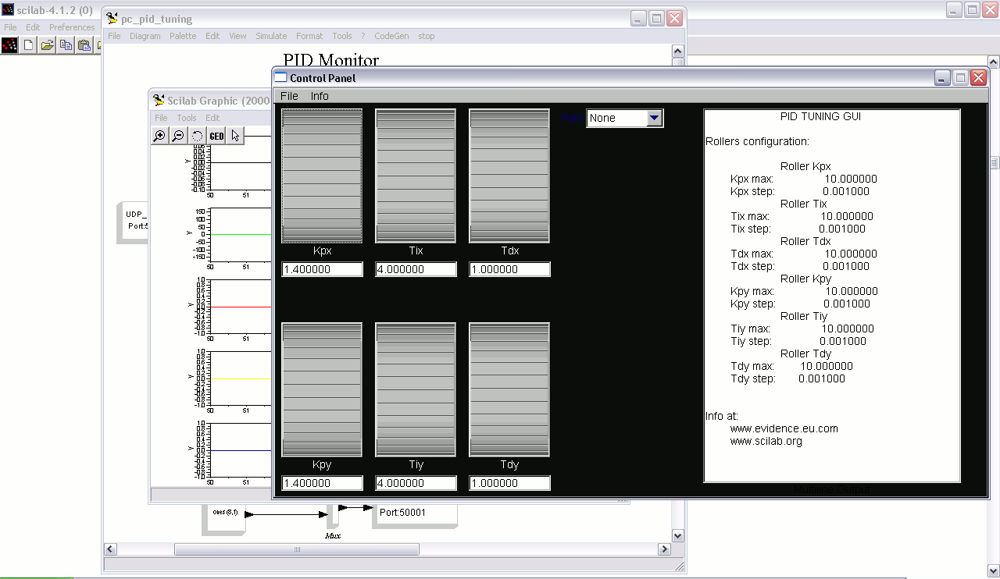](../files/File_Pc_side_tuner.png--1593.md)

Figure 9 – PC-side application (PID tuner)

Step 7:

- Release the reset to run the demo (refer Fig.10);

Initially the application calibrates the touch screen (refer Fig. 11), followed

by rest of the demo (refer Fig.12).

[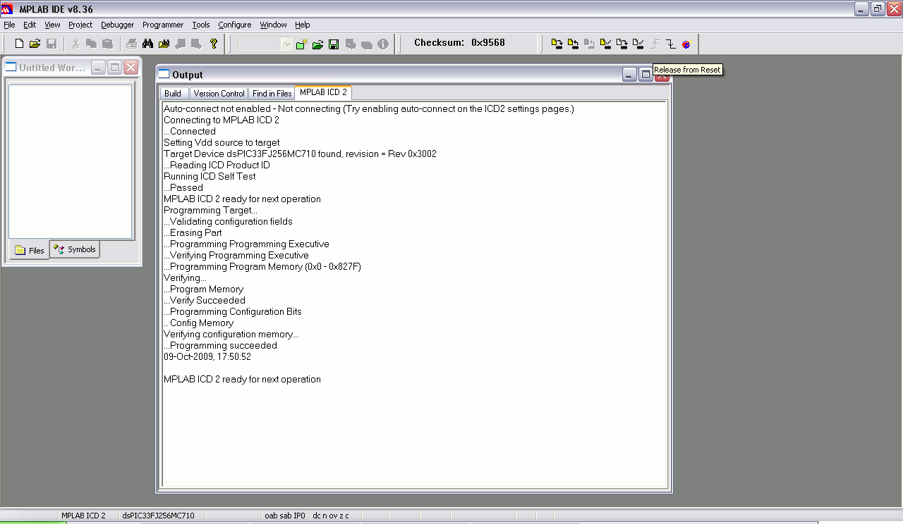](../files/File_Released_reset.png--1594.md)

Figure 10 - MPLAB IDE: Target released from reset

[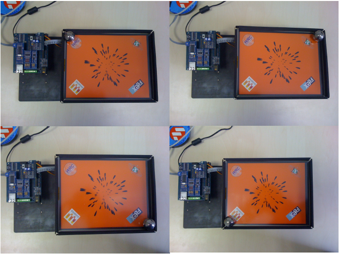](../files/File_Scicoslab10.png--1621.md)

Figure 11 – Touch panel calibration

[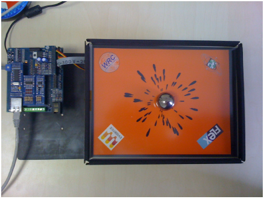](../files/File_Scicoslab11.png--1622.md)

Figure 12 – Control result

|  |

---

## Archive provenance

- [Original page](http://erika.tuxfamily.org/wiki/index.php?title=Amazing_Ball_Control_System%3A_An_application_with_the_FLEX_FULL_Motion_board_and_the_Scilab%2FScicos_code_generator) · [Archived source revision 4376](http://erika.tuxfamily.org/wiki/index.php?oldid=4376)
- Last source edit: 2012-01-24T13:49:54Z. Source retrieved on 2026-11-06; Markdown conversion completed on 2026-11-07.
- Original contributors recorded in exported history: WikiSysop, Erikadds.
- [Original MediaWiki source](../source/wikitext/1532.mediawiki) · [Original editing history](../source/history/batch-002.xml)
- [Attribution and licensing notice](../NOTICE.md). Original file-specific notices, where present, remain applicable.
