# Amazing Ball Control System: An example of PID control and UDP communication

Step 1:

- Open ScicosLab 4.4b7, the Scicos-FLEX pack is recognized by the program (refer Fig. 1).

Change the working directory to “C:\Programmi\scilab\scicoslab\_44b7\contrib\dspic”.

Type exec builder.sce to build any application of the pack.

[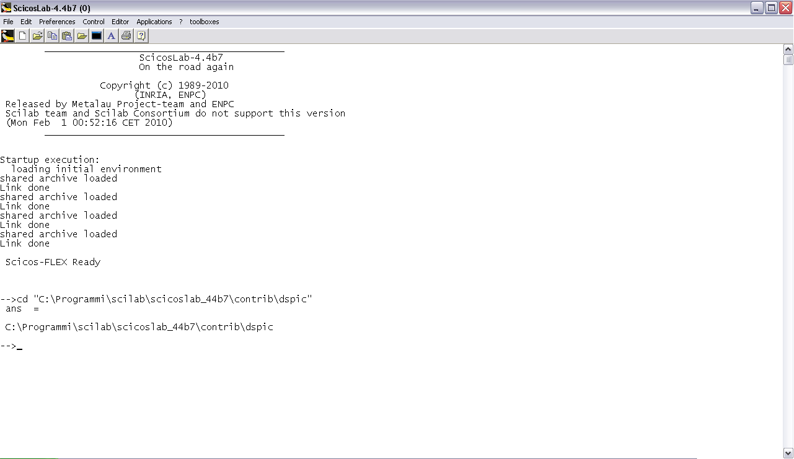](../files/File_Scicoslab1.png--1614.md)

Figure 1 – ScicosLab

Step 2:

- Open file “pid\_ctrl\_codegen\_udp\_tuning\_square\_circle.cos” (refer Fig. 2) in Scicos.

The .cos file contains the schematic for the FLEX embedded code generation (with SCICOS).

This application is for tuning coefficients of the PID control for improving system

performance.

[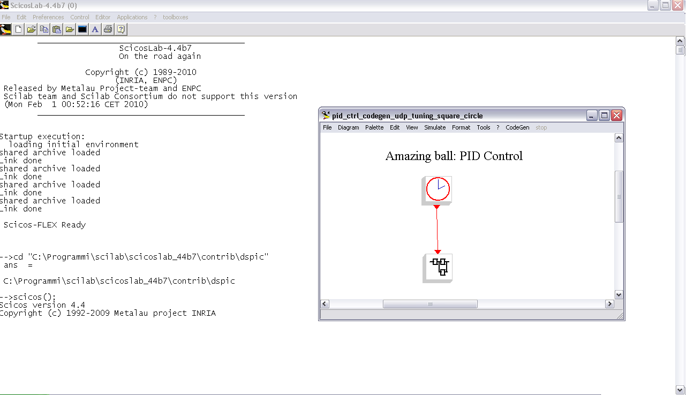](../files/File_Scicoslab2.png--1615.md)

Figure 2 – Control system schematic

Step 3:

- Click menu CodeGen and select FlexCodeGen.

Click on the super-block, the Embedded Code Generator's block property settings

window will appear (refer Fig. 3)

Provide path name and then press OK for code generation (refer Fig. 4)

[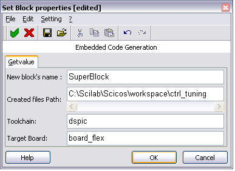](../files/File_Scicoslab3.png--1616.md)

Figure 3 – Embedded Code Generator window

[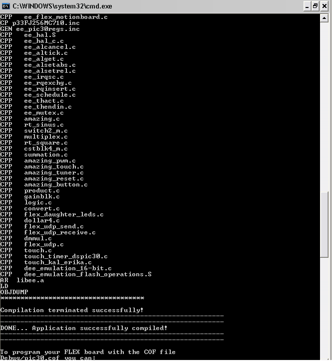](../files/File_Scicoslab4.png--1617.md)

Figure 4 – Code Generator results

Step 4:

- Open MPLAB IDE and import “pic30.cof” file created by the code generator in Step 3.

Connect the FLEX board (with DEMO2 motion control pack) to ICD for programming the

dsPic (refer Fig. 5). Program the FLEX board but do not start the application.

[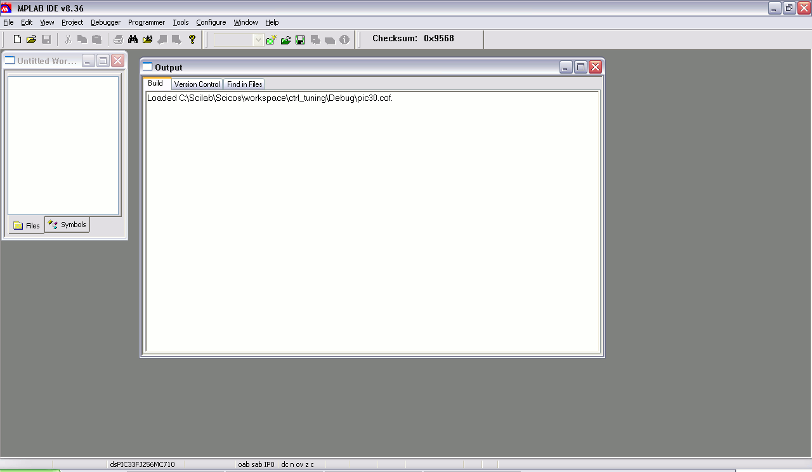](../files/File_Cof_ide1.png--1589.md)
[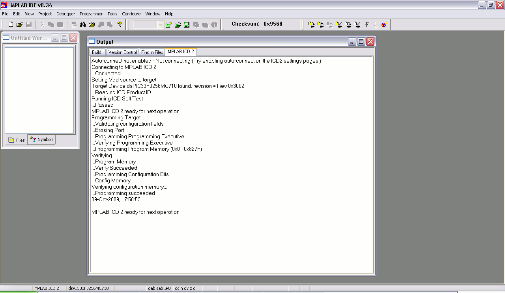](../files/File_Cof_ide2.png--1590.md)

Figure 5 - MPLAB IDE: COF file importing and target programming

Step 5:

- Check TCP/IP settings of the PC ethernet port (refer Fig. 6).

[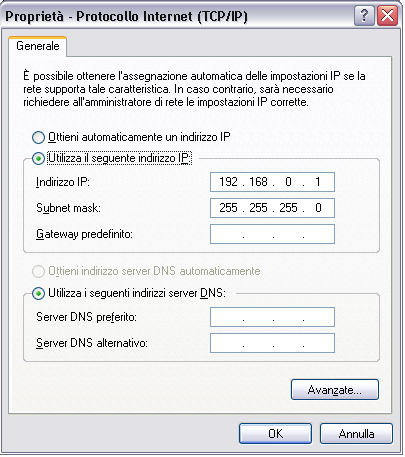](../files/File_Scicoslab6.png--1618.md)

Figure 6 – Check the TCP/IP port settings

Step 6:

- Open the PC-side file “PCside\_AmazingBall\_UDP\_PIDtuning.cos” in Scicos;

The .cos file contains the schematic for the PC-side (refer Fig. 7).

Connect the ethernet cable and start the almost-real-time simulation in SCICOS.

The application shows the received UDP data on multiple scopes and sends data for PID tuning

to the FLEX board (refer Fig. 8).

[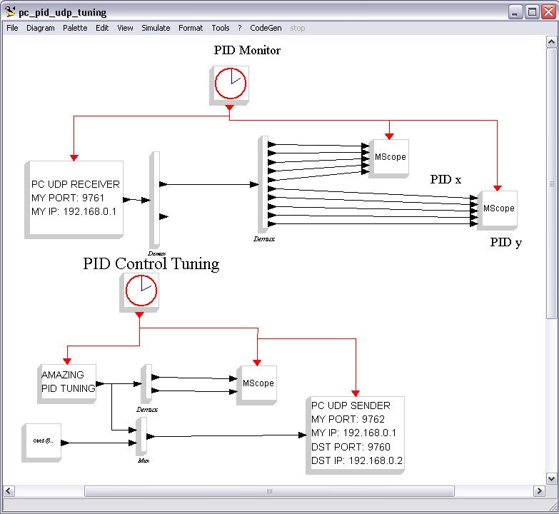](../files/File_Scicoslab7.png--1619.md)

Figure 7 – PC-side schematic

[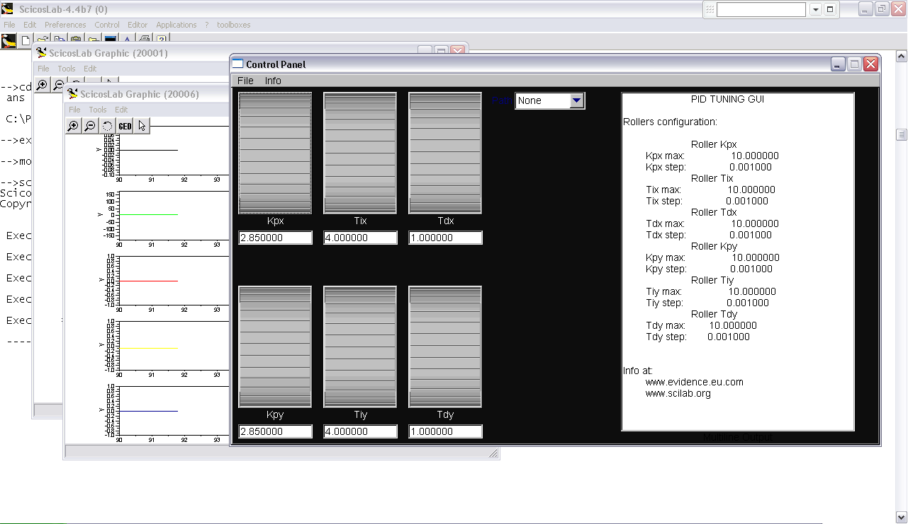](../files/File_Scicoslab8.png--1620.md)

Figure 8 – PC-side application (PID tuner)

Step 7:

- Release the reset to run the demo on the board(refer Fig.9);

Initially the application calibrates the touch screen (refer Fig. 11), then the control algorithm starts.

The application running on the board must be started after running the SCICOS diagram simulation to allow

proper initialization of the FLEX UDP interface. If the FLEX board does not receive data from the PC for any reason

the control algorithm does not start. (refer Fig.12).

[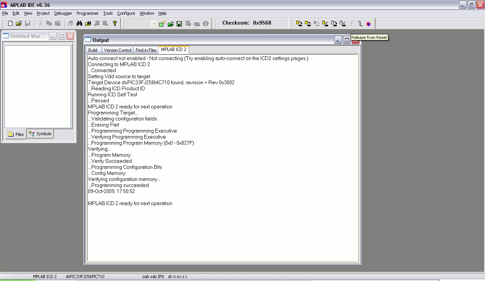](../files/File_Released_reset.png--1594.md)

Figure 9 - MPLAB IDE: Target released from reset

[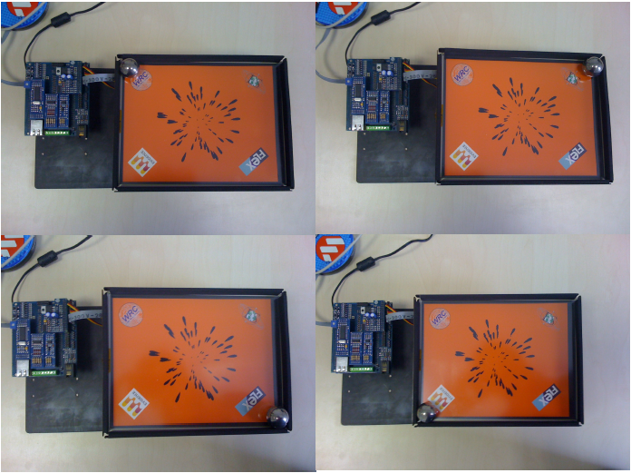](../files/File_Scicoslab10.png--1621.md)

Figure 10 – Touch panel calibration

[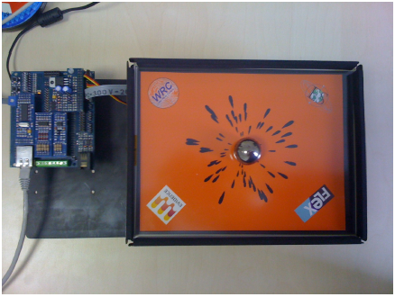](../files/File_Scicoslab11.png--1622.md)

Figure 11 – Control result

[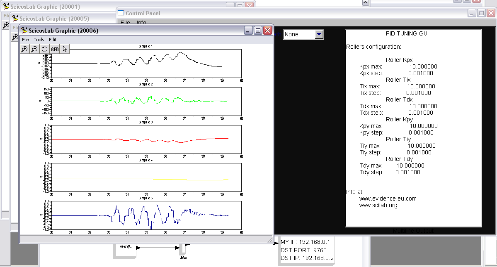](../files/File_Scicoslab12.png--1623.md)

Figure 12 – Data Plot

---

## Archive provenance

- [Original page](http://erika.tuxfamily.org/wiki/index.php?title=Amazing_Ball_Control_System%3A_An_example_of_PID_control_and_UDP_communication) · [Archived source revision 4884](http://erika.tuxfamily.org/wiki/index.php?oldid=4884)
- Last source edit: 2012-08-27T13:02:24Z. Source retrieved on 2026-11-06; Markdown conversion completed on 2026-11-07.
- Original contributors recorded in exported history: Erikadds.
- [Original MediaWiki source](../source/wikitext/1613.mediawiki) · [Original editing history](../source/history/batch-002.xml)
- [Attribution and licensing notice](../NOTICE.md). Original file-specific notices, where present, remain applicable.
