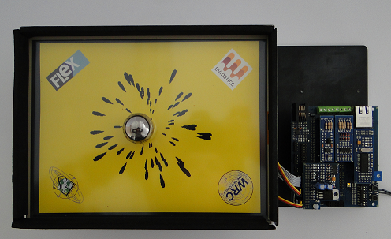

# Amazing Ball Introduction

The **Amazing Ball System**:

|  |
| --- |
| This section describes the Amazing Ball, a ball-on-plate balancing system. The realization of the system was obtained with the simultaneous consideration towards constraints like cost, performance, functionality, extendibility, and educational merit. A complete system description for the ball-on-plate system is presented.  PHYSICAL SYSTEM DESCRIPTION  The physical system consists of an mechanical plate, two actuation mechanisms for tilting the plate about two axes, a ball position sensor, instrumentation for signal processing, and real-time control software/hardware. The entire system is mounted on a mechanical (steel) base plate and is supported by four vertical springs and a central joint.  The motors are operated in angular position mode for ease of modeling and controls. A pulse-width modulated signal is employed for this purpose. The servos are powered by a 6V DC power supply.  A resistive touch sensitive glass screen (hantouch.com) that is actually meant to be a computer touchscreen was used for sensing the ball position. It provides an extremely reliable, accurate, and economical solution to the ball position sensing problem. The screen consists of three layers: a glass sheet, a conductive coating on the glass sheet, and a hard-coated conductive topsheet. An external DC voltage is applied to the four corners of the glass layer. Electrodes spread out the voltage on the glass layer creating a uniform voltage field. When the top layer is pressed by the weight the ball, the top sheet gets compressed into contact with the conductive coating on the glass layer. As a result, current is drawn from each side of the glass layer in proportion to the distance of the touch from the edge. This generates a set of four voltages at the corners of the glass-sheet. These four voltages are filtered and subsequently used for computing the ball position coordinates using simple linear relationships. The response time of this sensor is 8-15 ms which is fast enough for this application. The ball rolls on this touch-screen, which in turn is mounted on the plate.  The system can be used as an excellent test-bed for testing various control schemes. An optimal controller using full-state feedback can be designed to achieve yet better performance. Although controllers based on the linear model perform extremely well, it will interesting to apply the principles of non-linear controls and seek any further improvements in the system performance.  The system is distributed with a pre-loaded PID control system for an easier approach.  A brief guide to unpack the Amazing Ball system package:   - [Unpacking the Amazing ball package](Unpacking_the_Amazing_ball_package--1540.md "Unpacking the Amazing ball package")   The following tutorials show how to tune the control algorithm of the Amazing Ball system:   - [Amazing Ball Control System: An application with the FLEX FULL Motion board and the Scilab/Scicos code generator](Amazing_Ball_Control_System_An_application_with_the_FLEX_FULL_Motion_board_and_the_Scilab_--1532.md "Amazing Ball Control System: An application with the FLEX FULL Motion board and the Scilab/Scicos code generator") - [Amazing Ball Control System: An example of PID control and UDP communication](Amazing_Ball_Control_System_An_example_of_PID_control_and_UDP_communication--1613.md "Amazing Ball Control System: An example of PID control and UDP communication") |

---

## Archive provenance

- [Original page](http://erika.tuxfamily.org/wiki/index.php?title=Amazing_Ball_Introduction) · [Archived source revision 4378](http://erika.tuxfamily.org/wiki/index.php?oldid=4378)
- Last source edit: 2012-01-24T14:01:53Z. Source retrieved on 2026-11-06; Markdown conversion completed on 2026-11-07.
- Original contributors recorded in exported history: WikiSysop, Erikadds.
- [Original MediaWiki source](../source/wikitext/1533.mediawiki) · [Original editing history](../source/history/batch-002.xml)
- [Attribution and licensing notice](../NOTICE.md). Original file-specific notices, where present, remain applicable.
