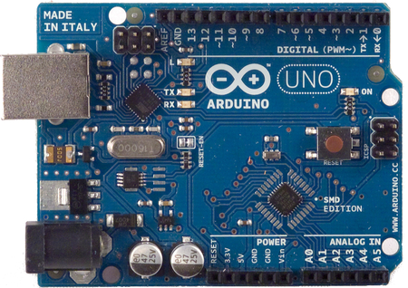

# Arduino

ERIKA Enterprise Manual for Arduino Uno board

<a id="Introduction"></a>

## Introduction

The Arduino board (see Figure 1.1) is supported by the [Atmel AVR8](Atmel_AVR8--2466.md "Atmel AVR8") porting of ERIKA Enterprise.

[](../files/File_Arduino_uno.jpg--2468.md)

Figure 1.1: The Arduino Uno board running ERIKA Enterprise

The Arduino Uno is a low cost, open-source board produced by [Arduino](http://www.arduino.cc/) with Atmel ATmega328p microcontroller, interfaces to USB, and many I/O to connect whatever device you need. To configure the usage of the Arduino Uno board, the user has to specify an appropriate BOARD\_DATA in the OIL file, as in the following example:

```
...
BOARD_DATA = ARDUINO_UNO {
...
}
...
```

The Arduino Uno board supports a set of devices which are directly available and mounted on it. These devices can be configured by adding attributes inside the BOARD\_DATA section.

The supported devices and the API functions needed to use them are described in the following sections. Please note that the current version of the board support only supports the AVR model ATmega328p MCU.

The following subsections will describe the functions available to control the Arduino Uno Board:

- *void EE\_board\_init(void);*

  Description: The function initializes the board.

<a id="LEDs"></a>

##### LEDs

The Arduino Uno Board has a 1 LED. To use the LED on the Board, the developer should specify the USELEDS attribute as TRUE, as in the following example:

```
...
BOARD_DATA = ARDUINO_UNO {
  USELEDS = TRUE;
...
}
...
```

The following subsections will describe the functions available to control the Arduino Uno LED:

- *void EE\_led\_on(void);*

  Description: The function turns on the LED.
- *void EE\_led\_off(void);*

  Description: The function turns off the LED.
- *void EE\_led\_toggle(void);*

  Description: The function toggles the LED.

<a id="Requirements"></a>

##### Requirements

ERIKA Enterprise supports Atmel AVR ATmega328p.

- Atmel Studio
- WinAVR

Useful links

- [Atmel Studio download link](http://www.atmel.com/tools/ATMELSTUDIO.aspx)
- [WinAVR download link](http://winavr.sourceforge.net/)

---

## Archive provenance

- [Original page](http://erika.tuxfamily.org/wiki/index.php?title=Arduino) · [Archived source revision 5596](http://erika.tuxfamily.org/wiki/index.php?oldid=5596)
- Last source edit: 2014-05-21T14:07:12Z. Source retrieved on 2026-11-06; Markdown conversion completed on 2026-11-07.
- Original contributors recorded in exported history: Giuseppe Serano.
- [Original MediaWiki source](../source/wikitext/2471.mediawiki) · [Original editing history](../source/history/batch-002.xml)
- [Attribution and licensing notice](../NOTICE.md). Original file-specific notices, where present, remain applicable.
