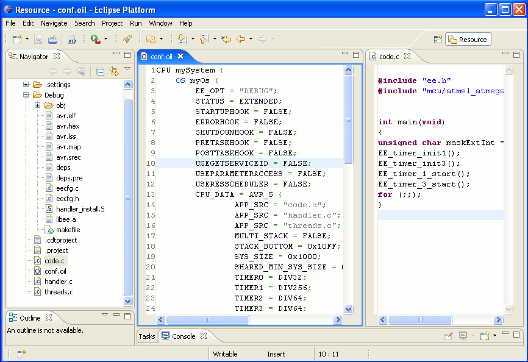
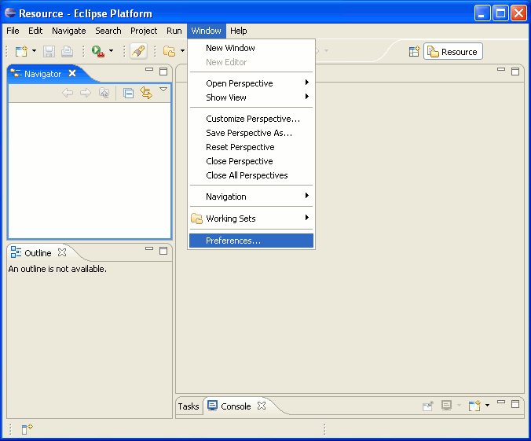
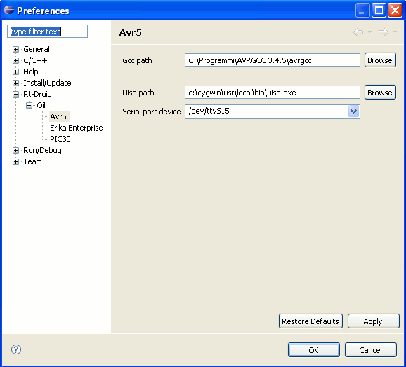
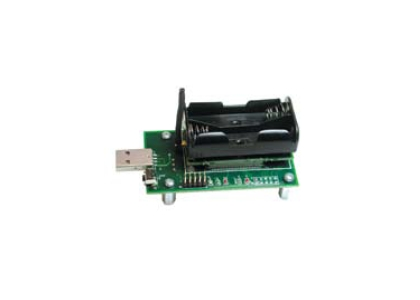
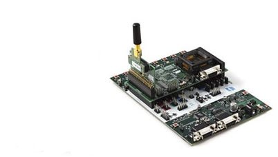
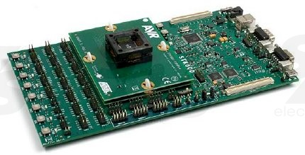
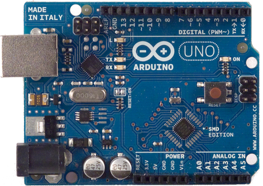

# Atmel AVR8

ERIKA Enterprise Manual for Atmel AVR8 targets

<a id="Introduction"></a>

## Introduction

Embedded microcontroller units are spreading in thousands of applications, ranging from single to distributed systems, control applications, multimedia, communication, medical applications and many others. Modern microcontrollers, which are growing in computational power, speed and interfacing capabilities, are more and more feeling the need of tools to make the development of complex scalable applications easier.

This manual describes the porting details of the ERIKA Enterprise kernel(s) for the Atmel families of microcontrollers which supports 8/16-bit RISC AVR cores (aka AVR8).

Atmel AVR8 replaces the OLD porting of the ERIKA Enterprise kernel(s) for the Atmel families of microcontrollers which supports 8/16-bit RISC AVR cores (aka AVR5) whose manual page is found [here](Atmel_AVR5--1475.md).

<a id="ERIKA_Enterprise_and_RT-Druid_for_AVR8"></a>

### ERIKA Enterprise and RT-Druid for AVR8

Embedded applications often require tight control on the temporal behavior of each single activity in the system. Real-time complex system systems such as Wireless Sensor Networks are nowadays deployed in academic and industrial environments. The very limited set of resources available in the popular hardware platforms, and the diversified domains of WSN applications, require the adoption of an Operating System responding to the following pre-requisites:

- minimum footprint to fit the limited RAM capacity (of the order of few KB);
- tunable scheduling algorithm to handle the execution of the tasks;
- an application interface acting on the kernel layer and well decoupled from OS service implementation.

Many WSNs are deployed making use of AVR8-based sensor boards like those commercialized by CrossBow Inc.

ERIKA Enterprise and RT-Druid represent the answer of Evidence Srl for the development of scalable real-time applications for AVR8.

ERIKA Enterprise provides AVR8 developers the following features:

- Traditional RTOS features:
  - Support for four conformance classes to match different application requirements;
  - Support for preemptive and non-preemptive multitasking;
  - Support for fixed priority scheduling;
  - Support for stack sharing techniques, and one-shot task model to reduce the overall stack usage;
  - Support for shared resources;
  - Support for periodic activations using Alarms;
  - Support for centralized Error Handling;
  - Support for hook functions before and after each context switch.

- RT-Druid development environment
  - Development environment based on the Eclipse IDE;
  - Support for the OIL language for the specification of the RTOS configuration;
  - Graphical configuration plugin to easily generate the OIL configuration file and to easily configure the RTOS parameters;
  - Full integration with the Cygwin development environment to provide a Unix-style scripting environment;
  - Apache ANT scripting support for code generation.

- AVR8 integration features
  - Installation setup which integrates the AVR8 GCC compiler and AVRStudio together with ERIKA Enterprise and RT-Druid;
  - Support for the Atmel JTAG ICE MKII debugger;
  - Support for the following families Atmel MCUs:
    - [MEGA](http://www.atmel.com/products/microcontrollers/avr/megaAVR.aspx)
    - [XMEGA](http://www.atmel.com/products/microcontrollers/avr/AVR_XMEGA.aspx)
    - [TINY](http://www.atmel.com/products/microcontrollers/avr/tinyavr.aspx)
  - Support for following boards
    - [Crossbow Mib510 and Mib520 Boards](http://www.xbow.com/) (ATmega128L)
    - [Atmel STK500/1 Board](http://www.atmel.com/tools/stk500.aspx) (ATmega128L)
    - [Atmel STK600 Board](http://www.atmel.com/tools/stk600.aspx) (ATxmega16D4)
    - [Arduino Uno Board](http://arduino.cc/en/Main/ArduinoBoardUno) (ATmega328p)
  - List of functions:
    - Full support of the RF230 RF solution from Atmel, with usage of the IEEE 802.15.4 MAC (ZigBee);
    - Full support for [Arduino.cc SDK 1.0.5](http://arduino.cc/en/main/software);
    - Full support for [Arduino.cc SDK 1.6.8](http://arduino.cc/en/main/software);
    - Full support for [Arduino.org SDK 1.7.9](http://www.arduino.org/software);

<a id="Integration_with_other_tools_for_AVR8"></a>

### Integration with other tools for AVR8

ERIKA Enterprise and RT-Druid aims to the best integration with the existing tools for development available from the AVR microcontrollers.
RT-Druid will be used to quickly configure the application, setting temporal parameters of real-time tasks, memory requirements, stack allocation and many other parameters. Moreover, RT-Druid generates the application template, and leaves the developer the task to implement the logic of each single task.
While programming the application, the developer can exploit the power and flexibility offered by the primitives of the ERIKA Enterprise real-time kernel.
ERIKA Enterprise also supports the compiling environments provided by Atmel, providing also direct support for the programming and JTAG solutions of Atmel.

<a id="Content_of_this_document"></a>

### Content of this document

The purpose of this document is to describe all the information needed to create, develop and modify an Erika Enterprise application for the AVR family of microcontrollers.

In particular, the document describes:

- The design flow which should be used to generate an Erika Enterprise application;
- The configuration of the development environment;
- The options which are available to configure the system.

As a final note, all the settings which are explained in this document apply both to Erika Enterprise if not otherwise stated.

```
Note: If you are looking for a step-by-step / quick guide tutorial on how to use Erika Enterprise and RT-Druid with AVR,
please read the “Erika Enterprise Tutorial for the AVR microcontrollers”, available for download on the Evidence Web site.
```

<a id="Erika_Enterprise_for_AVR8"></a>

## Erika Enterprise for AVR8

<a id="The_RT-Druid_and_Erika_Enterprise_design_flow"></a>

### The RT-Druid and Erika Enterprise design flow

The typical development environment provided by Atmel for the software development for the AVR microcontrollers is composed by the Atmel AVR Studio. Atmel AVR Studio is a development environment for Microsoft Windows which integrates a source code editor, an instruction set simulator and a debugger.

In addition to the traditional development flow, Evidence Srl provides a design and configuration environment named RT-Druid, based on [Eclipse](http://www.eclipse.org). Eclipse is an open framework initially developed by IBM, which allows the possibility of integrating various development tools in a common environment.

For that reason, when developing an application for Erika Enterprise the user is supposed to write the source code inside the RT-Druid IDE (see Figure 2.1).

[](../files/File_Avr5_eclipse_workspace.png--2318.md)

Figure 2.1: The Eclipse workspace and the RT-Druid plugins for AVR

Application compilation is also done inside the Eclipse Framework. In fact, the RTDruid code generator is able to generate the Erika Enterprise configuration files together with a set of configuration files (typically, a makefile plus a set of .c files) which are then used to compile the source code.

After that, compilation is started automatically by pressing on the “Build Project” menu item inside the “Project” menu, which automatically calls the underlying make application provided by the Cygwin environment. As an alternative, the “Build Project” command is also available by right clicking on the project name.

The choice of the Cygwin environment has been done to simplify the building process of an application: in fact, Cygwin provides a set of traditional Unix tools like make, awk, sed, which are really useful to implement a command line application building framework. Moreover, these tools are typically available for free on the Linux platform, easing in this way the porting of the application to a free development environment such as Linux.

<a id="Building_an_application_from_command_line"></a>

#### Building an application from command line

The RT-Druid plugins provide three ways to develop an application:

1. A graphical interface to simplify the development of an application, based on Eclipse.
2. A scripting interface based on [Apache ANT](http://ant.apache.org), which is the default scripting environment used in the Eclipse Framework.
3. A standalone code generator, that does not use Eclipse.

Using ANT or the standalone version, the developer can automatically generate from scripts the configuration data and the makefiles which are then used to compile the application. This removes the need of opening the graphical environment to compile an application, providing a way to implement automatic compilation scripts and regression tests.

Please refer to the RT-Druid reference manual for information about ANT scripting.

<a id="Setting_up_the_compiling_environment_for_AVR8"></a>

### Setting up the compiling environment for AVR8

Erika Enterprise has been designed to be compiled using the GNU gcc (AVR8GCC) toolchain. The AVR8 porting of ERIKA Enterprise in particular can be compiled using the GNU tools for AVR8. The porting provides both the binutils package and the gcc package, plus a set of libraries which can be used to control the various peripherals provided by the AVR8 microcontrollers.

The following list describes the various packages which contains the various parts of the compilation toolchain:

- **The GNU assembler and binutils.** This package is distributed inside the AVR8GCC Compiler Suite.

- **The GNU AVR-GCC.** The GNU assembler, binutils and compiler are available as a part of the AVRG8CC Compiler Suite.

- **C Libraries.** A set of libraries which can be used to control the peripherals implemented on the particular AVR8 chip in use. These libraries are packaged together with the AVR8-libc.

The AVR8GCC is available as:

- WinAVR project on surceforge <http://sourceforge.net/projects/winavr/>
- Linux project on Atmel <http://www.atmel.com/tools/ATMELAVRTOOLCHAINFORLINUX.aspx>
- Windows project on Atmel <http://www.atmel.com/tools/ATMELAVRTOOLCHAINFORWINDOWS.aspx>
- source code on Atmel <http://distribute.atmel.no/tools/opensource/Atmel-AVR-GNU-Toolchain/3.4.3/>

<a id="Compiler_Path"></a>

#### Compiler Path

It is possible to choose the path of the compiler in three different ways:

- Environment Variable: AVR\_TOOLS Environment Variable is able to override the path compiler set in RT-Druid during the build progress.
- Configuration File: see [RT-Druid configuration#Compiler paths](RT-Druid_configuration--2158.md#Compiler_paths "RT-Druid configuration")
- GUI Configuration: inside RT-Druid Eclipse preferences, it is possible to set the paths of above compiler. See below.

<a id="GUI_Configuration"></a>

##### GUI Configuration

Inside RT-Druid Eclipse, please go to the “Preference” item of “Window” menu, as shown in Figure 2.2,

[](../files/File_Avr5_preferences_menu.png--2321.md)

Figure 2.2: Go to the “Preference” menu

and find the “RT-Druid/Oil/AVR8 Configurator” form as depicted in Figure 2.3.

[](../files/File_Avr5_preferences.png--2320.md)

Figure 2.3: Select paths for compiler and assembler

The first textbox, labeled Gcc path, refers to the installation directory of the AVR8GCC compiler. The second and third textboxes are useful if you are using a development environment based on the Crossbow Mib5x0 board. In particular, the second textbox, labeled Uisp path, refers to the installation directory of the uisp programmer for Crossbow Mib5x0 board, and the third textbox, labeled Serial port device, refers to the COM serial port where the board is attached.

```
Warning: The install directory specified as Conpiler Path SHALL NOT include the bin directory!
That is, c:\WinAVR is correct, wheras c:\Programmi\WinAVR\bin is not.
```

<a id="Writing_software_for_AVR_using_Erika_Enterprise"></a>

### Writing software for AVR using Erika Enterprise

```
Note: Writing an application for AVR8 using ERIKA Enterprise is very simple.
Please refer to the ERIKA Enterprise Tutorial for the AVR8 architecture for a step-by-step guide
with screenshots on how to create, compile and debug a AVR8 application written with Erika Enterprise.
```

This section describes the details about the various configuration options which are available to create and compile an ERIKA Enterprise application for a AVR8 microcontroller.

```
Note: For a complete description of all the OIL parameters, please refer to the RT-Druid reference manual.
```

<a id="Internal_Types_re-definition"></a>

#### Internal Types re-definition

ERIKA Enterprise allow the user application to re-define the internal types by following `EE_OPT` inside OS object in the OIL file:

```
CPU mySystem {
  ...
  OS myOs {
    ...
    EE_OPT = " __HAS_TYPES_H__ ";
    ...
  };
  ...
};
```

The ERIKA Enterprise internal types re-definition is done wrinting a C header file named `ee_types.h`:

```
...
#define EE_TYPETICK EE_INT16
...
```

<a id="Avoid_the_generation_of_dependency_files"></a>

#### Avoid the generation of dependency files

The typical compilation process of an ERIKA Enterprise application involves the computation of a dependency file which is used to understand which are the files which needs to be compiled or updated.

To avoid the computation of these dependencies (useful when you are sure you basically have to compile everything), you can put the following `EE_OPT` inside OS object in the OIL file:

```
CPU mySystem {
  ...
  OS myOs {
    ...
    EE_OPT = " NODEPS ";
    ...
  };
  ...
};
```

<a id="Avoid_the_generation_of_.src_files_from_C_files"></a>

#### Avoid the generation of .src files from C files

The typical compilation process of an Erika Enterprise application produces various files which can be used to better analyze the code generated by the AVR8GCC compiler. In particular, from each .C file, a .SRC file is produced containing the corresponding assembler listing, which is then compiled by the Avr-Gcc compiler to produce the .o.

It is possible to avoid the intermediate step which leads to the production of the .SRC file. In that case, the compiler will be responsible of producing the .O file directly from the .C file. This in general also speeds up the compilation process a little bit.

To obtain that feature, you can put the following `EE_OPT` inside OS object in the OIL file:

```
CPU mySystem {
  ...
  OS myOs {
    ...
    EE_OPT = " NOSRC ";
    ...
  };
  ...
};
```

<a id="Printing_the_commands_executed_.28verbose_mode.29"></a>

#### Printing the commands executed (verbose mode)

The default compilation process typically prints only a compact output for each compilation step. That is in general not useful whenever a file is not compiled properly and the user wants to know the exact command which is executed in the compilation process.

To obtain a printing of the complete list of commands issued by the ERIKA Enterprise makefile, you can add the following line to the OIL file:

```
...
CPU mySystem {
  ...
  OS myOs {
    ...
    EE_OPT = " VERBOSE ";
    ...
  };
  ...
};
...
```

<a id="Configuring_the_AVR8_CPU"></a>

### Configuring the AVR8 CPU

`CPU_DATA` must be set to `AVR8` in the OIL file.

```
...
CPU mySystem {
  ...
  OS myOs {
    ...
    CPU_DATA = AVR8 {
      ...
    };
    ...
  };
  ...
};
```

<a id="Compiler_C_standard"></a>

#### Compiler C standard

The default compiler C standard is ANSI (C89). It's possible to change compiler C standard to C99 enabling `C99 = YES` attribute inside `CPU_DATA` object in the OIL file.

```
...
CPU_DATA = AVR8 {
  ...
  C99 = YES;
  ...
};
...
```

**NOTE:** This feature IS NOT currently implemented in RT-Druid. For now, to enable the feature you must put the follwing `EE_OPT` inside `OS` object in the OIL file.

```
...
OS myOS {
  ...
  EE_OPT = "__AVR8_GCC_C99__";
  ...
};
...
```

<a id="Compiler_Optimizations"></a>

#### Compiler Optimizations

The default compiler set-up does not include optimizations. It's possible to change compiler optimizations to `SIZE` optimization enabling `COPT = SIZE` attribute inside `CPU_DATA` object in the OIL file.

```
...
CPU_DATA = AVR8 {
  ...
  COPT = SIZE;
  ...
};
...
```

**NOTE:** This feature IS NOT currently implemented in RT-Druid. For now, to enable the feature you must put the follwing `EE_OPT` inside `OS` object in the OIL file.

```
...
OS myOS {
  ...
  EE_OPT = "__AVR8_GCC_OSIZE__";
  ...
};
...
```

<a id="Source_files_composing_an_application"></a>

#### Source files composing an application

The source files which can be put in an RT-Druid project are composed by C-language files (with extension .c) and Assembler files (with extension .S). Assembler files are always preprocessed by the C preprocessor. All the application files which has to be included in the final application needs to be listed inside the OIL file, as in the following OIL example:

```
...
CPU_DATA = AVR8 {
  ...
  APP_SRC = " file_1 .c ";
  APP_SRC = " file_2 .c ";
  ...
};
...
```

<a id="Stack_handling"></a>

#### Stack handling

ERIKA Enterprise can be configured as monostack or multistack.

In a monostack configuration, only a single stack exists in the system. No blocking primitives are supported, and all the tasks and interrupts execute on the same stack. In this case, the one and only stack starts from the top of the application allocated memory, growing towards higher addresses. The monostack configuration can not be used if the application needs to call RTOS primitives such as `WaitSem()` and `WaitEvent()`. Moreover, it cannot be used when ERIKA Enterprise conformance classes ECC1 and ECC2 are used.

To configure a monostack kernel in the OIL file, the user has to write the following lines:

```
...
CPU_DATA = AVR8 {
  ...
  MULTI_STACK = FALSE;
  ...
};
...
```

In a multistack configuration, the kernel support the existence of different stacks in the same application. Having different stacks allow the application tasks to use blocking primitives like `WaitSem()` and `WaitEvent()`, which basically may block the execution of the running task. In that case, the calling task must have a private stack which is changed upon blocking. The stack will be selected again when the task will be rescheduled. There are different stacks available in a multistack configuration:

- A shared stack (used by all the tasks which have a shared stack);
- An IRQ stack (used by all the ISR Type 2 routines);
- A set of private stacks (one for each task which has selected a private stack).

In the AVR8 architecture, the shared stack works as in the monostack configuration, that is it is allocated at the end of the SRAM data memory, growing towards lower addresses. The IRQ stack and the private stacks, instead, are allocated in the application data space as arrays. The following example shows an OIL configuration which configures a multistack kernel without a separate IRQ stack (in this case, IRQ handlers execute on the stack of the interrupted task):

```
...
CPU_DATA = AVR8 {
  ...
  MULTI_STACK = TRUE {
    IRQ_STACK = FALSE;
  };
  ...
};
...
```

The following example shows an OIL configuration which configures a multistack kernel with a separate IRQ stack (in this case, some registers are saved on the stack of the interrupted task, but the IRQ handler C function is executed on a separate IRQ stack). In this example is showed also the task0 that uses a private stack.

```
...
CPU mySystem {
  ...
  OS myOs {
    ...
    CPU_DATA = AVR8 {
      ...
      MULTI_STACK = TRUE {
        IRQ_STACK = TRUE {
          SYS_SIZE = 64;
        };
      };
      ...
    };
    ...
  };
  ...
  TASK Task0 {
    ...
    STACK = PRIVATE {
      SYS_SIZE = 64;
    };
    ...
  };
  ...
};
...
```

<a id="Interrupt_Handling"></a>

### Interrupt Handling

ERIKA Enterprise for AVR8 provide support for fast Interrupt Service Routines (ISR) which do not require any RTOS primitive to be called, as well as regular ISRs, which can call RTOS primitives (e.g., a timer interrupt can call `ActivateTask()` to activate a periodic task). The first kind of ISRs are called ISR Type 1, and always MUST have hardware interrupt priority greater than the second kind of ISRs which are called ISR Type 2.

To declare an ISR of tipe 1 or 2, the user have to specify inside the OIL file a set of parameters: the interrupt source used by the ISR, the type of ISR, and finally the symbol of the handler function associated with the ISR:

```
...
CPU mySystem {
  ...
  OS myOs {
    ...
  };
  ...
  ISR <SYMBOL> {
    CATEGORY = <TYPE>;
    ENTRY = "<ENTRY>";
    PRIORITY = <PRIORITY>;
  };
  ...
};
...
```

Where:

- `<TYPE>` is the type of the ISR (1 or 2).
- `<ENTRY>` is the Interrupt Vector Table Entry identifier which is microcontroller dependent.
- `<PRIORITY>` is the hardware interrupt priority which is microcontroller dependent.
- `<SYMBOL>` is the symbol of the handler function associated with the ISR. that must be the parameter of ISR<TYPE>() ISR signature, and <ENTRY> is the fixed Interrupt Vector Table Entry identifier.

The application source C code MUST contain the following `ISR<TYPE>(<SYMBOL>)` construct to define a Interrupt Service Routines.

```
...
ISR<TYPE>(<SYMBOL>)
{
  ...
}
...
```

<a id="Configuring_a_particular_AVR8_microcontroller"></a>

### Configuring a particular AVR8 microcontroller

Atmel produces various families of the AVR8 microcontrollers, each one with different peripherals and memory sizes.

<a id="MEGA_Family"></a>

#### MEGA Family

The AVR8GCC specifies the various peripherals and memory areas by passing an appropriate command line parameter which selects the right linker script for the specified device. For that reason, the OIL file allows the specification of the microcontroller used, as in the following example:

```
...
CPU mySystem {
  ...
  OS myOs {
    ...
    CPU_DATA = AVR8 {
      ...
    };
    ...
    MCU_DATA = MEGA {
      MODEL = MEGA_328p;
    };
    ...
  }
  ...
};
```

Currently, ERIKA Enterprise supports the following values for the `MODEL` attribute for MEGA family of AVR8 microcontrollers:

- `MEGA_128`: [ATmega128(L)](http://www.atmel.com/devices/ATMEGA128.aspx), 8-bit AVR Microcontroller, 128KB Flash, 64-pin.
- `MEGA_1281`: [ATmega1281](http://www.atmel.com/devices/ATMEGA1281.aspx), 8-bit AVR Microcontroller, 128KB Flash, 64-pin.
- `MEGA_328`: [ATmega328](http://www.atmel.com/devices/ATMEGA328.aspx), 8-bit AVR Microcontroller, 32KB Flash, 28/32-pin.
- `MEGA_328p`: [ATmega328P](http://www.atmel.com/devices/ATMEGA328P.aspx), 8-bit picoPower AVR Microcontroller, 32KB Flash, 28/32-pin.

<a id="Interrupt_Vector_Table"></a>

##### Interrupt Vector Table

The MEGA family of AVR8 microcontroller has an interrupt vector table which is stored in the flash memory. The lowest addresses of the interrupt vector table is allocated to the RESET and to the interrupt vectors. Interrupt handlers placed at lower addresses has higher hardware priorities than interrupt handlers placed at higher addresses. The complete list of vectors entries is shown below for every supported microcontroller.

- ATmega128(L)
  - `RESET`: External Pin, Power-on Reset, Brown-out Reset, Watchdog Reset, and JTAG AVR Reset
  - `INT0`: External Interrupt Request 0
  - `INT1`: External Interrupt Request 1
  - `INT2`: External Interrupt Request 2
  - `INT3`: External Interrupt Request 3
  - `INT4`: External Interrupt Request 4
  - `INT5`: External Interrupt Request 5
  - `INT6`: External Interrupt Request 6
  - `INT7`: External Interrupt Request 7
  - `TIMER2_COMP`: Timer/Counter2 Compare Match
  - `TIMER2_OVF`: Timer/Counter2 Overflow
  - `TIMER1_CAPT`: Timer/Counter1 Capture Event
  - `TIMER1_COMPA`: Timer/Counter1 Compare Match A
  - `TIMER1_COMPB`: Timer/Counter1 Compare Match B
  - `TIMER1_OVF`: Timer/Counter1 Overflow
  - `TIMER0_COMP`: Timer/Counter0 Compare Match
  - `TIMER0_OVF`: Timer/Counter0 Overflow
  - `SPI_STC`: SPI Serial Transfer Complete
  - `USART0_RX`: USART0 Rx Complete
  - `USART0_UDRE`: USART0 Data Register Empty
  - `USART0_TX`: USART0 Tx Complete
  - `ADC`: ADC Conversion Complete
  - `EE_READY`: EEPROM Ready
  - `ANALOG_COMP`: Analog Comparator
  - `TIMER1_COMPC`: Timer/Counter1 Compare Match C
  - `TIMER3_CAPT`: Timer/Counter3 Capture Event
  - `TIMER3_COMPA`: Timer/Counter3 Compare Match A
  - `TIMER3_COMPB`: Timer/Counter3 Compare Match B
  - `TIMER3_COMPC`: Timer/Counter3 Compare Match C
  - `TIMER3_OVF`: Timer/Counter3 Overflow
  - `USART1_RX`: USART1 Rx Complete
  - `USART1_UDRE`: USART1 Data Register Empty
  - `USART1_TX`: USART1, Tx Complete
  - `TWI`: Two-wire Serial Interface
  - `SPM_READY`: Store Program Memory Ready

- ATmega1281
  - `RESET`: External Pin, Power-on Reset, Brown-out Reset, Watchdog Reset, and JTAG AVR Reset
  - `INT0`: External Interrupt Request 0
  - `INT1`: External Interrupt Request 1
  - `INT2`: External Interrupt Request 2
  - `INT3`: External Interrupt Request 3
  - `INT4`: External Interrupt Request 4
  - `INT5`: External Interrupt Request 5
  - `INT6`: External Interrupt Request 6
  - `INT7`: External Interrupt Request 7
  - `PCINT0`: Pin Change Interrupt Request 0
  - `PCINT1`: Pin Change Interrupt Request 1
  - `PCINT2`: Pin Change Interrupt Request 2
  - `WDT`: Watchdog Time-out Interrupt
  - `TIMER2_COMPA`: Timer/Counter2 Compare Match A
  - `TIMER2_COMPB`: Timer/Counter2 Compare Match B
  - `TIMER2_OVF`: Timer/Counter2 Overflow
  - `TIMER1_CAPT`: Timer/Counter1 Capture Event
  - `TIMER1_COMPA`: Timer/Counter1 Compare Match A
  - `TIMER1_COMPB`: Timer/Counter1 Compare Match B
  - `TIMER1_COMPC`: Timer/Counter1 Compare Match C
  - `TIMER1_OVF`: Timer/Counter1 Overflow
  - `TIMER0_COMPA`: Timer/Counter0 Compare Match A
  - `TIMER0_COMPB`: Timer/Counter0 Compare match B
  - `TIMER0_OVF`: Timer/Counter0 Overflow
  - `SPI_STC`: SPI Serial Transfer Complete
  - `USART0_RX`: USART0 Rx Complete
  - `USART0_UDRE`: USART0 Data Register Empty
  - `USART0_TX`: USART0 Tx Complete
  - `ANALOG_COMP`: Analog Comparator
  - `ADC_ADC`: Conversion Complete
  - `EE_READY`: EEPROM Ready
  - `TIMER3_CAPT`: Timer/Counter3 Capture Event
  - `TIMER3_COMPA`: Timer/Counter3 Compare Match A
  - `TIMER3_COMPB`: Timer/Counter3 Compare Match B
  - `TIMER3_COMPC`: Timer/Counter3 Compare Match C
  - `TIMER3_OVF`: Timer/Counter3 Overflow
  - `USART1_RX`: USART1 Rx Complete
  - `USART1_UDRE`: USART1 Data Register Empty
  - `USART1_TX`: USART1 Tx Complete
  - `TWI`: 2-wire Serial Interface
  - `SPM_READY`: Store Program Memory Ready
  - `TIMER4_CAPT`: Timer/Counter4 Capture Event
  - `TIMER4_COMPA`: Timer/Counter4 Compare Match A
  - `TIMER4_COMPB`: Timer/Counter4 Compare Match B
  - `TIMER4_COMPC`: Timer/Counter4 Compare Match C
  - `TIMER4_OVF`: Timer/Counter4 Overflow
  - `TIMER5_CAPT`: Timer/Counter5 Capture Event
  - `TIMER5_COMPA`: Timer/Counter5 Compare Match A
  - `TIMER5_COMPB`: Timer/Counter5 Compare Match B
  - `TIMER5_COMPC`: Timer/Counter5 Compare Match C
  - `TIMER5_OVF`: Timer/Counter5 Overflow
  - `USART2_RX`: USART2 Rx Complete
  - `USART2_UDRE`: USART2 Data Register Empty
  - `USART2_TX`: USART2 Tx Complete
  - `USART3_RX`: USART3 Rx Complete
  - `USART3_UDRE`: USART3 Data Register Empty
  - `USART3_TX`: USART3 Tx Complete

- ATmega328 and ATmega328P
  - `RESET`: External Pin, Power-on Reset, Brown-out Reset and Watchdog System Reset
  - `INT0`: External Interrupt Request 0
  - `INT1`: External Interrupt Request 1
  - `PCINT0`: Pin Change Interrupt Request 0
  - `PCINT1`: Pin Change Interrupt Request 1
  - `PCINT2`: Pin Change Interrupt Request 2
  - `WDT`: Watchdog Time-out Interrupt
  - `TIMER2_COMPA`: Timer/Counter2 Compare Match A
  - `TIMER2_COMPB`: Timer/Counter2 Compare Match B
  - `TIMER2_OVF`: Timer/Counter2 Overflow
  - `TIMER1_CAPT`: Timer/Counter1 Capture Event
  - `TIMER1_COMPA`: Timer/Counter1 Compare Match A
  - `TIMER1_COMPB`: Timer/Coutner1 Compare Match B
  - `TIMER1_OVF`: Timer/Counter1 Overflow
  - `TIMER0_COMPA`: Timer/Counter0 Compare Match A
  - `TIMER0_COMPB`: Timer/Counter0 Compare Match B
  - `TIMER0_OVF`: Timer/Counter0 Overflow
  - `SPI_STC`: SPI Serial Transfer Complete
  - `USART_RX`: USART Rx Complete
  - `USART_UDRE`: USART, Data Register Empty
  - `USART_TX`: USART, Tx Complete
  - `ADC_ADC`: Conversion Complete
  - `EE_READY`: EEPROM Ready
  - `ANALOG_COMP`: Analog Comparator
  - `TWI`: 2-wire Serial Interface
  - `SPM_READY`: Store Program Memory Ready

All peripheral Interrupts are prioritized according to their interrupt vector address, where the lowest interrupt vector address has the highest interrupt priority.

The `PRIORITY` attribute of the `ISR` object in the OIL is USELESS.

<a id="External_IRQs"></a>

##### External IRQs

External IRQs are enabled by the following code in OIL file:

```
...
MCU_DATA = MEGA {
  ...
  USEIC = TRUE;
  ...
};
...
```

The user MUST also configure the ISRs related to external interrupts in the OIL file and write the corresponding `ISR<TYPE>()` code in application.

<a id="EE_IC_enable_external_IRQ"></a>

###### EE\_IC\_enable\_external\_IRQ

To use the external interrupt source the user must set the external interrupt mask with the following function.

**Synopsis**

```
void EE_IC_enable_external_IRQ(EE_TYPEIRQMASK i);
```

**Description**

Enables the external interrupt source that are specified in the 8-bit bitmask. For example, if the third bit in the bitmask is set, the third external interrupt will be enabled.

<a id="EE_IC_clear_pending_IRQ"></a>

###### EE\_IC\_clear\_pending\_IRQ

**Synopsis**

```
void EE_IC_clear_pending_IRQ(void);
```

**Description**

Clears ALL the pending interrupts.

<a id="Timers"></a>

##### Timers

The number of hardware timers in the MEGA family is highly dependent on the particular chip used. For example, the ATmega128 device has 4 timers (2 8-bit timers and 2 16-bit timers).

The timers used in the application with the corresponding prescalers can be specified in the OIL file (these settings applies to ATmega128).

The following example show how to configure a set of timers:

```
...
MCU_DATA = MEGA {
  ...
  TIMER0 = DIV32;
  TIMER1 = DIV8;
  TIMER2 = DIV64;
  TIMER3 = DIV1;
  ...
};
...
```

The prescaler factor for timers are DIV1, DIV8, DIV64, DIV256, and DIV1024. The timer0 have also the prescaler factor DIV32. The User can use inside the source code of application the following functions to use the timer.

To control the system timers the following functions are available:

- *void EE\_timer\_initx(EE\_UINT8 max\_tick);*

  Description: Inizialize the timerx (x = 0,1,2,3).
- *void EE\_timer\_x\_start(void);*

  Description: Start the timerx (x = 0,1,2,3).
- *void EE\_timer\_x\_stop(void);*

  Description: Stop the timerx (x = 0,1,2,3).
- *void EE\_timer\_x\_get(void);*

  Description: Return the value of the counter register of the timerx (x = 0,1,2,3).

<a id="UART"></a>

##### UART

The number of hardware UART units in the MEGA family is highly dependent on the particular chip used. For example, the ATmega128 device has 2 UART units.

The following example show how to configure the UART driver:

```
...
MCU_DATA = MEGA {
  ...
  USEUART = TRUE;
  ...
};
...
```

<a id="SPI"></a>

##### SPI

The number of hardware SPI units in the MEGA family is highly dependent on the particular chip used. For example, the ATmega128 device has only 1 SPI unit.

The following example show how to configure the SPI driver:

```
...
MCU_DATA = MEGA {
  ...
  USESPI = TRUE;
  ...
};
...
```

<a id="XMEGA_Family"></a>

#### XMEGA Family

The AVR8GCC specifies the various peripherals and memory areas by passing an appropriate command line parameter which selects the right linker script for the specified device. For that reason, the OIL file allows the specification of the microcontroller used, as in the following example:

```
...
CPU mySystem {
  ...
  OS myOs {
    ...
    CPU_DATA = AVR8 {
      ...
    };
    ...
    MCU_DATA = XMEGA {
      MODEL = MEGA_16d4;
    };
    ...
  }
  ...
};
```

Currently, ERIKA Enterprise supports the following values for the MODEL attribute for XMEGA family of AVR8 microcontrollers:

- `MEGA_16d4`: [ATxmega16d4](http://www.atmel.com/devices/ATXMEGA16D4.aspx), 8/16-bit AVR XMEGA D4 Microcontroller, 16KB Flash, 44-pin.
- `MEGA_32d4`: [ATxmega32d4](http://www.atmel.com/devices/ATXMEGA32D4.aspx), 8/16-bit AVR XMEGA D4 Microcontroller, 32KB Flash, 44-pin.

<a id="Interrupt_Vector_Table_2"></a>

##### Interrupt Vector Table

The XMEGA family of AVR8 microcontroller has an interrupt vector table which is stored in the flash memory. The lowest addresses of the interrupt vector table is allocated to the RESET and to the interrupt vectors. Interrupt handlers placed at lower addresses has higher hardware priorities than interrupt handlers placed at higher addresses. The complete list of vectors entries is shown below for every supported microcontroller.

- ATxmega16d4 and ATxmega32d4
  - `RESET`
  - `OSC_XOSCF`: Crystal Oscillator Failure Interrupt vector (NMI)
  - `PORTC_INT0`: Port C Interrupt0
  - `PORTC_INT1`: Port C Interrupt1
  - `PORTR_INT0`: Port R Interrupt0
  - `PORTR_INT1`: Port R Interrupt1
  - `RTC_OVF`: Real Time Counter Overflow
  - `RTC_COMP`: Real Time Counter Overflow
  - `TWIC_TWIS`: Two-Wire Interface on Port C Slave
  - `TWIC_TWIM`: Two-Wire Interface on Port C Master
  - `TCC0_OVF`: Timer/Counter 0 on port C Overflow/Undeflow
  - `TCC0_ERR`: Timer/Counter 0 on port C Error
  - `TCC0_CCA`: Timer/Counter 0 on port C compare or capture channel A
  - `TCC0_CCB`: Timer/Counter 0 on port C compare or capture channel B
  - `TCC0_CCC`: Timer/Counter 0 on port C compare or capture channel C
  - `TCC0_CCD`: Timer/Counter 0 on port C compare or capture channel D
  - `TCC1_OVF`: Timer/Counter 1 on port C Overflow/Undeflow
  - `TCC1_ERR`: Timer/Counter 1 on port C Error
  - `TCC1_CCA`: Timer/Counter 1 on port C compare or capture channel A
  - `TCC1_CCB`: Timer/Counter 1 on port C compare or capture channel B
  - `SPIC_INT`: SPI on port C
  - `USARTC0_RXC`: USART 0 on port C receive complete
  - `USARTC0_DRE`: USART 0 on port C data register empty
  - `USARTC0_RXC`: USART 0 on port C transmit complete
  - `NVM_EE`: Non-Volatile Memory EEPROM
  - `NVM_SPM`: Non-Volatile Memory SPM
  - `PORTB_INT0`: Port B Interrupt0
  - `PORTB_INT1`: Port B Interrupt1
  - `PORTE_INT0`: Port E Interrupt0
  - `PORTE_INT1`: Port E Interrupt1
  - `TWIE_TWIS`: Two-Wire Interface on Port E Slave
  - `TWIE_TWIM`: Two-Wire Interface on Port E Master
  - `TCE0_OVF`: Timer/Counter 0 on port E Overflow/Undeflow
  - `TCE0_ERR`: Timer/Counter 0 on port E Error
  - `TCE0_CCA`: Timer/Counter 0 on port E compare or capture channel A
  - `TCE0_CCB`: Timer/Counter 0 on port E compare or capture channel B
  - `TCE0_CCC`: Timer/Counter 0 on port E compare or capture channel C
  - `TCE0_CCD`: Timer/Counter 0 on port E compare or capture channel D
  - `PORTD_INT0`: Port D Interrupt0
  - `PORTD_INT1`: Port D Interrupt1
  - `PORTA_INT0`: Port A Interrupt0
  - `PORTA_INT1`: Port A Interrupt1
  - `ACA_AC0`: Analog Comparator on Port A analog comparator 0
  - `ACA_AC1`: Analog Comparator on Port A analog comparator 1
  - `ACA_ACW`: Analog Comparator on Port A analog comparator window
  - `ADCA_CH0`: Analog to Digital Converter on Port A channel 0
  - `TCD0_OVF`: Timer/Counter 0 on port D Overflow/Undeflow
  - `TCD0_ERR`: Timer/Counter 0 on port D Error
  - `TCD0_CCA`: Timer/Counter 0 on port D compare or capture channel A
  - `TCD0_CCB`: Timer/Counter 0 on port D compare or capture channel B
  - `TCD0_CCC`: Timer/Counter 0 on port D compare or capture channel C
  - `TCD0_CCD`: Timer/Counter 0 on port D compare or capture channel D
  - `SPID_INT`: SPI on port D
  - `USARTD0_RXC`: USART 0 on port D receive complete
  - `USARTD0_DRE`: USART 0 on port D data register empty
  - `USARTD0_RXC`: USART 0 on port D transmit complete

All peripherals can select between three different priority levels for their interrupts: low, medium, and high. Interrupts are prioritized according to their level and their interrupt vector address. Medium-level interrupts will interrupt low-level interrupt handlers. High-level interrupts will interrupt both medium- and low-level interrupt handlers. Within each level, the interrupt priority is decided from the interrupt vector address, where the lowest interrupt vector address has the highest interrupt priority.

The `PRIORITY` attribute of the `ISR` object in the OIL is related priority level: `1` for level low, `2` for level medium and `3` for level high.

<a id="Program_Space_Utilities"></a>

##### Program Space Utilities

In order to enable Program Space Utilities usage - for a program to access data stored in program space (flash memory) of the device - in the XMEGA family drivers the user MUST add the following code into OIL file:

```
...
MCU_DATA = XMEGA {
  ...
  AVR_PGMSPACE = YES;
  ...
};
...
```

<a id="Timer_Counter_Type_1"></a>

##### Timer Counter Type 1

In order to enable Time Counter Type 1 devices in the XMEGA family drivers the user MUST add the following code into OIL file:

```
...
MCU_DATA = XMEGA {
  ...
  USE_TC_HW = YES;
  ...
};
...
```

<a id="MCU_Driver"></a>

##### MCU Driver

The MCU Driver provides MCU services for Clock and RAM initialization and other MCU specific services.

In order to enable the MCU Driver for XMEGA Family of AVR8 microcontroller the user MUST add the follwing code in the OIL file:

```
...
MCU_DATA = XMEGA {
  ...
  ENABLE_MCU_DRIVER = TRUE { 
    ...
  };
  ...
};
...
```

<a id="Error_checking"></a>

###### Error checking

The MCU Driver offers two levels of error checking, extended status for development phase and standard status for production phase.

The extended status allows for enhanced plausibility checks on calling MCU Driver services. Due to the additional error checking it requires more execution time and memory
space than the standard version. However, many errors can be found in a test phase. After all errors have been eliminated, the systemcan be recompiled with the standard version.

In order to enable the extended status for MCU Driver the user MUST add the following code into OIL file:

```
...
MCU_DATA = XMEGA {
  ...
  ENABLE_MCU_DRIVER = TRUE { 
    ...
    MCU_STATUS = EXTENDED;
    ...
  };
  ...
};
...
```

<a id="APIs_Selection"></a>

###### APIs Selection

By default the MCU Driver enables the `EE_Mcu_Init()` API only. To anable each other API of the MCU Driver the user MUST add the following code into OIL file:

```
...
MCU_DATA = XMEGA {
  ...
  ENABLE_MCU_DRIVER = TRUE { 
    ...
    MCU_DEINIT_API = TRUE;
    MCU_INITCLOCK_API = TRUE;
    MCU_DEINITCLOCK_API = TRUE;
    MCU_GETCLOCKSTATUS_API = TRUE;
    MCU_DISTRIBUTECLOCK_API = TRUE;
    MCU_SETMODE_API = TRUE;
    MCU_GETRESETREASON_API = TRUE;
    MCU_PERFORMRESET_API = TRUE;
    ...
  };
  ...
};
...
```

Where:

- `MCU_DEINIT_API` enables `EE_Mcu_DeInit()` API
- `MCU_INITCLOCK_API` enables `EE_Mcu_InitClock()` API
- `MCU_DEINITCLOCK_API` enables `EE_Mcu_DeInitClock()` API
- `MCU_GETCLOCKSTATUS_API` enables `EE_Mcu_GetClockStatus()` API
- `MCU_DISTRIBUTECLOCK_API` enables `EE_Mcu_DistributeClock()` API
- `MCU_SETMODE_API` enables `EE_Mcu_SetMode()` API
- `MCU_GETRESETREASON_API` enables `EE_Mcu_GetResetReason()` API
- `MCU_PERFORMRESET_API` enables `EE_Mcu_PerformReset()` API

<a id="Power_Reduction"></a>

###### Power Reduction

The Power Reduction is used to shutdown unused peripherals.

In order to enable the Power Reduction for MCU Driver the user MUST add the following code into OIL file:

```
...
MCU_DATA = XMEGA {
  ...
  ENABLE_MCU_POWER_REDUCTION = YES {
    PULL_UP = FALSE;
    PORT_OUT = FALSE;
    JTAG = FALSE;
  };
  ...
};
...
```

By default the unused port pins are set as input port pins with a pull-down.

- The user can change the direction of the port pin from input to output changing the `PORT_OUT` attribute from `FALSE</code< to <code>TRUE`.
- The user can set a pull-up to unused port pins changing the `PULL_UP` attribute from `FALSE</code< to <code>TRUE`.
- The user can disable the JTAG port pins during the sleep mode changing the `JTAG` attribute from `FALSE</code< to <code>TRUE`.

<a id="E2P_Driver"></a>

##### E2P Driver

The E2P Driver provides E2P (EEPROM) provides services for reading, writing, erasing to/from an EEPROM. It also provides a service for comparing a data block in the EEPROM with a data block in the memory (e.g. RAM). The behaviour of those services can be synchronous or asynchronous.

In order to enable the E2P Driver for XMEGA Family of AVR8 microcontroller the user MUST add the follwing code in the OIL file:

```
...
MCU_DATA = XMEGA {
  ...
  ENABLE_E2P_DRIVER = TRUE { 
    ...
  };
  ...
};
...
```

<a id="Error_checking_2"></a>

###### Error checking

The E2P Driver offers two levels of error checking, extended status for development phase and standard status for production phase.

The extended status allows for enhanced plausibility checks on calling E2P Driver services. Due to the additional error checking it requires more execution time and memory
space than the standard version. However, many errors can be found in a test phase. After all errors have been eliminated, the systemcan be recompiled with the standard version.

In order to enable the extended status for E2P Driver the user MUST add the following code into OIL file:

```
...
MCU_DATA = XMEGA {
  ...
  ENABLE_E2P_DRIVER = TRUE { 
    ...
    E2P_STATUS = EXTENDED;
    ...
  };
  ...
};
...
```

<a id="Synchronous_or_Aynchronous_Behaviour"></a>

###### Synchronous or Aynchronous Behaviour

By default the E2P Driver has an Ansychronous Behaviour. The user can ca

<a id="APIs_Selection_2"></a>

###### APIs Selection

By default the E2P Driver enables the `EE_E2p_Init()` API only. To anable each other API of the E2P Driver the user MUST add the following code into OIL file:

```
...
MCU_DATA = XMEGA {
  ...
  ENABLE_EP2_DRIVER = TRUE { 
    ...
    E2P_DEINIT_API = TRUE;
    E2P_INITCLOCK_API = TRUE;
    E2P_DEINITCLOCK_API = TRUE;
    E2P_GETCLOCKSTATUS_API = TRUE;
    E2P_DISTRIBUTECLOCK_API = TRUE;
    E2P_SETMODE_API = TRUE;
    E2P_GETRESETREASON_API = TRUE;
    E2P_PERFORMRESET_API = TRUE;
    ...
  };
  ...
};
...
```

Where:

- `E2P_DEINIT_API` enables `EE_E2p_DeInit()` API
- `E2P_INITCLOCK_API` enables `EE_E2p_InitClock()` API
- `E2P_DEINITCLOCK_API` enables `EE_E2p_DeInitClock()` API
- `E2P_GETCLOCKSTATUS_API` enables `EE_E2p_GetClockStatus()` API
- `E2P_DISTRIBUTECLOCK_API` enables `EE_E2p_DistributeClock()` API
- `E2P_SETMODE_API` enables `EE_E2p_SetMode()` API
- `E2P_GETRESETREASON_API` enables `EE_E2p_GetResetReason()` API
- `E2P_PERFORMRESET_API` enables `EE_E2p_PerformReset()` API

<a id="TINY_Family"></a>

#### TINY Family

The AVR8GCC specifies the various peripherals and memory areas by passing an appropriate command line parameter which selects the right linker script for the specified device. For that reason, the OIL file allows the specification of the microcontroller used, as in the following example:

```
...
CPU mySystem {
  ...
  OS myOs {
    ...
    CPU_DATA = AVR8 {
      ...
    };
    ...
    MCU_DATA = TINY {
      MODEL = TINY_1634;
    };
    ...
  }
  ...
};
```

Currently, ERIKA Enterprise supports the following values for the `MODEL` attribute for TINY family of AVR8 microcontrollers:

- `TINY_1634`: [ATtiny1634](http://www.atmel.com/devices/ATtiny1634.aspx), 8-bit AVR Microcontroller, 16KB Flash, 18-pin.

<a id="Interrupt_Vector_Table_3"></a>

##### Interrupt Vector Table

The TINY family of AVR8 microcontroller has an interrupt vector table which is stored in the flash memory. The lowest addresses of the interrupt vector table is allocated to the RESET and to the interrupt vectors. Interrupt handlers placed at lower addresses has higher hardware priorities than interrupt handlers placed at higher addresses. The complete list of vectors entries is shown below for every supported microcontroller.

- ATtiny1634
  - `RESET`: External Pin, Power-on Reset, Brown-out Reset, Watchdog Reset, and JTAG AVR Reset
  - `INT0`: External Interrupt Request 0
  - `PCINT0`: Pin Change Interrupt Request 0
  - `PCINT1`: Pin Change Interrupt Request 1
  - `PCINT2`: Pin Change Interrupt Request 2
  - `TIMER1_CAPT`: Timer/Counter1 Capture Event
  - `TIMER1_COMPA`: Timer/Counter1 Compare Match A
  - `TIMER1_COMPB`: Timer/Counter1 Compare Match B
  - `TIMER1_OVF`: Timer/Counter1 Overflow
  - `TIMER0_COMPA`: Timer/Counter0 Compare Match A
  - `TIMER0_COMPB`: Timer/Counter0 Compare Match B
  - `TIMER0_OVF`: Timer/Counter0 Overflow
  - `ANA_COMP`: Analog Comparator
  - `ADC`: ADC Conversion Complete
  - `USART0_START`: USART0 Rx Start
  - `USART0_RX`: USART0 Rx Complete
  - `USART0_UDRE`: USART0 Data Register Empty
  - `USART0_TX`: USART0 Tx Complete
  - `USART1_START`: USART1 Rx Start
  - `USART1_RX`: USART1 Rx Complete
  - `USART1_UDRE`: USART1 Data Register Empty
  - `USART1_TX`: USART1 Tx Complete
  - `USI_START`: USI Start
  - `USI_OVF`: USI Overflow
  - `TWI`: Two-wire Serial Interface
  - `EE_READY`: EEPROM Ready
  - `QTRIP`: QTRIP QTouch

All peripheral Interrupts are prioritized according to their interrupt vector address, where the lowest interrupt vector address has the highest interrupt priority.

The `PRIORITY` attribute of the `ISR` object in the OIL is USELESS.

<a id="Timers_2"></a>

##### Timers

The number of hardware timers in the TINY family is highly dependent on the particular chip used. For example, the ATtiny1634 device has 2 timers (1 8-bit timers and 1 16-bit timers).

The timers used in the application with the corresponding prescalers can be specified in the OIL file (these settings applies to ATtiny1634).

The following example show how to configure a set of timers:

```
...
MCU_DATA = TINY {
  ...
  TIMER0 = DIV32;
  TIMER1 = DIV8;
  ...
};
...
```

The prescaler factor for timers are DIV1, DIV8, DIV64, DIV256, and DIV1024. The timer0 have also the prescaler factor DIV32. The User can use inside the source code of application the following functions to use the timer.

**NOTE:** This feature IS NOT currently implemented in RT-Druid. For now, to enable the feature you must put the follwings `EE_OPT`s inside `OS` object in the OIL file.

```
...
OS myOS {
  ...
  EE_OPT = "__TIMER_USED__";
  EE_OPT = "__TIMER_0_USED__";
  EE_OPT = "__TIMER0_CLK_DIV32__";
  EE_OPT = "__TIMER_1_USED__";
  EE_OPT = "__TIMER1_CLK_DIV8__";
  ...
};
...
```

To control the system timers the following functions are available:

- *void EE\_timer\_initx(EE\_UINT8 max\_tick);*

  Description: Inizialize the timerx (x = 0,1,2,3).
- *void EE\_timer\_x\_start(void);*

  Description: Start the timerx (x = 0,1,2,3).
- *void EE\_timer\_x\_stop(void);*

  Description: Stop the timerx (x = 0,1,2,3).
- *void EE\_timer\_x\_get(void);*

  Description: Return the value of the counter register of the timerx (x = 0,1,2,3).

<a id="Configuring_the_EDF_scheduler"></a>

### Configuring the EDF scheduler

When configuring the EDF kernel for an ERIKA Enterprise application, the user has the possibility to specify the tick length in the OIL file to allow the specification of a relative deadline using a temporal value.

In particular, the user can specify a tick value as follows:

```
KERNEL_TYPE = EDF {
  TICK_TIME = "125 ns ";
};
```

and then specify a relative deadline using a timing value as follows:

```
TASK myTask1 {
  REL_DEADLINE = "10 ms ";
};
```

The RT-Druid code generator will handle the the conversion between the relative deadline value in the corresponding timing value automatically.
The important thing in this process is to correctly specify the TICK\_TIME. In general, that value depends on the timing reference which is made available by the AVR. The current timing reference implemented in the EDF kernel for AVR is based on the value of the 16 bit timer Timer1.
The 16 bit timer is obtained by using the timer1 available on the AVR. The clock used for the timers is the system clock, with a tick time equal to 1 Fc. Fc is the frequency of the oscillator, and depends on the application configuration.

In the case of the Atmel ATmega128, the default frequency is 8 MHz. In that case, the OIL file should contain the following line:

```
KERNEL_TYPE = EDF {
  TICK_TIME = "125 ns ";
};
```

and the main() function should have the following line before using any Erika Enterprise primitive:

```
EE_timer1_init();
EE_timer1_start();
```

<a id="Boards"></a>

### Boards

<a id="Crossbow_MIB5X0_Board"></a>

#### Crossbow MIB5X0 Board

This chapter describes the support done in ERIKA Enterprise for the Crossbow MIB5X0 Board. Please note that both boards mib510 and mib520 are supported, enabling the programming of the mica2 and micaz nodes (see Figure 3.1).

[](../files/File_Avr5_mibmicaz.jpg--2319.md)

Figure 3.1: Crossbow MIB520 Board and MicaZ

The Mib520 is a low cost, efficient development board produced by [Crossbow](http://www.xbow.com/) with interfaces to JTAG and USB.

To configure the usage of both MIB510 Board and MIB520 board, the user has to specify an appropriate BOARD\_DATA, as in the following example:

```
...
BOARD_DATA = XBOW_MIB5X0 {
...
}
...
```

<a id="LEDs"></a>

##### LEDs

The MIB5X0 Board has a set of 3 LEDs attached to the PORTA pins of the microcontroller. To use the LEDs on the Board, the developer should specify the USELEDS attribute as TRUE, as in the following example:

```
...
BOARD_DATA = XBOW_MIB5X0 {
  USELEDS = TRUE;
...
}
...
```

The following subsections will describe the functions available to control the Crossbow MIB5X0 LEDs:

- *void EE\_led\_1\_on(void);*

  Description: The function turns on LED 1.
- *void EE\_led\_1\_off(void);*

  Description: The function turns off LED 1.
- *void EE\_led\_2\_on(void);*

  Description: The function turns on LED 2.
- *void EE\_led\_2\_off(void);*

  Description: The function turns off LED 2.
- *void EE\_led\_3\_on(void);*

  Description: The function turns on LED 3.
- *void EE\_led\_3\_off(void);*

  Description: The function turns off LED 3.

<a id="Atmel_STK500.2F1_Board"></a>

#### Atmel STK500/1 Board

This chapter describes the support done in ERIKA Enterprise for the Atmel STK500/1 Board (see Figure 4.1).

[](../files/File_Avr5_atmel_zig.jpg--2317.md)

Figure 4.1: The Atmel STK500/1 board running ERIKA Enterprise

The STK500/1 is a low cost, efficient development board produced by [Atmel](http://www.atmel.com) with interfaces to JTAG, SPI, and RS-232. To configure the usage of the STK500/1 Board, the user has to specify an appropriate BOARD\_DATA, as in the following example:

```
...
BOARD_DATA = ATMEL_STK50X {
...
}
...
```

The STK500/1 board supports a set of devices which are directly available and mounted on it. These devices can be configured by adding attributes inside the BOARD\_DATA section.

The supported devices and the API functions needed to use them are described in the following sections. Please note that the current version of the board support only supports the AVR model ATmega128L MCU. Please remember that you have to connect ISP6PIN plug of the STK500 with the SPROG plug of the STK501 through 6-wires cable.

<a id="LEDs_2"></a>

##### LEDs

The Atmel STK500 Board has a set of 8 LEDs attached to the PORTB pins of the microcontroller. To use the LEDs on the Board, the developer should specify the USELEDS attribute as TRUE, as in the following example:

```
...
BOARD_DATA = ATMEL_STK50X {
  USELEDS = TRUE;
...
}
...
```

The following subsections will describe the functions available to control the Atmel STK500 LEDs:

- *void EE\_led\_1\_on(void);*

  Description: The function turns on LED 1.
- *void EE\_led\_1\_off(void);*

  Description: The function turns off LED 1.
- *void EE\_led\_2\_on(void);*

  Description: The function turns on LED 2.
- *void EE\_led\_2\_off(void);*

  Description: The function turns off LED 2.
- *void EE\_led\_3\_on(void);*

  Description: The function turns on LED 3.
- *void EE\_led\_3\_off(void);*

  Description: The function turns off LED 3.
- *void EE\_led\_4\_on(void);*

  Description: The function turns on LED 4.
- *void EE\_led\_4\_off(void);*

  Description: The function turns off LED 4.
- *void EE\_led\_5\_on(void);*

  Description: The function turns on LED 5.
- *void EE\_led\_5\_off(void);*

  Description: The function turns off LED 5.
- *void EE\_led\_6\_on(void);*

  Description: The function turns on LED 6.
- *void EE\_led\_6\_off(void);*

  Description: The function turns off LED 6.
- *void EE\_led\_7\_on(void);*

  Description: The function turns on LED 7.
- *void EE\_led\_7\_off(void);*

  Description: The function turns off LED 7.
- *void EE\_led\_8\_on(void);*

  Description: The function turns on LED 8.
- *void EE\_led\_8\_off(void);*

  Description: The function turns off LED 8.

<a id="Requirements"></a>

##### Requirements

ERIKA Enterprise supports Atmel AVR ATmega128L.

- Atmel Studio
- WinAVR

Useful links

- [Atmel Studio download link](http://www.atmel.com/tools/ATMELSTUDIO.aspx)
- [WinAVR download link](http://winavr.sourceforge.net/)

<a id="Atmel_STK600_Board"></a>

#### Atmel STK600 Board

This chapter describes the support done in ERIKA Enterprise for the Atmel STK600 Board (see Figure 5.1).

[](../files/File_Atmel_stk600.jpg--2467.md)

Figure 5.1: The Atmel STK600 board running ERIKA Enterprise

The STK600 is a low cost, efficient development board produced by [Atmel](http://www.atmel.com) with interfaces to JTAG, SPI, and RS-232. To configure the usage of the STK600 Board, the user has to specify an appropriate BOARD\_DATA, as in the following example:

```
...
BOARD_DATA = ATMEL_STK60X {
...
}
...
```

The STK600 board supports a set of devices which are directly available and mounted on it. These devices can be configured by adding attributes inside the BOARD\_DATA section.

The supported devices and the API functions needed to use them are described in the following sections. Please note that the current version of the board support only supports the AVR model ATxmega16D4 MCU. Please remember that you have to connect ISP6PIN plug of the STK500 with the SPROG plug of the STK600 through 6-wires cable.

<a id="LEDs_3"></a>

##### LEDs

The Atmel STK600 Board has a set of 8 LEDs which could be attached to one PORT pins of the microcontroller. To use the LEDs on the Board, the developer should specify the USELEDS attribute as TRUE and select the port of the microcontroller, as in the following example:

```
...
BOARD_DATA = ATMEL_STK600 {
  USELEDS = TRUE;
  LEDPORT = A;
...
}
...
```

The following subsections will describe the functions available to control the Atmel STK600 LEDs:

- *void EE\_Led\_Init(EE\_TYPELED Led, EE\_TYPELEDFLAGS Flags);*

  Description: The function initializes a LED.
- *void EE\_Led\_DeInit(EE\_TYPELED Led, EE\_TYPELEDFLAGS Flags);*

  Description: The function de-initializes a LED.
- *void EE\_Led\_On(EE\_TYPELED Led);*

  Description: The function turns on a LED.
- *void EE\_Led\_Off(EE\_TYPELED Led);*

  Description: The function turns off a LED.
- *void EE\_Led\_Toggle(EE\_TYPELED Led);*

  Description: The function toggles a LED.

<a id="Requirements_2"></a>

##### Requirements

ERIKA Enterprise supports Atmel AVR ATxmega16D4.

- Atmel Studio
- WinAVR

Useful links

- [Atmel Studio download link](http://www.atmel.com/tools/ATMELSTUDIO.aspx)
- [WinAVR download link](http://winavr.sourceforge.net/)

<a id="Arduino_Uno_Board"></a>

#### Arduino Uno Board

This chapter describes the support done in ERIKA Enterprise for the Arduino Uno Board (see Figure 6.1).

[](../files/File_Arduino_uno.jpg--2468.md)

Figure 6.1: The Arduino Uno board running ERIKA Enterprise

The Arduino Uno is a low cost, open-source board produced by [Arduino](http://www.arduino.cc/) with interfaces to USB, and RS-232. To configure the usage of the Arduino Uno Board, the user has to specify an appropriate BOARD\_DATA, as in the following example:

```
...
BOARD_DATA = ARDUINO_UNO {
...
}
...
```

The Arduino Uno board supports a set of devices which are directly available and mounted on it. These devices can be configured by adding attributes inside the BOARD\_DATA section.

The supported devices and the API functions needed to use them are described in the following sections. Please note that the current version of the board support only supports the AVR model ATmega328p MCU.

The following subsections will describe the functions available to control the Arduino Uno Board:

- *void EE\_board\_init(void);*

  Description: The function initializes the board.

<a id="LEDs_4"></a>

##### LEDs

The Arduino Uno Board has a 1 LED. To use the LED on the Board, the developer should specify the USELEDS attribute as TRUE, as in the following example:

```
...
BOARD_DATA = ARDUINO_UNO {
  USELEDS = TRUE;
...
}
...
```

The following subsections will describe the functions available to control the Arduino Uno LED:

- *void EE\_led\_on(void);*

  Description: The function turns on the LED.
- *void EE\_led\_off(void);*

  Description: The function turns off the LED.
- *void EE\_led\_toggle(void);*

  Description: The function toggles the LED.

<a id="Requirements_3"></a>

##### Requirements

ERIKA Enterprise supports Atmel AVR ATmega328p.

- Atmel Studio
- WinAVR

Useful links

- [Atmel Studio download link](http://www.atmel.com/tools/ATMELSTUDIO.aspx)
- [WinAVR download link](http://winavr.sourceforge.net/)

<a id="UISP"></a>

## UISP

[Download UISP](http://www.nongnu.org/uisp/download.html)

UISP is a tool for AVR (and AT89S) microcontrollers which can interface to many hardware in-system programmers.
UISP was written to work in a GNU/Linux environment, but can also run inside Microsoft Windows systems, by using Cygwin.

---

## Archive provenance

- [Original page](http://erika.tuxfamily.org/wiki/index.php?title=Atmel_AVR8) · [Archived source revision 6068](http://erika.tuxfamily.org/wiki/index.php?oldid=6068)
- Last source edit: 2017-01-18T09:49:26Z. Source retrieved on 2026-11-06; Markdown conversion completed on 2026-11-07.
- Original contributors recorded in exported history: Giuseppe Serano, Pj.
- [Original MediaWiki source](../source/wikitext/2466.mediawiki) · [Original editing history](../source/history/batch-002.xml)
- [Attribution and licensing notice](../NOTICE.md). Original file-specific notices, where present, remain applicable.
