# CAL support on FPG-EYE

### Introduction

This tutorial explains how to create a  [CAL](Brief_introduction_to_the_CAL_language--1768.md "Brief introduction to the CAL language") network for the FPGA on the Evidence's FPG-EYE board using three system actors developed for the FPG-EYE board. Also, it explains how to integrate a hardware CAL network with our system actors. For more background information, see the [Brief introduction to the CAL language](Brief_introduction_to_the_CAL_language--1768.md "Brief introduction to the CAL language").

### Prerequisites

Before to start working with FPG-EYE board, you have to download and install the right developer tools.

#### Eclipse

Eclipse is designed to build integrated development environments (IDEs). It can be used to create various end-to-end computing solutions for multiple execution environments. You can download it at <http://www.eclipse.org/>.

#### OpenForge

OpenForge is a XLIM to HDL compiler. You can download it at <https://openforge.svn.sourceforge.net/svnroot/openforge>.

#### OpenDf

OpenDf is a CAL simulator working as the front end for HDL generation. The OpenDf tools can even produce XLIM code as intermediate format.
You can download it at <https://opendf.svn.sourceforge.net/svnroot/opendf>. To install the plug-in in Eclipse you can follow [these instructions on the OpendDf site](https://opendf.svn.sourceforge.net/svnroot/opendf/trunk/doc/Eclipse_Plugin_Install.txt).

#### ispLEVER

FPG-EYE board is based on a Lattice FPGA, so Lattice developer tools must be used to compile CAL projects. In this tutorial [Lattice ispLEVER](http://www.latticesemi.com/products/designsoftware/isplever/index.cfm) is adopted. ispLEVER is an integrated software development environment able to control all aspects of the development work flow. It should be noticed that the free ispLEVER version cannot be used for this tutorial as it is able to compile project containing only either Verilog or VHDL source files.
In order to be able to proceed with this tutorial you need a commercial license for ispLEVER from Lattice Semiconductor.

#### Diamond

Diamond is the next generation replacement for ispLEVER featuring design exploration, ease of use, improved design flow, and numerous other enhancements. A free version is available on [download Lattice page](http://www.latticesemi.com/products/designsoftware/diamond/downloads.cfm). A free license can be requested from the Lattice website previous Lattice site registration.
It should be noticed that the free Diamond version cannot be used for this tutorial as it is able to compile project containing only either Verilog or VHDL source files.
In order to be able to proceed with this tutorial you need a commercial license for Diamond from Lattice Semiconductor.

### FPG-EYE package

The FPG-EYE package contains the system actors source files in Verilog for three actors (LEDs, Switches, and Camera), some examples their use, and test bench to simulate each actor. To be used those examples have only to be compiled.

The system actors we have created for the FPG-EYE are:

- Leds.
- Switches.
- Camera.

#### LEDs System Actor

The LEDs System Actor, written in Verilog, uses the eight LEDs on the boards (see DL0,...., DL7 into ES-02610\_SCH\_main.pdf file) to display the input byte.
The Actor input interface receives an 8 bit token from another actor in the system, one bit for each LEDs (data\_0 => led0, data\_1 => led1, etc...). When a data\_bit is 0 the corresponding LED is off, when a data\_bit is 1 logic, the corresponding LED is on.
The actor LEDs consists of the following files:

- LEDs.v (in the directory svn-cal\hw\trunk\hdl\_actors\actor\_led)
- arbiter2.v (in the directory svn-cal\hw\trunk\examples\arbiter2)
- serial\_io.v (in the directory svn-cal\hw\trunk\examples\serial\_io)
- wb\_leds.v (in the directory svn-cal\hw\trunk\examples\examble1)

[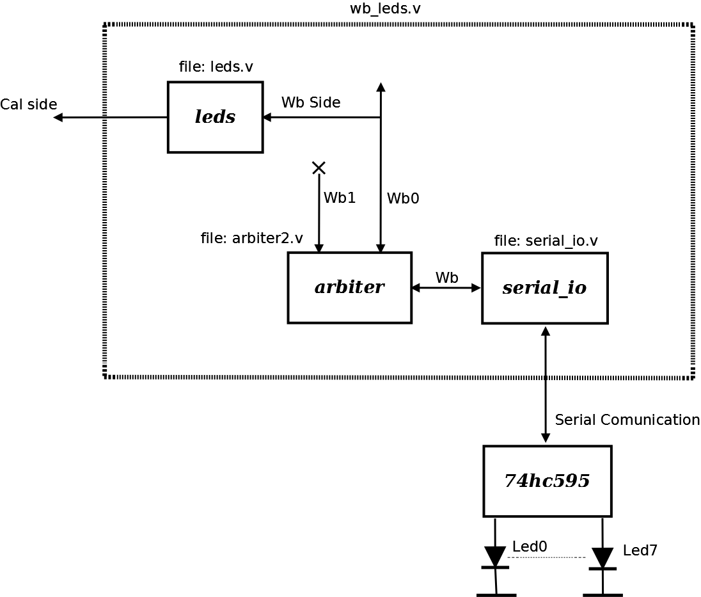](../files/File_Leds.png--1773.md)

System Actors LEDs structure

**leds.v**

The leds.v file contains the module leds (a state machine written in Verilog) that manages both the Actors protocol, and the WishBone bus protocol.

**arbiter2.v**

The arbiter2.v file contains the arbiter module (written in Verilog), a two-way WishBone arbiter with two masters and a single slave. The actor LEDs uses the master bus 0 (wb0), while the actors Switches uses the master bus 1 (wb1).

**serial\_io.v**

The file serial\_io.v contains a state machine serial\_io (written in Verilog) managing the WishBone protocol, and a serial/parallel register, interfacing with the 74hc595 chip that drives the LEDs on the board.

**wb\_leds.v**

The file wb\_leds.v is a wrapper enclosing the component leds, arbiter and serial\_io as their connections.

An example of these actors and the related component could be located in svn-cal\hw\trunk\examples\example1, where a simple testbench of the leds actor is present (example1\active\_hdl). A project example based on an 8-bit number generator and the LEDs actor can be find in the directory svn-cal\hw\trunk\examples\example3.

[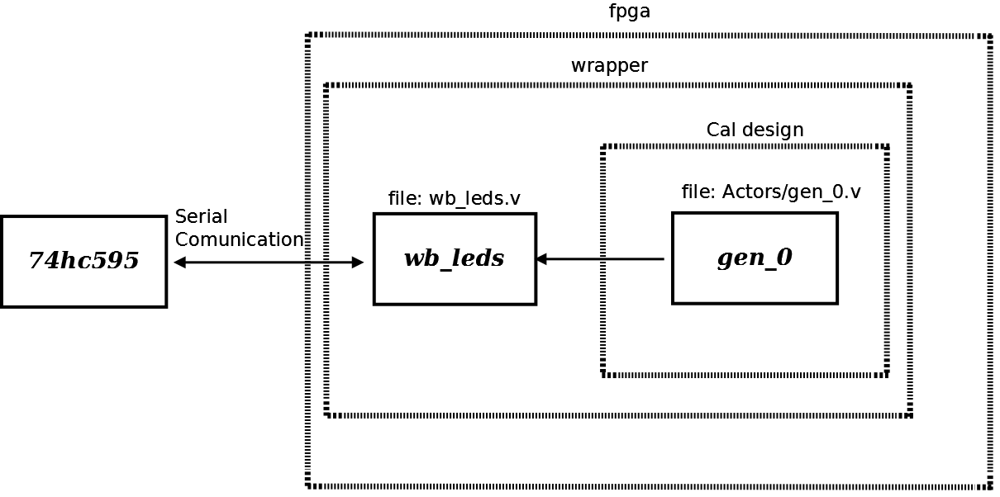](../files/File_Example3.png--1774.md)

Example3: LEDs System Actor with eight bits number generator

#### Switches System Actor

The Switches System Actor is an actor for the FPG-EYE board written in Verilog.
This actor uses eight Switches on the boards (see SW0,...., SW7 into ES-02610\_SCH\_main.pdf file) to read their state, and produce a token containing such state.
The actor Switches consists of the following files:

- switches.v (in the directory svn-cal\hw\trunk\hdl\_actors\actor\_switches)
- arbiter2.v (in the directory svn-cal\hw\trunk\examples\arbiter2)
- serial\_io.v (in the directory svn-cal\hw\trunk\examples\serial\_io)
- wb\_switches.v (in the directory svn-cal\hw\trunk\examples\examble2)

[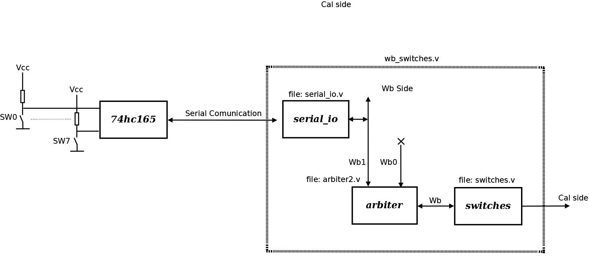](../files/File_Switches.png--1775.md)

Switches System Actors structure

**switches.v**

The switches.v file consists of the state machine switches (written in Verilog) that manages both the Actors and the WishBone protocols.

**arbiter2.v**

The arbiter2.v file contains the arbiter module (written in Verilog), a two-way WishBone arbiter with two masters and a single slave. The actor LEDs uses the master bus 0 (wb0), while the actors Switches uses the master bus 1 (wb1).

**serial\_io.v**

The file serial\_io.v contains a state machine serial\_io (written in Verilog) managing the WishBone protocol, and a serial/parallel register, interfacing with the 74hc595 and 74hc195 chips that drive the LEDs and poll the switches.

**wb\_switches.v**

The file wb\_switches.v is a wrapper enclosing the component switches, arbiter and serial\_io.

A simple testbench for this actors could be find in the directory svn-cal\hw\trunk\examples\example2.
Moreover, a simulation example where the actor switches is used along
with the actor LEDs is contained in the directory
svn-cal\hw\trunk\examples\example4. In this example, when a switch is
turned off/on the correspondent LED is turned off/on (see fig: Example4). The related Lattice FPGA implementation can be found in the svn-cal\hw\trunk\examples\example5 directory.

#### Camera System Actor

The Camera System Actor is an actor for the FPG-EYE board written in
Verilog. The actor require a hardware camera module to be mounted on
the board.

[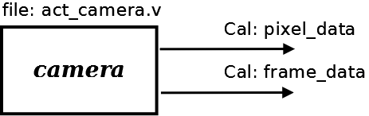](../files/File_Camera.png--1776.md)

System Actors camera structure

The actor Camera consists only of the file act\_camera.v (in the directory svn-cal\hw\trunk\hdl\_actors\actor\_camera)

**act\_camera.v**

The act\_camera.v file consists of the state machine camera (written in Verilog) that manages the camera signals and the CAL protocol. The actor Camera has two CAL compatible output interfaces (sending tokens to other actors). The first CAL output has a data size of 8 bits and sends token containing the image pixel values, while the second CAL output, with a data size of 1 bit, sends a token whenever a new frame starts.

A simple example for camera actor is located in the svn-cal\hw\trunk\examples\example7 directory. All the three actors are used in this example: the LEDs act as a bar graph, whose length is proportional to the average image luminance.

[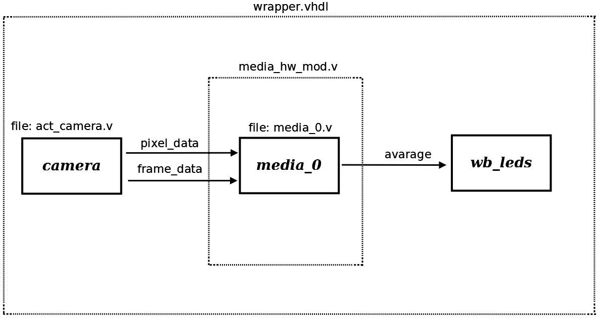](../files/File_Example7.png--1777.md)

example7: Board LEDs are turned on or off proportionally to the average image luminance

### How to Interface a CAL Netlist to System Actors

To interface a CAL Netlist with an actor few steps are needed:

- Create a Netlist in the CAL environment with the needed number of input and output ports
- Build a wrapper in Verilog (or VHDL) that connects the netlist with the required system actors

### How to Build a CAL Project with ispLEVER or Diamond

First you must to have a Cal project with System Actors for FPG-EYE. See [Create a Cal project with System Actors](Create_a_Cal_project_with_System_Actors--1800.md "Create a Cal project with System Actors") for instructions on how to do it.
To build an ispLEVER CAL project we have to:

- Open ispLEVER and click on new project.

  [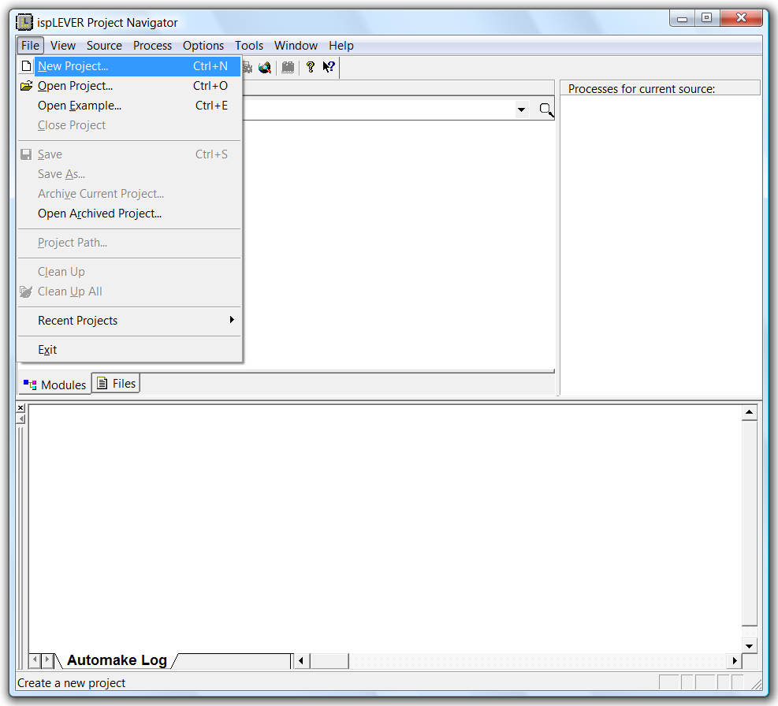](../files/File_New_project.png--1779.md)

  Click on "Open Project"
- In the following window choose the project name and the its destination path. Please remember to select "Mixed Verilog/VHDL" for the option "Design Entry Type".

  [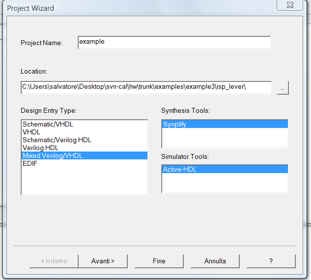](../files/File_Name_project.png--1780.md)

  Add "Name Project"
- In the following window we have to select the device. For the FPG-EYE board we must use:
  - Family: LatticeXP2;
  - Device: LFXP2-17E;
  - Speed grade: 5;
  - Package type: PQFP208;
  - Operating conditions: Commercial;
  - PartName: LFXP2-17E-5QN208C.

    [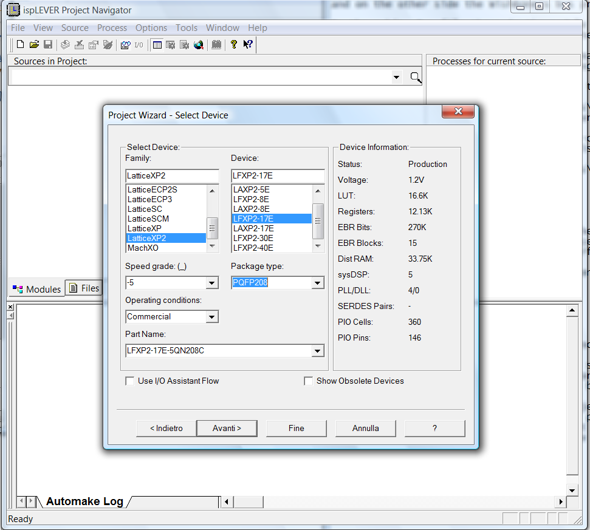](../files/File_Select_device.png--1781.md)

    "Select Device"
- Finally by clicking the End button

  [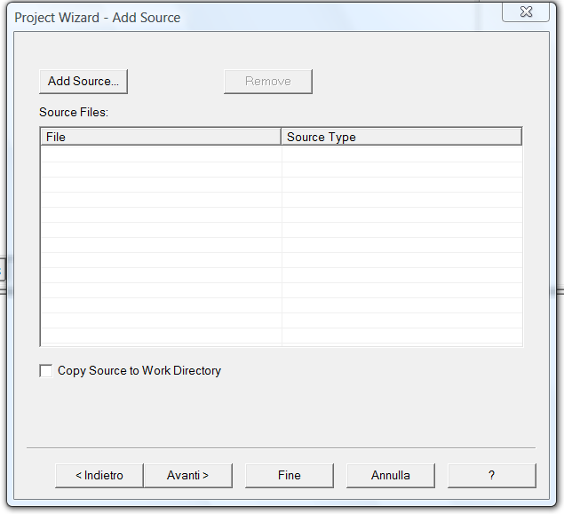](../files/File_Add_source.png--1782.md)

  "Add Source"

  the following window will be displayed:

  [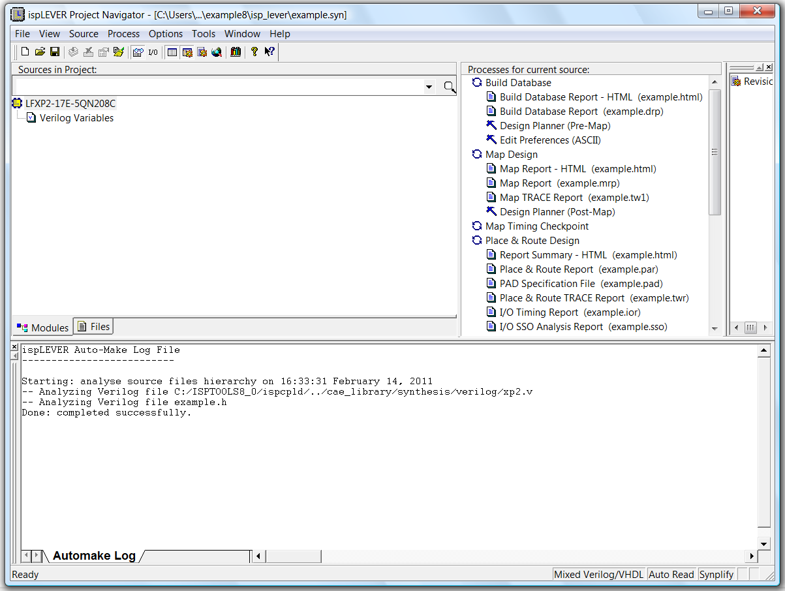](../files/File_Isp_lever.png--1783.md)

  ispLEVER
- To import lattice\_cal.vhdl the library (svn-cal/hw/trunk/lib\_vhdl) we have to right click on device and select "Import...".

  [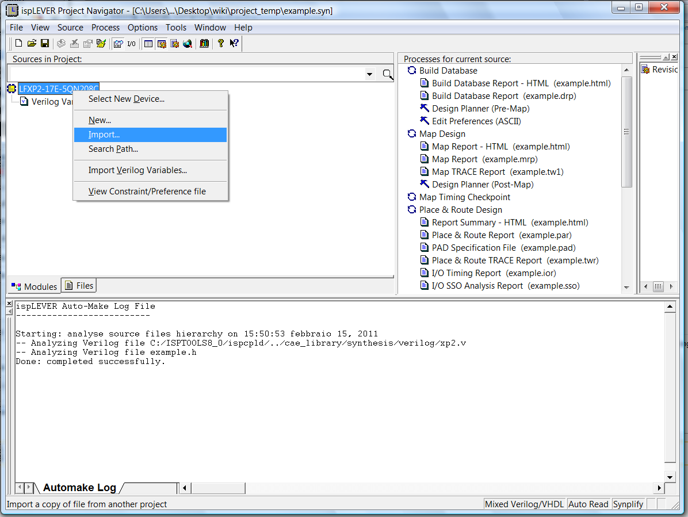](../files/File_Import_file.png--1784.md)

  Import file
- In the file window we can now select the file lattice\_cal.vhdl

  [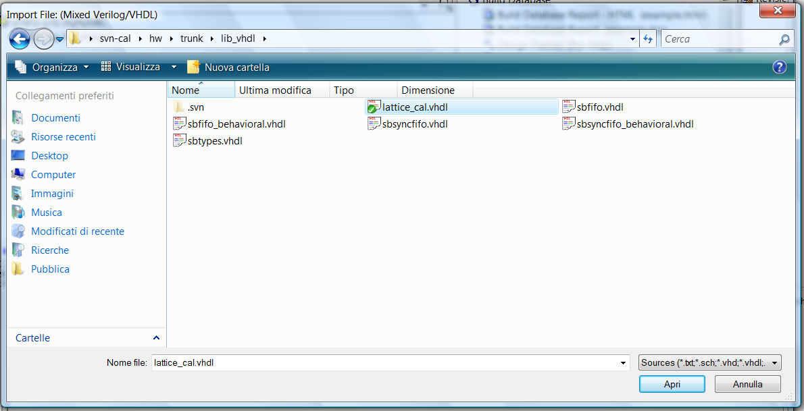](../files/File_Lib_vhdl.png--1785.md)

  Import the file "lattice\_cal.vhdl"
- Now by right clicking the lattice\_cal.vhdl we can select "Library Name"

  [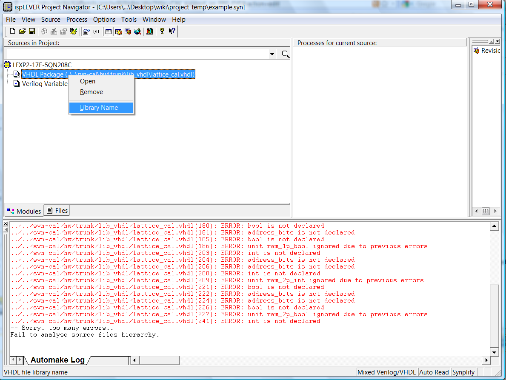](../files/File_Library_name.png--1786.md)

  Select "Library Name"
- In the Box "VHDL Library Name" we can insert the namespace SystemBuilder

  [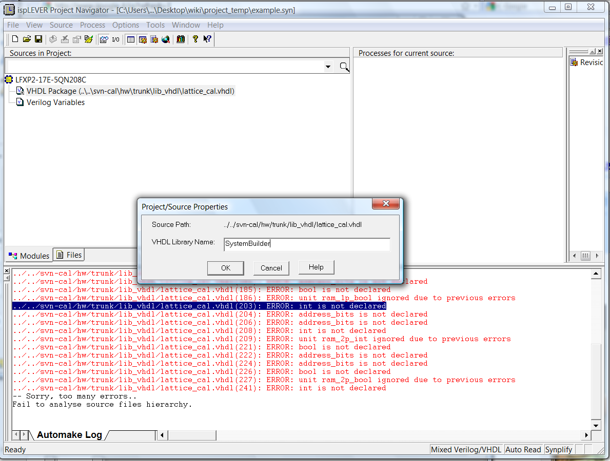](../files/File_System_builder.png--1787.md)

  Write: SystemBuilder
- Each file created by the CAL compiler has an undefined module FD. This module is a D-FF (flip flop) declared in the xilinx library. This is part of a small reset synchronizer circuit. You have to remove this part because the Lattice software does not recognize it.  
   There is a Perl script main\_modify.pl that searches these FD instances in Verilog files and replaces them with a reset synchronizer. You can run this Perl script with the top level VHDL file as input. Before executing the Perl script, please check that all generated files are in the same folder. If the top level generated file name is main\_nw.vhd, we can issue perl main\_modify.pl main\_nw.  
   The script will produce a \*\_mod.v file for each parsed Verilog file.
- After importing the files related to the various actors (LED, camera, and those related to our CAL netlist), a constraint file describing the connection between FPGA pins and logic blocks must be created. An example of these constraints can be found in "svn-cal\hw\trunk\examples\example7\isp\_lever\example7.lpf"
- We can finally compile the project, thus obtaining a binary JED file to program the FPG-EYE board.

### How to Build a CAL Project with Diamond

First you must to have a Cal project with System Actors for FPG-EYE. See [Create a Cal project with System Actors](Create_a_Cal_project_with_System_Actors--1800.md "Create a Cal project with System Actors") for instructions on how to do it.
To build a Diamond CAL project we have to:

- Open Diamond and click on new project.

  [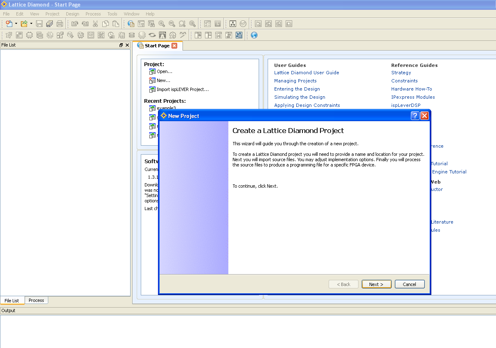](../files/File_New_project_diamond.png--2192.md)

  Click on "Open Project"
- In the following window choose the project name and the its destination path.

  [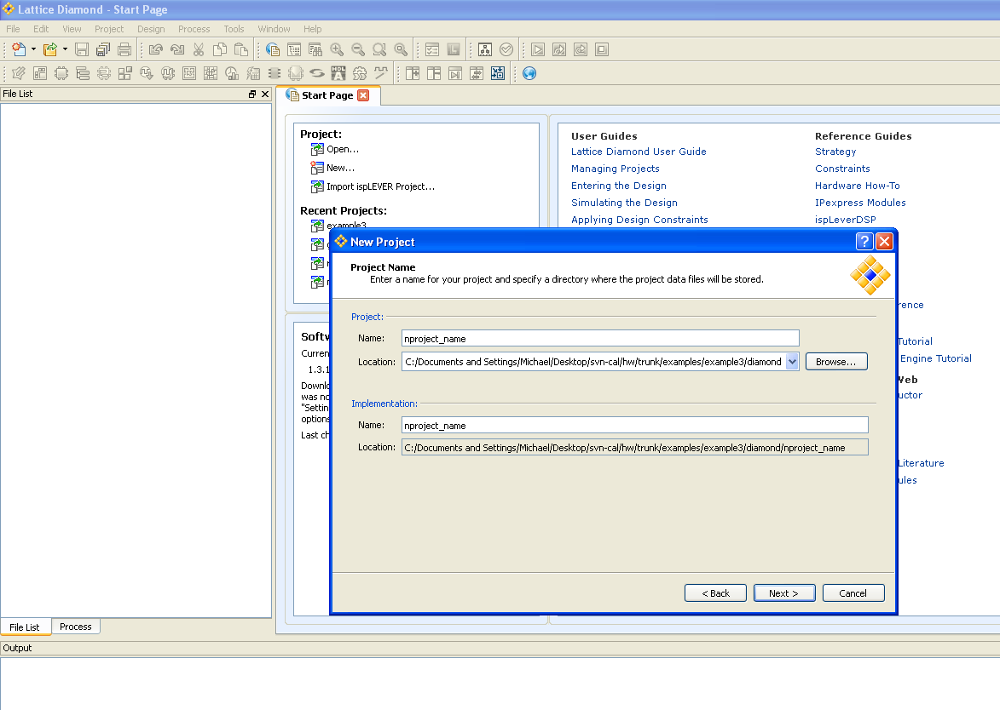](../files/File_Name_project_diamond.png--2193.md)

  Add "Name Project"
- In the following window we have to select the device. For the FPG-EYE board we must use:
  - Family: LatticeXP2;
  - Device: LFXP2-17E;
  - Speed grade: 5;
  - Package type: PQFP208;
  - Operating conditions: Commercial;
  - PartName: LFXP2-17E-5QN208C.

    [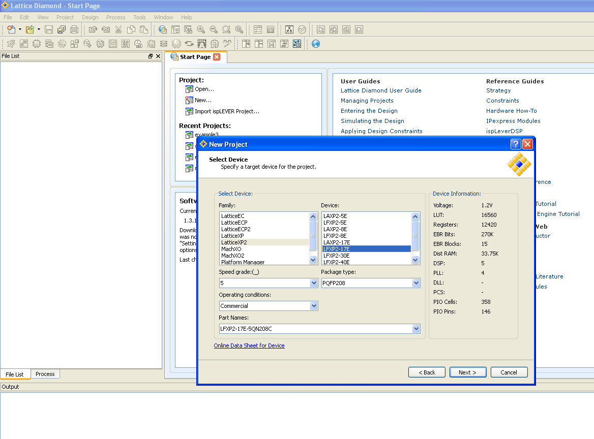](../files/File_Select_device_diamond.png--2194.md)

    "Select Device"
- Finally by clicking the End button the following window will be displayed:

  [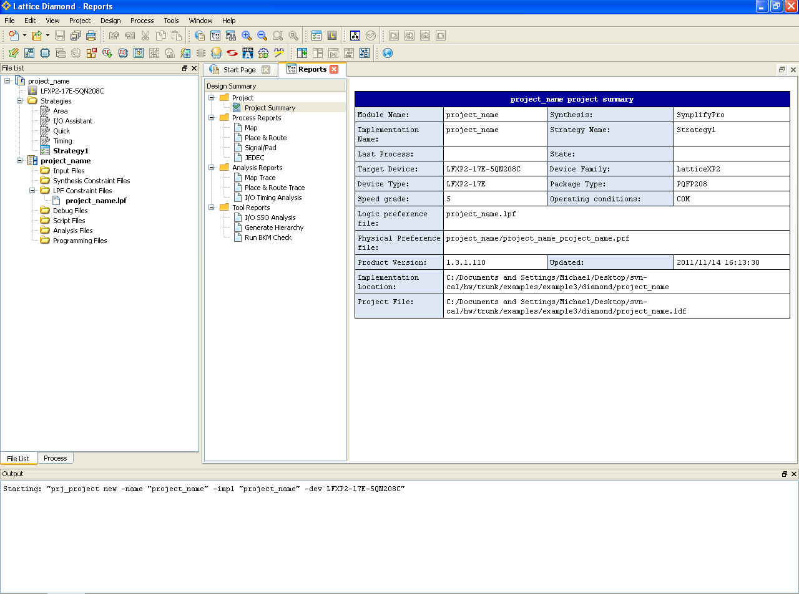](../files/File_Diamond.png--2195.md)

  Diamond
- To import lattice\_cal.vhdl the library (svn-cal/hw/trunk/lib\_vhdl) we have to right click on device and select "Add->Existing File".

  [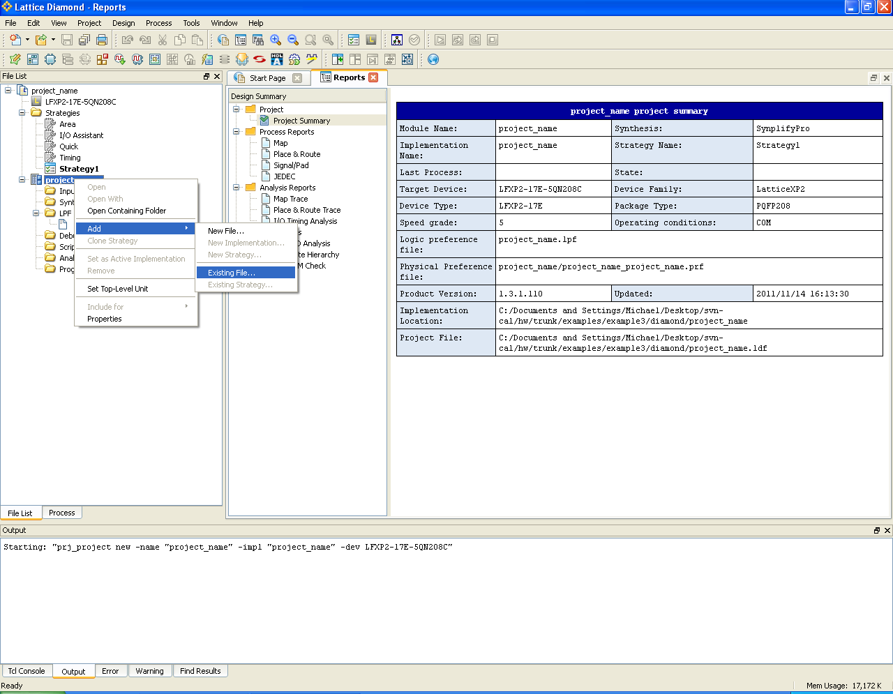](../files/File_Import_file_diamond.png--2196.md)

  Import file
- In the file window we can now select the file lattice\_cal.vhdl

  

  Import the file "lattice\_cal.vhdl"
- Now by right clicking the lattice\_cal.vhdl we can select "Properties" an then in the Box "VHDL Library Name" we can insert the namespace SystemBuilder

  [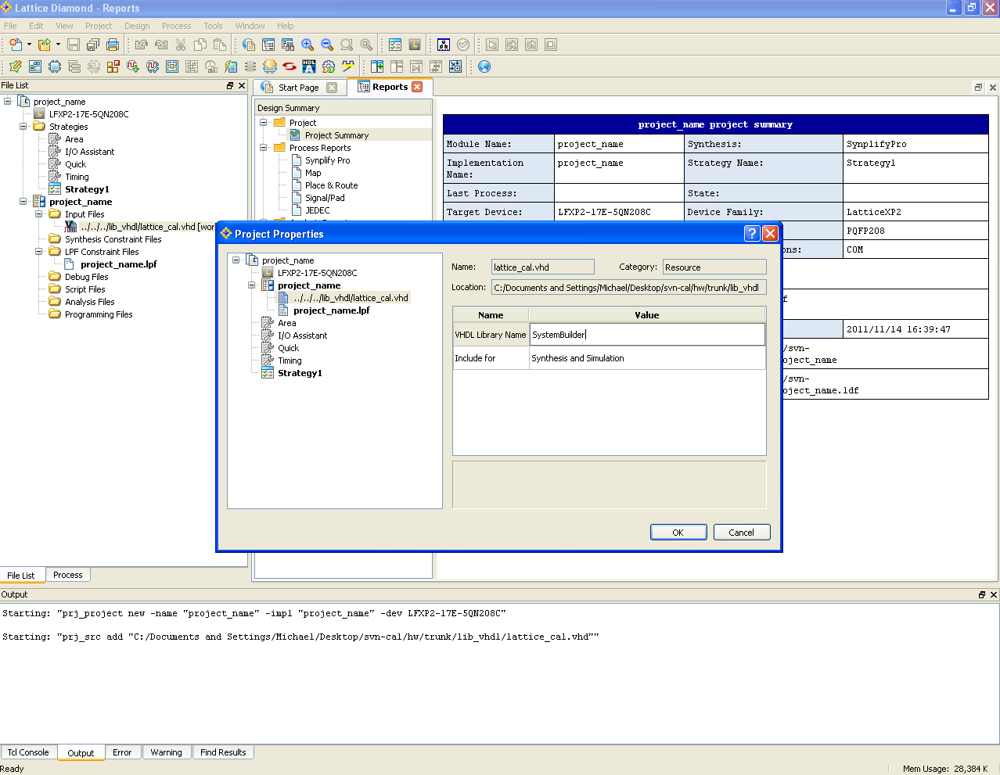](../files/File_System_builder_diamond.png--2197.md)

  Write: SystemBuilder
- Each file created by the CAL compiler has an undefined module FD. This module is a D-FF (flip flop) declared in the xilinx library. This is part of a small reset synchronizer circuit. You have to remove this part because the Lattice software does not recognize it.  
   There is a Perl script main\_modify.pl that searches these FD instances in Verilog files and replaces them with a reset synchronizer. You can run this Perl script with the top level VHDL file as input. Before executing the Perl script, please check that all generated files are in the same folder. If the top level generated file name is main\_nw.vhd, we can issue perl main\_modify.pl main\_nw.  
   The script will produce a \*\_mod.v file for each parsed Verilog file.
- After importing the files related to the various actors (LED, camera, and those related to our CAL netlist), a constraint file describing the connection between FPGA pins and logic blocks must be created. An example of these constraints can be found in "svn-cal\hw\trunk\examples\example7\diamond\example7.lpf"
- We can finally compile the project, thus obtaining a binary JED file to program the FPG-EYE board.

[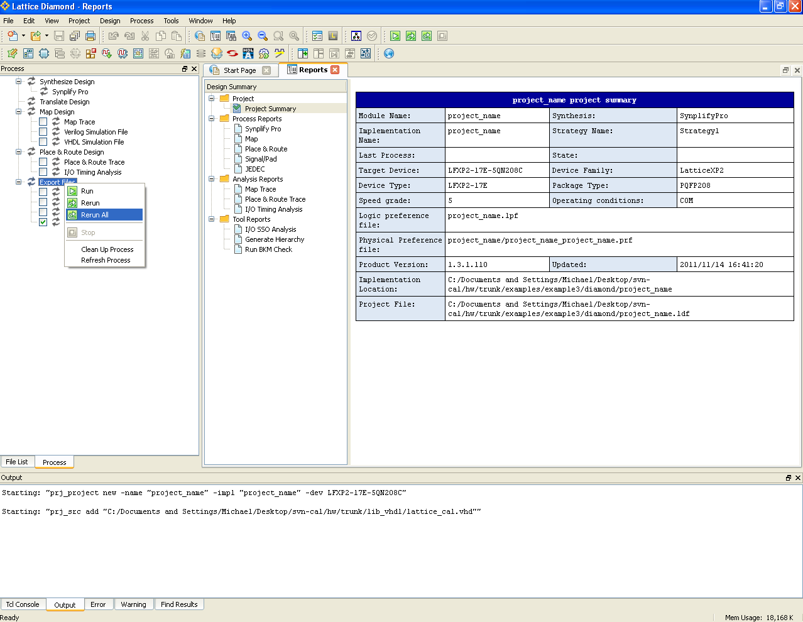](../files/File_Compile_diamond.png--2198.md)

"Return All" for obtaining a binary JED file

### How to Program the FPG-EYE board

See [Programming the FPG-EYE board](Programming_the_FPG-EYE_board--1799.md "Programming the FPG-EYE board") for instructions on how to download the JED file onto the board

---

## Archive provenance

- [Original page](http://erika.tuxfamily.org/wiki/index.php?title=CAL_support_on_FPG-EYE) · [Archived source revision 4153](http://erika.tuxfamily.org/wiki/index.php?oldid=4153)
- Last source edit: 2011-11-14T16:00:07Z. Source retrieved on 2026-11-06; Markdown conversion completed on 2026-11-07.
- Original contributors recorded in exported history: Salva, Dibbe, Eguidieri.
- [Original MediaWiki source](../source/wikitext/1772.mediawiki) · [Original editing history](../source/history/batch-002.xml)
- [Attribution and licensing notice](../NOTICE.md). Original file-specific notices, where present, remain applicable.
