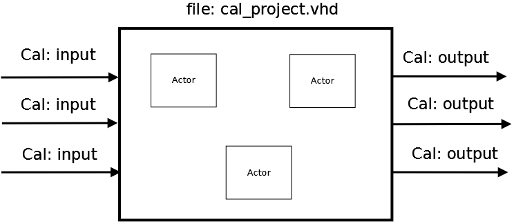
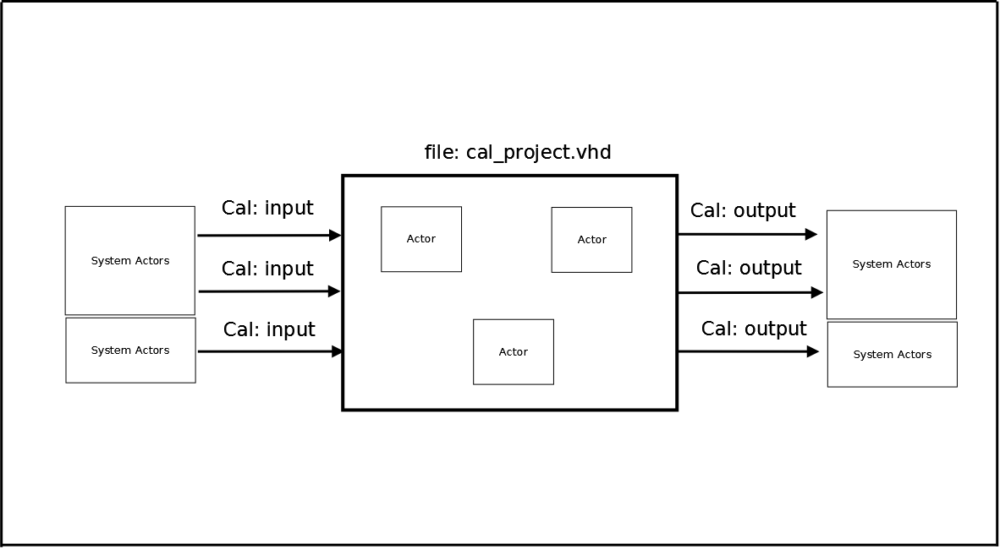
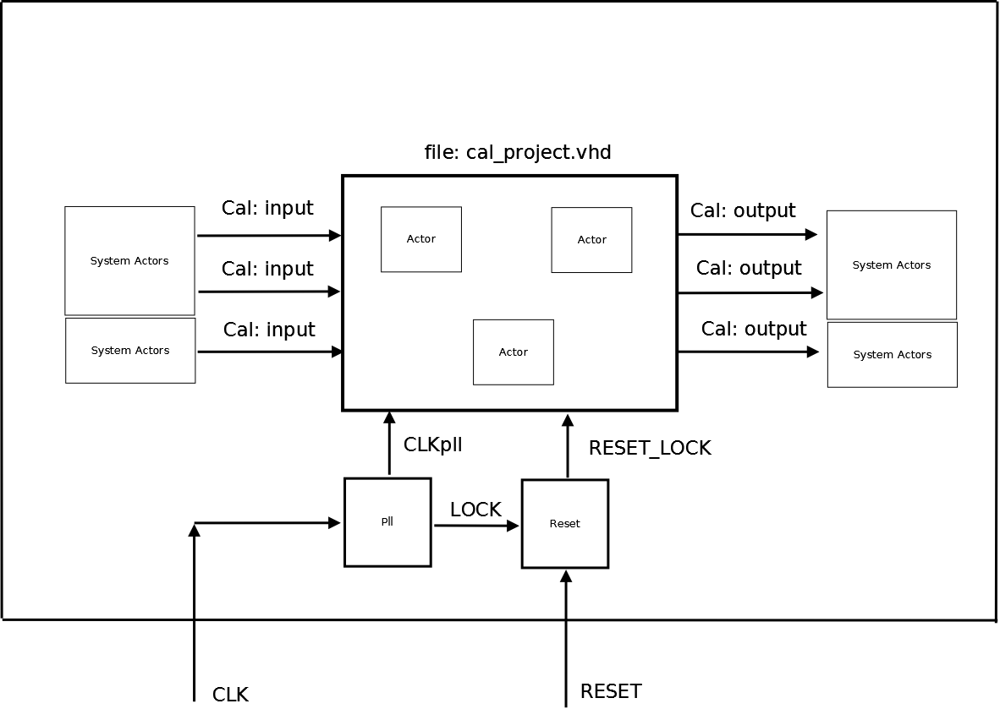

# Create a Cal project with System Actors

Now we are going to create a Cal project using the FPG-EYE's System Actor. Our System Actors are not yet included in the Cal development tool. This requires manual editing of some files.

### Cal project without System Actors

First step we have to create a Cal network without FPG-EYE's System actors. But the network must have the inputs/outputs external ports.

Cal project without FPG-EYE's System Actors

### Wrapper Cal project with System Actors

Now we have to create a vhdl file wapper. In this wrapper we must put the Cal network and the FPG-EYE's System Actors.

Cal project with wrapper and FPG-EYE's System Actors

In the wrapper we can add other component. For example in the example3 and example8, we have added a module Pll and
a module Reset.

Wrapper with a Pll and Reset modules.

---

## Archive provenance

- [Original page](http://erika.tuxfamily.org/wiki/index.php?title=Create_a_Cal_project_with_System_Actors) · [Archived source revision 3019](http://erika.tuxfamily.org/wiki/index.php?oldid=3019)
- Last source edit: 2011-04-11T13:25:23Z. Source retrieved on 2026-11-06; Markdown conversion completed on 2026-11-07.
- Original contributors recorded in exported history: Salva, Dibbe.
- [Original MediaWiki source](../source/wikitext/1800.mediawiki) · [Original editing history](../source/history/batch-003.xml)
- [Attribution and licensing notice](../NOTICE.md). Original file-specific notices, where present, remain applicable.
