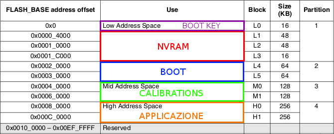
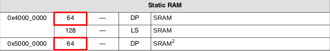
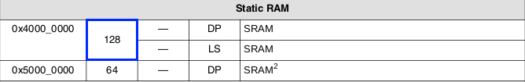
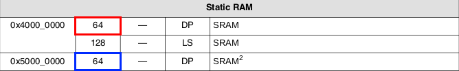
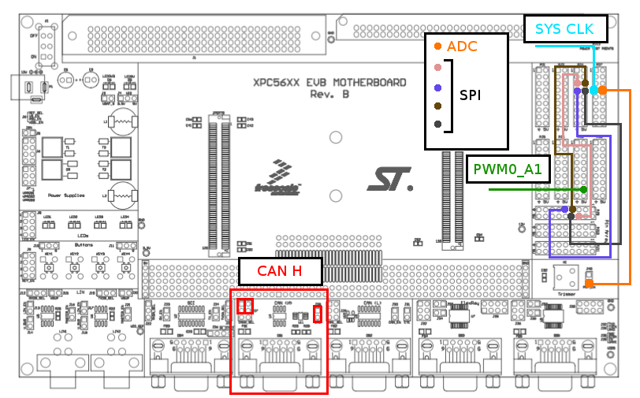
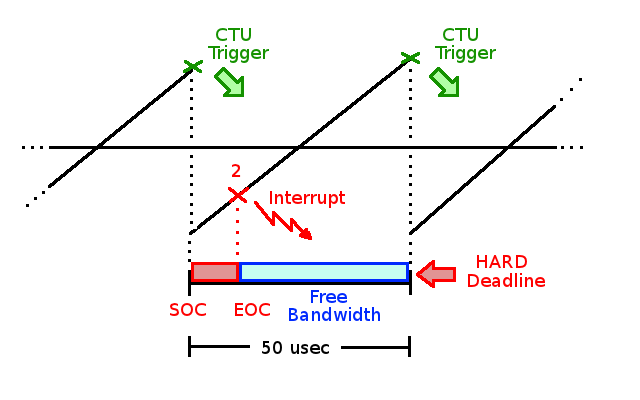

# ERIKA Enterprise Device Drivers for Leopard MPC5643L

## Architecture description (Ref. Freescale MPC5643LRM Rev. 9 12 Mar 2012)

The Qorivva MPC5643L microcontroller is based on the Power Architecture. All MPC5643L devices are built around a dual-core safety platform, each core is a member of the e200z4 Power Architecture family. Lock step Redundancy Checking Units are implemented at each output of this Sphere of Replication (SoR). ECC is available for on-chip SRAM and flash memories. A programmable fault collection and control unit monitors the integrity status of the device and provides flexible safe state control. The peripheral set provides high-end electrical motor control capability with very low CPU intervention due to the on-chip cross-triggering unit (CTU).

## Flash Usage

There are three address spaces featuring Flash memory of MPC5643L:

- Low address space (256 KB)
- Mid address space (256 KB)
- High address space (512 KB)

The MPC5643L flash memory usage has been managed as follow.

- Block L0 (0x0 - 0x00004000) hosts the boot key of the microcontroler. MPC5643L has several boot sectors, Each boot sector in the flash memory contains at offset 0x00 the Reset Configuration Half-Word (RCHW) that is composed by 2 parts. First part is used to mark this boot sector as "bootable" (0x5A), second part to set VLE/BOOK E mode:

1. 0x15a0000 if the microcontroller runs in "VLE" mode
2. 0x05a0000 if the microcontroller runs in "BOOK E" mode

RCHW is immediately followed by the reset vector of the microcontroller (the address from the microncontroller starts from).

- Block L1, L2 and L3 (0x00004000 - 0x00020000) hosts Non-Volatile-RAM (NVRAM) data. The policy in charge of managing this flash area is explained in section NVRAM.
- Block L4 and L5 (0x00020000 - 0x00040000) hosts boot code. The content of this flash area is explained in section BOOT.
- Block M0 and M1 (0x00040000 - 0x00080000) hosts calibrations data. The policy in charge of managing this flash area is explained in section CALIBRATIONS.
- Block H0 and H1 (0x00080000 - 0x000C0000) hosts application code. The content of this flash area is explained in section APPLICATION.

Flash memory is devised as follow:

### BOOT Flash area

This area will be used to locate Bootloader code. Not provided in this version

## APPLICATION Flash area

Application Flash area hosts user application, drivers and Erika OS.

### Erika OS

Erika has been provide with the following configurations:

- **Single Core (DPM mode)**. The main feaure of this configuration is that the user has 128 Kbytes of SRAM memory available divided in two memory banks (0x40000000 - 0x4000FFFF and 0x50000000 - 0x5000FFFF). This configuration can be executed from SRAM and from FLASH. The flags used to enable SRAM configurations is: \_\_E200ZX\_EXECUTE\_FROM\_RAM\_\_, if it is not used, FLASH configuration is enabled by default. Notice that SRAM configuration is used for a comfortable debug, if the application executes from SRAM, code and data share SRAM banks and Flash is not used, consequently reducing the amount of memory available by user application.

- **Single core (Lock-step)**. The main feaure of this configuration is that the user has 128 Kbytes of SRAM memory available (0x40000000 - 0x0001FFFF). This configuration can be executed from SRAM and from FLASH. In order to enable Lock-step mode the LOCK\_STEP flag has to be enabled. This flag has to be combined with \_\_E200ZX\_EXECUTE\_FROM\_RAM\_\_ if the target has to execute from SRAM. If only LOCK\_STEP is enabled the target executes from Flash. Notice that SRAM configuration is used for a comfortable debug, if the application executes from SRAM, code and data share SRAM banks and Flash is not used, consequently reducing the amount of memory available by user application.

- **Multicore (DPM mode)**. The main feature of this configuration is that the user has 64 Kbytes of SRAM memory available for each core. In particular the first 64 Kbytes-bank of SRAM memory (0x40000000 - 0x4000FFFF) is allocated to the master core, this memory area also hosts data shared by both cores. The second 64 Kbytes-bank of SRAM memory (0x50000000 - 0x5000FFFF) is allocated to the slave core. In order to enable this configuration the flag \_\_MSRP\_\_ has to be defined. It has to be combined with \_\_E200ZX\_EXECUTE\_FROM\_RAM\_\_ to have a system running from SRAM. If this flag is not enabled, hence the multicore application is configured to run from Flash. Notice that SRAM configuration is used for a comfortable debug, if the application executes from SRAM, code and data share SRAM banks and Flash is not used, consequently reducing the amount of memory available by user application.

**Additional notes about Erika-multicore in MPC5643L**

Erika uses hardware semaphores to guarantee data coherence between master and slave cores. It also used a signalling system based on software interrupts to provides basic inter-core synchronisation mechanism. MPC5643L has two SEMA4 modules, each module has 16 HW semaphores, but these semaphores are not all available by the user since they are used by the operating system to implement a barrier to synchronise both cores after boot sequence. According with these assumptions the 7-th software interrupt is used by signal mechanism and semaphore 0 and 1 of the master's SEMA4 module are used to implement synchronisation barrier, therefore they cannot be used for different purposes. All the remaining semaphores (from 2 to 15 belonging to the master's SEMA4 and all 16 belonging to the slave's SEMA4) and software interrupts (from 1 to 7 of both interrupt controllers) can be used by the user application. Notice that these limitations have to be taken into account only when the system is configured as multi-core. In single-core mode the user is free to use all software interrupts according with his needs, since boot-barrier is not enabled and inter-processor (software) interrupt are not required.

### Drivers

The implemented drivers are: CanDrv, FlashDrv, SpiDrv, Adc, Pwm and CTU. The details concerning these Drivers are reported in section Device Drivers.

### User Application

Evidence is not in charge of this part.

## Board Internal Connections

This chapter provides a schema to show connections required for SPI, ADC, CAN (configured as CANDRV\_NORMAL), System clock and one PWM signal (PWM0\_A1).

## Device Drivers

### Can Driver (CanDrv)

Can Driver is based on Freescale FlexCan present in MPC5643L. Can Driver details will be provided in two distinct sections: configuration and API. Configuration section concerns Can Driver static configuration, that means that Can Driver has to be statically configured by CanCfg module (reference: sources/ApplCfg/CanCfg.c). The API section of the manual shows the set of functionalities featuring this CanDrv implemenation.

#### CanDrv Configuration

There two levels of CanDrv configuration: FlexCan level and message level. First level is used to configure Can Module with respect the following fields:

- peripheralEn: it can be CANDRV\_ENABLED/CANDRV\_DISABLED according with the fact that the user wants to enabled or disabled the current Flexcan module. Notice that MPC5643L has two FlexCan modules.
- mode: it can be CANDRV\_NORMAL, CANDRV\_LOOPBACK or CANDRV\_OPENDRAIN. CANDRV\_LOOPBACK means that FlexCan module works in loopback mode (look at Reference Manual for details. Ref: MPC5643LRM Rev. 9 12 Mar 2012), CANDRV\_OPENDRAIN means that Flexcan is in open drain mode that means that user can connect two FlexCan modules available in MPC564L without the need of external connections.
- autobusonEn: this field can be CANDRV\_ENABLED/CANDRV\_DISABLED according with the fact that the Auto-buson feature is enabled or not (look at Reference Manual for details. Ref: MPC5643LRM Rev. 9 12 Mar 2012)
- peripheralFreq: this field determines FlexCan frequency. There five available values: CANDRV\_1MBPS, CANDRV\_500KBPS, CANDRV\_250KBPS or CANDRV\_125KBPS.
- errorHandlingEn: it can be CANDRV\_ENABLED/CANDRV\_DISABLED according with the fact that user needs error handling capability.
- sampleNumMode: it can be CANDRV\_THREE\_SAMPLE if user wants to sample the signal three times.

In CW project and Integration project there are three cases (NORMAL, LOOPBACK and OPENDRAIN) characterised by their configuration parameters. LOOPBACK and OPENDRAIN cases are commented, in order to try these configurations please comment NORMAL mode and uncomment LOOPBACK or OPENDRAIN.
The configuration version currently available in the repository provides FlexCan0 module enabled and FlexCan1 module disabled. All the fields of FlexCan1 are set to CANDRV\_DO\_NOT\_CARE because peripheralEn is set to CANDRV\_DISABLED. CanFlex0 is set as a 500 Kbps FlexCan module, with error handling enabled, auto-buson enabled, normal mode and three samples feature enabled.

#### CanDrv API

**StdReturnType CanDrvInit(void);**

Input parameters are:

- No input parameters

Output parameter:

- No output parameters

Description:

Initialise canDrv component according with the features set in CanCfg module.

**void ManageCanIsr(uint8 isrSourceIndex, uint32 bufferFlags, CanChannelType canChannel);**

Input parameters are:

- isrSourceIndex: is the offset in the FLAG1 register representing the isr source;
- bufferFlags: the real isr source;
- canChannel: represents FlexCan0 or FlexCan1

Output parameter:

- No output parameters

Description:

Initialises Flexcan modules according with the user features set in CanCfg.

**StdReturnType CanTransmit(CanTxMsgIndexType msgIndex);**

Input parameters are:

- msgIndex: message index taken from all message indexes defined by the user;

Output parameter:

- a value to be used to check if function execution has been successfully performed.

Description:

This function transmits "msgIndex" Can message. Return value of this function is the return value of CanSendManageMsg().

**StdReturnType CanPollMessage(CanRxMsgIndexType msgIndex, CanChannelType canChannel);**

Input parameters are:

- msgIndex: message index taken from all message indexes defined by the user;
- canChannel: FlexCan channel. It can be Flexcan0 or FlexCan1.

Output parameter:

- a value to be used to check if function execution has been successfully performed.

Description:

If canChannel is different fromFlexcan0 or Flexcan1, return value is STD\_NOT\_OK. If CanPollMessage() is called for a message for which a isr has been defined and the driver is working in INTERRUPT mode, return value is STD\_NOT\_OK. For all the remaining scenarios the return value is STD\_OK.

**void CanDrvEnableInterrupts(void);**

Input parameters are:

- No input parameters

Output parameter:

- No output parameters

Description:

Enable Flexcan interrupts according with the CanCfg flags.

**void CanDrvDisableInterrupts(void);**

Input parameters are:

- No input parameters

Output parameter:

- No output parameters

Description:
Disable ALL FlexCan interrupts featuring ENABLED Flexcan modules.

**void CanDrvPolling(void);**

Input parameters are:

- No input parameters

Output parameter:

- No output parameters

Description:

This function polls all FlexCan messages.

### Spi Driver (SpiDrv)

A simplified Spi Driver has been provide. Through this driver it is possible to use Spi Module both in Polling mode and Isr mode. APIs are defined as follow:

**void SpiTransmit(uint8 channel, uint8 chip\_select, uint8 \* data, uint8 length);**

Input parameters are:

- channel: is the Spi channel
- chip\_select: is the cuip select (from 0 to 7).
- length: is message length

Output parameter:

- No output parameters

Description:

This function transmits a spi message. Notice that no checks are performed on input parameters.

**StdReturnType SpiDrvInit(void);**

Input parameters are:

- No input parameters

Output parameter:

- a value to be used to check if function execution has been successfully performed.

Description:

This function initialises Spi Driver according with flags present in SpiCfg module.

**void SpiPoolChannel(const uint8 channel, uint16\_t \* res);**

Input parameters are:

- channel: is the Spi channel
- res: is the location of the result

Output parameter:

- No output parameters

Description:

This function pools one Spi channel and store the result in the location pointed by res.

**uint32 SpiGetMessageLenght(const uint8 channel);**

Input parameters are:

- channel: is the Spi channel

Output parameter:

- message length

Description:

Not still developed (NO REQUIREMENTS).

### Pwm+Adc Drivers (with CTU support)

In PWM driven systems it is important to schedule the acquisition of the state variables with respect to
PWM cycle. State variables are obtained through the following peripherals: ADC, position counter (e.g.
quadrature decoder, resolver and sine-cos sensor) and PWM duty cycle decoder.
The cross triggering unit (CTU) is intended to completely avoid CPU involvement in the time acquisitions
of state variables during the control cycle that can be the PWM cycle, the half PWM cycle or a number of
PWM cycles. In such case the pre-setting of the acquisition times needs to be completed during the
previous control cycle, where the actual acquisitions are to be made, and a double-buffered structure for
the CTU registers is used, in order to activate the new settings at the beginning of the next control cycle.

**Problem:** the main problem featuring this part of the application concerns ADC timing. In order to speed the acquisition up, the
PWM A0 rising edge is used to trigger the Star-Of-Conversion (SOC). This means that whenever the PWM counter ramp reaches the maximum value,
the CTU triggers a ADC acquisition without CPU intervention. This CTU action starts an ADC conversion at the beginning of 50 usec interval (SOC).
Once the ADC conversion terminates at the End-Of-Conversion point (EOC at point 2), a ISR may be raised (but it has been disabled, since a polling strategy has
been preferred). The remaining chunk of time (from EOC to the end of 50 usec), can be used for secondary activities (it is denoted as Free Bandwidth).
At the end of 50-usecs interval, CTU triggers a new acquisition. Notice that the end of 50 usec represents a HARD Deadline, hence it will never being missed.

**Performance note:** through a preliminary test, the interval of time between SOC and EOC (the red chunk) assumes a value equal to 790 PWM counter ticks (approximately 14 usec with a 120 Mhz CPU clock).

#### PWM

MPC5643L has two PWM modules,
A simplified PWM Driver has been provide. Through this driver it is possible to access PWM basic functionalities. MPC5643L has two PWM modules, each PWM module has four PWM devices, for this application only a subset of FlexPWM0 module is used to generate three PWM signals: PWM0\_A0, PWM0\_A1 and PWM0\_A2. APIs are defined as follow:

**void InitFlexPWM0(void);**

Input parameters are:

- No input parameters

Output parameter:

- No output parameters

Description:
This function initialises FlexPWM0.

**void PWM0\_AX\_load\_new\_rising\_edge(unsigned int val);**

Input parameters are:

- val: match value of the rising edge of X sub-module (X=0,1,2)

Output parameter:

- No output parameters

Description:
This function sets the match value (for rising edge) of PWM0\_AX sub-module (X=0,1,2).

**void PWM0\_AX\_load\_new\_falling\_edge(unsigned int val);**

Input parameters are:

- val: match value of the falling edge of X sub-module (X=0,1,2)

Output parameter:

- No output parameters

Description:
This function sets the match value (for falling edge) of PWM0\_AX sub-module (X=0,1,2).

#### ADC

The Analog to Digital Converter (ADC) is a 12 bit Successive Approximation register (SAR) ADC with a mixed capacitive/resistive DAC. This device includes two ADC modules, referred to as ADC\_0 and ADC\_1. A conversion can be triggered by
software or hardware (CTU), the solution selected for this application is the second one, that is based on CTU support. Currently the system starts the acquisition of 8 different ADC signals of the ADC\_0 module as soon as CTU triggers the ADC\_0 module. This happens whenever the internal counter of the PWM0 module matches its maximum value.

External ADC channels:

- 9 external channels on ADC\_0 (channels 0..8)
- 9 external channels on ADC\_1 (channels 0..8)
- 4 external channels shared between ADC\_0 and ADC\_1 (channels 11..14)

This the list of ADC Driver APIs:

**StdReturnType InitADC(void);**

Input parameters are:

- No input parameters

Output parameter:

- a value to be used to check if function execution has been successfully performed.

Description:
This function initialises ADC\_0 module according with flags present in sources/ApplCfg/AdcCfg/AdcCfg.c. Data structure featuring ADC\_0 and ADC\_1 is adcConfContainer[2], it is characterised by the followinh data fields:

- peripheralEn: it can be ADC\_ENABLED/ADC\_DISABLED to enable/disable ADC\_0
- peripheralFreq: it can be ADC\_HALF\_SYS\_FREQ for a working freq. equal to 1/2 of the system freq. It can be ADC\_SYS\_FREQ if the user requires a working freq. equal to the system freq.
- adcCommandConfigPtr: pointer to a CTU command list.

**uint8 AdcPollChannel(const uint8 adcModule, const uint8 channel)**

Input parameters are:

- adcModule: it can be ADC\_\_0 or ADC\_\_1

Output parameter:

- No output parameters

Description:
This function pools the couple "ADC module and channel" represented by adcModule and channel.

#### CTU (Cross Triggering Unit)

The CTU in this context is used to synchronises the Star-Of-Conversion of the ADC0 channel to the PWM0 counter rising edge , this has been guaranteed without any CPU intervention. CTU has to be initialised in order to accomplish this requirement. All the initialization parameters are collected in one API:

**void InitCTU(void);**

Input parameters are:

- No input parameters

Output parameter:

- No output parameters

Description:
This function initialises CTU to address the problem shown at the beginning of section "Pwm+Adc Drivers (with CTU support)".

### Stm Driver

Driver supporting basic STM (System Timer Module) functionalities. In the Erika repository is also provided a AUTOSAR-like version of STM Driver. This is the list of APIs featuring this STM basic driver:

**void mpc5643l\_stm\_freeze\_on(void);**

Input parameters are:

- No input parameters

Output parameter:

- No output parameters

Description:

Enable freeze mode option of STM timer. If enabled, when system switches to debug mode, timer stops running.

**void mpc5643l\_stm\_freeze\_off(void);**

Input parameters are:

- No input parameters

Output parameter:

- No output parameters

Description:

Disable freeze mode option of STM timer. If disabled, when system switches to debug mode, timer continues to increment.

**void mpc5643l\_stm\_set\_prescaler(unsigned int val);**

Input parameters are:

- val: prescaler value

Output parameter:

- No output parameters

Description:
This function set STM prescaler

**void mpc5643l\_stm\_select\_channel(unsigned int ch);**

Input parameters are:

- ch: channel to be use

Output parameter:

- No output parameters

Description:
This function select STM timer to use

**void mpc5643l\_stm\_unselect\_channel(unsigned int ch);**

Input parameters are:

- ch: channel to be unselected

Output parameter:

- No output parameters

Description:
This function deselects a specific STM channel.

**void mpc5643l\_stm\_channel\_cmp(unsigned int ch, unsigned int val);**

Input parameters are:

- ch: channel to be unselected
- val: comparator value

Output parameter:

- No output parameters

Description:
This set a comparator for a specific STM channel

**void mpc5643l\_stm\_clear\_int(unsigned int ch);**

Input parameters are:

- ch: channel to be unselected

Output parameter:

- No output parameters

Description:
Clear interrupt for a specific STM channel

**void mpc5643l\_stm\_set\_counter(unsigned int val);**

Input parameters are:

- val: set the counter of the STM

Output parameter:

- No output parameters

Description:
Set STM counter value

**void mpc5643l\_stm\_enable(void);**

Input parameters are:

- No input parameters

Output parameter:

- No output parameters

Description:
Enable STM

**void mpc5643l\_stm\_disable(void);**

Input parameters are:

- No input parameters

Output parameter:

- No output parameters

Description:
Disable STM

## Debugger support

- [Lauterbach TRACE32 Support for Leopard MPC5643L](Lauterbach_TRACE32_Support_for_Leopard_MPC5643L--2525.md "Lauterbach TRACE32 Support for Leopard MPC5643L")

- [iSYSTEM winIDEA Support for Leopard MPC5643L](ISYSTEM_winIDEA_Support_for_Leopard_MPC5643L--2526.md "ISYSTEM winIDEA Support for Leopard MPC5643L")

---

## Archive provenance

- [Original page](http://erika.tuxfamily.org/wiki/index.php?title=ERIKA_Enterprise_Device_Drivers_for_Leopard_MPC5643L) · [Archived source revision 6040](http://erika.tuxfamily.org/wiki/index.php?oldid=6040)
- Last source edit: 2015-11-16T13:57:30Z. Source retrieved on 2026-11-06; Markdown conversion completed on 2026-11-07.
- Original contributors recorded in exported history: Francesco, Pj, Antonio Marcello Catinella.
- [Original MediaWiki source](../source/wikitext/2487.mediawiki) · [Original editing history](../source/history/batch-003.xml)
- [Attribution and licensing notice](../NOTICE.md). Original file-specific notices, where present, remain applicable.
