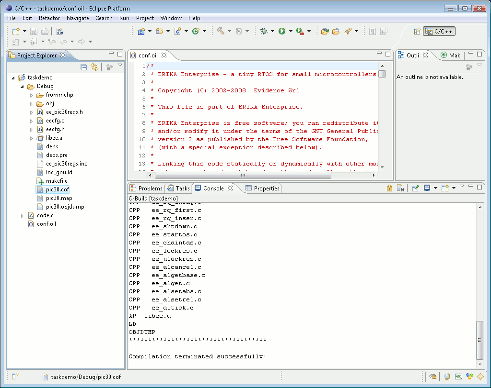

# ERIKA Enterprise and RT-Druid Design Flow

The typical design flow of an embedded application based on ERIKA Enterprise is done inside RT-Druid, which is an analysis and configuration environment, based on Eclipse. Eclipse is an open framework initially developed by IBM, which allows the possibility of integrating various development tools in a common environment.

The sytem is mainly composed of the following parts:

1. The Eclipse IDE
2. The RT-Druid Eclipse plugins, including the OIL compiler, the schedulability analyzer, and others
3. The ERIKA Enterprise source code, packaged as a set of Eclipse plugins (to ease online update)
4. (on Windows only) A minimal Cygwin installation
5. A set of compiler and debuggers for the specific architecture, typically downloaded from the silicon vendor website

When developing an application for Erika Enterprise, the user is supposed to write the source code inside the RT-Druid IDE.

The Eclipse workspace and the RT-Druid plugins for dsPIC (R) DSC.

Application compilation is also done inside the Eclipse Framework. In fact, the RTDruid code generator is able to generate the Erika Enterprise configuration files together with a set of configuration files (typically, a makefile plus a set of .c files) which are
then used to compile the source code. After that, compilation is started automatically by pressing on the “Build Project” menu item inside the “Project” menu, which automatically calls the underlying make application (on Windows provided by the Cygwin environment). As an alternative, the “Build Project” command is also available by right clicking on the project name.

On Windows, the choice of the Cygwin environment has been done to simplify the building process of an application: in fact, Cygwin provides a set of traditional Unix tools like make, awk, sed, which are really useful to implement a command line application building framework. Moreover, these tools are typically available for free on GNU/Linux platform, easing in this way the porting of the application to a free development environment such as GNU/Linux.

---

## Archive provenance

- [Original page](http://erika.tuxfamily.org/wiki/index.php?title=ERIKA_Enterprise_and_RT-Druid_Design_Flow) · [Archived source revision 4708](http://erika.tuxfamily.org/wiki/index.php?oldid=4708)
- Last source edit: 2012-03-29T09:30:24Z. Source retrieved on 2026-11-06; Markdown conversion completed on 2026-11-07.
- Original contributors recorded in exported history: Paolo.gai, Nicola.
- [Original MediaWiki source](../source/wikitext/2067.mediawiki) · [Original editing history](../source/history/batch-003.xml)
- [Attribution and licensing notice](../NOTICE.md). Original file-specific notices, where present, remain applicable.
