# Easylab

The **Easylab** palette:

| Symbol | Description |
| --- | --- |
| [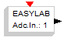](../files/File_Easylab_adc.png--2082.md) | This block controls the 4 analog pins of the Easylab board. The internal parameter specifies the pin. |
| [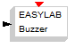](../files/File_Easylab_buzzer.png--2083.md) | This block controls the Buzzer of the Easylab board. No internal parameters. |
| [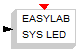](../files/File_Easylab_sysled.png--2084.md) | This block controls the Microstick led. No internal parameters. |
| [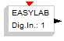](../files/File_Easylab_input.png--2085.md) | This block controls the digital input pins of the Easylab board. The internal parameter specifies the pin. |
| [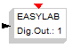](../files/File_Easylab_output.png--2086.md) | This block controls the digital output pins of the Easylab board. The internal parameter specifies the pin. |
| [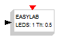](../files/File_Easylab_leds.png--2087.md) | This block controls the leds of the Easylab board. The internal parameters specify the threshold and the led. |
| [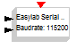](../files/File_Easylab_serial_send.png--2088.md) | This block controls data sending through the serial interface. The internal parameter specifies the baudrate of the UART controller. |
| [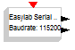](../files/File_Easylab_serial_receive.png--2089.md) | This block controls data reception through the serial interface. The internal parameter specifies the baudrate of the UART controller. |
| [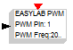](../files/File_Easylab_pwm.png--2090.md) | This block controls the 4 PWM pins of the Easylab board. The internal parameters specify the PWM signal frequency and the pin. |
| [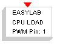](../files/File_Easylab_cpuload_pwm.png--2135.md) | This block measures the CPU load and controls the selected PWM output pin of the Easylab board. The internal parameters specify the PWM signal frequency and the pin. |
| [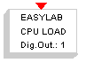](../files/File_Easylab_cpuload_gpout.png--2136.md) | This block measures the CPU load and controls the selected digital output pin of the Easylab board. The internal parameter specifies the pin. |

---

## Archive provenance

- [Original page](http://erika.tuxfamily.org/wiki/index.php?title=Easylab) · [Archived source revision 3823](http://erika.tuxfamily.org/wiki/index.php?oldid=3823)
- Last source edit: 2011-10-13T13:59:49Z. Source retrieved on 2026-11-06; Markdown conversion completed on 2026-11-07.
- Original contributors recorded in exported history: Erikadds.
- [Original MediaWiki source](../source/wikitext/2081.mediawiki) · [Original editing history](../source/history/batch-003.xml)
- [Attribution and licensing notice](../NOTICE.md). Original file-specific notices, where present, remain applicable.
