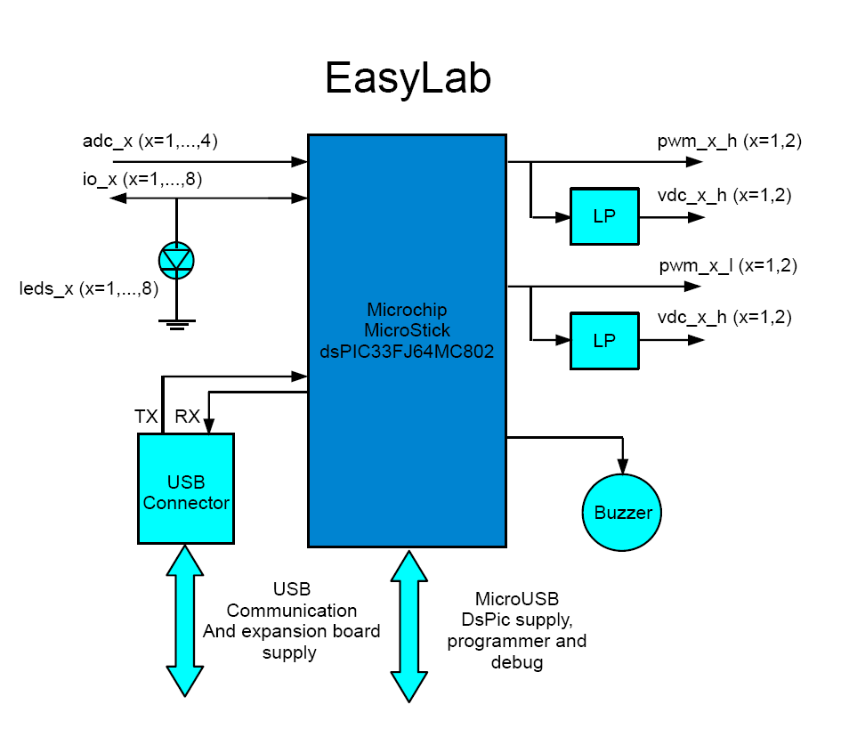
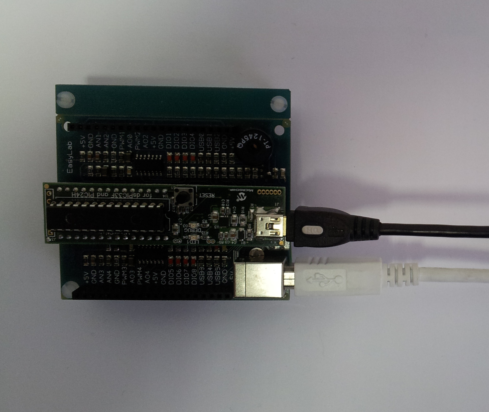

# Easylab board: Description & MPLAB IDE Library

## Description

[Easylab board](http://www.evidence.eu.com/products/easy-lab.html) is prototyping board developed by [Evidence Srl](http://www.evidence.eu.com/). It's essentially an expansion board of the [Microchip Microstick dsPIC33F and PIC24H Development Board](http://www.microchip.com/stellent/idcplg?IdcService=SS_GET_PAGE&nodeId=1406&dDocName=en548414).

EasyLab simple diagram block

Key Features:

- RS232 to USB Interface to PC for board control.
- Power supply 5V DC from USB cable.
- miniUSB In-System Programming (ISP) for Microstick module.
- 8 Pin I/O, configurable as input or output, for general use.
- 8 LEDS on each I/O pin.
- 2 Configurable Output PWM to drive dc-motor in motion control.
- 2 Low Pass Filter on each PWM to obtain a programmable dc voltage.
- All I/O ports easily accessible through pin header connectors.

## EasyLab Connecting the Hardware

The EasyLab needs to run two USB cables. The first cable is a miniUSB (*A* in the follow picture) is for programming/debugging and
power supply of the Microchip MicroStick. The second cable, a normal USB, is for pc to board communication and power supply of the expansion board.

EasyLab needs two USB cable to run

## Easylab simple Library

There is a very simple library in the [Easylab Software Packet](../assets/linked/Easylab--cc938ae0ed0d1078.zip). The library consists in a C file (easylab.c) and the relative header file (easylab.h). These files have written to be compiled by [Microchip C30 compiler](http://www.microchip.com/stellent/idcplg?IdcService=SS_GET_PAGE&nodeId=1406&dDocName=en010065&part=SW006012). In the EasyLab library use some Microchip C30's API , so is necessary to install a Microchip C30 compiler for dsPIC (we tested with version 3.25) for try them.

API Software description:

- Configure dspic pins in realation with board layout
- Set/Get actual clock frequency (with internal FRC with PLL)
- Turn on/off & toggle leds
- Read/Write DIO pins
- Configure up to 2 General Purpose Timers
- Start and stop a buzzer with a given forcing frequency
- Configure one of 4 ADC channels and sample that synchronously
- Configure 2 couple of PWM pins in any combination of PWM/override, with given frequency and duty cycle
- Serial comunication with UART serial over USB

The library has been coded with dsPIC33FJ64MC802 as only test target, even though [Microstick](http://www.microchip.com/stellent/idcplg?IdcService=SS_GET_PAGE&nodeId=1406&dDocName=en548414) package come with a PIC24FJ64GP too.

## Easylab Library in a MPLAB's example

Easylab Library comes with a complete example that shows the usage of some features of the board like PWM, ADC, Buzzer, USB/Serial and leds.
The library and the [MPLAB's](http://www.microchip.com/stellent/idcplg?IdcService=SS_GET_PAGE&nodeId=1406&dDocName=en019469&part=SW007002). project are placed in the [Easylab Software Packet](../assets/linked/Easylab--cc938ae0ed0d1078.zip).  
In the [How Compile and Run a MPLAB's project](How_Compile_and_Run_a_MPLAB_s_project--2260.md "How Compile and Run a MPLAB's project") are placed all the instruction to do it.  
At the beginning the test configure the PWM and the ADC channels. Then, using a simple cable, the user can connect the analogic output (AOx for PWM channel x) to the AD converter (ANx for ADC channel x). The value measured by the AD converter is then transmitted to the PC. You can interact with the application with any serial console (e.g Putty.exe, HyperTerminal, HTerm etc...).

So application steps are:

1. Select the PWM channel.
2. Select the ADC channel.
3. Set the desired voltage value.
4. Connect the cable and measure the output voltage.

You can send 'ESC' char to restart the demo.

---

## Archive provenance

- [Original page](http://erika.tuxfamily.org/wiki/index.php?title=Easylab_board%3A_Description_%26_MPLAB_IDE_Library) · [Archived source revision 4539](http://erika.tuxfamily.org/wiki/index.php?oldid=4539)
- Last source edit: 2012-01-31T10:46:18Z. Source retrieved on 2026-11-06; Markdown conversion completed on 2026-11-07.
- Original contributors recorded in exported history: Eguidieri, Erikadds, Salva.
- [Original MediaWiki source](../source/wikitext/2132.mediawiki) · [Original editing history](../source/history/batch-003.xml)
- [Attribution and licensing notice](../NOTICE.md). Original file-specific notices, where present, remain applicable.
