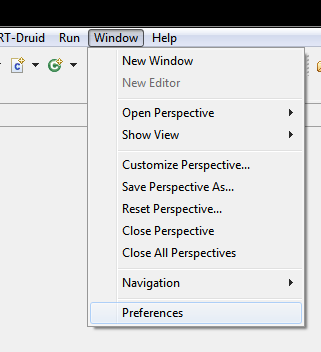
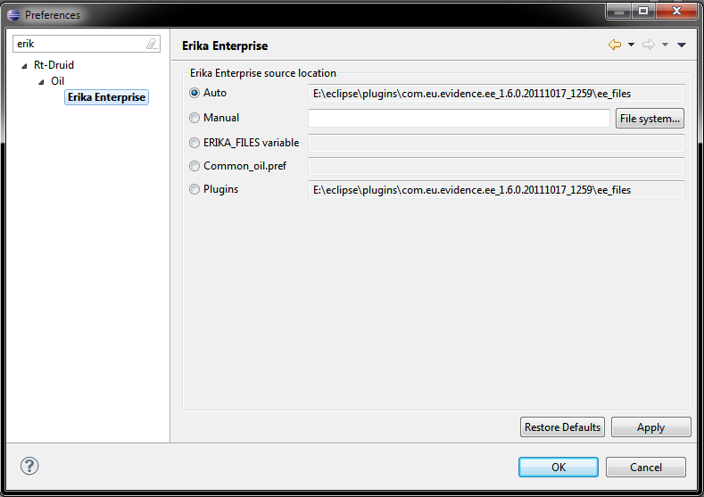
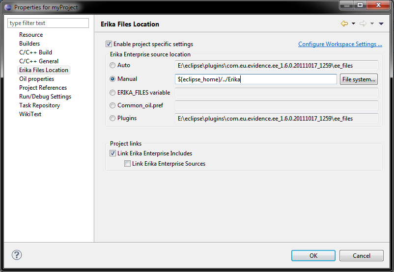
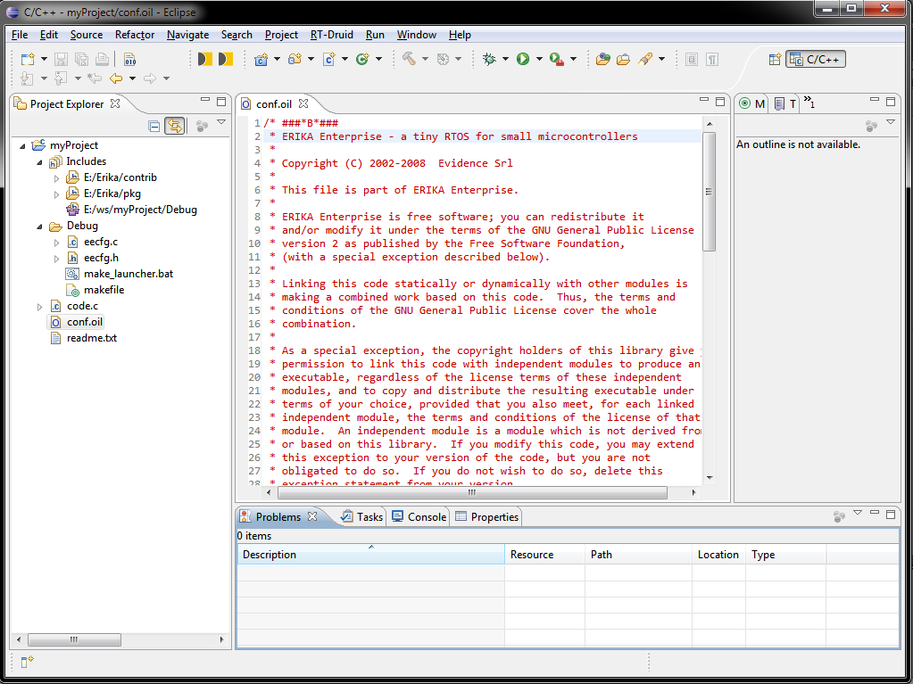
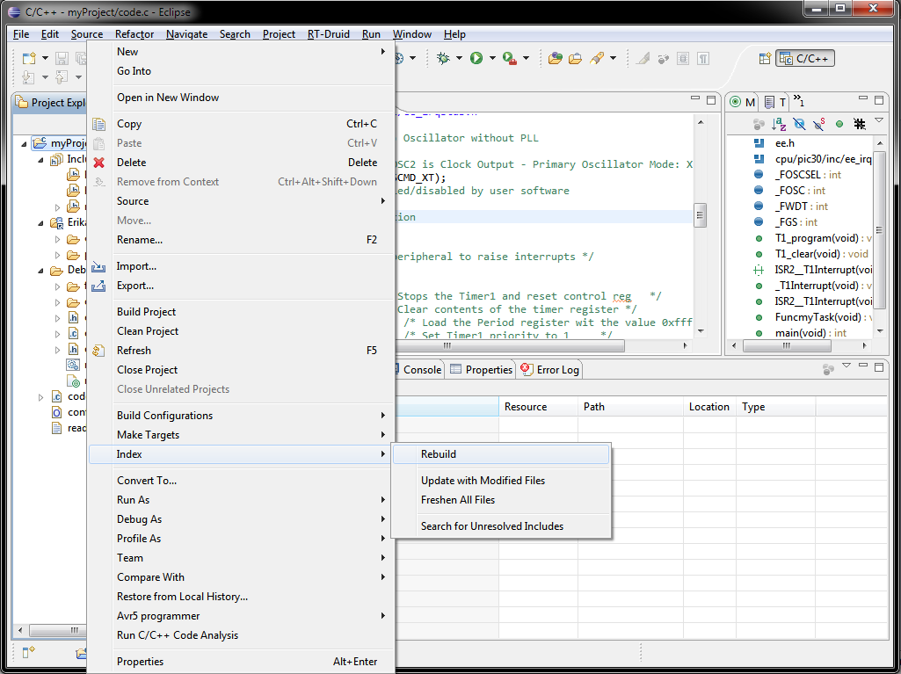
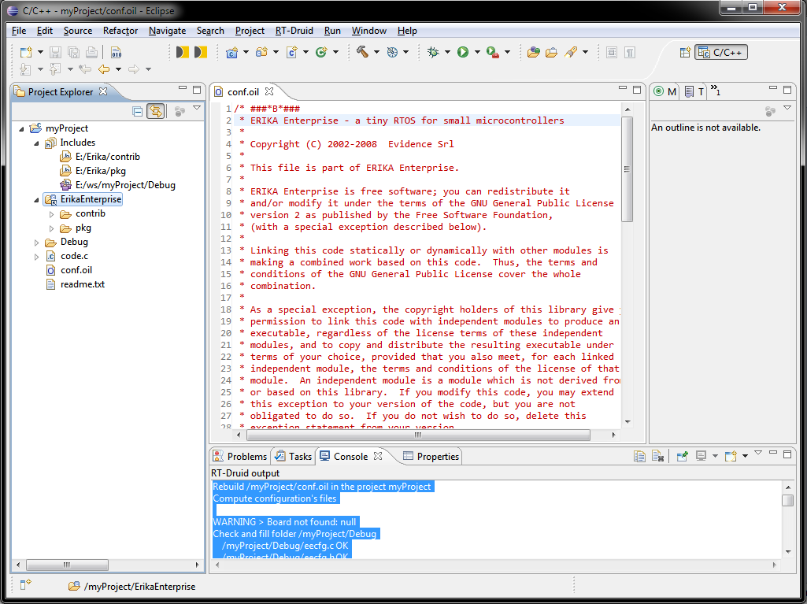

# Erika path in RT-Druid

<a id="Erika_Enterprise_Paths"></a>

### Erika Enterprise Paths

Erika Enterprise uses two variables to store source path:

- **ERIKA\_FILES** contains the path in the format used by the host machine. This variable is intended to **not** be used inside makefiles. For example, on Windows it will be something like *C:\Evidence\ee* while on Linux it can be */opt/Evidence/ee*.

- **EEBASE** contains the path in the format used by makefile and it should be used **only** inside makefiles. For example, if you are using a Cygwin toolchain it will be something like */cygdrive/c/Evidence/ee*, while in a Linux makefile it can be */opt/Evidence/ee*.

<a id="Define_the_path_in_RT-Druid"></a>

### Define the path in RT-Druid

RT-Druid allows the user to define the Erika Enterprise path for the workspace and for each project. This is done using workspace and project preferences.

The path can come from different sources (in this order):

- a value specified by the user (available using the eclipse GUI)
- ERIKA\_FILES environment variable
- erika\_enterprise\_location keyword specified in the configuration file of RT-Druid (see common\_oil.pref inside eclipse/configuration folder) (see also [Common\_oil.pref\_example](Common_oil.pref_example--2161.md "Common oil.pref example"))
- plugin settings (i.e. the Erika Enterprise sources embedded inside a plugin)

| Source | GUI | Batch | where | when |
| --- | --- | --- | --- | --- |
| User Value | X |  | Workspace and project property | hard-coded in the project, the always valid |
| ERIKA\_FILES | X | X | Environment | related to a specific run of RT-Druid |
| erika\_enterprise\_location keyword | X | X | RT-Druid configuration file | related to a specific installation of RT-Druid |
| plugins | X | X | hard-coded inside Erika source plugin | a RT-Druid distribution feature |

<a id="variable_paths"></a>

#### variable paths

Both *User Value* and *erika\_enterprise\_location* support eclipse *variable* syntax. This means that you can specify a path that is computed at runtime. Note that this feature is intended to be used with variables that does not change their value during the execution of eclipse, otherwise you should refresh manually the workspace.

As example, if you have Erika Enterprise sources directory located inside the same place where is the eclipse directory, you can write:

```
 ${eclipse_home}/../erika_enterprise
```

<a id="erika_enterprise_location_keyword"></a>

#### erika\_enterprise\_location keyword

Current version of RT-Druid support a configuration file that, as default, is located at *eclipse/configurations/common\_oil.pref*. This file is wrote using the *java properties* standard, i.e. a text file where each line is in the form

```
 keyword=value 
```

You can add comments using the character *#* at the beginning of the line.

Example:

```
 # Set the folder with the Erika Enterprise sources
 erika_enterprise_location=d:\Evidence\Erika_Enterprise_svn
```

(see also [Common\_oil.pref\_example](Common_oil.pref_example--2161.md "Common oil.pref example"))

<a id="Workspace_properties"></a>

#### Workspace properties

Opening eclipse preferences, there is a tab dedicated to the location in your file system of Erika Enterprise files.
Here you can see available options: setting *Auto* RT-Druid will choose the most specific for the running instance, otherwise
select other options (*ERIKA\_FILES variable*, *Common\_oil.pref* and *Plugins*) to ask RT-Druid to base the choice only on that source.

Through the *Manual* option, you can force RT-Druid to use a generic directory in you filesystem.

[](../files/File_Preferences_menu.png--2142.md)

Preference command in the eclipse menu.

[](../files/File_Workspace_ee_path.png--2143.md)

Workspace preference of Erika Enterprise source files location.

After you change the Workspace setting of Erika Enterprise location, all RT-Druid projects that use this property are automatically updated. Depending on the *auto build* setting, this update may trigger the build process.

<a id="Project_properties"></a>

#### Project properties

Opening project properties (right click on the project and then *properties* in the popup menu), there is a tab dedicated to the location in your file system of Erika Enterprise files.
The default choice is to use the one specified in the Workspace preferences, but you are free to use a different value:
to enable a project's specific value check the checkbox *Enable project settings*.
Then you can choose among the same options available in workspace preferences: *Auto*, *Manual*, *ERIKA\_FILES variable*, *Common\_oil.pref* and *Plugins*.

In the screen-shot, the manual path contains a path directory sibling to eclipse's one.

[](../files/File_Project_ee_path.png--2144.md)

Project preference of Erika Enterprise source files location.

After you change the Project setting of Erika Enterprise location, that project is automatically updated. Depending on the *auto build* setting, this update may trigger the build process.

<a id="Show_Erika_files_in_the_workspace"></a>

### Show Erika files in the workspace

Using project properties, you can ask RT-Druid to link Erika Enterprise source files in your project.
There are three choices:

- do not link anything
- link includes (.h files)
- link both includes and sources

In this screen-shot only the option *Link Erika Enterprise Includes* is enabled

[](../files/File_Project_ee_path.png--2144.md)

Project preference of Erika Enterprise source files location.

The result of enabling the link to Erika Includes it that is now possible to navigate .h files inside eclipse.
cdt's indexer can parse those .h files to resolve function and type definitions, however this is possible only after RT-Druid produces eecfg.h file. Indeed erika's .h file are full of ifdef statements and they depends on the defines provided by eecfg.h

Using other words, if you want content assist and resolve types and functions, you should enable *link to include* and do a build after changing the oil configuration file.

[](../files/File_Project_link_ee_include.png--2145.md)

Project with link to Erika Enterprise Include files.

Usually is enough to run the RT-Druid builder to produce the eecfg.h file (RT-Druid will also ask the indexer to update with the new set of defines), but some architectures, like Microchip pics, use .h file produced during the complete build process. In this case you need to ask manually the indexer to updare: right click in the project, then *Index* -> *rebuild*.

[](../files/File_Project_rebuild_index.png--2146.md)

Project with link to Erika Enterprise Include files.

If you enable the link to Erika source files, you will have more functionalities available:

- with Navigate-> open a resource (default short-cut **control+shift+R**) you will able to find a specific file (using some characters of the name as expression for the search)
- with Search (short-cut **control+H**) you will able to find some text inside Erika Source files
- if there is an compilation error, clicking on the *problem* tab it will open the file that contains the error (even if it is an Erika source file)

[](../files/File_Project_link_ee_sources.png--2147.md)

Project with link to Erika Enterprise Include files.

Note that the *rebuild index* operation is a log time operation that run in background. If you have a middle size project with the link to Erika Include files, it will take few seconds, while a big size project, with all Erika source files may take form 30 to few minutes, depending on the speed of the working machine.

---

## Archive provenance

- [Original page](http://erika.tuxfamily.org/wiki/index.php?title=Erika_path_in_RT-Druid) · [Archived source revision 4969](http://erika.tuxfamily.org/wiki/index.php?oldid=4969)
- Last source edit: 2013-01-07T13:04:25Z. Source retrieved on 2026-11-06; Markdown conversion completed on 2026-11-07.
- Original contributors recorded in exported history: Nicola, Dibbe, Pj.
- [Original MediaWiki source](../source/wikitext/2141.mediawiki) · [Original editing history](../source/history/batch-004.xml)
- [Attribution and licensing notice](../NOTICE.md). Original file-specific notices, where present, remain applicable.
