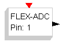
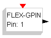
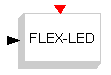
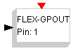
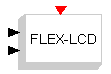

# FLEX

The **FLEX** palette:

| Symbol | Description |
| --- | --- |
|  | This block maps to an analog input pin of the FLEX Board. The internal parameter specifies the ADC pin (from 1 to 8). |
|  | This block maps to an digital input pin of the FLEX Board. The internal parameter specifies the GPIO pin (from 1 to 8). |
|  | This block controls the FLEX system LED. The LED is on when the input is greater than 0.5. |
|  | This block controls an output pin of the FLEX Board. It has an internal parameter which is the ouput pin. |
|  | This block controls the LCD which is attached to the first prototype of the Demo Daughter Board (this hardware is no more available, and the block is here for historical usage). If used with the Demo Daughter Board, it controls the LCD of that board. |

---

## Archive provenance

- [Original page](http://erika.tuxfamily.org/wiki/index.php?title=FLEX) · [Archived source revision 1806](http://erika.tuxfamily.org/wiki/index.php?oldid=1806)
- Last source edit: 2009-12-26T20:05:38Z. Source retrieved on 2026-11-06; Markdown conversion completed on 2026-11-07.
- Original contributors recorded in exported history: WikiSysop.
- [Original MediaWiki source](../source/wikitext/1534.mediawiki) · [Original editing history](../source/history/batch-004.xml)
- [Attribution and licensing notice](../NOTICE.md). Original file-specific notices, where present, remain applicable.
