# FLEX-Communication

The **FLEX-Communication** palette:

| Symbol | Description |
| --- | --- |
| [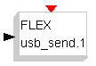](../files/File_Usb_send.png--1551.md) | This block controls the sending of a packet through the USB connection for the FLEX FULL Board. The internal parameter specifies the channel(from 0 to 14). |
| [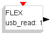](../files/File_Usb_read.png--1552.md) | This block controls the reception of a packet through the USB connection for the FLEX FULL Board. The internal parameter specifies the channel(from 0 to 14). |
| [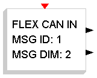](../files/File_Can_in.png--1553.md) | This block controls the sending of a packet on a CAN bus for the FLEX Board. The internal parameters specify the message ID and the number of the output lines of the block. |
| [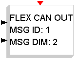](../files/File_Can_out.png--1554.md) | This block controls the reception of a packet on a CAN bus for the FLEX Board. The internal parameters specify the message ID and the number of the input lines of the block. |
| [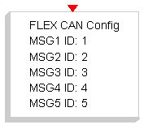](../files/File_Can_cfg.png--2079.md) | This block configures the FLEX CAN driver. The internal parameters specify the message identifiers (only 5 different IDs are supported at the moment). |
| [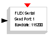](../files/File_Serial_send.png--1555.md) | This block controls the serial sending through the RS-232 protocol for the FLEX Board. The internal parameters specify the serial port and the baud-rate. |
| [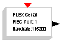](../files/File_Serial_receive.png--1556.md) | This block controls the serial reception through the RS-232 protocol for the FLEX Board. The internal parameters specify the serial port and the baud-rate. |
| [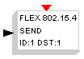](../files/File_802154_send.png--1557.md) | This block controls the serial sending through the 802.15.4 protocol for the FLEX Board. The internal parameters specify the data ID, the destination address and the usse of GTS. |
| [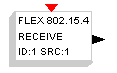](../files/File_802154_receive.png--1558.md) | This block controls the reception of a packet through the 802.15.4 protocol for the FLEX Board. The internal parameters specify the data ID, the source address. |
| [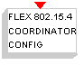](../files/File_Coord.png--1561.md) | This block sets the Coordinator parameters for a 802.15.4 based communication for the FLEX Board. The internal parameters specify the coordinator settings. |
| [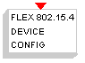](../files/File_Device.png--1562.md) | This block sets the Device parameters for a 802.15.4 based communication for the FLEX Board. The internal parameters specify the device settings. |
| [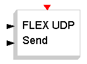](../files/File_Udp_send.png--2076.md) | This block controls the data sending through the UDP protocol for the FLEX Board. The internal parameter specifies the number of the input lines of the block. |
| [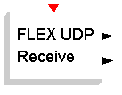](../files/File_Udp_receive.png--2077.md) | This block controls the data reception through the UDP protocol for the FLEX Board. The internal parameter specifies the number of the output lines of the block. |
| [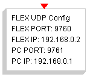](../files/File_Udp_cfg.png--2078.md) | This block sets the socket parameters for an UDP based communication for the FLEX Board. The internal parameters specify the FLEX IP address, the FLEX UDP socket port, the FLEX IP subnet mask, the FLEX Gateway address, the FLEX primary DNS address, the FLEX secondary DNS address, the PC IP address and the PC UDP socket port. |

---

## Archive provenance

- [Original page](http://erika.tuxfamily.org/wiki/index.php?title=FLEX-Communication) · [Archived source revision 3762](http://erika.tuxfamily.org/wiki/index.php?oldid=3762)
- Last source edit: 2011-10-11T15:51:28Z. Source retrieved on 2026-11-06; Markdown conversion completed on 2026-11-07.
- Original contributors recorded in exported history: WikiSysop, Erikadds.
- [Original MediaWiki source](../source/wikitext/1535.mediawiki) · [Original editing history](../source/history/batch-004.xml)
- [Attribution and licensing notice](../NOTICE.md). Original file-specific notices, where present, remain applicable.
