# FLEX-DemoBoard

The **FLEX-DemoBoard** palette:

| Symbol | Description |
| --- | --- |
| [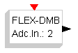](../files/File_Flex_sources_dmbadcin.png--1289.md) | This block maps to an analog input pin of the FLEX Demo Daughter Board. The internal parameter specifies the ADC pin (from 1 to 8). |
| [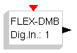](../files/File_Flex_sources_dmbdigin.png--1291.md) | This block maps to an digital input pin of the FLEX Demo Daughter Board. The internal parameter specifies the GPIO pin (from 1 to 8). |
| [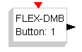](../files/File_Flex_sources_dmbbutton.png--1290.md) | This block maps to a button of the FLEX Demo Daughter Board. The internal parameter specifies the Button (from 1 to 4). |
| [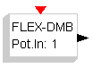](../files/File_Flex_sources_dmbpot.png--1294.md) | This block maps to the potentiometer analog input of the FLEX Demo Daughter Board. The internal parameter specifies the Potentiometer (from 1 to 4). |
| [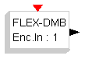](../files/File_Flex_sources_dmbencin.png--1292.md) | This block maps to the encoder input of the FLEX Demo Daughter Board. The internal parameter specifies the encoder (from 1 to 2). |
| [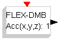](../files/File_Flex_sources_dmbacc.png--1288.md) | This block maps to the accelerometer input of the FLEX Demo Daughter Board. The internal parameter specifies the Channel (1=x, 2=y, 3=z). |
| [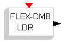](../files/File_Flex_sources_dmbldr.png--1293.md) | This block maps to the light sensor of the FLEX Demo Daughter Board. |
| [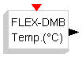](../files/File_Flex_sources_dmbtemp.png--1295.md) | This block maps to the temperature sensor of the FLEX Demo Daughter Board. |
| [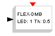](../files/File_Flex_sinks_dmbled.png--1302.md) | This block controls one of the eight LEDs of the Demo Daughter Board. The internal parameter specifies the LED number. |
| [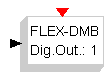](../files/File_Flex_sinks_dmbdigout.png--1300.md) | This block controls one of the eight digit output pins of the Demo Daughter Board. The internal parameter specifies the pin. |
| [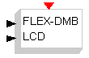](../files/File_Flex_sinks_dmblcd.png--1301.md) | This block controls the LCD on the Demo Daughter Board. |
| [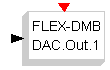](../files/File_Flex_sinks_dmbdac.png--1299.md) | This block controls one of the two DAC outputs. The internal parameter specifies the DAC channel number. The input is from 0.0 (0.0 V) to 1.0 (3.0 or 5.0 V depending on the HW configuration) |
| [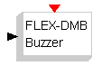](../files/File_Flex_sinks_dmbbuzzer.png--1285.md) | This block controls the buzzer mounted on the Demo Daughter Board. The input value is the frequency of the buzzer sound, in Hz. |
| [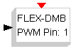](../files/File_Flex_PWMpin.png--1542.md) | This block controls a PWM output of the FLEX Board. The internal parameter specifies the PWM pin (from 1 to 4). |
| [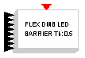](../files/File_Flex_Barrier.png--1543.md) | This block controls the LED barrier of the FLEX Board. The internal parameter specifies the threshold. |

---

## Archive provenance

- [Original page](http://erika.tuxfamily.org/wiki/index.php?title=FLEX-DemoBoard) · [Archived source revision 3761](http://erika.tuxfamily.org/wiki/index.php?oldid=3761)
- Last source edit: 2011-10-11T14:49:05Z. Source retrieved on 2026-11-06; Markdown conversion completed on 2026-11-07.
- Original contributors recorded in exported history: WikiSysop, Erikadds.
- [Original MediaWiki source](../source/wikitext/1536.mediawiki) · [Original editing history](../source/history/batch-004.xml)
- [Attribution and licensing notice](../NOTICE.md). Original file-specific notices, where present, remain applicable.
