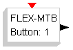
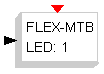
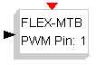
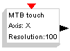
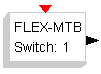
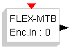
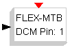

# FLEX-MotionBoard

The **FLEX-MotionBoard** palette:

| Symbol | Description |
| --- | --- |
|  | This block controls the FLEX Motion Daughter Board buttons. The internal parameter specifies the button(from 1 to 2). |
|  | This block controls the FLEX Motion Daughter Board leds. The internal parameter specifies the led(from 1 to 2). |
|  | This block controls the FLEX Motion Daughter Board buttons. The internal parameter specifies the pwm channel(from 1 to 2). |
|  | This block controls a touch panel connected to the FLEX Motion Daughter Board (refer Amazing Ball). The internal parameters specifie the axis and the panel resolution(from 1 to 2). |
|  | This block controls the FLEX Motion Daughter Board switch. The internal parameter specifies the switch number(from 1 to 8). |
|  | This block controls the FLEX Motion Daughter Board encoder. The internal parameter specifies the encoder type(0 for HW encoder based on QEI, 1 for SW encoder based on interrupts). HW encoder output is in "counts" 4x mode in the range +-2^15, SW encoder output is in "counts" 2\*2x mode in the range +-2^16. |
|  | This block controls the FLEX Motion Daughter Board PWM plugin for DC-Motor. The internal parameter specifies the channel(from 1 to 2). The code of the block assumes a max voltage of 12V and a saturarion voltage of +-6V. |

---

## Archive provenance

- [Original page](http://erika.tuxfamily.org/wiki/index.php?title=FLEX-MotionBoard) · [Archived source revision 2132](http://erika.tuxfamily.org/wiki/index.php?oldid=2132)
- Last source edit: 2010-11-11T09:15:33Z. Source retrieved on 2026-11-06; Markdown conversion completed on 2026-11-07.
- Original contributors recorded in exported history: WikiSysop, Erikadds.
- [Original MediaWiki source](../source/wikitext/1537.mediawiki) · [Original editing history](../source/history/batch-005.xml)
- [Attribution and licensing notice](../NOTICE.md). Original file-specific notices, where present, remain applicable.
