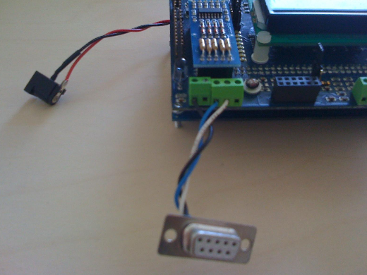
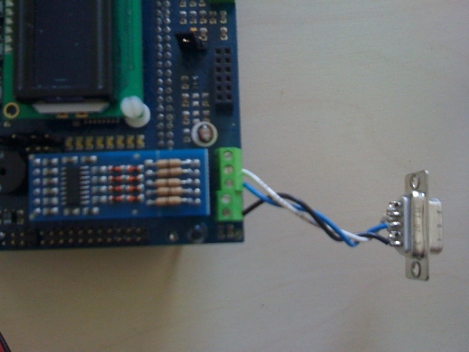
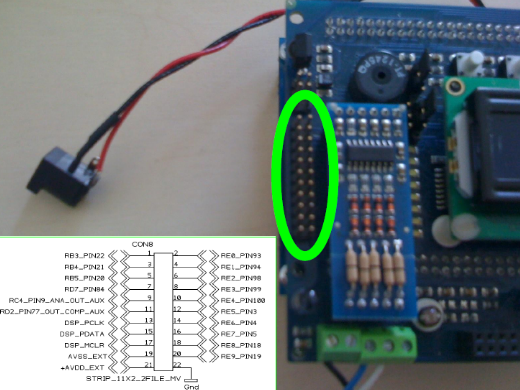
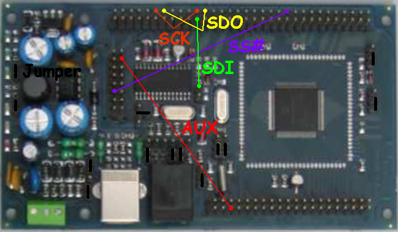
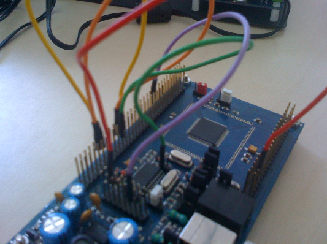

# FLEX Demo Daughter Board

## Description

The FLEX Demo Board is a FLEX Daughter Board, targeted specifically for educational institutions e.g. Schools and Universities.
The FLEX Demo Board fits directly on FLEX Full / FLEX Light Base Board and it adds-on a lot of most commonly used features that are used for carrying out prototyping and laboratory experiments.

The features hosted on FLEX Demo Board are:

- 2 DAC outputs (12 bit resolution)
- 3-axis accelerometer (selectable range from 1.5g to 6g)
- Direct support for quadrature encoder
- Set of 4 Push buttons
- Set of 8 LEDs
- LCD (16 characters x 2 lines)
- Buzzer
- Potentiometer
- Thermal sensor
- Light sensor
- InfraRed receiver and transmitter
- ZigBee connector
- Socket for Multibus serial modules (one of FLEX103, FLEX104, FLEX105, and FLEX108)
- USB wiring for FLEX Full Base Board

Moreover, the FLEX Demo Board is fully supported by Scilab/Scicos code generator, where specific blocks are available to directly control the main peripherals. Hence, applications can be entirely generated without writing any C code.

[FLEX Demo Daughter Board product page](http://www.evidence.eu.com/content/view/263/273/)

## FAQ

- How can I connect a standard DB9 serial cable to the MORS3 connector on the demo board? Is there anywhere I can purchase this cable already made?

We usually solder a DB9 connector ourselves.
The pins to be soldered are:

MORS3\_PIN5 -> DB9\_PIN5 (GROUND, BLACK WIRE).

MORS3\_PIN3 -> DB9\_PIN3 (TX\_RS232, BLUE WIRE).

MORS3\_PIN2 -> DB9\_PIN2 (RX\_RS232, WHITE WIRE).

The images below show how to connect a DB9 connector. Please, note that you need the RS232 module. We can send you a solded connector (You'll pay just the shipping).

- Is there an exposed pin on the DemoBoard that can be used as an ADC input to the microcontroller?

Yes, on CON8 connector. There are: RB3/AN3, RB4/AN4, RB5/AN5, RC4/AN19, RE8/AN20, RE9/AN21 which are programmable as ADC inputs. Furthermore, the CON8 connector has the following pins: RD7/OC8, RD2/OC3, RE0/PWM1L, RE1/PWM1H, RE2/PWM2L, RE3/PWM2H, RE4/PWM3L, RE5/PWM3H, RE6/PWM4L, RE7/PWM4H which are programmable as PWM outputs or general purpose digital IO pins. The image below shows all the con8 connector pins.

- Is there an exposed pin on the DemoBoard that can be used as an external interrupt to the microcontroller?

Yes, on CON8 connector. There are RE8/INT1 and RE9/INT2. Look the previous image.

- Can I use USB communication without FLEX DEMO daughter board?

Yes. The demo board provide correct SPI connection between the PIC18 and the dsPIC. If you are not using the demo board you can set-up manually a SPI connection. For safety considerations it is STRONGLY recommended to use the same voltage for both dsPIC and PIC18, 3.3V. In the following figure you can be see SPI connections and jumpers setttings.

In the USB applications note the PIC18 is only a transceiver since it receives messages from the host PC through a USB connection and forwards these messages to the dsPIC through a SPI connection. The PIC18 has a full speed USB 2.0 interface that allows to easily implement USB connection with host computers. The PIC18 can be only a device. We used the code furnished by Microchip to implement the HID behaviour of the PIC18.

You can have PIC18 firmware for USB applications downloading the scicoslab pack:
<http://erika.tuxfamily.org/scilabscicos.html>

Application reference:
[http://erika.tuxfamily.org/wiki/index.php?title=USB\_communication\_using\_FLEX\_FULL\_Demo\_Board\_and\_the\_Scilab/Scicos\_code\_generator](USB_communication_using_FLEX_FULL_Demo_Board_and_the_Scilab_Scicos_code_generator--1539.md)

---

## Archive provenance

- [Original page](http://erika.tuxfamily.org/wiki/index.php?title=FLEX_Demo_Daughter_Board) · [Archived source revision 2117](http://erika.tuxfamily.org/wiki/index.php?oldid=2117)
- Last source edit: 2010-11-10T10:31:36Z. Source retrieved on 2026-11-06; Markdown conversion completed on 2026-11-07.
- Original contributors recorded in exported history: Erikadds.
- [Original MediaWiki source](../source/wikitext/1604.mediawiki) · [Original editing history](../source/history/batch-005.xml)
- [Attribution and licensing notice](../NOTICE.md). Original file-specific notices, where present, remain applicable.
