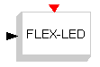
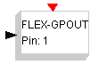
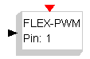
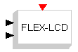
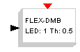
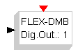
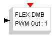
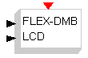
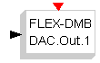
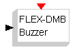

# FLEX Sinks

The **FLEX Sinks** palette:

| Symbol | Description |
| --- | --- |
|  | This block controls the FLEX system LED. The LED is on when the input is greater than 0.5. |
|  | This block controls an output pin of the FLEX Board. It has an internal parameter which is the ouput pin. |
|  | This block controls a PWM output of the FLEX Board. The internal parameter specifies the PWM pin (from 1 to 4). |
|  | This block controls the LCD which is attached to the first prototype of the Demo Daughter Board (this hardware is no more available, and the block is here for historical usage). If used with the Demo Daughter Board, it controls the LCD of that board. |
|  | This block controls one of the eight LEDs of the Demo Daughter Board. The internal parameter specifies the LED number. |
|  | This block controls one of the eight digit output pins of the Demo Daughter Board. The internal parameter specifies the pin. |
|  | This block controls one of the PWM outputs of the Demo Daughter Board. The internal parameter specifies the pin number (from 1 to four). |
|  | This block controls the LCD on the Demo Daughter Board. |
|  | This block controls one of the two DAC outputs. The internal parameter specifies the DAC channel number. The imput is from 0.0 (0.0 V) to 1.0 (3.0 or 5.0 V depending on the HW configuration) |
|  | This block controls the buzzer mounted on the Demo Daughter Board. The input value is the frequency of the buzzer sound, in Hz. |

---

## Archive provenance

- [Original page](http://erika.tuxfamily.org/wiki/index.php?title=FLEX_Sinks) · [Archived source revision 1557](http://erika.tuxfamily.org/wiki/index.php?oldid=1557)
- Last source edit: 2008-10-24T20:16:13Z. Source retrieved on 2026-11-06; Markdown conversion completed on 2026-11-07.
- Original contributors recorded in exported history: 193.205.81.5, Paolo.gai.
- [Original MediaWiki source](../source/wikitext/1308.mediawiki) · [Original editing history](../source/history/batch-005.xml)
- [Attribution and licensing notice](../NOTICE.md). Original file-specific notices, where present, remain applicable.
