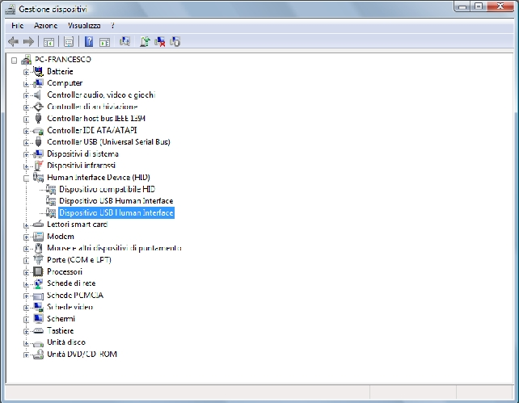
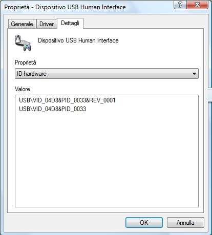
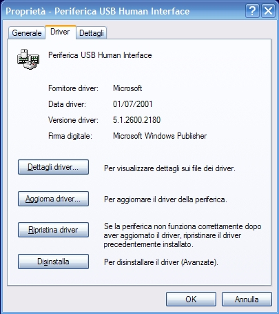
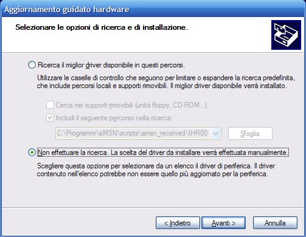
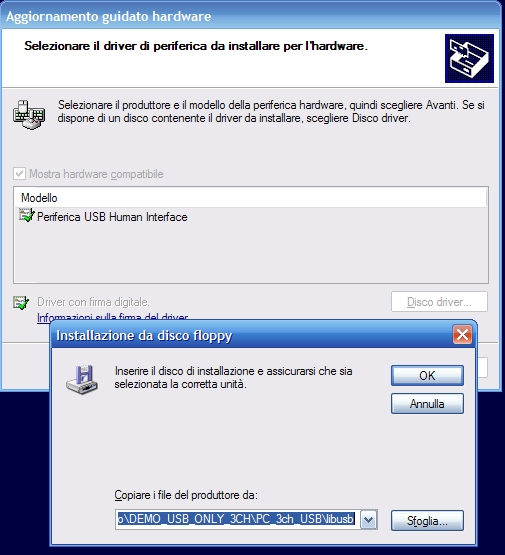
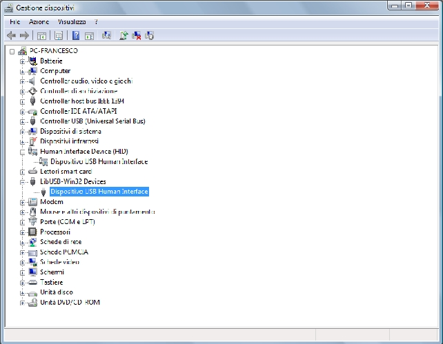

# FLEX usb data communication using Scilab and Scicos

This section focuses on the USB data communication between the FLEX Board and a host PC.

Please start by downloading this file:

- <http://www.evidence.eu.com/download/flex/USB_driver.zip>

### PIC18 USB firmware

The FLEX Full USB connection is provided by the PIC18F2550 that communicates with the dsPIC through a SPI protocol. Download the FLEX\_USB\_PIC18.cof (furnished with *USB\_driver* software) inside the microcontroller using MPLAB IDE. Usually, there is no need to change the configuration bits. In some cases the a configuration bit must be changed manually. After importing the cof file, check under MPLAB IDE in Configure → Configuration bits that address 0x300000 has value 0x24. If the proposed value is 0x04 unselect the checkbox and insert the correct value. After flashing the device, reset the board and connect the USB cable.

### Interfacing with the PC

This is a **one time operation** that has to be done before using the FLEX Full Board.

1. After programming the Flex board, connect it to the PC
2. The PC automatically recognize the device as a HID device. Open the PC control panel → system → device manager: open the Human Interface Device (as shown in the Figure below).

   ****
3. Double click on one of the devices, in order to identify the device with VID = 0x04d8 and PID = 0x0033 on the property window. This is the FLEX board. See the Figure below

   ****
4. Click on the driver tab as in the Figure below:

   ****
5. Click on Update driver → search the driver in the computer → manually search the driver.

   ****
6. Specify the path of the folder libusb furnished with *USB\_driver* software (USB\_driver\libusb).

   ****
7. The PC will load this as a new driver for the FLEX Full Board.

   ****

### Prerequisites for the USB PC application

- First of all you have to download and install Scilab 4.1.2. The Scilab executable can be found at the following addresses:

[[1]](http://www.scilab.org/download/index_download.php?page=old_releases)
[[2]](http://www.evidence.eu.com/content/view/293/382/)

- Then you have to download and install Visual studio 2008 C++ express edition from the Microsoft website. To compile external code, Scilab must detect and support Visual studio 2008 C++ express edition with dynamic link. This is required if you want to re-compile the scicos pack dll.

The tool is downloadable at:
[[3]](http://www.microsoft.com/Express/VC/)

- Then can be useful to download and install the Microchip MPLAB IDE to program the

Flex Full microcontroller (dsPIC33FJ256MC710). For the download go to the site:
[[4]](http://www.microchip.com/stellent/idcplg?IdcService=SS_GET_PAGE&nodeId=1406&dDocName=en019469&part=SW007002)

- The next step is to download and install ERIKA Enterprise for Microchip dsPIC and the scicos pack 8.1. The software can be found at:

[[5]](http://www.evidence.eu.com/content/view/293/382/)

### Using Scicos pack 8.1 USB PC application

The demo description is at **FLEX usb data communication using Scilab and Scicos**

---

## Archive provenance

- [Original page](http://erika.tuxfamily.org/wiki/index.php?title=FLEX_usb_data_communication_using_Scilab_and_Scicos) · [Archived source revision 4894](http://erika.tuxfamily.org/wiki/index.php?oldid=4894)
- Last source edit: 2012-09-28T08:43:57Z. Source retrieved on 2026-11-06; Markdown conversion completed on 2026-11-07.
- Original contributors recorded in exported history: Francesco, Shiva, Nino, Chris, Paolo.gai, WikiSysop, Nicola.
- [Original MediaWiki source](../source/wikitext/1398.mediawiki) · [Original editing history](../source/history/batch-005.xml)
- [Attribution and licensing notice](../NOTICE.md). Original file-specific notices, where present, remain applicable.
