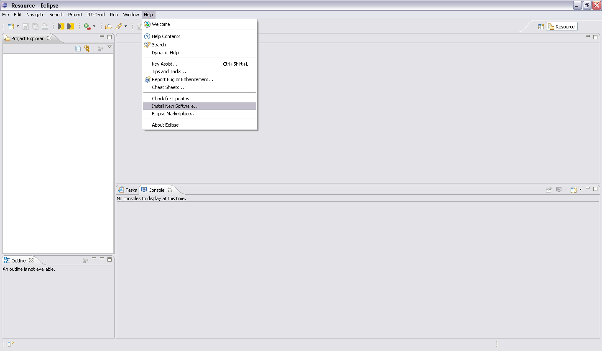
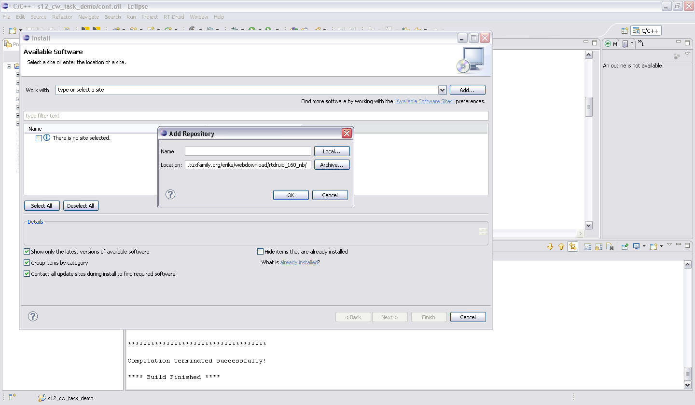

# Freescale S12

<a id="Freescale_S12_support"></a>

## Freescale S12 support

ERIKA Enterprise supports Freescale HCS12 microcontrollers.
The support for RT-Druid is now available .  
The HCS12 support includes:

1. support for **COSMIC** compiler (only for HCS12XS, since Erika release 1.5.0)
2. support for **CODEWARRIOR CWS12v5.1** compiler (since Erika release 1.6.0).
3. support for single and multi stack configurations.
4. ISR interrupt supported.
5. support for Freescale HIWAVE Debugger.

- **Supported compiler**
  - COSMIC C cross compiler and ELF module generation for debugging information.
  - CODEWARRIOR CWS12v5.1 compiler and ELF module generation for debugging information (Note: For some MCU is recommended to install the compiler updates available on the Freescale website).

- CODEWARRIOR compiler is enabled adding this option in the conf.oil file:

```
 EE_OPT = "__CODEWARRIOR__";
```

- If the compiler evaluation license is expired, you may have to add also this option to avoid syntax errors during the compilation:

```
 EE_OPT = "CW_EVAL_VERSION"; 
```

- **Mode of operation**
  - *Mono-stack*: The Monostack configuration of the ERIKA Kernel models the fact that all tasks and ISRs in the system share the same stack.
  - *Multi-stack*: Every thread can have its private stack, or it can share it with other threads.

- **Handling of paging registers**

The compiler supports bank switching for code and data, using the internal window mechanism provided by the HCS12 processor.

Bank switching mechanism delivers 32-bit performance with all the advantages and efficiencies of a 16-bit MCU.

Bank switching is supported via:

- @far type qualifier to describe a function relocated in a different bank. Calling such a function implies a special calling

sequence, and a special return sequence. Such a function has to be defined @far and referenced as @far in all the files using

it. The COSMIC compiler also provides a specific option +modf to automatically consider all the functions to be @far. The @far type

modifier is also used to declared variables allocated in a data bank.

- Linker options are required to ensure proper physical and logical addresses computations. The linker is also able to

automatically fill banks without any need to take care of the page boundaries.

<a id="CPUs"></a>

## CPUs

- **S12 Hardware Abstraction Layer** (since Erika revision 1531): S12 HAL now integrates the Erika HAL common files (see ['pkg/cpu/common'](http://svn.tuxfamily.org/viewvc.cgi/erika_erikae/repos/ee/trunk/ee/pkg/cpu/common/) folder and [Common\_files\_for\_the\_HAL](Common_files_for_the_HAL--1530.md) for further info). This feature simplifies future extensions for other S12 devices and ensures greater code stability against changes to the kernel code.
- **Nesting of interrupts**:
  - *MC9s12XS128*: The IPL bits allow the nesting of interrupts, blocking interrupts of an equal or lower priority. The current IPL is automatically pushed to the stack by the standard interrupt stacking procedure. The new IPL is copied to the CCR from the Priority Level of the highest priority active interrupt request channel. The copying takes place when the interrupt vector is fetched. The previous IPL is automatically restored by executing the RTI instruction.
  - *MC9S12G128*:

    ```
    WARNING: MC9S12G128 doesn't support IPL mechanism.
    ```

    To enable the nesting of interrupts in the code, the user should clear I bit (in the CCR register) inside the interrupt service routine and after the peripheral interrupt flag has been cleared. If the I bit is cleared before the peripheral interrupt flag has been cleared the CPU restarts the interrupt creating an infinite loop. For this reason I-bit cannot be cleared inside Erika HAL files and this task is left to the user. To enable the compilation of the code for the nesting of interrupts the symbol

```
 __ALLOW_NESTED_IRQ__
```

must be defined.
Note: If the kernel type is FP the nesting of the interrupts can be enabled in this way:

```
 KERNEL_TYPE = FP{
   NESTED_IRQ = TRUE;
 }; 
```

otherwise the default case is FALSE and the nesting of the interrupts is disabled.

<a id="MCUs"></a>

## MCUs

- The MCUs currently supported are the following:
  - *Freescale* **MC9S12XS128**
  - *Freescale* **MC9S12G128**
  - *Freescale* **MC9S12G48**
  - *Freescale* **MC9S12GN16**
  - *Freescale* **MC9S12GN32**
  - *Freescale* **MC9S12GN48**

- List of functions:
  - *Periodic interrupt timer*
    - void EE\_pit0\_init( unsigned char pitmtld0, unsigned char pitld0, unsigned char prio ); // To init PIT0
    - void EE\_pit0\_close( void ); // To close PIT0
    - void EE\_pit0\_clear\_ISRflag( void ); // To clean PIT0 ISR flag
  - *Serial communication interface*
    - void EE\_sci\_open(unsigned char sci\_num, unsigned long int baudrate); // Open the serial interface. Requires: EE\_set\_peripheral\_frequency\_mhz(f\_mhz)
    - void EE\_sci\_close(unsigned char sci\_num); // To close the serial interface
    - Bool EE\_sci\_send\_byte(unsigned char sci\_num, unsigned char buffer); // To send a byte
    - Bool EE\_sci\_send\_string(unsigned char sci\_num, const char\* s, unsigned int num); // to send a string
    - Bool EE\_sci\_send\_bytes(unsigned char sci\_num, char\* v, unsigned int num); // To send a vector of bytes
    - Bool EE\_sci\_get\_byte(unsigned char sci\_num, unsigned char \*buffer); // to get a byte
    - Bool EE\_sci\_getcheck(unsigned char sci\_num); // to check the serial reception of a byte
  - *Timer*
    - int EE\_timer\_init\_us(EE\_UINT16 tim\_id, EE\_UINT32 period\_us, EE\_UINT8 isr\_mode) // init timer. Requires: EE\_set\_peripheral\_frequency\_mhz(f\_mhz)
    - int EE\_timer\_init\_ms(EE\_UINT16 tim\_id, EE\_UINT16 period\_ms, EE\_UINT8 isr\_mode) // init timer. Requires: EE\_set\_peripheral\_frequency\_mhz(f\_mhz)
    - void EE\_timer\_start() // start timer
    - void EE\_timer\_stop() // stop timer
    - void EE\_timer\_reset() // reset timer
    - void EE\_timer\_clear\_ISRflag(EE\_UINT16 tim\_id) // clear interrrupt flag
    - EE\_UINT16 EE\_timer\_get\_counter() // get counter
    - void EE\_timer\_enable\_ISR(EE\_UINT16 tim\_id, EE\_UINT8 isr\_mode) // enable IRQ
  - void EE\_timer\_disable\_ISR(EE\_UINT16 tim\_id) // disable IRQ

<a id="Boards"></a>

## Boards

- The boards currently supported are the following:
  - *SofTec Microsystems* **DEMO9S12XSFAME** demo board.
  - *Freescale Axiom* **TWRS12G128** evaluation board.

- **DEMO9S12XSFAME** List of functions (refer to [demo9s12xsfame](http://svn.tuxfamily.org/viewvc.cgi/erika_erikae/repos/ee/trunk/ee/pkg/board/hs12xs_demo9s12xsfame/))
  - void EE\_demo9s12xsfame\_leds\_init(void); // To configure the leds port
  - void EE\_demo9s12xsfame\_leds( EE\_UINT8 data ); // To set the led port vaules
  - void EE\_demo9s12xsfame\_led\_0\_on(void); // To turn on LED0
  - void EE\_demo9s12xsfame\_led\_0\_off(void); // To turn off LED0
  - void EE\_demo9s12xsfame\_led\_1\_on(void); // To turn on LED1
  - void EE\_demo9s12xsfame\_led\_1\_off(void); // To turn off LED1
  - void EE\_demo9s12xsfame\_led\_2\_on(void); // To turn on LED2
  - void EE\_demo9s12xsfame\_led\_2\_off(void); // To turn off LED2
  - void EE\_demo9s12xsfame\_led\_3\_on(void); // To turn on LED3
  - void EE\_demo9s12xsfame\_led\_3\_off(void); // To turn off LED3
  - void EE\_demo9s12xsfame\_leds\_on(void); // To turn on all the leds
  - void EE\_demo9s12xsfame\_leds\_off(void); // To turn off all the leds
  - void EE\_demo9s12xsfame\_buttons\_init( EE\_UINT8 bx, EE\_UINT8 prio ); // To init the buttons port
  - void EE\_demo9s12xsfame\_buttons\_close( void ); // To reset the buttons port
  - void EE\_demo9s12xsfame\_buttons\_disable\_interrupts( EE\_UINT8 bx ); // To disable interrupt related to the buttons
  - void EE\_demo9s12xsfame\_buttons\_enable\_interrupts( EE\_UINT8 bx ); // To enable interrupt related to the buttons
  - void EE\_demo9s12xsfame\_buttons\_clear\_ISRflag( EE\_UINT8 bx ); // To clear button ISR flag
  - EE\_UINT8 EE\_demo9s12xsfame\_button\_get\_B0( void ); // To get the BUTTON0 value
  - EE\_UINT8 EE\_demo9s12xsfame\_button\_get\_B1( void ); // To get the BUTTON1 value
  - void EE\_demo9s12xsfame\_adc\_init( unsigned char res, unsigned char numconvseq ); // To init ADC
  - void EE\_demo9s12xsfame\_adc\_convert( void ); // To start conversion
  - unsigned int EE\_demo9s12xsfame\_adc\_getvalue( unsigned int adcch ); // To get a value
  - void EE\_demo9s12xsfame\_adc\_close( void ); // To close ADC
  - EE\_UINT16 EE\_demo9s12xsfame\_analog\_get\_light( void ); // To get light sensor value
  - EE\_UINT16 EE\_demo9s12xsfame\_analog\_get\_pot( void ); // To get potentiometer value

- **TWRS12G128** List of functions (refer to [twrs12g128](http://svn.tuxfamily.org/viewvc.cgi/erika_erikae/repos/ee/trunk/ee/pkg/board/twrs12g128/))
  - void EE\_leds\_init() or EE\_twrs12g128\_leds\_init()
  - void EE\_leds(EE\_UINT8 data) or EE\_twrs12g128\_leds(EE\_UINT8 data)
  - void EE\_led\_1\_on() or EE\_twrs12g128\_led\_1\_on()
  - void EE\_led\_1\_off() or EE\_twrs12g128\_led\_1\_off()
  - void EE\_led\_2\_on() or EE\_twrs12g128\_led\_2\_on()
  - void EE\_led\_2\_off() or EE\_twrs12g128\_led\_2\_off()
  - void EE\_led\_3\_on() or EE\_twrs12g128\_led\_3\_on()
  - void EE\_led\_3\_off() or EE\_twrs12g128\_led\_3\_off()
  - void EE\_led\_4\_on() or EE\_twrs12g128\_led\_4\_on()
  - void EE\_led\_4\_off() or EE\_twrs12g128\_led\_4\_off()
  - void EE\_led\_1\_toggle() or EE\_twrs12g128\_led\_1\_toggle()
  - void EE\_led\_2\_toggle() or EE\_twrs12g128\_led\_2\_toggle()
  - void EE\_led\_3\_toggle() or EE\_twrs12g128\_led\_3\_toggle()
  - void EE\_led\_4\_toggle() or EE\_twrs12g128\_led\_4\_toggle()
  - void EE\_leds\_on() or EE\_twrs12g128\_leds\_on()
  - void EE\_leds\_off() or EE\_twrs12g128\_leds\_off()
  - void EE\_buttons\_init(EE\_UINT8 bx) or EE\_twrs12g128\_buttons\_init(EE\_UINT8 bx)
  - void EE\_buttons\_close or EE\_twrs12g128\_buttons\_close()
  - EE\_UINT8 EE\_button\_get\_B1() or EE\_twrs12g128\_button\_get\_B1()
  - EE\_UINT8 EE\_button\_get\_B2() or EE\_twrs12g128\_button\_get\_B2()
  - EE\_UINT8 EE\_button\_get\_B3() or EE\_twrs12g128\_button\_get\_B3()
  - EE\_UINT8 EE\_button\_get\_B4() or EE\_twrs12g128\_button\_get\_B4()

<a id="Examples"></a>

## Examples

- The examples and tests are available in this folders:
  - [S12XS examples](http://svn.tuxfamily.org/viewvc.cgi/erika_erikae/repos/ee/trunk/ee/examples/s12xs/)
  - [S12G examples](http://svn.tuxfamily.org/viewvc.cgi/erika_erikae/repos/ee/trunk/ee/examples/s12g/)

<a id="Download_and_install"></a>

## Download and install

RT-Druid and Erika Enterprise RTOS (version 1.6.0), for Microsoft Windows, can be freely downloaded from the following web address:

- [EE\_160\_Win.zip](http://download.tuxfamily.org/erika/webdownload/eeb_gpl/EE_160_Win.zip)

Once downloaded, extract all the files contained in it and copy the folder named *eclipse* in your preferred directory on your PC (a recommended path is: C:\Evidence\).
Now, launch the program by double-clicking on the executable *eclipse.exe*inside the *C:\Evidence\eclipse* folder and choose the path of your workspace.
The workspace is the default working directory in which the projects will be created.

If you want to download only a selected revision of the kernel, open the Cygwin shell and get an anonymous SVN checkout typing this command:

```
 svn co svn://svn.tuxfamily.org/svnroot/erika/erikae/repos/ee/trunk/ee -r number_of_revision
```

Note:
Cygwin can be downloaded from this web site: <http://www.cygwin.com/>
To use SVN, the Cygwin SVN package must to be installed using the Cygwin Setup utility.

To update your RT-DRUID version:

- Open the “Help” menu item and selecting “Install New Software” (see image below).

[](../files/File_Install_new_sw.PNG--2201.md)

- Then add, for example, the following path: [[1]](http://download.tuxfamily.org/erika/webdownload/rtdruid_160_nb/)
- To add a new web address, clicking on “Add” and write the desired address in the filed “Location” (see image below).

[](../files/File_Add_web_address.PNG--2202.md)

- Select all the plugins and click on the “Next” button. Then click again on “Next”, read the conditions and *in case* accept them by clicking on the “Finish” button.
- Wait for the completion of the update and restart before using the software.

**Warnings and recommendations**

- For a fast installation deselect *Contact all update sites during install to find required software*.
- The revision **1543** of **RT-Druid** and **Erika** has been tested on the MODISTARC testcase, so this version is recommended.
- However, the new Erika HCS12 package can work also with the previous versions of RT-Druid.

<a id="How_to_build_a_project_in_RT-DRUID"></a>

## How to build a project in RT-DRUID

- [A quick tutorial on how to create, compile and debug an application for Freescale S12XS](A_quick_tutorial_on_how_to_create_compile_and_debug_an_application_for_Freescale_S12XS--1520.md "A quick tutorial on how to create, compile and debug an application for Freescale S12XS")
- [A quick tutorial on how to create, compile and debug an application for Freescale S12G](A_quick_tutorial_on_how_to_create_compile_and_debug_an_application_for_Freescale_S12G--2203.md "A quick tutorial on how to create, compile and debug an application for Freescale S12G")
- [Tutorial: S12XS - First installation and application compilation on Windows](Tutorial_S12XS_-_First_installation_and_application_compilation_on_Windows--2214.md "Tutorial: S12XS - First installation and application compilation on Windows")
- [OIL example for Freescale S12](OIL_example_for_Freescale_S12--2224.md "OIL example for Freescale S12")

<a id="How_to_run_MODISTARC_regression_tests"></a>

## How to run MODISTARC regression tests

- [A brief description on how to run MODISTARC regression tests for Freescale S12XS](A_brief_description_on_how_to_run_MODISTARC_regression_tests_for_Freescale_S12XS--1597.md "A brief description on how to run MODISTARC regression tests for Freescale S12XS")

---

## Archive provenance

- [Original page](http://erika.tuxfamily.org/wiki/index.php?title=Freescale_S12) · [Archived source revision 5086](http://erika.tuxfamily.org/wiki/index.php?oldid=5086)
- Last source edit: 2013-05-23T08:46:25Z. Source retrieved on 2026-11-06; Markdown conversion completed on 2026-11-07.
- Original contributors recorded in exported history: Paolo.gai, Erikadds, WikiSysop.
- [Original MediaWiki source](../source/wikitext/1478.mediawiki) · [Original editing history](../source/history/batch-005.xml)
- [Attribution and licensing notice](../NOTICE.md). Original file-specific notices, where present, remain applicable.
