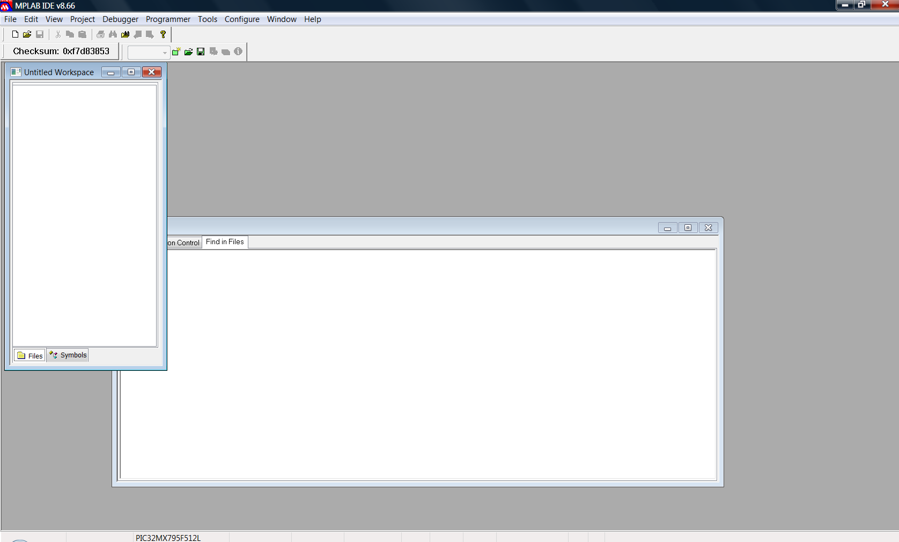
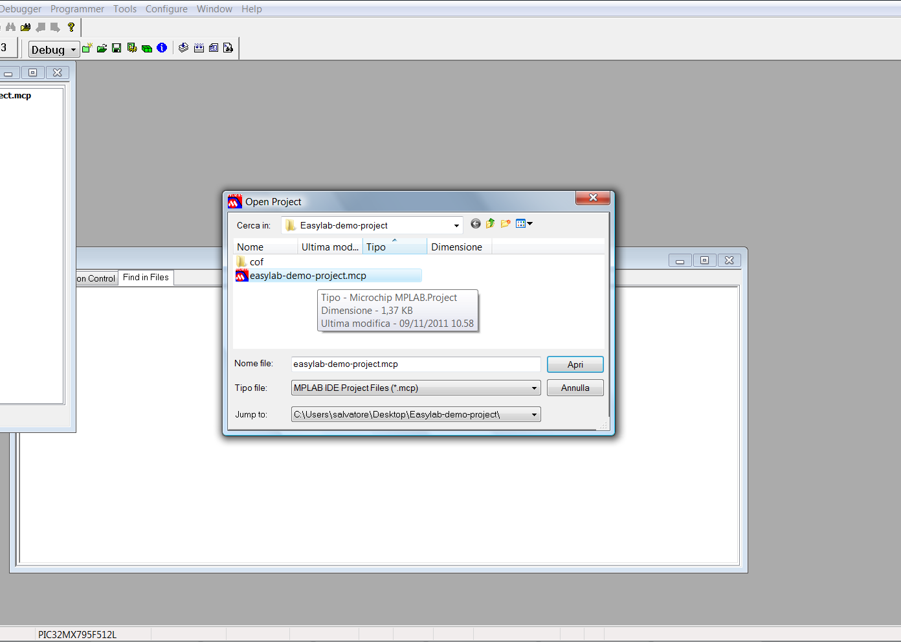
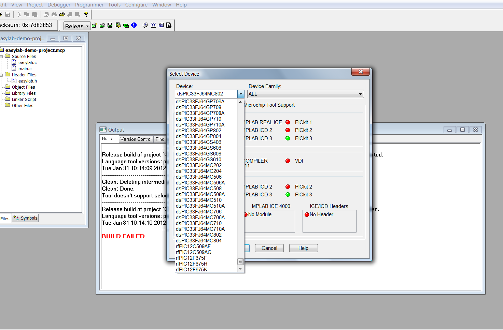
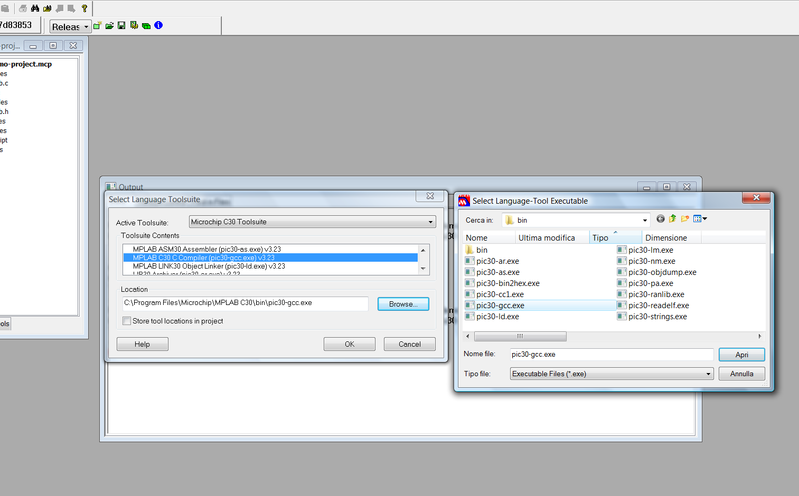
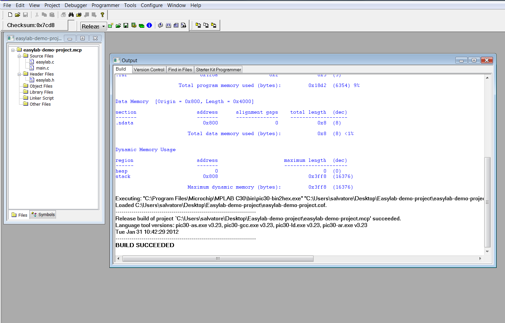
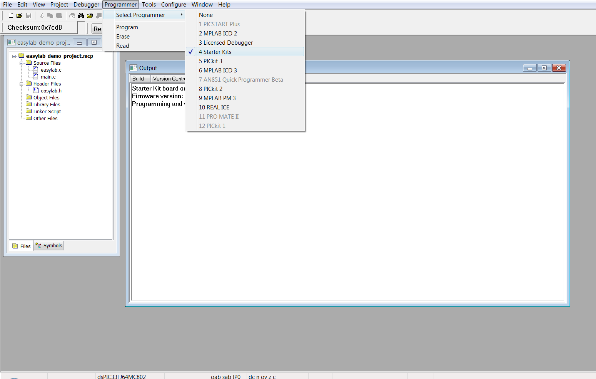
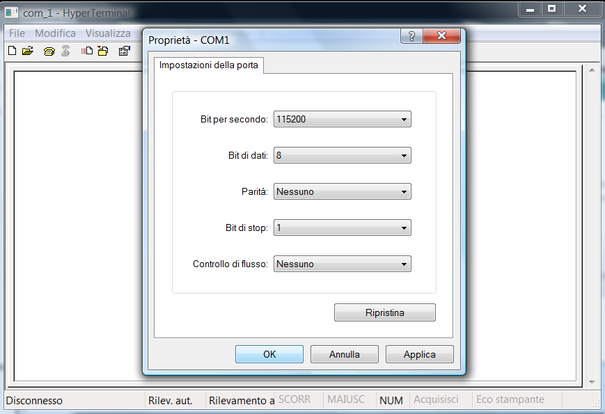
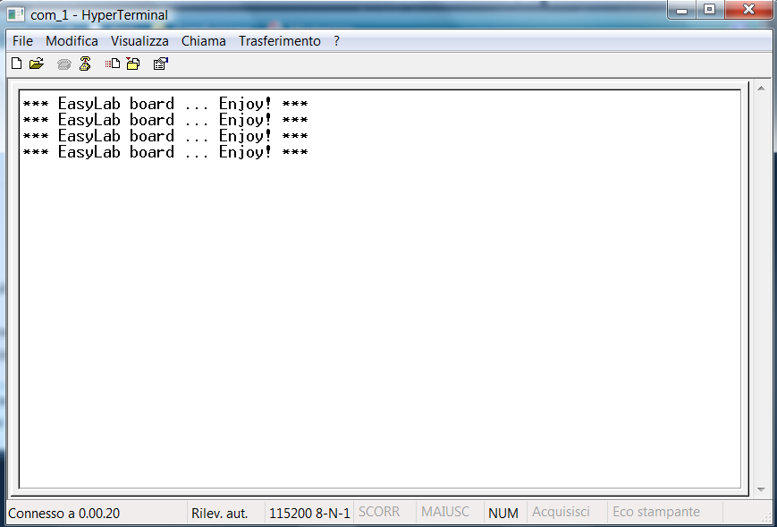

# How Compile and Run a MPLAB's project

## Introduction

To compile and run the example you should download the [MPLAB IDE](http://www.microchip.com/stellent/idcplg?IdcService=SS_GET_PAGE&nodeId=1406&dDocName=en019469&part=SW007002) v8.66 or later. Then please download the [compiler C30](http://www.microchip.com/stellent/idcplg?IdcService=SS_GET_PAGE&nodeId=1406&dDocName=en010065&part=SW006012) (a C version compiler for dsPic). For install MPLAB IDE and C30 Compiler please follow the instructions present on the Microchip web site.

## EasyLab Project Packet

We take as example the [Easylab Software Packet](../assets/linked/Easylab--cc938ae0ed0d1078.zip). It contains the follow files:

- **easy-lab-demo-project.mcp:** is the MPLAB's project file.
- **easylab.c:** is demo library C file.
- **easylab.h:** is demo library header file.
- **main.c:** is the project main file where is called the library API.
- **cof:** is a directory where is placed an programmable *cof* file ready to be programmed (without compile the project).

Put these files in a your working project directory.

## MPLAB IDE

Now please launch the Microchip Mplab ide from your 'Start Program'.

Microchip Mplab ide

Now click on *Open Project* and select the project where it was decompressed.

Open the *EasyLab demo project*

In **Menu -> Configure -> Select Device** please select the device **dsPIC33FJ64MC802**.

Open the *EasyLab demo project*

Now in the **Menu -> Project -> Select Language Toolsuite** select the **Microchip C30 toolsuite** and its location in the your file system.

Select **Language Toolsuite**

Now click on **Menu -> Project -> Build All** and the project should be compiled.

Build the demo project

Now connect your Easylab with miniUSB supply programming cable and USB communication cable at your Pc.
Select **Starter Kits programmer** in **Menu -> Programmer -> Select Programmer -> Starter Kits**.

Select **Starter Kit**

For the Pc communications please open a Serial Terminal (e.g. Putty.exe, HTerm.exe). Configure the port, baud rate (115200),data bits(8 bit), stop bits (1 bit) and parity bits (none). DON'T enable CTS. Connet to the channel.

Serial communication with EasyLab

Program your board clicking on **Program** button (It should have been appeared after you selected the programmer)
Enjoy the kitting effect and a nice stadium choir. :)
Look at your serial terminal, you should get the example instruction on the console.

EasyLab Menu

Have fun with it. :D

---

## Archive provenance

- [Original page](http://erika.tuxfamily.org/wiki/index.php?title=How_Compile_and_Run_a_MPLAB%27s_project) · [Archived source revision 4537](http://erika.tuxfamily.org/wiki/index.php?oldid=4537)
- Last source edit: 2012-01-31T10:45:00Z. Source retrieved on 2026-11-06; Markdown conversion completed on 2026-11-07.
- Original contributors recorded in exported history: Salva.
- [Original MediaWiki source](../source/wikitext/2260.mediawiki) · [Original editing history](../source/history/batch-005.xml)
- [Attribution and licensing notice](../NOTICE.md). Original file-specific notices, where present, remain applicable.
