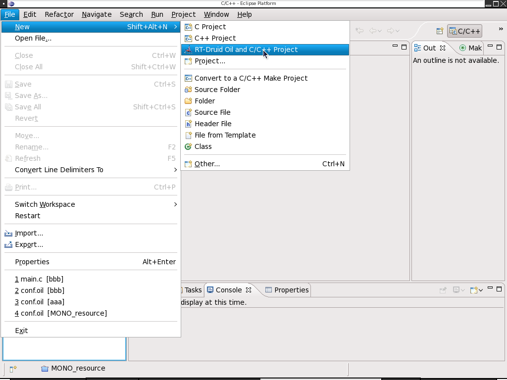
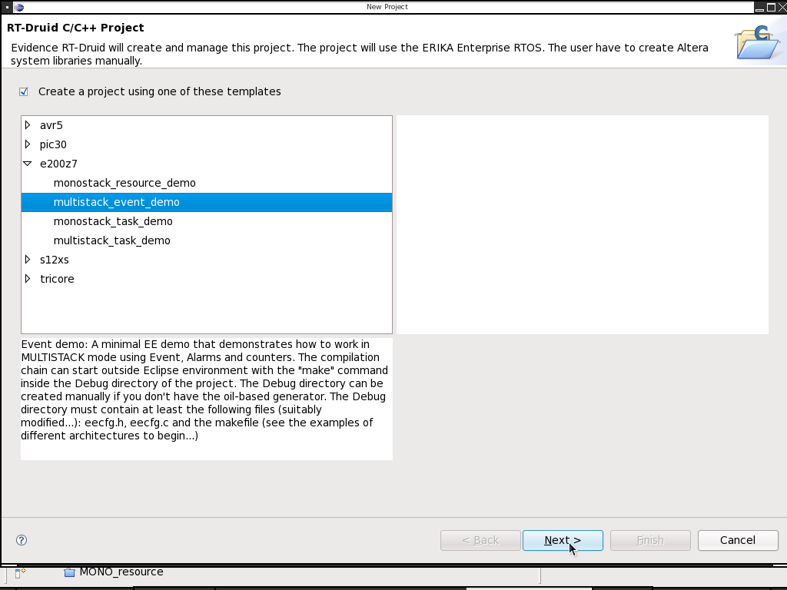
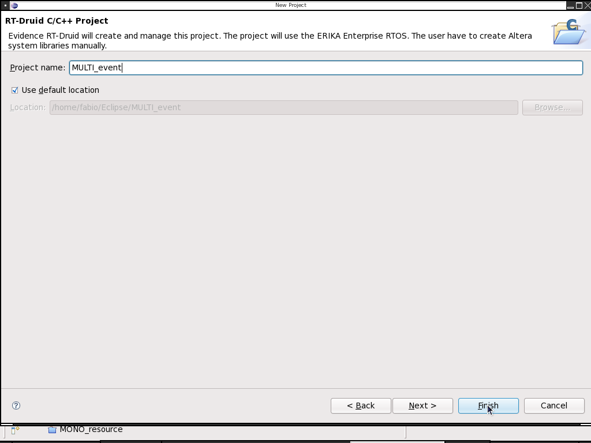
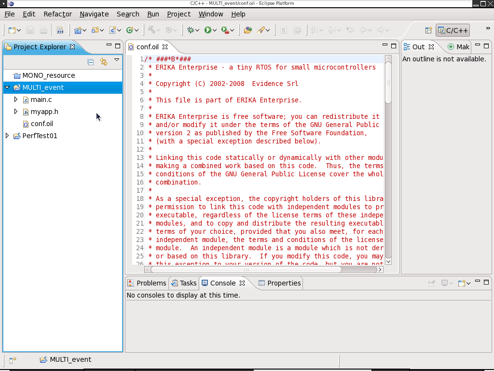
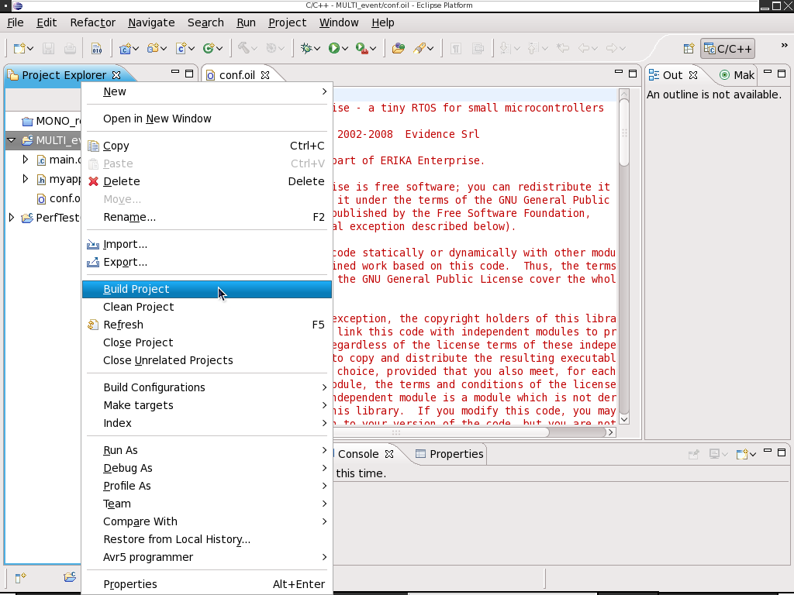

# How to create, compile and debug an application for Freescale MPC5674F

1. In the Eclipse/RT-Druid window, open the *New Project* window.

   ****
2. Select a template from the *e200z7* menu.

   ****
3. Give your project a name.

   ****

   - the folder appears in the *Project Explorer*;

   ****
4. Build the project (click with the right button of the mouse on the project name);

   ****
5. After the compilation ends, the ELF image is available in Debug/ppc.elf. To start the Lauterbach debugger just cd into Debug and run t32mppc as usual.

---

## Archive provenance

- [Original page](http://erika.tuxfamily.org/wiki/index.php?title=How_to_create%2C_compile_and_debug_an_application_for_Freescale_MPC5674F) · [Archived source revision 3030](http://erika.tuxfamily.org/wiki/index.php?oldid=3030)
- Last source edit: 2011-04-11T20:12:23Z. Source retrieved on 2026-11-06; Markdown conversion completed on 2026-11-07.
- Original contributors recorded in exported history: Fchecconi, Dibbe.
- [Original MediaWiki source](../source/wikitext/1631.mediawiki) · [Original editing history](../source/history/batch-006.xml)
- [Attribution and licensing notice](../NOTICE.md). Original file-specific notices, where present, remain applicable.
