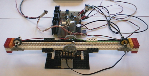
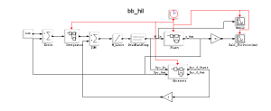
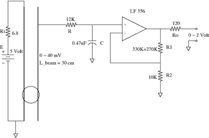

# INRIA Roquencourt (Scilab Consortium)

**Project:** Scilab/Scicos Development for FLEX boards

**Details:**

- Development of a FLEX specific Scicos code generator with Roberto Bucher (SUPSI-Lugano) as project leader.
- Development of FLEX specific Scicos blocks for simulation and code generation.
- Integration with ERIKA Enterprise (Paolo Gai, Evidence srl).
- Scicos Hardware In the Loop functions with FLEX board using USB link.
- Hardware and software testing.
- Realization of simple demos (DC motor closed loop position control using encoder, ball and beam experiment, etc.)

**Contact:** [Simone Mannori](mailto:simone.mannori@inria.fr)

**Web-site:**  -

**Project:** Ball and beam experiment with Scilab/Scicos

**Details:**

Experimental setup

Scicos

Ball position sensor

**Contact:** [Simone Mannori](mailto:simone.mannori@inria.fr)

**Web-site:**  -

---

## Archive provenance

- [Original page](http://erika.tuxfamily.org/wiki/index.php?title=INRIA_Roquencourt_%28Scilab_Consortium%29) · [Archived source revision 1538](http://erika.tuxfamily.org/wiki/index.php?oldid=1538)
- Last source edit: 2008-09-26T11:03:51Z. Source retrieved on 2026-11-06; Markdown conversion completed on 2026-11-07.
- Original contributors recorded in exported history: Shiva.
- [Original MediaWiki source](../source/wikitext/1422.mediawiki) · [Original editing history](../source/history/batch-006.xml)
- [Attribution and licensing notice](../NOTICE.md). Original file-specific notices, where present, remain applicable.
