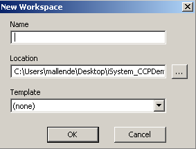
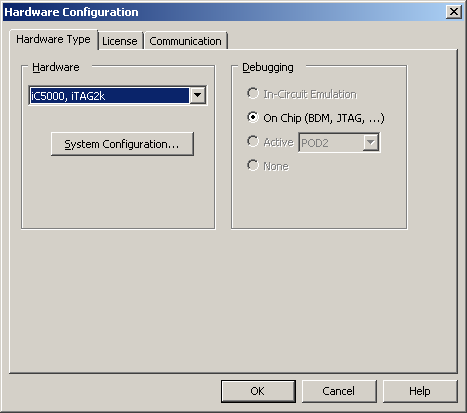
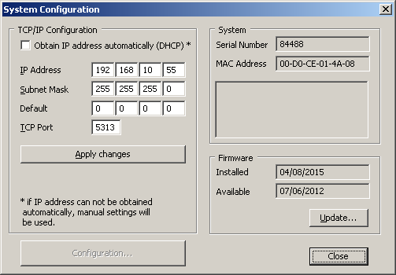
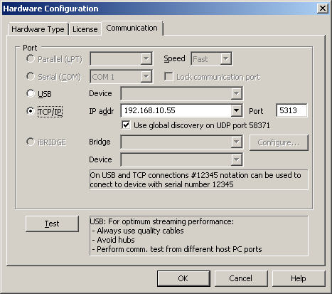
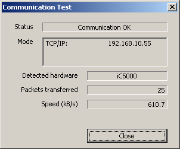
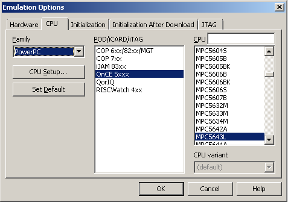
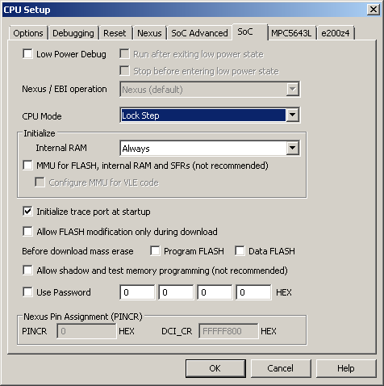
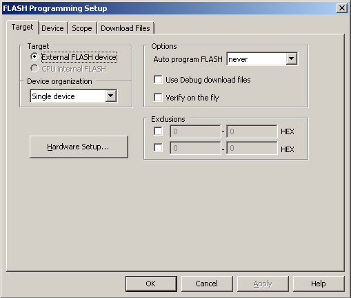
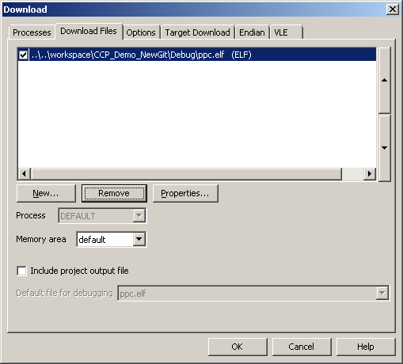

# ISYSTEM winIDEA Support for Leopard MPC5643L

In order to use the iSystem iC5000 hardware emulator follow these steps.

The first time you launch the winIDEA program, you will be requested to create a new Workspace:

Add a name, select a Location and press the OK button

As first thing configure the communication to the iSystem device (for our purpose, we've connected the device through TCP/IP connection). Go under Hardware -> Hardware menu and set the following options:

|  |  |  |
| --- | --- | --- |
| Select iC5000, iTAG2k and press the System Configuration button | Insert the IP address, the subnet mask and leave the default TCP port. Finally press Apply Changes button | Select the TCP/IP type of connection, insert the right IP address  and leave the default port as 5313 |

You can now test the communication by pressing the Test button under Hardware -> Hardware, Communication tab. The expected result should be something like:

Communication Ok displayed in the Status text box

We can now set the type of board we want to use in Hardware -> Emulation Options. Please make sure to select the right board in CPU tab:

|  |  |
| --- | --- |
| Select the CPU corresponding to the Leopard board and press CPU Setup button | Under SoC tab make sure to select the Lock Step mode as CPU mode |

Leave all the other settings under Hardware -> Emulation Options and Hardware -> CPU Setup as default.

As last thing go under Flash -> Setup and make sure that Auto program FLASH is set to never in the Target tab as shown below:

Set auto program FLASH to never

In order to flash the device, go under Debug -> Files for Download and select the application to flash:

Select an application, remove it or add a brand new one by pressing the New button. Default options for the selected elf will suit.

Finally flash the new application by pressing Debug -> Download

---

---

## Archive provenance

- [Original page](http://erika.tuxfamily.org/wiki/index.php?title=ISYSTEM_winIDEA_Support_for_Leopard_MPC5643L) · [Archived source revision 6041](http://erika.tuxfamily.org/wiki/index.php?oldid=6041)
- Last source edit: 2015-11-16T13:58:49Z. Source retrieved on 2026-11-06; Markdown conversion completed on 2026-11-07.
- Original contributors recorded in exported history: Pj.
- [Original MediaWiki source](../source/wikitext/2526.mediawiki) · [Original editing history](../source/history/batch-006.xml)
- [Attribution and licensing notice](../NOTICE.md). Original file-specific notices, where present, remain applicable.
