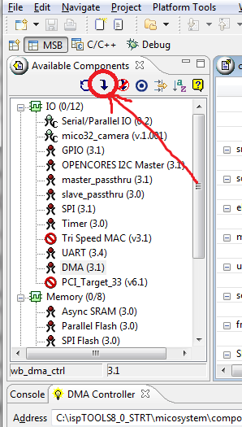
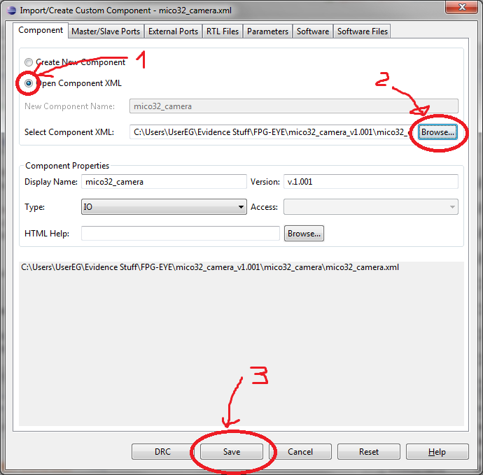
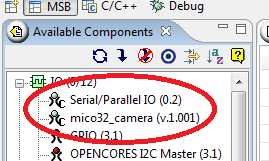

# Installation of Mico32/FPG-EYE development environment

<a id="Introduction"></a>

## Introduction

This page describes a set of steps needed to compile and deploy a platform on FPG-EYE board.

To begin with, following [free license softwares from Lattice](http://www.latticesemi.com/licensing/index.cfm) must be installed in your environment:

- [ispLEVER](http://www.latticesemi.com/dynamic/index.cfm?fuseaction=view_documents&document_type=65&sloc=01-01-07-55-23-01&source=sidebar) or [Diamond](http://www.latticesemi.com/dynamic/index.cfm?fuseaction=view_documents&document_type=65&sloc=01-01-07-55-23-01&source=sidebar)
- [ispVM System](http://www.latticesemi.com/dynamic/index.cfm?fuseaction=view_documents&document_type=65&sloc=01-01-07-30&source=sidebar) or the Diamond programmer
- [LatticeMico System Development Tools (aka MSB)](http://www.latticesemi.com/dynamic/index.cfm?fuseaction=view_documents&document_type=65&sloc=01-01-07-20&source=sidebar)

Note:

- Each version of ispLEVER or Diamond requires corresponding version of LatticeMico System Development Tools.
- 64 bit OSes are not supported by ispLEVER (even though we were able to install it on a 64 bit Windows Vista/7, it is cumbersome).
- The ispVM System must be version 18.0 or superior if you use ispLever.

The entire FPG-EYE software has been developed with ispLEVER 8.0 and correspondant LatticeMico System Development Tools. It is assumed that all the tools are installed in the same base directory **%ispTOOLS%**. The support for Lattice Diamond is also available.

In addition to lattice software you also need:

- [Evidence RT-Druid software](http://erika.tuxfamily.org/erika-for-multiple-devices.html) to run ERIKA Enterprise OS on Mico32 softcore
- [Python](http://www.python.org/) installation with [pySerial module](http://pyserial.sourceforge.net/) to deploy your application on the FPG-EYE external flash, with Evidence's bootloader Mico32 application.

<a id="Standard_Mico32_components_Patches_.28not_necessary_with_Diamond.29"></a>

## Standard Mico32 components Patches (not necessary with Diamond)

During FPG-EYE software development a few bugs encountered in standard Mico32 components were corrected. These bugs are not present in the Diamond software, but only with ispLever software. If you are using ispLever, you have to patch the component. Namely small bugs in following components:

- SPI Flash Controller (Component directory: spi\_flash. Verilog files: spi\_flash\_intf.v wb\_intf.v) with version previous to v.1.1
- Async SRAM Controller (Componet directory: asram\_top. Verilog files: asram\_core.v) with version previous to v.1.1

The above mentioned bugs were of ispLEVER version 8.0 components. We are not sure if the same have been fixed in later versions.

Patched verilog files can be found in [FPG-EYE Software Packet](../assets/linked/FPG-EYE_software_packet--117012d0f3aa1162.zip). To apply these patches, you need to copy these new files in their respective components folders.

The base directory for all the components is:

```
%ispTOOLS%\micosystem\components
```

Patched verilog files for each component must be placed in:

```
%ispTOOLS%\micosystem\components\<Component directory>\rtl\verilog
```

to fix the known bugs.

<a id="Evidence_custom_Mico32_components"></a>

## Evidence custom Mico32 components

FPG-EYE demo application uses a couple of custom Mico32 components:

- Mico32\_camera component (used to acquire frames from the cmos camera)
- serial\_io (used to access programmable DIP switches, LEDs, and peripherals power-off MOSFET switches)

These components are available in [FPG-EYE Software Packet](../assets/linked/FPG-EYE_software_packet--117012d0f3aa1162.zip), Mico32\_camera as component binary, and serial\_io directly as source code. The components works whether you use the Lattice Diamond or Lattice ispLever.

To use these components in your platform, they must be imported inside the LatticeMico System Development Tools.

<a id="Import_custom_Mico32_components_in_LatticeMico_System_Development_Tools"></a>

### Import custom Mico32 components in LatticeMico System Development Tools

Open your LatticeMico System Development Tool and on Available Components view click Import/Create custom Component button

[](../files/File_LatticeMicoSystem_import_button.png--2097.md)

Available Components view Import/Create button.

Select radio button Open component XML and load the xml component description file from the FPG-EYE software packet directory (e.g. **FPG-EYE\_software\_packet\wishbone\_components\mico32\_camera\mico32\_camera.xml**)

[](../files/File_LatticeMicoSystem_import_evidence_camera_component.png--2098.md)

Import evidence camera component

In our version of LatticeMico System Development Tools, sometimes for unknown reason, this procedure needs to be repeated more than once.

[](../files/File_LatticeMicoSystem_import_result.png--2099.md)

Import Evidence custom components result

<a id="ERIKA_and_RT-Druid"></a>

## ERIKA and RT-Druid

[FPG-EYE demo application](Tutorial_Running_ERIKA_on_Mico32_and_FPG-EYE--2113.md "Tutorial: Running ERIKA on Mico32 and FPG-EYE") is an ERIKA application, and to compile this,
 [ERIKA and RT-Druid](Tutorial_PIC30_-_Installing_ERIKA_and_RT-Druid_and_compile_your_first_application--1637.md "Tutorial: Installing ERIKA and RT-Druid, and compile your first application") softwares are required.

<a id="Python_and_pySerial_module"></a>

## Python and pySerial module

To deploy a Mico32 application on the FPG-EYE external flash, Evidence provides a dedicated bootloader for FPG-EYE XP2. To interact with this bootloader, a python script is available with [FPG\_EYE Software Packet](../assets/linked/FPG-EYE_software_packet--117012d0f3aa1162.zip). This python script has been written and tested on a python 2.x environment.

<a id="Installing_Python_on_Windows"></a>

### Installing Python on Windows

Python can be installed on a windows machine in two different ways:

- as native.
- under cygwin.

To install the native one just download the correct [installer](http://www.python.org/download/) and run it. If you want the cygwin version, just run the cygwin setup application and select python package.

<a id="Install_pySerial_on_Windows"></a>

### Install pySerial on Windows

If you have installed the native version of python, download the [pySerial installer](http://pypi.python.org/pypi/pyserial) and run it.
The easy way to install the pySerial module on cygwin is to install [python setuptools](http://pypi.python.org/pypi/setuptools) first by running [this script](http://peak.telecommunity.com/dist/ez_setup.py) in a Cygwin shell, and then, after the installation of the setuptools, just type:

```
easy_install pyserial
```

The setuptools will automatically select the right version of the module for your environment.

---

## Archive provenance

- [Original page](http://erika.tuxfamily.org/wiki/index.php?title=Installation_of_Mico32%2FFPG-EYE_development_environment) · [Archived source revision 4308](http://erika.tuxfamily.org/wiki/index.php?oldid=4308)
- Last source edit: 2012-01-16T09:56:46Z. Source retrieved on 2026-11-06; Markdown conversion completed on 2026-11-07.
- Original contributors recorded in exported history: Eguidieri, Salva, Erikadds.
- [Original MediaWiki source](../source/wikitext/2093.mediawiki) · [Original editing history](../source/history/batch-006.xml)
- [Attribution and licensing notice](../NOTICE.md). Original file-specific notices, where present, remain applicable.
