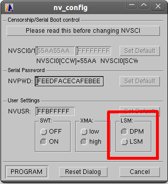
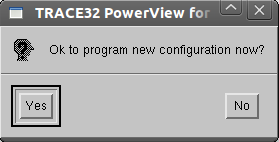
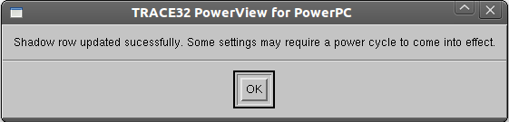

# Lauterbach TRACE32 Support for Leopard MPC5643L

The reference debugging solution for MPC5643L is Lauterbach. In the Erika tree (look at pkg/mcu/freescale\_mpc5643l/cfg) is collected a set of Lauterbach sripts for single and multicore configurations. Such a scripts also provide support for execution from SRAM and Flash, in VLE and BookE mode. MPC5643L provides the capability to work in lock-step mode, for this reason a script to pass from/to DPM/lock-step mode is provide (set\_lsm\_dpm.cmm). To launch this script, user have to launch Lauterbach Tracer first (for instance by editing "t32mppc" in Linux prompt, or equivalent command under Window), and then editing "do set\_lsm\_dpm.cmm" in the Lauterbach command prompt. This script provides several functionalities, but the only functionality addressed by this manual is the one to switch from/to lock-step/DPM mode. Once the user launches this script the following window appears:

Red box shows two buttons to select lock-step or DPM mode. For instance, in this case we have a system set as DPM, if we would like to switch to LSM mode, we have to press the LSM button, and then press "PROGRAM". After this action, a confirmation window will be shown, press "YES" to confirm:

If the programming task is successfully accomplished, the following window will be shown. Press "OK" to terminate the script.

IMPORTANT NOTE:  in order to make the switch-mode effective, a power-cycle has to be done. Therefore power your board off, and then power it on.

---

## Archive provenance

- [Original page](http://erika.tuxfamily.org/wiki/index.php?title=Lauterbach_TRACE32_Support_for_Leopard_MPC5643L) · [Archived source revision 6042](http://erika.tuxfamily.org/wiki/index.php?oldid=6042)
- Last source edit: 2015-11-16T13:59:27Z. Source retrieved on 2026-11-06; Markdown conversion completed on 2026-11-07.
- Original contributors recorded in exported history: Pj.
- [Original MediaWiki source](../source/wikitext/2525.mediawiki) · [Original editing history](../source/history/batch-007.xml)
- [Attribution and licensing notice](../NOTICE.md). Original file-specific notices, where present, remain applicable.
