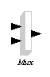
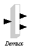
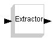
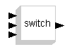
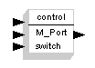
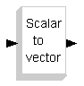
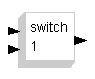

# MCHP16 Branching

The **MCHP16 Branching** palette:

| Symbol | Description |
| --- | --- |
|  | This block multiplexes a number of inputs together to form a vector. |
|  | This block demultiplexes the inputs. |
|  | This block only extracts one entry of the input vector. |
|  | This block implements a switch. |
|  | This block implements an M-port switch. |
|  | This block transforms a scalar value to a vector. |
|  | This block implements a connected switch. |

---

## Archive provenance

- [Original page](http://erika.tuxfamily.org/wiki/index.php?title=MCHP16_Branching) · [Archived source revision 3421](http://erika.tuxfamily.org/wiki/index.php?oldid=3421)
- Last source edit: 2011-09-28T10:05:14Z. Source retrieved on 2026-11-06; Markdown conversion completed on 2026-11-07.
- Original contributors recorded in exported history: 193.205.81.5, Erikadds.
- [Original MediaWiki source](../source/wikitext/1395.mediawiki) · [Original editing history](../source/history/batch-007.xml)
- [Attribution and licensing notice](../NOTICE.md). Original file-specific notices, where present, remain applicable.
