# MCHP16 Linear

The **MCHP16 Linear** palette:

| Symbol | Description |
| --- | --- |
| [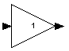](../files/File_Mchp16_linear_multip.png--1352.md) | This block implement a proportional gain. The Gain value is specified as the internal parameter. |
| [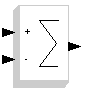](../files/File_Mchp16_linear_subtract.png--1356.md) | This block implements a sum/subtraction of different inputs. The Sign vector and the Overflow rules can be specified as the internal parameters. |
| [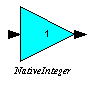](../files/File_Mchp16_linear_intmultip.png--1346.md) | This block implement a proportional gain with integer inputs. The Gain value is specified as the internal parameter. |
| [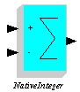](../files/File_Mchp16_linear_intsubtract.png--1348.md) | This block implements a sum/subtraction of different integer inputs. The Sign vector and the Overflow rules can be specified as the internal parameters. |
| [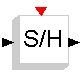](../files/File_Mchp16_linear_sh.png--1354.md) | This is a sample and hold block. |
| [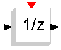](../files/File_Mchp16_linear_z.png--1358.md) | This is a delay of 1 sample. |
|  | This is a sample and hold block for integer inputs. |
| [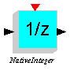](../files/File_Mchp16_linear_intz.png--1349.md) | This is a delay of 1 sample, for integer inputs. |
| [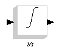](../files/File_Mchp16_linear_integral.png--1345.md) | This is a continuous integral block. Internal parameters specified are Initial condition, Reinitialization, Saturation, and Upper and Lower limits. |
| [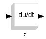](../files/File_Mchp16_linear_derivate.png--1342.md) | This is a continuous derivate. |
| [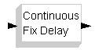](../files/File_Mchp16_linear_contdelay.png--1341.md) | This is a delay block. |
| [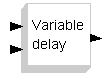](../files/File_Mchp16_linear_vardelay.png--1357.md) | This is a variable delay. |
|  | This is a shift register. The Initial length and the Values of the shift register can be specified using the internal variables. |
| [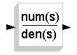](../files/File_Mchp16_linear_fracts.png--1343.md) | This is a continuous transfer function. |
| [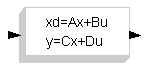](../files/File_Mchp16_linear_matrixs.png--1350.md) | This is a continuous linear system. |
| [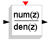](../files/File_Mchp16_linear_fractz.png--1344.md) | This is a discrete transfer function. |
| [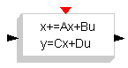](../files/File_Mchp16_linear_matrixz.png--1351.md) | This is a discrete linear system. |

---

## Archive provenance

- [Original page](http://erika.tuxfamily.org/wiki/index.php?title=MCHP16_Linear) · [Archived source revision 3415](http://erika.tuxfamily.org/wiki/index.php?oldid=3415)
- Last source edit: 2011-09-28T09:42:01Z. Source retrieved on 2026-11-06; Markdown conversion completed on 2026-11-07.
- Original contributors recorded in exported history: 193.205.81.5, Erikadds.
- [Original MediaWiki source](../source/wikitext/1392.mediawiki) · [Original editing history](../source/history/batch-007.xml)
- [Attribution and licensing notice](../NOTICE.md). Original file-specific notices, where present, remain applicable.
