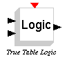
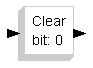
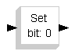
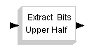
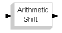
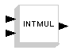
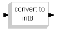
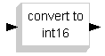
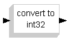

# MCHP16 Logic

The **MCHP16 Logic** palette:

| Symbol | Description |
| --- | --- |
|  | This block implements a Truth table. |
|  | This block can be used to clear a bit in the integer input. The bit to clear is specified using the internal parameter. |
|  | This block can be used to set a bit in the integer input. The bit to clear is specified using the internal parameter. |
|  | This block can be used to extract a set of bits taken from the upper part of the input. |
|  | This block implements an arithmetic shift operation. The number of bits to shift can be specified as internal parameter. |
|  | This block implements an integer multiplication. The Data type, and the Behavior in case of an overflow (Nothing, Saturate, Error) are specified as internal parameters. |
|  | This block converts an input type to int8. The Input type is specified as internal parameter. |
|  | This block converts an input type to int16. The Input type is specified as internal parameter. |
|  | This block converts an input type to int32. The Input type is specified as internal parameter. |

---

## Archive provenance

- [Original page](http://erika.tuxfamily.org/wiki/index.php?title=MCHP16_Logic) · [Archived source revision 3416](http://erika.tuxfamily.org/wiki/index.php?oldid=3416)
- Last source edit: 2011-09-28T09:47:40Z. Source retrieved on 2026-11-06; Markdown conversion completed on 2026-11-07.
- Original contributors recorded in exported history: 193.205.81.5, Erikadds.
- [Original MediaWiki source](../source/wikitext/1394.mediawiki) · [Original editing history](../source/history/batch-007.xml)
- [Attribution and licensing notice](../NOTICE.md). Original file-specific notices, where present, remain applicable.
