# MCHP16 Non Linear

The **MCHP16 Non Linear** palette:

| Symbol | Description |
| --- | --- |
| [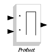](../files/File_Mchp16_nonlinear_product.png--1382.md) | The result of this block is the multiplication or division of its inputs. The Number and the Operation done on each input are specified as internal parameters. |
| [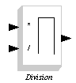](../files/File_Mchp16_nonlinear_division.png--1375.md) | The result of this block is the multiplication or division of its inputs. The Number and the Operation done on each input are specified as internal parameters. |
| [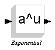](../files/File_Mchp16_nonlinear_exponential.png--1376.md) | If *u* is the input, the block returns *a**u*, where *a* is the internal parameter. |
| [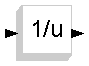](../files/File_Mchp16_nonlinear_inverse.png--1378.md) | This block returns the inverse of the input. |
| [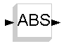](../files/File_Mchp16_nonlinear_abs.png--1372.md) | This returns the absolute value of the input. The internal parameter specifies if the zero-crossing option has been selected. |
| [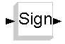](../files/File_Mchp16_nonlinear_sign.png--1385.md) | This returns the sign of the input. The internal parameter specifies if the zero-crossing option has been selected. |
| [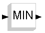](../files/File_Mchp16_nonlinear_min.png--1381.md) | This block returns the minimum or maximum value of the input. The Operation (min or max), the Zero-crossing option, and the Number of inputs are specified as internal parameters. |
| [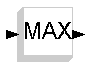](../files/File_Mchp16_nonlinear_max.png--1380.md) | This block returns the minimum or maximum value of the input. The Operation (min or max), the Zero-crossing option, and the Number of inputs are specified as internal parameters. |
| [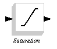](../files/File_Mchp16_nonlinear_saturation.png--1384.md) | This block implements a saturation. The Upper and Lower limits, and the zero-crossing option are specified as internal parameters. |
| [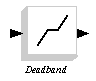](../files/File_Mchp16_nonlinear_deadband.png--1374.md) | This block specifies a deadband zone, which is specified using the internal parameters. The Zero-crossing option can also be specified as internal parameter. |
| [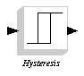](../files/File_Mchp16_nonlinear_hysteresis.png--1377.md) | This block implements an hysteresis. The start and end of Hysteresis, the two values of the output, and the Zero-crossing option are specified as internal parameters. |
| [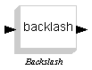](../files/File_Mchp16_nonlinear_backlash.png--1373.md) | (empty description) |
| [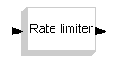](../files/File_Mchp16_nonlinear_ratelimiter.png--1383.md) | (empty description) |
| [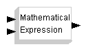](../files/File_Mchp16_nonlinear_mathexpr.png--1379.md) | This block allows the computation of a generic Scilab expression, specified as input parameter. |

---

## Archive provenance

- [Original page](http://erika.tuxfamily.org/wiki/index.php?title=MCHP16_Non_Linear) · [Archived source revision 1414](http://erika.tuxfamily.org/wiki/index.php?oldid=1414)
- Last source edit: 2008-08-13T14:17:59Z. Source retrieved on 2026-11-06; Markdown conversion completed on 2026-11-07.
- Original contributors recorded in exported history: 193.205.81.5, 93.149.52.226.
- [Original MediaWiki source](../source/wikitext/1393.mediawiki) · [Original editing history](../source/history/batch-007.xml)
- [Attribution and licensing notice](../NOTICE.md). Original file-specific notices, where present, remain applicable.
