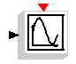
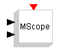
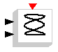
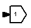

# MCHP16 Sinks

The **MCHP16 Sinks** palette:

| Symbol | Description |
| --- | --- |
|  | This is a scope block, which can be used to display signals during simulation. |
|  | This is a multiple scope block, which can be used to display signals during simulation. |
|  | This is a scope block, which can be used to display signals during simulation. |
|  | This is a scope block, which can be used to display signals during simulation. |
|  | This is an output block, which takes the Port number as internal parameter. |

---

## Archive provenance

- [Original page](http://erika.tuxfamily.org/wiki/index.php?title=MCHP16_Sinks) · [Archived source revision 3414](http://erika.tuxfamily.org/wiki/index.php?oldid=3414)
- Last source edit: 2011-09-28T09:40:28Z. Source retrieved on 2026-11-06; Markdown conversion completed on 2026-11-07.
- Original contributors recorded in exported history: 193.205.81.5, Erikadds.
- [Original MediaWiki source](../source/wikitext/1326.mediawiki) · [Original editing history](../source/history/batch-007.xml)
- [Attribution and licensing notice](../NOTICE.md). Original file-specific notices, where present, remain applicable.
