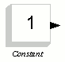
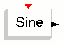
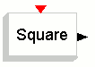
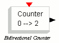
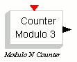

# MCHP16 Sources

The **MCHP16 Sources** palette:

| Symbol | Description |
| --- | --- |
|  | This is the main system clock. It has two internal parameters, the Period which gives the system periodicity, and an Init time which can be used to specify an initial offset. |
|  | A constant value, specified as an internal parameter. |
|  | Input port. The port number is specified as an internal parameter. |
|  | Event input port. The port number is specified as an internal parameter. |
|  | This block generates a sine wave. The input are Amplitude, Frequency, Phase, Bias, and Delay. |
|  | A square wave generator. The input parameters are Amplitude, Period, Impulse width, Bias, and Delay. |
|  | A step input. The input parameters are Amplitude, and Delay. |
|  | A random number generator. The input parameters are Amplitude, and Seed. |
|  | A counter. The input parameters are Minimum value, Maximum value, and Rule (1=Decrement, 2=Decrement). |
|  | A modulo counter. The input parameters are Initial state (greater than zero), and Modulo number. |

---

## Archive provenance

- [Original page](http://erika.tuxfamily.org/wiki/index.php?title=MCHP16_Sources) · [Archived source revision 1340](http://erika.tuxfamily.org/wiki/index.php?oldid=1340)
- Last source edit: 2008-08-13T12:36:43Z. Source retrieved on 2026-11-06; Markdown conversion completed on 2026-11-07.
- Original contributors recorded in exported history: 193.205.81.5.
- [Original MediaWiki source](../source/wikitext/1325.mediawiki) · [Original editing history](../source/history/batch-007.xml)
- [Attribution and licensing notice](../NOTICE.md). Original file-specific notices, where present, remain applicable.
