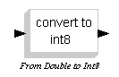
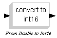
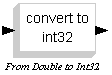
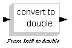
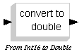
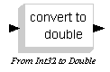

# MCHP16 Typeconversion

The **MCHP16 Typeconversion** palette:

| Symbol | Description |
| --- | --- |
|  | This block converts the input from double to int8. |
|  | This block converts the input from double to int16. |
|  | This block converts the input from double to int32. |
|  | This block converts the input from int8 to double. |
|  | This block converts the input from int16 to double. |
|  | This block converts the input from int32 to double. |

---

## Archive provenance

- [Original page](http://erika.tuxfamily.org/wiki/index.php?title=MCHP16_Typeconversion) · [Archived source revision 1411](http://erika.tuxfamily.org/wiki/index.php?oldid=1411)
- Last source edit: 2008-08-13T13:55:34Z. Source retrieved on 2026-11-06; Markdown conversion completed on 2026-11-07.
- Original contributors recorded in exported history: 193.205.81.5.
- [Original MediaWiki source](../source/wikitext/1396.mediawiki) · [Original editing history](../source/history/batch-007.xml)
- [Attribution and licensing notice](../NOTICE.md). Original file-specific notices, where present, remain applicable.
