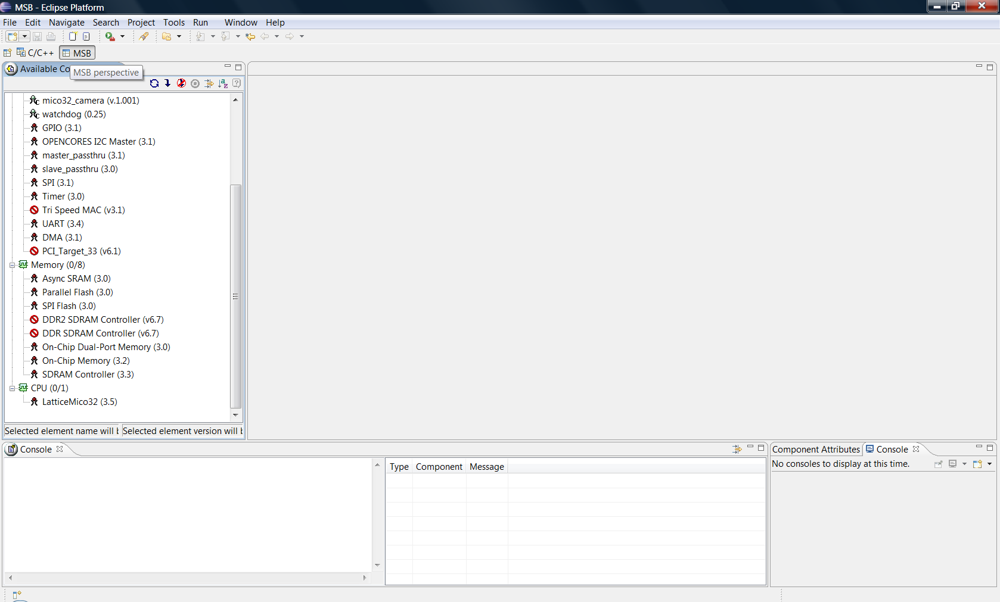

# Mico32 camera: Building platform with mico32 camera component

### Introduction

In this document we will see how to build the platform with the component [mico32\_camera](http://erika.tuxfamily.org/wiki/index.php?title=Mico32_camera "Mico32 camera (page does not exist)").
The platform can be downloaded at the following address [svn](http://svn.tuxfamily.org/svnroot/erika/erikae/repos/ee/trunk/ee/examples/mico32/demo/platforms/camera_debug_50/).
Recall that to compile a platform is necessary Lattice tools [[ispLever](http://www.latticesemi.com/products/designsoftware/isplever/isplever/index.cfm?source=sidebar)] and [[MSB](http://www.latticesemi.com/products/designsoftware/micodevelopmenttools/index.cfm)].

#### Open Platform with MSB

Once downloaded the platform open the MSB Lattice tool.

tool *msb*

---

## Archive provenance

- [Original page](http://erika.tuxfamily.org/wiki/index.php?title=Mico32_camera%3A_Building_platform_with_mico32_camera_component) · [Archived source revision 3426](http://erika.tuxfamily.org/wiki/index.php?oldid=3426)
- Last source edit: 2011-09-28T10:25:48Z. Source retrieved on 2026-11-06; Markdown conversion completed on 2026-11-07.
- Original contributors recorded in exported history: Salva.
- [Original MediaWiki source](../source/wikitext/2072.mediawiki) · [Original editing history](../source/history/batch-008.xml)
- [Attribution and licensing notice](../NOTICE.md). Original file-specific notices, where present, remain applicable.
