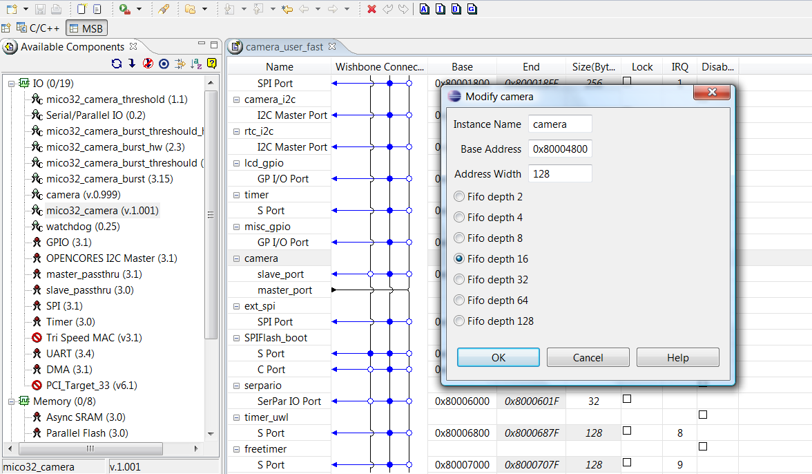
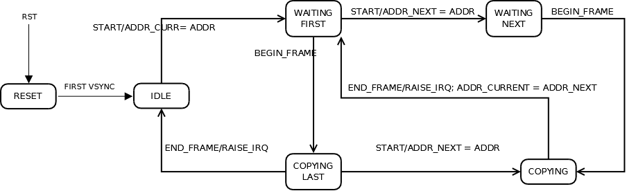

# Mico32 camera: Writing drivers based on mico32 camera

<a id="Introduction"></a>

### Introduction

This document is for programmers for writes drivers based on *mico32\_camera* wishbone component. In the document examples we will refer camera values like follow figure:

[](../files/File_Platform_with_camera.png--2070.md)

*mico32\_camera* values in the platform

<a id="Registers_of_the_mico32_camera"></a>

### Registers of the *mico32\_camera*

Following registers are visible by the program:

| Register Name | Offset | Num. Bits | Type |
| --- | --- | --- | --- |
| ADDR | 0x0 | 32 | R/W |
| STATE | 0x04 | 32 | R |
| FLAG | 0x08 | 32 | R |
| CNTR1 | 0x0C | 32 | W |
| CNTR2 | 0x10 | 32 | R/W |
| DIV | 0x14 | 32 | R/W |
| COUNT | 0x18 | 32 | R/W |

All register are 32 bits. Some registers are read-only (*STATE* and *FLAG*), only one register is write-only (*CNTR1*), the remaining registers are read-write (*ADDR*, *CNTR2*, *DIV* and *COUNT*). In our example will use the follow mico32\_camera register structure:

```
/* Camera controller registers */
typedef struct st_MicoCamera{
     void* volatile addr;
     volatile unsigned int state;
     volatile unsigned int flag;
     volatile unsigned int cntr1;
     volatile unsigned int cntr2;
     volatile unsigned int div;
     volatile unsigned int count;
} MicoCamera_t;
```

<a id="C_code_example_to_read_a_value_from_register"></a>

#### C code example to read a value from register

To get a register value (*ADDR*, *STATE*, *FLAG*, *CNTR2*, *DIV* and *COUNT*):

```
/* Offsets mico32_camera resister from address_base */ 
#define ADDR_OFF    0x00000000
#define STATE_OFF   0x00000004
#define FLAG_OFF    0x00000008
#define CNTR2_OFF   0x00000010
#define DIV_OFF     0x00000014
#define COUNT_OFF   0x00000018
  
int main(void) {
  
     /* Macro CAMERA_BASE_ADDRESS from system_conf.h */
     unsigned long *register = (CAMERA_BASE_ADDRESS + COUNT_OFF);
     unsigned long count_value;
     ...
     
     /* Read count register. */
     count_value = *register;     

     ...      
     return 0;
}
```

<a id="C_code_example_to_write_a_value_to_register"></a>

#### C code example to write a value to register

To set a register value (*ADDR*, *CNTR1*, *DIV* and *COUNT*):

```
#define ADDR_VALUE  0x00010000

/* Offsets mico32_camera resister from address_base */ 
#define ADDR_OFF    0x00000000
#define STATE_OFF   0x00000004
#define FLAG_OFF    0x00000008
#define CNTR2_OFF   0x00000010
#define DIV_OFF     0x00000014
#define COUNT_OFF   0x00000018
  
int main(void) {
  
     /* Macro CAMERA_BASE_ADDRESS from system_conf.h */
     unsigned long *register = (CAMERA_BASE_ADDRESS + ADDR_OFF);
     ...

     /* Write addr register. */
     *register = ADDR_VALUE;     

     ...
     return 0;
}
```

<a id="Registers_description"></a>

### Registers description

The mico32\_camera has seven registers. The functionality of each register is as described below.

<a id="ADDR_register_.28dim:_32_bits.2C_type:_R.2FW.2C_offset:_0x00.2C_reset:_0x00000000.29"></a>

#### *ADDR* register (dim: *32 bits*, type: *R/W*, offset: *0x00*, reset: *0x00000000*)

When *mico32\_camera* starts a new image acquisition, it stores the streaming camera data (*32 bits* at time) in the memory. After every data write in memory, the *mico32\_camera* increments the internal pointer for next data write. The address base where the data writing begins is written in *ADDR* register.

ADDR register

| Bit31 | Bit30 | ... | Bit2 | Bit1 | Bit0 |
| ADDR31 | ADDR30 | ... | ADDR2 | ADDR1 | ADDR0 |

Example code:

```
  #define ADDR_VALUE  0x00010000
  /* Offsets mico32_camera resister from address_base */ 
  #define ADDR_OFF    0x00000000
  #define STATE_OFF   0x00000004
  #define FLAG_OFF    0x00000008
  #define CNTR2_OFF   0x00000010
  #define DIV_OFF     0x00000014
  #define COUNT_OFF   0x00000018
 
  int main(void) {
  
     /* Macro CAMERA_BASE_ADDRESS from system_conf.h */
     unsigned long *register = (CAMERA_BASE_ADDRESS + ADDR_OFF);
     ...
     /* Write addr register. */
     *register = ADDR_VALUE;     
     ...
     return 0;
  }
```

<a id="STATE_register_.28dim:_32_bits.2C_type:_R.2C_offset:_0x04.29"></a>

#### *STATE* register (dim: *32 bits*, type: *R*, offset: *0x04*)

The *STATE* register stores *mico32\_component's* internal state information:

STATE register

| Bit31 | Bit30 | ... | Bit3 | Bit2 | Bit1 | Bit0 |
| - | - | ... | - | STATE2 | STATE1 | STATE0 |

Bits *STATE2*, *STATE1* and *STATE0* (*STATE\_S*) (dim: *3 bits*, type: *R*, offset: *0x00*, reset: *000*). Returns the state of the component.

1. *000 => Reset*
2. *001 => Idle*
3. *010 => Waiting First*
4. *011 => Waiting Next*
5. *100 => Copying*
6. *101 => Copying Last*

Example code:

```
/* Offsets mico32_camera resister from address_base */ 
#define ADDR_OFF    0x00000000
#define STATE_OFF   0x00000004
#define FLAG_OFF    0x00000008
#define CNTR2_OFF   0x00000010
#define DIV_OFF     0x00000014
#define COUNT_OFF   0x00000018

/* mico32_camera states */
#define RESET          0
#define IDLE           1
#define WAITING_FIRST  2
#define WAITING_NEXT   3
#define COPYING        4
#define COPYING_LAST   5
  
int main(void) {
  
     /* Macro CAMERA_BASE_ADDRESS from system_conf.h */
     unsigned long *register = (CAMERA_BASE_ADDRESS + STATE_OFF);
     unsigned long state;

     ...
     /* Waiting IDLE mico32_camera state */
     do {

          /* Read mico32_component's state */
          state = *register;

     } while (state != IDLE);
     
     ...
     return 0;

}
```

<a id="FLAG_register_.28dim:_32_bits.2C_type:_R.2C_offset:_0x08.29"></a>

#### *FLAG* register (dim: *32 bits*, type: *R*, offset: *0x08*)

The *FLAG* register is composed of :

STATE register

| Bit31 | Bit30 | ... | Bit2 | Bit1 | Bit0 |
| - | - | ... | - | SIZE\_ERR | ERR\_FLAG | IF\_FLAG |

<a id="Bit_SIZE_ERR_.28dim:_1_bit.2C_type:_R.2C_mask:_0x00000004.2C_reset:_0.29"></a>

##### Bit *SIZE\_ERR* (dim: *1 bit*, type: *R*, mask: *0x00000004*, reset: *0*)

If the image's size in bytes is different from the value register count, this bit is set. The control is turned off when the value register count is set to 0 (zero).

Example code:

```
#define MASK_SIZE_ERR 0x00000004

/* Size image: 640x480 colors (2 byte).
#define IMAGE_SIZE    (640*480*2)

/* Offsets mico32_camera resister from address_base */ 
#define ADDR_OFF      0x00000000
#define STATE_OFF     0x00000004
#define FLAG_OFF      0x00000008
#define CNTR2_OFF     0x00000010
#define DIV_OFF       0x00000014
#define COUNT_OFF     0x00000018
  
int main(void) {
  
     /* Macro CAMERA_BASE_ADDRESS from system_conf.h */
     unsigned long *register_count = (CAMERA_BASE_ADDRESS + COUNT_OFF);
     unsigned long *register_flag = (CAMERA_BASE_ADDRESS + FLAG_OFF);
     unsigned long bit_size_err;

     ...
     /* With a write in count register we enable the image size control. */
     *register_count = IMAGE_SIZE;

     ...
     /* Capture an image */

     ...
     /* Read bit SIZE_ERR */
     bit_size_err = *register_flag & MASK_SIZE_ERR;

     if (bit_size_err) {

           /* There was a size error */
           ...

     } else {

           /* There was not size error */
           ...
            
     }
     
     ...
     return 0;
}
```

<a id="Bit_ERR_FLAG_.28dim:_1_bit.2C_type:_R.2C_mask:_0x00000002.2C_reset:_0.29"></a>

##### Bit *ERR\_FLAG* (dim: *1 bit*, type: *R*, mask: *0x00000002*, reset: *0*)

If there was a Wishbone error (wire *w\_err* on Wishbone bus) or an overflow in the *Master* FIFO this Flag is set high. The Flag will be reset when new frame starts.

Example code:

```
#define MASK_FLAG_ERR 0x00000002

/* Size image: 640x480 colors (2 byte).
#define IMAGE_SIZE    (640*480*2)

/* Offsets mico32_camera resister from address_base */ 
#define ADDR_OFF      0x00000000
#define STATE_OFF     0x00000004
#define FLAG_OFF      0x00000008
#define CNTR2_OFF     0x00000010
#define DIV_OFF       0x00000014
#define COUNT_OFF     0x00000018
  
int main(void) {
  
     /* Macro CAMERA_BASE_ADDRESS from system_conf.h */
     unsigned long *register_flag = (CAMERA_BASE_ADDRESS + FLAG_OFF);
     unsigned long bit_err_flag;

     ...
     /* Capture an image */
     ...

     /* Read bit ERR_FLAG */
     bit_err_flag = *register_flag & MASK_ERR_FLAG;

     /* Was there an error ?
     if (bit_err_flag) {

           /* There was a error on wishbone and/or overflow data fifo */
           ...
 
     } else {

           /* There was not error */
           ...
     }

     ...
     return 0;
}
```

<a id="Bit_IF_FLAG_.28dim:_1_bit.2C_type:_R.2C_mask:_0x00000001.2C_reset:_0.29"></a>

##### Bit *IF\_FLAG* (dim: *1 bit*, type: *R*, mask: *0x00000001*, reset: *0*)

It is set at the end of an acquisition. In other words, when a frame has been completely written in the memory the flag change value from 0 logic to 1 logic. The Flag will be reset when new frame starts.

1. *from 0 to 1* => The *mico32\_camera* switches from *Writing Last* state to *Idle* state or from *Writing* state to *Waiting Next* state. If *IE\_FLAG = 1'b1* an interrupt is raised.
2. *0* => No frame has been completed.

Example code (we are waiting the end image capture polling on bit *IF\_FLAG*):

```
#define MASK_IF_FLAG  0x00000001

/* Offsets mico32_camera resister from address_base */ 
#define ADDR_OFF      0x00000000
#define STATE_OFF     0x00000004
#define FLAG_OFF      0x00000008
#define CNTR2_OFF     0x00000010
#define DIV_OFF       0x00000014
#define COUNT_OFF     0x00000018
  
int main(void) {
     /* Macro CAMERA_BASE_ADDRESS from system_conf.h */
     unsigned long *register_flag = (CAMERA_BASE_ADDRESS + FLAG_OFF);
     unsigned long bit_if_flag;

     ...
     /* Start capture image */
     ...

     /* Read bit IF_FLAG for end capture */
     do {

           ...
           bit_if_flag = *register_flag & MASK_IF_FLAG;
           ...

     } while (!bit_if_flag);

     ...
     return 0;

}
```

<a id="CNTR1_register_.28dim:_32_bits.2C_type:_W.2C_offset:_0x0000000C.29"></a>

#### *CNTR1* register (dim: *32 bits*, type: *W*, offset: *0x0000000C*)

This register has three bits:

CNTR1 register

| Bit31 | Bit30 | ... | Bit2 | Bit1 | Bit0 |
| - | - | ... | CNTR\_RST | IF\_RESET | CNTR\_S |

<a id="Bit_CNTR_START_.28dim:_1_bit.2C_type:_W.2C_mask:_0x00000001.2C_reset:_-.29"></a>

##### Bit *CNTR\_START* (dim: *1 bit*, type: *W*, mask: *0x00000001*, reset: *-*)

1. When the programmer writes *1 logic* in this bit the component starts an new acquisition.

Example code:

```
#define MASK_CNTR_START  0x00000001
  
/* Offsets mico32_camera resister from address_base */ 
#define ADDR_OFF         0x00000000
#define STATE_OFF        0x00000004
#define FLAG_OFF         0x00000008
#define CNTR1_OFF        0x0000000C
#define CNTR2_OFF        0x00000010
#define DIV_OFF          0x00000014
#define COUNT_OFF        0x00000018
  
int main(void) {
     
     /* Macro CAMERA_BASE_ADDRESS from system_conf.h */
     unsigned long *register_cntr1 = (CAMERA_BASE_ADDRESS + CNTR1_OFF);
     ...
     
     /* Start capture image */
     *register_cntr1 = MASK_CNTR_START;
     
     /* Read bit IF_FLAG for end capture */
     do {
       
           ...
           /* Polling bit IF_FLAG from FLAg register.
           bit_if_flag = *register_flag & MASK_IF_FLAG;
       
     } while (!bit_if_flag);

     ...
     return 0;
  }
```

<a id="Bit_IF_RESET_.28dim:_1_bit.2C_type:_W.2C_mask:_0x00000002.2C_reset:_-.29"></a>

##### Bit *IF\_RESET* (dim: *1 bit*, type: *W*, mask: *0x00000002*, reset: *-*)

1. The programmer writes “1” logic for acknowledge interrupt.

Example code:

```
#define MASK_CNTR_START  0x00000001
#define MASK_IF_RESET    0x00000002

/* Offsets mico32_camera resister from address_base */ 
#define ADDR_OFF         0x00000000
#define STATE_OFF        0x00000004
#define FLAG_OFF         0x00000008
#define CNTR1_OFF        0x0000000C
#define CNTR2_OFF        0x00000010
#define DIV_OFF          0x00000014
#define COUNT_OFF        0x00000018

/* Macro CAMERA_BASE_ADDRESS from system_conf.h */
unsigned long *register_cntr1 = (CAMERA_BASE_ADDRESS + CNTR1_OFF);

/* Prototype Interrupt handler end image acquisition */
void frame_isr(void);
  
int main(void) {

     /* Record handler camera interrupt 
        See: LatticeMico32 Software Developer User Guide, on Lattice Semiconductor Web site
        Enable Mico32 external interrupt (in this case from mico32_camera). 
     */
     MicoEnableInterrupt(mico32_camera_irq);	
     MicoRegisterISR(mico32_camera_irq, NULL, frame_isr);

     ...
     /* Start capture image */
     *register_cntr1 = MASK_CNTR_START;

     ...
     return 0;
}

/* Interrupt handler end image acquisition */
void frame_isr(void) {

     ...
     /* Acknowledge interrupt */
     *register_cntr1 = MASK_IF_RESET;

     ...
    
}
```

<a id="Bit_CNTR_RST_.28dim:_1_bit.2C_type:_W.2C_mask:_0x00000004.2C_reset:_-.29"></a>

##### Bit *CNTR\_RST* (dim: *1 bit*, type: *W*, mask: *0x00000004*, reset: *-*)

1. If the programmer writes *1 logic* in this bit, the component switches to *Reset* state.

Example code:

```
#define MASK_CNTR_RST    0x00000004

/* Offsets mico32_camera resister from address_base */ 
#define ADDR_OFF         0x00000000
#define STATE_OFF        0x00000004
#define FLAG_OFF         0x00000008
#define CNTR1_OFF        0x0000000C
#define CNTR2_OFF        0x00000010
#define DIV_OFF          0x00000014
#define COUNT_OFF        0x00000018
 
int main(void) {

     /* Macro CAMERA_BASE_ADDRESS from system_conf.h */
     unsigned long *register_state = (CAMERA_BASE_ADDRESS + STATE_OFF);
     unsigned long *register_cntr1 = (CAMERA_BASE_ADDRESS + CNTR1_OFF);
     unsigned lond state;
  
     /* Reset mico32_camera */
     *register_cntr1 = MASK_CNTR_RST;

     /* Waiting IDLE mico32_camera state */
     do {
    
           state = *register_state;
           ...

     } while (state != IDLE);  

  ...
  return 0;
}
```

<a id="CNTR2_register_.28dim:_32_bits.2C_type:_R.2FW.2C_offset:_0x00000010.29"></a>

#### *CNTR2* register (dim: *32 bits*, type: *R/W*, offset: *0x00000010*)

This register has one bit:

CNTR2 register

| Bit31 | Bit30 | ... | Bit2 | Bit1 | Bit0 |
| - | - | ... | - | - | IE\_FLAG |

<a id="Bit_IE_FLAG_.28dim:_1_bit.2C_type:_R.2FW.2C_mask:_0x00000001.2C_reset:_0.29"></a>

##### Bit *IE\_FLAG* (dim: *1 bit*, type: *R/W*, mask: *0x00000001*, reset: *0*)

1. The programmer writes “1” logic for interrupt camera enable (mico32\_camera is enabled to send an interrupt).

Example code:

```
#define MASK_IE_FLAG     0x00000001
#define MASK_CNTR_START  0x00000001
#define MASK_IF_RESET    0x00000002

/* Offsets mico32_camera resister from address_base */ 
#define ADDR_OFF         0x00000000
#define STATE_OFF        0x00000004
#define FLAG_OFF         0x00000008
#define CNTR1_OFF        0x0000000C
#define CNTR2_OFF        0x00000010
#define DIV_OFF          0x00000014
#define COUNT_OFF        0x00000018

/* Macro CAMERA_BASE_ADDRESS from system_conf.h */
unsigned long *register_cntr1 = (CAMERA_BASE_ADDRESS + CNTR1_OFF);
unsigned long *register_cntr2 = (CAMERA_BASE_ADDRESS + CNTR2_OFF);

/* Prototype Interrupt handler end image acquisition */
void frame_isr(void);
  
int main(void) {

     /* Record handler camera interrupt 
        See: LatticeMico32 Software Developer User Guide, on Lattice Semiconductor Web site
        Enable Mico32 external interrupt (in this case from mico32_camera). 
     */
     MicoEnableInterrupt(mico32_camera_irq);	
     MicoRegisterISR(mico32_camera_irq, NULL, frame_isr);

     /* mico32_camera is enabled to send an interrupt */
     *register_cntr2 = MASK_IE_FLAG;

     ...
     /* Start capture image */
     *register_cntr1 = MASK_CNTR_START;

     ...
     return 0;
}

/* Interrupt handler end image acquisition */
void frame_isr(void) {

     ...
     /* Acknowledge interrupt */
     *register_cntr1 = MASK_IF_RESET;

     ...    
}
```

<a id="DIV_register_.28dim:_32_bits.2C_type:_R.2FW.2C_offset:_0x00000014.29"></a>

#### *DIV* register (dim: *32 bits*, type: *R/W*, offset: *0x00000014*)

DIV register

| Bit31 | Bit30 | ... | Bit8 | Bit7 | Bit6 | Bit5 | Bit4 | Bit3 | Bit2 | Bit1 | Bit0 |
| - | - | ... | - | DIV7 | DIV6 | DIV5 | DIV4 | DIV3 | DIV2 | DIV1 | DIV0 |

This register set the period clock to mico32\_camera. The clock's mico32\_camera will be 2\*(platform\_freq/(div\_value+1)).

Example code:

```
/* Platform clock is 50MHz */
#define PLATFORM_CLK     50000000UL

/* Offsets mico32_camera resister from address_base */ 
#define ADDR_OFF         0x00000000
#define STATE_OFF        0x00000004
#define FLAG_OFF         0x00000008
#define CNTR1_OFF        0x0000000C
#define CNTR2_OFF        0x00000010
#define DIV_OFF          0x00000014
#define COUNT_OFF        0x00000018

/* Macro CAMERA_BASE_ADDRESS from system_conf.h */
unsigned long *register_div = (CAMERA_BASE_ADDRESS + DIV_OFF);

int main(void) {

     ...
     /* With div_value = 3 the mico32_camera will be: (2*50)/(3+1) = 25MHz */
     *register_div = 3;

     ...
     return 0;
}
```

<a id="COUNT_register_.28dim:_32_bits.2C_type:_R.2FW.2C_offset:_0x00000018.29"></a>

#### *COUNT* register (dim: *32 bits*, type: *R/W*, offset: *0x00000018*)

This register should be set to the value of image size (in bytes). If we don't require the control image, we write 0 (zero) value.

Example code:

```
/* The camera is set on resolution: 640x480x2 */
#define IMAGE_SIZE       (640*480*2)

/* Offsets mico32_camera resister from address_base */ 
#define ADDR_OFF         0x00000000
#define STATE_OFF        0x00000004
#define FLAG_OFF         0x00000008
#define CNTR1_OFF        0x0000000C
#define CNTR2_OFF        0x00000010
#define DIV_OFF          0x00000014
#define COUNT_OFF        0x00000018

/* Macro CAMERA_BASE_ADDRESS from system_conf.h */
unsigned long *register_count = (CAMERA_BASE_ADDRESS + COUNT_OFF);

int main(void) {

     ...
     /* We expect a size of 640 * 480 * 2 */
     *register_count = IMAGE_SIZE;

     ...
     return 0;
}
```

<a id="How_the_mico32_camera_works"></a>

### How the mico32\_camera works

The *mico32\_camera* has six states. The state scan be read with register STATE. They are:

[](../files/File_State_mico32_camera.png--2071.md)

States mico32\_camera component

1. *Reset*: *STATE\_BITS = 3'b000*. In the Reset state the component sends an impulse on the reset signal to the Camera. It resets also all the other components. Then it changes state on the first impulse signal *Vsync*.

1. *Idle*: *STATE\_BITS = 3'b001*. The mico32\_camera wait a new start command for a capture frame.

1. *Waiting First*: *STATE\_BITS = 3'b010*. After a new start command the *mico32\_camera* switches in the *Waiting First*. So it waits the start of a new frame. When a new frame begins the *mico32\_camera* switches to the *Copying Last* state. When the mico32\_camera is in *Waiting First* and it receives another start command, the component switches to *Waiting Next* and the *ADDR* register is stored in internal buffer; its value will be used for the frame after the next.

1. *Waiting Next*: *STATE\_BITS = 3'b011*. The component is waiting for the start of a new frame; the frame after the next is scheduled to be written in memory. When a new frame begins the component switches to the *Copying* state. If the component receives a new start command nothing happens.

1. *Copying*: *STATE\_BITS = 3b'100*. The component is writing the current frame into the memory; the frame after the current is scheduled to be written in memory. When the writing finishes the component sets *FLAG\_IF* and switches to state *Waiting First*. If *FLAG\_IE = 1'b1* it generates an interrupt. If the component receives a new start command nothing happens.

1. *Copying Last*: *STATE\_BITS = 3'b101*. The component is writing a frame into the memory; no other frame is scheduled to be written in memory. When the writing finishes the component sets *FLAG\_IF* and switches to the *IDLE* state. If *FLAG\_IE = 1'b1* it generates an interrupt. If the component receives a new start command, the component switches to *Copying* state and the *ADDR* register is read; the value read will be used for the frame after the current.

If a reset command (CNTR\_RST is asserted) is received when component is any state different from Reset, it switches to the Reset state.

<a id="Simple_C_code_for_manager_mico32_camera"></a>

### Simple C code for manager mico32\_camera

In all examples will use the following macros (which can be placed in a header file):

```
/* Offsets resister from mico32_camera's address_base */ 
#define ADDR_OFF         0x00000000
#define STATE_OFF        0x00000004
#define FLAG_OFF         0x00000008
#define CNTR1_OFF        0x0000000C
#define CNTR2_OFF        0x00000010
#define DIV_OFF          0x00000014
#define COUNT_OFF        0x00000018
  
/* Mico32_camera states from STATE register */
#define RESET          0
#define IDLE           1
#define WAITING_FIRST  2
#define WAITING_NEXT   3
#define COPYING        4
#define COPYING_LAST   5
  
/* Masks bit FLAG register */
#define MASK_IF_FLAG  0x00000001
#define MASK_FLAG_ERR 0x00000002
#define MASK_SIZE_ERR 0x00000004
  
/* Masks bit CNTR1 register */
#define MASK_CNTR_START  0x00000001
#define MASK_IF_RESET    0x00000002
#define MASK_CNTR_RST    0x00000004
  
/* Mask bit CNTR2 register */
#define MASK_IE_FLAG     0x00000001
```

Now we will use a very simple C code for the acquisition of an image (no control size for now). We will use the technique of polling on the state registers:

```
unsigned long *reg_addr  = (CAMERA_BASE_ADDRESS + ADDR_OFF);
unsigned long *reg_state = (CAMERA_BASE_ADDRESS + STATE_OFF);
unsigned long *reg_flag  = (CAMERA_BASE_ADDRESS + FLAG_OFF);
unsigned long *reg_cntr1 = (CAMERA_BASE_ADDRESS + CNTR1_OFF);
unsigned long *reg_cntr2 = (CAMERA_BASE_ADDRESS + CNTR2_OFF);
unsigned long *reg_div   = (CAMERA_BASE_ADDRESS + DIV_OFF);
unsigned long *reg_count = (CAMERA_BASE_ADDRESS + COUNT_OFF);

unsigned long state;

int main(void) {
     
     /* Reset mico32_camera: Recommended */
     *register_cntr1 = MASK_CNTR_RST;
     
     /* After a software reset the mico32_camera goes in RESET state.
        Then at first vsync camera signal the mico32_camera switches in IDLE state.
        No timeout in this code */
     do {
        
           /* Polling mico32_camera state */
           state = *register_state;
        
     } while (state != IDLE);  
     
     /* Set address memory acquisition of the image */
     *reg_addr = ADDR_VALUE;
     
     /* Clock camera is 4 time less than platform clock */
     *reg_div = 3;
     
     /* Start acquisition */
     *register_cntr1 = MASK_CNTR_START;
     
     /* Waiting the end of the acquisition (return mico32_camera in IDLE state) */
     do {
     
           /* Polling mico32_camera state */
           state = *register_state;
     
     } while (state != IDLE); 
  
     /* Now the image is available from the address ADDR_VALUE */
     ...
  
     return 0;
   }
```

Same code with control of image size:

```
unsigned long *reg_addr  = (CAMERA_BASE_ADDRESS + ADDR_OFF);
unsigned long *reg_state = (CAMERA_BASE_ADDRESS + STATE_OFF);
unsigned long *reg_flag  = (CAMERA_BASE_ADDRESS + FLAG_OFF);
unsigned long *reg_cntr1 = (CAMERA_BASE_ADDRESS + CNTR1_OFF);
unsigned long *reg_cntr2 = (CAMERA_BASE_ADDRESS + CNTR2_OFF);
unsigned long *reg_div   = (CAMERA_BASE_ADDRESS + DIV_OFF);
unsigned long *reg_count = (CAMERA_BASE_ADDRESS + COUNT_OFF);

unsigned long state;

int main(void) {

     /* Reset mico32_camera: Recommended */
     *register_cntr1 = MASK_CNTR_RST;
  
     /* After a software reset the mico32_camera goes in RESET state.
        Then at first vsync camera signal the mico32_camera switches in IDLE state.
        No timeout in this code 
     */
     do {
           
           /* Read the mico32_camera's state */
           state = *register_state;

     } while (state != IDLE);  
  
     /* Set address memory acquisition of the image */
     *reg_addr = ADDR_VALUE;
  
     /* Clock camera is 4 time less than platform clock */
     *reg_div = 3;
  
     /* The camera is set @ 320 x 240 x 1 */
     *reg_count = IMAGE_SIZE;
  
     /* Start acquisition */
     *register_cntr1 = MASK_CNTR_START;
  
     /* Waiting the end of the acquisition (return mico32_camera in IDLE state) */
     do {

           /* Read the mico32_camera's state */
           state = *register_state;

     } while (state != IDLE);
  
     /* size error? */
     if (*reg_flag & MASK_SIZE_ERR) {

           /* Something goes wrong, maybe different camera resolution */
           ...

     } else {

           /* Now the image is available from the address ADDR_VALUE */
           ...
     }
  
     ...
  
     return 0;
}
```

---

## Archive provenance

- [Original page](http://erika.tuxfamily.org/wiki/index.php?title=Mico32_camera%3A_Writing_drivers_based_on_mico32_camera) · [Archived source revision 3903](http://erika.tuxfamily.org/wiki/index.php?oldid=3903)
- Last source edit: 2011-10-17T15:05:23Z. Source retrieved on 2026-11-06; Markdown conversion completed on 2026-11-07.
- Original contributors recorded in exported history: Salva.
- [Original MediaWiki source](../source/wikitext/2069.mediawiki) · [Original editing history](../source/history/batch-008.xml)
- [Attribution and licensing notice](../NOTICE.md). Original file-specific notices, where present, remain applicable.
