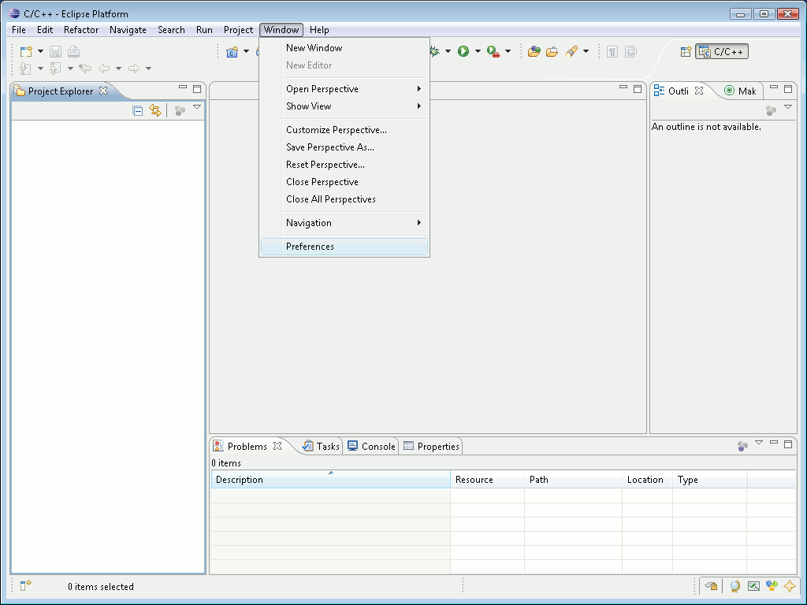
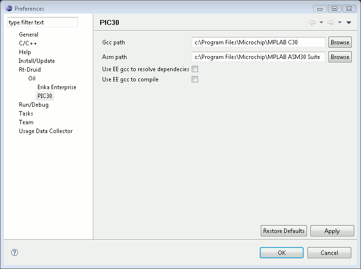
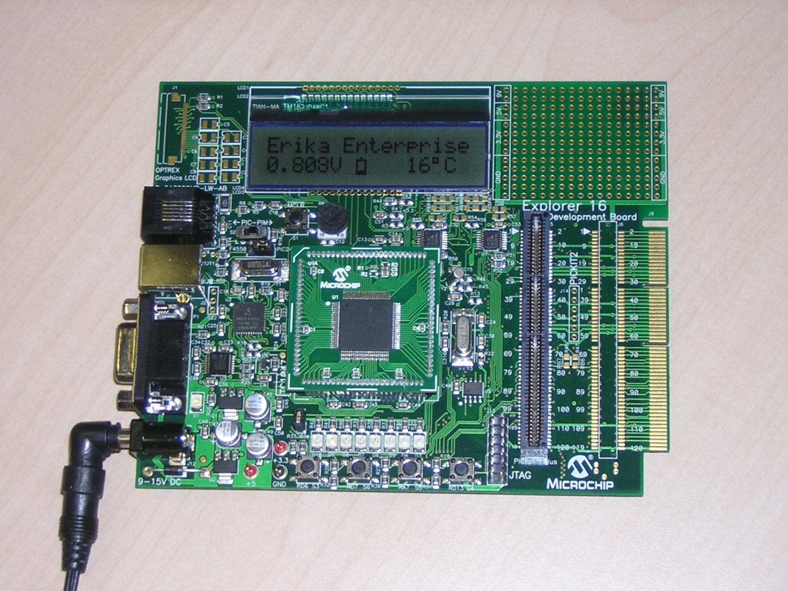
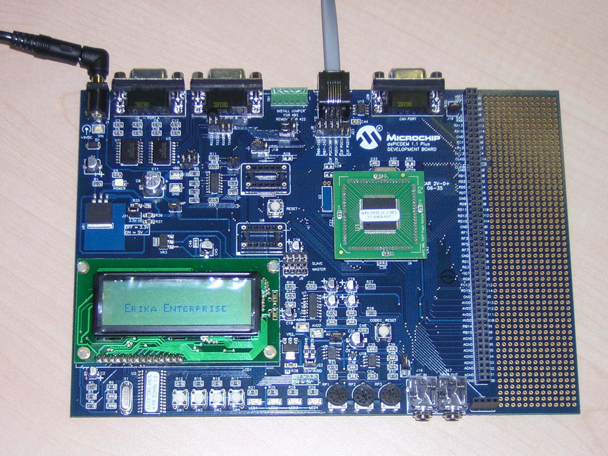

# Microchip dsPIC

<a id="Introduction"></a>

## Introduction

Embedded microcontroller units are spreading in thousands of applications, ranging from single to distributed systems, control applications, multimedia, communication, medical applications and many others. Modern microcontrollers, which are growing in computational power, speed and interfacing capabilities, are more and more feeling the need of tools to make the development of complex scalable applications easier.

The dsPIC (R) DSC family represents the latest product of Microchip Technology Inc., the world leading company in the field of microcontroller units. With a speed of up to 40 MHz, the dsPIC (R) DSC family seamlessly integrates a DSP core for high performance computation with a full range of interfaces to several buses like CAN, I2C, SPI, serial lines, ecc.

<a id="Erika_Enterprise_and_RT-Druid_for_Microchip_dsPIC_.28R.29_DSC"></a>

### Erika Enterprise and RT-Druid for Microchip dsPIC (R) DSC

Embedded applications often require tight control on the temporal behavior of each single activity in the system. The research in the field of real-time systems brought the team of Evidence Srl to design a small, efficient, modular real-time kernel that can be used to easily guarantee real-time constraints in every embedded applications.

Erika Enterprise and RT-Druid represent the answer of Evidence Srl for the development of scalable real-time applications for the Microchip dsPIC (R) DSC family.

The main features of ERIKA Enterprise and RT-Druid which are specific for Microchip dsPIC (R) DSC are the following:

- Installation setup which integrates Microchip software together with fully configured Evidence Erika Enterprise + RT-Druid;
- Full support for the Microchip devices libraries;
- Full support for the Microchip C30 compiler;
- Full support of the MPLAB IDE debugging environment;
- Full support for the Microchip ICD2 debugger;
- Full support for dsPIC (R) DSC series 30 and 33, and PIC24
- Support for the 802.15.4 (ZigBee) wireless communication protocol (using Maxstream XBee, Microchip ZigBee coming soon);
- Support for I/O to Multimedia Card (MMC) / Secure Digital with FAT filesystem (coming soon);
- Development of many specific hardware drivers for dsPIC (R) DSC, like multiple servomotor driving, bus EIB support (domotic), and many other (coming soon);
- Support for the FLEX development board (see here for details);

<a id="Integration_with_Microchip_Inc._products"></a>

### Integration with Microchip Inc. products

Erika Enterpise and RT-Druid aims to the best integration with the existing tools for development available from Microchip Inc.

RT-Druid will be used to quickly configure the application, setting temporal parameters of real-time tasks, memory requirements, stack allocation and many other parameters. RT-Druid generates the application template, and leaves the developer the task to implement the logic of each single task.

While programming the application, the developer can exploit the power and flexibility offered by the primitives of the Erika Enterprise real-time kernel.

The application can be imported into MPLAB IDE to be written into the dsPIC (R) DSC EPROM flash memory. Moreover, the application can be debugged from within the MPLAB IDE.

<a id="Requirements"></a>

### Requirements

Erika Enterprise supports Microchip dsPIC (R) DSC families 30 and 33, and PIC24.

Additional software is provided to compile the USB support for the FLEX Full using the Microchip C18 compiler.

The following table lists the requirements upon external programs provided by companies other than Evidence.

**There is no guarantee our software will work if you install a different version from what is listed in the table below.**

**Note the list is basically the sw versions we tried ourselves. if it does not work on your version, just send us a message on the forum...**

- ERIKA Enterprise 1.4.3
  - Microchip MPLAB 8.01 to 8.14
  - Microchip C30 Compiler 2.0.5, 3.0.2, 3.10b, 3.11(by adding the patch below)
  - Microchip C18 3.20
- ERIKA Enterprise 1.5.0
  - Microchip MPLAB 8.01 to 8.36
  - Microchip C30 Compiler 3.0.2 to 3.20
  - Microchip C18 3.20
- ERIKA Enterprise 1.5.1
  - Microchip MPLAB 8.01 to 8.66
  - Microchip C30 Compiler 3.0.2 to 3.23
  - Microchip C18 3.20
- ERIKA Enterprise 1.6.0
  - Microchip MPLAB 8.66
  - Microchip C30 Compiler 3.0.2 to 3.25
  - Microchip C18 3.20

Useful links

- [Microchip MPLAB download link](http://www.microchip.com/mplabide)
- [Microchip C30 Compiler download link](http://www.microchip.com/c30) (please note there is a free Student edition available!)

**PLEASE TRY TO USE THE MICROCHIP TOOL VERSIONS LISTED ABOVE. OTHER VERSIONS MAY NOT WORK.** (unfortunately Microchip changes the location of the compiler almost at each new version!)

<a id="Erika_Enterprise_for_PIC_devices"></a>

## Erika Enterprise for PIC devices

<a id="ERIKA_Enterprise_and_RT-Druid_Design_Flow"></a>

### ERIKA Enterprise and RT-Druid Design Flow

[ERIKA Enterprise and RT-Druid Design Flow](ERIKA_Enterprise_and_RT-Druid_Design_Flow--2067.md "ERIKA Enterprise and RT-Druid Design Flow")

<a id="Setting_up_the_compiling_environment_for_the_PIC30_architecture"></a>

### Setting up the compiling environment for the PIC30 architecture

Erika Enterprise has been designed to be compiled using the GNU gcc toolchain. The dsPIC porting of Erika Enterprise in particular can be compiled using the GNU tools for dsPIC provided by Microchip. The porting provides both the binutils package and the gcc package, plus a set of proprietary libraries from Microchip which can be used to control the various peripherals provided by the dsPIC microcontrollers.

The following list describes the various packages which contains the various parts of the compilation toolchain:

- The GNU assembler and binutils. This package is distributed inside the MPLAB IDE from Microchip. ERIKA does **not** use this package
- The GNU GCC from Microchip, named Microchip C30 Compiler. The compiler is packaged in a separate product, called The Microchip C30 Compiler, which is available as a product under the Microchip website. A free version is also available for students and universities. The source code of the compiler is also available under the GPL license on the Microchip web site.
- C Libraries. A set of libraries which can be used to control the peripherals implemented on the particular Microchip chip in use. These libraries are packaged together with the Microchip C30 Compiler.

To compile an Erika Enterprise application, the development environment needs to be configured to correctly recognize the Microchip C30 compiler and the MPLAB ASM30 assembler programs. For doing so, please go to the “Preference” menu, as shown in Figure

[](../files/File_Erikatutorial_preferences_menu.png--1641.md)

Go to the “Preference” menu inside Eclipse.

and find the “RT-Druid/Oil/PIC30 Configurator” form as depicted in Figure

[](../files/File_Erikatutorial_preferences_pic30.png--1642.md)

dsPIC paths for compiler and assembler.

The first textbox, labeled Gcc path, refers to the installation directory of the Microchip C30 compiler. The second textbox, labeled Asm path, refers to the installation directory of the ASM30 assembler provided with the MPLAB IDE. The two checkbox are provided for legacy support.

**Warning**: The install directories specified in the two textboxes in the figure above does not include the bin directory!
That is,

```
c:\Programmi\Microchip\MPLAB C30 
```

is correct, wheras

```
c:\Programmi\Microchip\MPLAB C30\bin 
```

is not.

**Warning**: The install directory of the assembler refers to the assembler provided with MPLAB IDE and not the assembler provided with the C30 compiler.

<a id="Writing_software_for_dsPIC_using_Erika_Enterprise"></a>

### Writing software for dsPIC using Erika Enterprise

**Note**: Please refer to [Tutorial: Installing ERIKA and RT-Druid, and compile your first application](Tutorial_PIC30_-_Installing_ERIKA_and_RT-Druid_and_compile_your_first_application--1637.md "Tutorial: Installing ERIKA and RT-Druid, and compile your first application") for a step-by-step guide with screenshots on how to create, compile and debug a dsPIC application written with Erika Enterprise.

This section describes the details about the various configuration options which are available to create and compile an Erika Enterprise application for a dsPIC microcontroller.

<a id="Avoid_the_generation_of_dependency_files"></a>

#### Avoid the generation of dependency files

The typical compilation process of an Erika Enterprise application involves the computation of a dependency file which is used to understand which are the files which needs to be compiled or updated.

To avoid the computation of these dependencies (useful when you are sure you basically have to compile everything), you can put the following line in the OIL file:

```
CPU mySystem {
  OS myOs {
    EE_OPT = " NODEPS ";
    ...
  };
  ...
};
```

<a id="Avoid_the_generation_of_.src_files_from_C_files"></a>

#### Avoid the generation of .src files from C files

The typical compilation process of an Erika Enterprise application produces various files which can be used to better analyze the code generated by the C30 compiler. In particular, from each .C file, a .SRC file is produced containing the corresponding assembler listing, which is then compiled by the MPLAB ASM30 compiler to produce the .o.

It is possible to avoid the intermediate step which leads to the production of the .SRC file. In that case, the compiler will be responsible of producing the .O file directly from the .C file. This in general also speeds up the compilation process a little bit. To obtain that feature, you can put the following lines in the OIL file.

```
CPU mySystem {
  OS myOs {
    EE_OPT = " NOSRC ";
    ...
  };
  ...
};
```

<a id="Printing_the_commands_executed_.28verbose_mode.29"></a>

#### Printing the commands executed (verbose mode)

The default compilation process typically prints only a compact output for each compilation step. That is in general not useful whenever a file is not compiled properly and the user wants to know the exact command which is executed in the compilation process.

To obtain a printing of the complete list of commands issued by the Erika Enterprise makefile, you can add the following line to the OIL file:

```
CPU mySystem {
  OS myOs {
    EE_OPT = " VERBOSE ";
    ...
  };
  ...
};
```

<a id="Source_files_composing_an_application"></a>

#### Source files composing an application

The source files which can be put in an RT-Druid project are composed by C-language files (with extension .c) and Assembler files (with extension .S). Assembler files are always preprocessed by the C preprocessor. All the application files which has to be included in the final application needs to be listed inside the OIL file, as in the following OIL example:

```
...
CPU_DATA = PIC30 {
  ...
  APP_SRC = "file_1.c";
  APP_SRC = "file_2.c";
};
...
```

<a id="Stack_handling"></a>

#### Stack handling

Erika Enterprise can be configured as monostack or multistack.

In a monostack configuration, only a single stack exists in the system. No blocking primitives are supported, and all the tasks and interrupts execute on the same stack. In this case, the one and only stack starts from the top of the application allocated memory, growing towards higher addresses. The monostack configuration can not be used if the application needs to call RTOS primitives such as WaitSem and WaitEvent. Moreover, it cannot be used when Erika Enterprise conformance classes ECC1 and ECC2 are used. To configure a monostack kernel in the OIL file, the user has to write the following lines:

```
...
CPU_DATA = PIC30 {
  ...
  MULTI_STACK = FALSE;
};
...
```

In a multistack configuration, the kernel support the existence of different stacks in the same application. Having different stacks allow the application tasks to use blocking primitives like WaitSem and WaitEvent, which basically may block the execution of the running task. In that case, the calling task must have a private stack which is changed upon blocking. The stack will be selected again when the task will be rescheduled. There are different stacks available in a multistack configuration:

- A shared stack (used by all the tasks which have a shared stack);
- An IRQ stack (used by all the ISR Type 2 routines);
- A set of private stacks (one for each task which has selected a private stack).

In the dsPIC architecture, the shared stack works as in the monostack configuration, that is it is allocated at the end of the application data section, growing towards higher addresses. The IRQ stack and the private stacks, instead, are allocated in the
application data space as arrays.

The following example shows an OIL configuration which configures a multistack kernel without a separate IRQ stack (in this case, IRQ handlers execute on the stack of the interrupted task):

```
...
CPU_DATA = PIC30 {
  ...
  MULTI_STACK = TRUE {
    IRQ_STACK = FALSE;
  };
};
...
```

The following example shows an OIL configuration which configures a multistack kernel with a separate IRQ stack (in this case, some registers are saved on the stack of the interrupted task, but the IRQ handler C function is executed on a separate IRQ stack).

```
...
CPU_DATA = PIC30 {
  ...
  MULTI_STACK = TRUE {
    IRQ_STACK = TRUE {
      SYS_SIZE =64;
    };
  };
};
...
```

<a id="Runtime_stack_checking_exceptions"></a>

#### Runtime stack checking exceptions

When multistack configurations are used, it is very useful to be informed when a particular stack becomes full. For this reason, the dsPIC (R) DSC core allows the user to specify a stack limit over which an exception should be raised. The stack limit is contained
inside the internal register SPLIM.

Erika Enterprise is able to automatically handle the SPLIM register, setting it at runtime to the top of the current stack when a multistack configuration. The SPLIM feature is by default disabled, because it adds some (little) overhead at each stack change. To enable it, you must include the following lines inside the OIL configuration file:

```
...
CPU_DATA = PIC30 {
  ...
  ENABLE_SPLIM = TRUE;
  };
...
```

Please note that Erika Enterprise does not provide a default handler for the stack overflow exception generated by the SPLIM register. The exception should be specified by the developer as the behavior to implement is often application dependent.

<a id="Interrupt_handling"></a>

#### Interrupt handling

Erika Enterprise for dsPIC (R) DSC provide support for fast Interrupt Service Routines (ISR) which do not require any RTOS primitive to be called, as well as regular ISRs, which can call RTOS primitives (e.g., a timer interrupt can call ActivateTask to activate a periodic task). The first kind of ISRs are called ISR Type 1, and always have hardware interrupt priority greater than the second kind of ISRs which are called ISR Type 2.

At the implementation level, Erika Enterprise uses the dsPIC DISI assembler instruction to implement interrupt disabling. The DISI instruction only disables the first 6 priority levels out of the 7 available in the 16-bit dsPIC (R) DSC core. For this reason, ISR Type 2 must always have an interrupt priority between 1 and 6.

ISR Type 1 must always have a priority greater or equal than ISR Type 2. As a matter of fact, interrupt priority 7 is reserved for ISR Type 1 only.

ISR names follow the Microchip convention. Basically the ISR names are listed inside the linker script for the particular target which are provided together with the ASM30 assembler packaged together with Microchip MPLAB IDE under the directory *MPLAB\_install\_directory*/MPLAB ASM30 Suite/Support/gld.

To define an ISR Type 1 the developer has to write an interrupt handler as it is written in typical dsPIC applications which does not use Erika Enterprise. Here is an example of the definition of an ISR Type 1 for the timer 3 Interrupt of a pic30F2010 device:

```
void __attribute__(( __interrupt__)) _T3Interrupt( void)
{
...
}
```

Writing an ISR 1 in this way implies that:

- The C function will be attached to the interrupt of the peripheral (in the example, timer 3). Every time an interrupt for the peripheral arrives, then the C function will be executed.
- The compiler will generate a proper function prologue and epilogue which saves the register used before starting executing the statements inside the function. The registers will be saved inside the stack of the interrupted task. For that reason, when using a multistack configuration, the user should reserve a proper space able to contain all the nested ISR Type 1 for each stack in the system.

To define an ISR Type 2 the developer has to write a C function in the following way:

```
# include " cpu/ pic30/ inc/ ee_irqstub.h"
...
ISR2( _T3Interrupt)
{
...
}
```

Writing an ISR 2 in this way implies that:

- An assembler stub will generated for the ISR. The ISR stub will have the name of the ISR (in the example,

  ```
  _T3Interrupt
  ```

  ). The assembler stub will call a C function named ISR2\_functionname which content is specified as the content of the function (in the example, the function is called ISR2\_\_T3Interrupt). The assembler function will be attached to the interrupt of the peripheral (in the example, timer 3). Every time an interrupt for the peripheral arrives, the assembler stub will execute, which in turns calls the internal C function whose body has been specified by the developer.

- The assembler stub saves all the CPU registers on the current stack. After that, if a multistack configuration with private IRQ stack has been selected, the stack is changed to a private IRQ stack. Otherwise, the ISR will execute on the stack of the running task, as in the ISR1 case. At the end of the stub, the Erika Enterprise end IRQ function will be executed to choose which is the next task to run.

<a id="Configuring_the_usage_of_Microchip_ICD2"></a>

#### Configuring the usage of Microchip ICD2

dsPIC (R) DSC devices can be debugged using the Microchip product called Microchip ICD2, which is basically an In-Circuit debugger which directly connects to the microcontroller core. When connected, the ICD2 requires the usage of a set of memory locations, which must be left free by the application.

For this reason, when compiling an application which will be debugged using the Microchip ICD2, the user has to specify the following line inside the OIL file:

```
...
CPU_DATA = PIC30 {
  ...
  ICD2 = TRUE;
};
...
```

<a id="Configuring_a_particular_dsPIC_.28R.29_DSC_microcontroller"></a>

#### Configuring a particular dsPIC (R) DSC microcontroller

Microchip produces various versions of the Microchip microcontrollers, each one with different peripherals and memory sizes. To support the heterogeneity of these devices, Microchip offers, through the C30 Compiler toolchain, a set of files which can be used
to configure the compiling process.

In particular, for each device, there are four files:

- A linker script, available under the directory Support/gld of the Microchip ASM30 Assembler, which contains the linking information such as the memory sizes, and the available interrupt handlers;
- An Assembler include file, available under the directory Support/inc of the Microchip ASM30 Assembler, which contains the declaration of the device’s register addresses to be used inside assembler programs;
- A C include file, available under the directory support/h of the Microchip C30Compiler, which contains the declaration of the device’s addresses to be used inside C programs;
- A library, available under the directory lib of the Microchip C30 compiler, which contains a set of libraries for the usage of the microcontroller peripherals.

Every Erika Enterprise application which has to be compiled together with the Microchip C30 compiler needs the specification of these four files. To set which files have to be used for the particular device, the user can specify the following lines inside the OIL file.

If the device number is known, and the files to be used are the default files provided by Microchip, then the developer can directly specify the device name in the OIL file, as in the following example:

```
...
MCU_DATA = PIC30 {
  MODEL = PIC33FJ256GP710;
};
...
```

Currently, Erika Enterprise supports the following values for the MODEL attribute:

- PIC24 devices: PIC24FJ128GA006, PIC24FJ128GA008, PIC24FJ128GA010, PIC24FJ32GA002, PIC24FJ32GA004, PIC24FJ64GA002, PIC24FJ64GA004, PIC24FJ64GA006, PIC24FJ64GA008, PIC24FJ64GA010, PIC24FJ96GA006, PIC24FJ96GA008, PIC24FJ96GA010, PIC24HJ128GP206, PIC24HJ128GP210, PIC24HJ128GP306, PIC24HJ128GP310, PIC24HJ128GP506, PIC24HJ128GP510, PIC24HJ256GP206, PIC24HJ256GP210, PIC24HJ256GP610, PIC24HJ64GP206, PIC24HJ64GP210, PIC24HJ64GP506, PIC24HJ64GP510.
- PIC30 devices: PIC30F1010, PIC30F2010, PIC30F2011, PIC30F2012, PIC30F2020, PIC30F2021, PIC30F2022, PIC30F2023, PIC30F3010, PIC30F3011, PIC30F3012, PIC30F3013, PIC30F3014, PIC30F4011, PIC30F4012, PIC30F4013, PIC30F5011, PIC30F5013, PIC30F5015, PIC30F5016, PIC30F6010, PIC30F6010A, PIC30F6011, PIC30F6011A, PIC30F6012, PIC30F6012A, PIC30F6013, PIC30F6013A, PIC30F6014, PIC30F6014A, PIC30F6015.
- PIC33 devices: PIC33FJ128GP206, PIC33FJ128GP306, PIC33FJ128GP310, PIC33FJ128GP706, PIC33FJ128GP708, PIC33FJ128GP710, PIC33FJ128MC506, PIC33FJ128MC510, PIC33FJ128MC706, PIC33FJ128MC708, PIC33FJ128MC710, PIC33FJ256GP506,PIC33FJ256GP510, PIC33FJ256GP710, PIC33FJ256MC510, PIC33FJ256MC710, PIC33FJ64GP206, PIC33FJ64GP306, PIC33FJ64GP310, PIC33FJ64GP706, PIC33FJ64GP708, PIC33FJ64GP710, PIC33FJ64MC506, PIC33FJ64MC508, PIC33FJ64MC510, PIC33FJ64MC706, PIC33FJ64MC710, PIC33FJ64MC802.

Please note that we did not have the possibility to directly test all the possible devices produced by Microchip. In general this is not a problem, because the various devices are directly mapped to appropriate compiler flags. The following is the list of devices
we tested directly: PIC30F2010, PIC30F6014A, PIC33FJ256GP710, PIC24FJ128GA010, which basically are the devices mounted on the Microchip Evaluation boards supported by Erika Enterprise.

If the device is not supported by the particular version of RT-Druid or if the developer needs to use a custom file, then the four files can be specified separately as in the following example:

```
...
MCU_DATA = PIC30 {
  MODEL = CUSTOM {
    MODEL = "33FJ256GP710";
    LINKERSCRIPT = "p33FJ256GP710.gld ";
    DEV_LIB = "libp33FJ256GP710-elf.a";
    INCLUDE_C = " p33FJ256GP710.h";
    INCLUDE_S = " p33FJ256GP710.inc ";
  };
};
...
```

As a result of this specification, the correct include files, libraries and linker scripts will be used when compiling an Erika Enterprise application.

<a id="Configuring_the_EDF_scheduler"></a>

### Configuring the EDF scheduler

When configuring the EDF kernel for an Erika Enterprise application, the user has the possibility to specify the tick length in the OIL file to allow the specification of a relative deadline using a temporal value.

In particular, the user can specify a tick value as follows:

```
KERNEL_TYPE = EDF { TICK_TIME = "25 ns ";};
```

and then specify a relative deadline using a timing value as follows:

```
TASK myTask1 {
  REL_DEADLINE = "10 ms ";
};
```

The RT-Druid code generator will handle the the conversion between the relative deadline value in the corresponding timing value automatically.
The important thing in this process is to correctly specify the TICK\_TIME. In general, that value depends on the timing reference which is made available by the dsPIC. The current timing reference implemented in the EDF kernel is based on the value of a 32 bit timer.

Having a 32 bit timing reference helps implementing a long lifetime for the circular timer, allowing the support of relatively long relative deadlines. The 32 bit timer is obtained by concatenating the two 16 bit timers TMR8 and TMR9 available on the dsPIC (R) DSC. The clock used for the timers is the system clock, with a tick time equal to 1/Fcy, where Fcy = Fosc/2 . Fosc, the frequency of the oscillator, depends on its configuration which is typically done in the application by using appropriate macros shown below.

The following paragraphs describe two typical oscillator values which can be used, and the correspondent parameters which has to be put in the OIL file. The same settings are available in two template applications distributed with Erika Enterprise which work on the FLEX boards featuring a dsPIC (R) DSC model PIC33FJ256MC710.

Finally, always remember that the EE\_time\_init function has to be called inside the main function before using any primitive of the EDF kernel.

<a id="Primary_oscillator_without_PLL"></a>

#### Primary oscillator without PLL

In this configuration, a primary oscillator at 4 MHz is used without any moltiplication. In this case, the tick duration is 500 ns, and the dsPIC (R) DSC is running at 2 MIPS. To configure the system in this way, the C language has to contain the following compiler directive:

```
_FOSCSEL ( FNOSC_PRI);
```

The OIL file will contain the following line:

```
KERNEL_TYPE = EDF { TICK_TIME = "500 ns ";};
```

The maximum relative deadline which can be expressed in the OIL file is 500ns\*2^31, which is slightly more than 1073 secs.

A template application which initializes an EDF periodic task for this case is available under the RT-Druid templates.

<a id="Primary_oscillator_with_PLL"></a>

#### Primary oscillator with PLL

In this configuration, the dsPIC (R) DSC is configured to provide its maximum computational power. To do that, the internal PLL is used to push the internal frequency Fosc to 80 MHz. As a consequence, Fcy become 40 MHz, which is the nominal maximum computational power of 40 MIPS declared by Microchip. In this case, the tick duration is 25 ns.

To configure the system in this way, the C language has to contain the following compiler directive:

```
_FOSCSEL ( FNOSC_PRIPLL);
```

Moreover, at the beginning of the main function, the PLL multiplier registers needs to be set with the following code:

```
/* Clock setup for 40 MIPS */
CLKDIVbits. DOZEN = 0;
CLKDIVbits. PLLPRE = 0;
CLKDIVbits. PLLPOST = 0;
PLLFBDbits. PLLDIV = 78;
/* Wait for PLL to lock */
while( OSCCONbits. LOCK !=1);
```

Finally, the OIL file will contain the following line:

```
KERNEL_TYPE = EDF { TICK_TIME = "25 ns ";};
```

The maximum relative deadline which can be expressed in the OIL file is 25ns\*2^31, which is slightly more than 53 secs.

<a id="EE_time_init"></a>

#### EE time init

- *void EE\_time\_init(void);*

  Description: The function programs TMR8 and TMR9 as a 32 bit timer which is then used by the EDF Kernel to take the timing reference. The function must be called before calling any Erika Enterprise primitive.

  If dsPIC have less than 9 hardware timers, *EE\_time\_init* may also programs TMR2 and TMR3 or TMR4 and TMR5 instead of TMR8 and TMR9. To enable that you have to put *EE\_OPT="\_\_DSPIC\_EDF\_TMR23\_\_";* or *EE\_OPT="\_\_DSPIC\_EDF\_TMR45\_\_";* in conf.oil file.

<a id="Boards"></a>

## Boards

<a id="Flex_Board"></a>

### Flex Board

<a id="Introduction_2"></a>

#### Introduction

This chapter describes the support done in Erika Enterprise for the Evidence/Embedded solutions Flex Board.

Flex is an embedded board which can be used by all the developers who want to fully exploit the potential of the latest Microchip micro-controllers: the dsPIC (R) DSC family.

Flex is born as a development board where to easily develop and test real-time applications for the dsPIC (R) DSC micro-controller. The main features of Flex are:

- robust electronic design;
- modular architecture;
- availability of a growing number of application notes;
- the full support of Erika Enterprise.

To configure the usage of the Flex Board, the user has to specify an appropriate
BOARD\_DATA, as in the following example:

```
...
BOARD_DATA = EE_FLEX {
...
}
...
```

The Flex board supports a set of devices which are directly mounted on it, plus a set of additional devices mounted on specific add-on boards. These devices can be configured by adding attributes inside the BOARD\_DATA section.

The supported devices and the API functions needed to use them are described in the following sections.

<a id="System_LED"></a>

#### System LED

The Flex Board has a system LED attached to a GPIO pin of the microcontroller. To use the system LED on the Flex Board, the developer should specify the USELEDS attribute as TRUE, as in the following example:

```
...
BOARD_DATA = EE_FLEX {
  USELEDS = TRUE;
  ...
}
...
```

The following paragraphs will describe the functions available to control the Flex System LED.

- *void EE\_leds\_init(void);*

  Description: The function configures the GPIO pin. The LED starts turned off.
- *void EE\_led\_sys\_on(void);*

  Description: The function turns on the LED.
- *void EE\_led\_sys\_off(void);*

  Description: The function turns off the LED.
- *void EE\_led\_on(void);*

  Description: The function turns on the LED.
- *void EE\_led\_off(void);*

  Description: The function turns off the LED.

<a id="Flex_Demo_Daughter_Board"></a>

### Flex Demo Daughter Board

<a id="Introduction_3"></a>

#### Introduction

This chapter describes the support done in Erika Enterprise for the Evidence/Embedded solutions Flex Demo Daughter Board.
The Demo Daughter board is a small board that plugs on the Flex Light / Flex Full connectors and which provides a set of devices useful to implement small demos and demonstrators of control algorithms.

The main features of the Flex Demo Daughter board are:

- 8 leds;
- 4 buttons;
- 1 accelerometer;
- 8 Analog Inputs;
- 1 buzzer;
- 1 DAC;
- direct availability of the MCU encoder pins
- Infrared receiver;
- 16x2 characters LCD;
- PWM outputs;
- Temperature sensor;
- Light sensor;
- Trimmer;
- Connections to implement the USB communication on the FLEX Full
- Zigbee connector for Microchip or Easybee modules.

To configure the usage of the Flex Demo Daughter Board, the user has to specify an appropriate BOARD\_DATA, as in the following example:

```
...
BOARD_DATA = EE_FLEX {
  TYPE = DEMO {
    ...
  };
  ...
}
...
```

The supported devices and the API functions needed to use them are described in the following sections.

<a id="LEDS"></a>

#### LEDS

The Flex Demo Daughter board hosts 8 LEDs which are attached to GPIO pins. To use the LEDs on the Flex Demo Daughter Board, the developer should include the following fragment in the application OIL file:

```
...
BOARD_DATA = EE_FLEX {
  TYPE = DEMO { OPTIONS = LEDS; };
  ...
}
...
```

The following subsections will describe the functions available to control the Flex Demo Daughter Board LEDs.

- *void EE\_demoboard\_leds\_init(void);*

  Description: The function configures the LEDs, which starts turned off.
- *void EE\_leds(EE\_UINT8 data);*

  Description: The function sets the led values using the data parameter.
- *void EE\_leds\_on(void);*

  Description: The function turns all the LEDs on.
- *void EE\_leds\_off(void);*

  Description: The function turns all the LEDs off.
- *void EE\_led\_0\_on(void);*

  Description: The function turns LED 0 on.
- *void EE\_led\_0\_off(void);*

  Description: The function turns LED 0 off.
- *void EE\_led\_1\_on(void);*

  Description: The function turns LED 1 on.
- *void EE\_led\_1\_off(void);*

  Description: The function turns LED 1 off.
- *void EE\_led\_2\_on(void);*

  Description: The function turns LED 2 on.
- *void EE\_led\_2\_off(void);*

  Description: The function turns LED 2 off.
- *void EE\_led\_3\_on(void);*

  Description: The function turns LED 3 on.
- *void EE\_led\_3\_off(void);*

  Description: The function turns LED 3 off.
- *void EE\_led\_4\_on(void);*

  Description: The function turns LED 4 on.
- *void EE\_led\_4\_off(void);*

  Description: The function turns LED 4 off.
- *void EE\_led\_5\_on(void);*

  Description: The function turns LED 5 on.
- *void EE\_led\_5\_off(void);*

  Description: The function turns LED 5 off.
- *void EE\_led\_6\_on(void);*

  Description: The function turns LED 6 on.
- *void EE\_led\_6\_off(void);*

  Description: The function turns LED 6 off.
- *void EE\_led\_7\_on(void);*

  Description: The function turns LED 7 on.
- *void EE\_led\_7\_off(void);*

  Description: The function turns LED 7 off.

<a id="Buttons"></a>

#### Buttons

The Flex Demo Daughter Board has a set of four buttons attached to GPIO pins of the microcontroller. To use the buttons, the developer should include the following fragment in the application OIL file:

```
...
BOARD_DATA = EE_FLEX {
  TYPE = DEMO { OPTIONS = BUTTONS ; };
  ...
}
...
```

The following subsections will describe the functions available to control the Flex Demo Daughter Board buttons.

- *void EE\_buttons\_init( void (\*isr\_callback)(void), EE\_UINT8 mask );*

  Description: The function configures the GPIO pins used by the buttons. Buttons can be configured to be controlled only by using polling functions (no isr\_callback is specified), or can be configured to raise an interrupt (if isr\_callback is specified). When the isr\_callback is specified, the mask parameter is used to control for which buttons the interrupt will be generated.

  Parameters:
  - *isr\_callback*

    The function is called inside an ISR2 upon a button press.
  - *mask*

    If isr\_callback is specified, then this parameter controls which buttons will generate an interrupt request. In particular, bit 0x01 is used for button S1, bit 0x02 is used for button S2, bit 0x04 is used for button S3, bit 0x08 is used for button S4.

- *EE\_UINT8 EE\_button\_get\_S1(void);*

  Description: The function returns the status of the button number S1.

  Return Values:
  - unsigned char

    1 of the button is pressed, 0 otherwise.

- *EE\_UINT8 EE\_button\_get\_S2(void);*

  Description: The function returns the status of the button number S2.

  Return Values:
  - unsigned char

    1 of the button is pressed, 0 otherwise.

- *EE\_UINT8 EE\_button\_get\_S3(void);*

  Description: The function returns the status of the button number S3.

  Return Values:
  - unsigned char

    1 of the button is pressed, 0 otherwise.

- *EE\_UINT8 EE\_button\_get\_S4(void);*

  Description: The function returns the status of the button number S4.

  Return Values:
  - unsigned char

    1 of the button is pressed, 0 otherwise.

<a id="LCD"></a>

#### LCD

The Flex Demo Daughter Board has an alpha-numeric 16 x 2 LCD display mounted on the board attached to the GPIO pins of the microcontroller. To use the LCD on the board, the developer should include the following fragment in the application OIL file:

```
...
BOARD_DATA = EE_FLEX {
  TYPE = DEMO { OPTIONS = LCD; };
  ...
}
...
```

The functions available can be used to print character and strings to the LCD Display, and to select the current cursor position (which is the position where the next character will be printed).
To specify a character position in the LCD, the functions provided uses an integer.
Numbers from 0 to 15 represents the first line, whereas numbers from 15 to 31 represents the second line.
The following subsections will describe the functions available to control the LCD.

- *void EE\_lcd\_init(void);*

  Description: The function initializes the LCD display.

- *void EE\_lcd\_command(EE\_UINT8 cmd);*

  Description: The function sends a command to the LCD. Most of the LCD functions described in this chapters basically remap to this function. The developer can use this function to implement features which are currently not supported by the LCD API.

  Parameters:
  - cmd

    The LCD command.

- *void EE\_lcd\_putc(EE\_INT8 data);*

  Description: The function puts a character on the LCD display, at the current cursor position.

- *void EE\_lcd\_puts(EE\_INT8 \*buf);*

  Description: The function prints a string to the display.

  Parameters:
  - buf

    The string to display. It must be a valid C-language string.

- *unsigned char EE\_lcd\_busy(void);*

  Description: The function returns 1 if the display is busy, 0 otherwise. This function can be used to check if the application can send a new command to the LCD, or if the command can not be sent because the LCD is still busy processing the previous command.

  Return Values:
  - unsigned char

    1 if the display is busy, 0 otherwise.

- *void EE\_lcd\_clear(void);*

  Description: The function clears the LCD.

- *void EE\_lcd\_home(void);*

  Description: The function sets the current cursor position to the top left display character.

- *void EE\_lcd\_line2(void);*

  Description: The function sets the current cursor position to the bottom left display character.

- *void EE\_lcd\_curs\_right(void);*

  Description: The function sets the current cursor position on the next character on the right.

- *void EE\_lcd\_curs\_left(void);*

  Description: The function sets the current cursor position on the next character on the left.

- *void EE\_lcd\_shift(void);*

  Description: The function can be used to enable the shift mode of the LCD. When in shift mode, each character sent provoke the shifting of all the characters of the LCD.

- *void EE\_lcd\_goto(EE\_UINT8 posx, EE\_UINT8 posy);*

  Description: The function sets the current cursor position to (posx, posy).

  Parameters:
  - posx

    The LCD column, from 0 to 15.
  - posy

    The LCD row, 0 or 1.

<a id="Analog_sensors"></a>

#### Analog sensors

The Flex Demo Daughter Board has a set of analog channels available, in particular (in parenthesis the pin assignments):

- Temperature sensor (AN12/RB12);
- Light sensor (AN13/RB13);
- Trimmer (AN15/RB15);
- Accelerometer X axis (AN16/RC1);
- Accelerometer Y axis (AN17/RC2);
- Accelerometer Z axis (AN18/RC3);
- ADC Aux (AN19/RC4).

To use these inputs, the developer should include the following fragment in the application OIL file:

```
...
BOARD_DATA = EE_FLEX {
  TYPE = DEMO {
    OPTIONS = ADC_IN ; // for the analog inputs
    OPTIONS = ACCELEROMETER; // for the accelerometer
    OPTIONS = SENSORS ; // for the sensors
    OPTIONS = TRIMMER ; // for the potentiometer
  };
};
...
```

The functions available can be used to start and stop the A/D converter, and to read the values from the various sensors.

- *void EE\_analog\_init(void);*

  Description: The function initializes the A/D converter. The ADC is initialized in polling mode.

- *void EE\_analog\_close(void);*

  Description: The function turns off the A/D converter.

- *void EE\_adcin\_init(void);*

  Description: The function initializes the A/D converter. It has the same functionality as EE\_analog\_init.

- *EE\_UINT16 EE\_adcin\_get\_volt(void);*

  Description: The function reads the ADC Aux channel and returns its value. The A/D converter should have been already initialized using EE\_adcin\_init.

  Return Values
  - EE\_UINT16

    The voltage read from the ADC Aux channel, in millivolt.

- *void EE\_trimmer\_init(void);*

  Description: The function initializes the A/D converter. It has the same functionality as EE\_analog\_init.

- *EE\_UINT16 EE\_trimmer\_get\_volt(void);*

  Description: The function reads the Trimmer channel and returns its value. The A/D converter should have been already initialized using EE\_adcin\_init.

  Return Values:
  - EE\_UINT16 The voltage read from the Trimmer channel, in millivolt.

- *void EE\_analogsensors\_init(void);*

  Description: The function initializes the A/D converter. It has the same functionality as EE\_analog\_init.

- *EE\_UINT16 EE\_nalog\_get\_temperature(void);*

  Description: The function reads the temperature sensor and returns its value. The A/D converter should have been already initialized using EE\_adcin\_init.

  Return Values:
  - EE\_UINT16

    The voltage read from the temperature sensor, in millivolt.

- *EE\_UINT16 EE\_analog\_get\_light(void);*

  Description: The function reads the Light sensor and returns its value. The A/D converter should have been already initialized using EE\_adcin\_init.

  Return Values:
  - EE\_UINT16

    The voltage read from the Light sensor, in millivolt.

- *void EE\_accelerometer\_init(void);*

  Description: The function initializes the A/D converter. It has the same functionality as EE\_analog\_init, plus some initialization specific for the 3-axis accelerometer..

- *EE\_UINT8 EE\_accelerometer\_getglevel(void);*
- *void EE\_accelerometer\_setglevel(EE\_UINT8 level);*
- *void EE\_accelerometer\_sleep(void);*
- *void EE\_accelerometer\_wakeup(void);*
- *float EE\_accelerometer\_getx(void);*
- *float EE\_accelerometer\_gety(void);*
- *float EE\_accelerometer\_getz(void);*

<a id="Buzzer"></a>

#### Buzzer

The Flex Demo Daughter Board has a buzzer which can be used to produce simple sounds.
To use the buzzer, the developer should include the following fragment in the application OIL file:

```
...
BOARD_DATA = EE_FLEX {
  TYPE = DEMO {
    OPTIONS = BUZZER ; // for the analog inputs
  };
};
...
```

The functions available can be used to setup the buzzer, and to play notes.
**Warning:** The buzzer driver uses timer T3.

- *void EE\_buzzer\_init(void);*

  Description: The function initializes the buzzer.

- *void EE\_buzzer\_set\_freq(EE\_UINT16 new\_freq);*

  Description: The function sets an output frequency for the buzzer. Frequencies should be higher than 10 Hz. No action is taken if the new frequency differs from the previous one by less than 10 Hz.

  Parameters:
  - new\_freq The new buzzer frequency, in Hz.

- *EE\_UINT16 EE\_buzzer\_get\_freq(void);*

  Description: The function returns the current buzer frequency.

  Return Values:
  - EE\_UINT16

    The current buzzer frequency.

- *void EE\_buzzer\_mute(void);*

  Description: The function mutes the buzzer.

- *void EE\_buzzer\_unmute(void);*
- Description: The function unmutes the buzzer.

- *void EE\_buzzer\_close(void);*

  Description: The function resets the buzzer.

<a id="PWM_Output"></a>

#### PWM Output

The Flex Demo Daughter Board has a PWM output which is attached to the Output Compare 3 of the Timer 2.
To use the PWM, the developer should include the following fragment in the application OIL file:

```
...
BOARD_DATA = EE_FLEX {
  TYPE = DEMO {
    OPTIONS = PWM_OUT ;
  };
};
...
```

The functions available can be used to start, stop and set the duty cycle of the PWM.

- *void EE\_pwm\_init(EE\_UINT16 Period);*

  Description: The function initializes the PWM, setting also its period.

  Parameters:
  - Period

    The PWM period.

- *void EE\_pwm\_set\_duty(float duty);*

  Description: The function sets the duty cycle of the PWM.

  Parameters:
  - duty

    The PWM duty cycle.

- *void EE\_pwm\_close(void);*

  Description: The function shuts down the PWM.

<a id="DAC_Output"></a>

#### DAC Output

The Flex Demo Daughter Board has a DAC output connected to the Microcontroller I2C port which can be used to convert digital signals to analog values.
To use the DAC, the developer should include the following fragment in the application OIL file:

```
...
BOARD_DATA = EE_FLEX {
  TYPE = DEMO {
    OPTIONS = DAC;
  };
};
...
```

The functions available can be used to start, stop and set the duty cycle of the PWM.

- *EE\_INT8 EE\_dac\_general\_call(EE\_UINT8 second);*
- *EE\_INT8 EE\_dac\_fast\_write(EE\_UINT16 data, EE\_UINT8 port, EE\_UINT8 power);*
- *EE\_INT8 EE\_dac\_write(EE\_UINT16 data, EE\_UINT8 port, EE\_UINT8 power, EE\_UINT8 save);*
- *void EE\_dac\_init(void);*

<a id="Explorer16_Board"></a>

### Explorer16 Board

<a id="Introduction_4"></a>

#### Introduction

This chapter describes the support done in Erika Enterprise for the Microchip Explorer16 Board.

[](../files/File_Erikatutorial_explorer16running.jpg--1656.md)

Microchip Explorer 16 board running ERIKA Enterprise.

The Explorer 16 is a low cost, efficient development board produced by Microchip hosting an alpha-numeric 16 x 2 LCD display, with interfaces to MPLAB ICD 2, USB, and RS-232. To configure the usage of the Explorer 16 Board, the user has to specify an appropriate
BOARD\_DATA, as in the following example:

```
...
BOARD_DATA = MICROCHIP_EXPLORER16 {
  ...
}
...
```

The Explorer 16 board supports a set of devices which are directly mounted on it. These devices can be configured by adding attributes inside the BOARD\_DATA section. The supported devices and the API functions needed to use them are described in the
following sections. The current version of the board support for Flex supports both the dsPIC model 33FJ256GP710 and the PIC24 model 24FJ128GA010.

<a id="Buttons_2"></a>

#### Buttons

The Explorer 16 Board has a set of four buttons attached to GPIO pins of the microcontroller. To use the buttons on the Explorer 16 Board, the developer should specify the USEBUTTONS attribute as TRUE, as in the following example:

```
...
BOARD_DATA = MICROCHIP_EXPLORER16 {
  USEBUTTONS = TRUE;
  ...
}
...
```

The following subsections will describe the functions available to control the Explorer 16 buttons.

- *void EE\_buttons\_init( void (\*isr\_callback)(void), EE\_UINT8 mask );*

  Description: The function configures the GPIO pins used by the buttons. Buttons can be configured to be controlled only by using polling functions (no isr\_callback is specified), or can be configured to raise an interrupt (if isr\_callback is specified). When the isr\_callback is specified, the mask parameter is used to control for which buttons the interrupt will be generated.

  Parameters:
  - isr\_callback

    The function is called inside an ISR2 upon a button press.
  - mask

    If isr\_callback is specified, then this parameter controls which buttons will generate an interrupt request. In particular, bit 0x01 is used for button S3, bit 0x02 is used for button S4, bit 0x04 is used for button S5, bit 0x08 is used for button S6.

- *EE\_UINT8 EE\_button\_get\_S3(void);*

  Description: The function returns the status of the button number S3.

  Return Values:
  - unsigned char

    1 of the button is pressed, 0 otherwise.

- *EE\_UINT8 EE\_button\_get\_S4(void);*

  Description: The function returns the status of the button number S4.

  Return Values:
  - unsigned char

    1 of the button is pressed, 0 otherwise.

- *EE\_UINT8 EE\_button\_get\_S5(void);*

  Description: The function returns the status of the button number S5.

  Return Values:
  - unsigned char

    1 of the button is pressed, 0 otherwise.

- *EE\_UINT8 EE\_button\_get\_S6(void);*

  Description: The function returns the status of the button number S6.

  Return Values:
  - unsigned char

    1 of the button is pressed, 0 otherwise.

<a id="LEDs_2"></a>

#### LEDs

The Explorer 16 Board has a set of 8 LEDs attached to the GPIO pins of the microcontroller. To use the LEDs on the Explorer 16 Board, the developer should specify the USELEDS attribute as TRUE, as in the following example:

```
...
BOARD_DATA = MICROCHIP_EXPLORER16 {
  USELEDS = TRUE;
  ...
}
...
```

The following subsections will describe the functions available to control the Explorer 16 LEDs.

- *void EE\_leds\_init(void);*

  Description: The function configures the GPIO pins. The LEDs start turned off.

- *void EE\_leds\_on(void);*

  Description: The function turns on all the LEDs.

- *void EE\_leds\_off(void);*

  Description: The function turns off all the LEDs.

- *void EE\_led\_on(void);*
- Description: The function turns on LED 3 (which is the first led on the board).

- *void EE\_led\_off(void);*
- Description: The function turns off LED 3 (which is the first led on the board).

- *void EE\_led\_3\_on(void);*

  Description: The function turns on LED 3.

- *void EE\_led\_3\_off(void);*

  Description: The function turns off LED 3.

- *void EE\_led\_4\_on(void);*

  Description: The function turns on LED 4.

- *void EE\_led\_4\_off(void);*

  Description: The function turns off LED 4.

- *void EE\_led\_5\_on(void);*

  Description: The function turns on LED 5.

- *void EE\_led\_5\_off(void);*

  Description: The function turns off LED 5.

- *void EE\_led\_6\_on(void);*
- Description: The function turns on LED 6.

- *void EE\_led\_6\_off(void);*
- Description: The function turns off LED 6.

- *void EE\_led\_7\_on(void);*

  Description: The function turns on LED 7.

- *void EE\_led\_7\_off(void);*

  Description: The function turns off LED 7.

- *void EE\_led\_8\_on(void);*

  Description: The function turns on LED 8.

- *void EE\_led\_8\_off(void);*

  Description: The function turns off LED 8.

- *void EE\_led\_9\_on(void);*

  Description: The function turns on LED 9.

- *void EE\_led\_9\_off(void);*

  Description: The function turns off LED 9.

- *void EE\_led\_10\_on(void);*

  Description: The function turns on LED 10.

- *void EE\_led\_10\_off(void);*

  Description: The function turns off LED 10.

<a id="LCD_2"></a>

#### LCD

The Explorer 16 Board has an alpha-numeric 16 x 2 LCD display mounted on the board attached to the GPIO pins of the microcontroller. To use the LCD on the Explorer 16 Board, the developer should specify the USELCD attribute as TRUE, as in the following example:

```
...
BOARD_DATA = MICROCHIP_EXPLORER16 {
  USELCD = TRUE;
  ...
}
...
```

The functions available can be used to print character and strings to the LCD Display, and to select the current cursor position (which is the position where the next character will be printed).
To specify a character position in the LCD, the functions provided uses an integer.
Numbers from 0 to 15 represents the first line, whereas numbers from 15 to 31 represents the second line.
The following subsections will describe the functions available to control the Explorer 16 LCD.

- *void EE\_lcd\_init(void);*

  Description: The function initializes the LCD display.

- *void EE\_lcd\_command(EE\_UINT8 cmd);*

  Description: The function sends a command to the LCD. Most of the LCD functions described in this chapters basically remap to this function. The developer can use this function to implement features which are currently not supported by the LCD API.

  Parameters:
  - cmd

    The LCD command.

- *void EE\_lcd\_putc(EE\_INT8 data);*
- Description: The function puts a character on the LCD display, at the current cursor position.

- *EE\_INT8 EE\_lcd\_getc(void);*

  Description: The function returns the character which is present at the current cursor position.

  Return Values:
  - char

    The character which is displayed at the current cursor position.

- *void EE\_lcd\_puts(EE\_INT8 \*buf);*

  Description: The function prints a string to the display.

  Parameters:
  - buf

    The string to display. It must be a valid C-language string.

- *unsigned char EE\_lcd\_busy(void);*

  Description: The function returns 1 if the display is busy, 0 otherwise. This function can be used to check if the application can send a new command to the LCD, or if the command can not be sent because the LCD is still busy processing the previous command.

  Return Values:
  - unsigned char 1 if the display is busy, 0 otherwise.

- *void EE\_lcd\_clear(void);*

  Description: The function clears the LCD.

- *void EE\_lcd\_home(void);*

  Description: The function sets the current cursor position to the top left display character.

- *void EE\_lcd\_line2(void);*

  Description: The function sets the current cursor position to the bottom left display character.

- *void EE\_lcd\_curs\_right(void);*

  Description: The function sets the current cursor position on the next character on the right.

- *void EE\_lcd\_curs\_left(void);*

  Description: The function sets the current cursor position on the next character on the left.

- *void EE\_lcd\_shift(void);*

  Description: The function can be used to enable the shift mode of the LCD. When in shift mode, each character sent provoke the shifting of all the characters of the LCD.

- *void EE\_lcd\_goto(EE\_UINT8 posx, EE\_UINT8 posy);*

  Description: The function sets the current cursor position to (posx, posy).

  Parameters:
  - posx

    The LCD column, from 0 to 15.
  - posy

    The LCD row, 0 or 1.

<a id="Analog_sensors_2"></a>

#### Analog sensors

The Explorer 16 Board has two analog inputs which are connected to the board. The first is a temperature sensor, whereas the second is a potentiometer. To use these two analog inputs on the Explorer 16 Board, the developer should specify the USEANALOG attribute as TRUE, as in the following example:

```
...
BOARD_DATA = MICROCHIP_EXPLORER16 {
  USEANALOG = TRUE;
  ...
}
...
```

The functions available can be used to start and stop the A/D converter, and to read the values from the two sensors.
The following subsections will describe the functions available to control the Explorer 16 on-board sensors.

- *void EE\_analog\_init(void);*

  Description: The function initializes the A/D converter. As a result, a periodic interrupt is raised. An interrupt handler is also internally provided by the A/D handler to read the sensor values and make them available to the user using the functions EE\_analog\_get\_volt and EE\_analog\_get\_temp.

- *EE\_UINT16 EE\_analog\_get\_volt(void);*

  Description: The function returns the last voltage read from the potentiometer installed on the Explorer 16 board. The A/D converter should have been already initialized using EE\_analog\_init.

  Return Values:
  - EE\_UINT16 The voltage read from the potentiometer installed on the Explorer 16 board, in millivolt.

- *EE\_UINT16 EE\_analog\_get\_temp(void);*

  Description: The function returns the last temperature read from the temperature sensor installed on the Explorer 16 board. The A/D converter should have been already initialized using EE\_analog\_init.

  Return Values:
  - EE\_UINT16 The temperature read from the sensor, in Celsius degrees.

- *void EE\_analog\_start(void);*

  Description: The function turns on A/D conversion. Please note that the A/D conversion is automatically started when EE\_analog\_init is called.

- *void EE\_analog\_stop(void);*
- Description: The function turns off A/D conversion. To turn on again the A/D conversion, the developer can call EE\_analog\_start.

<a id="dsPICDEM_1.1_Plus_Board"></a>

### dsPICDEM 1.1 Plus Board

<a id="Introduction_5"></a>

#### Introduction

This chapter describes the support done in Erika Enterprise for the Microchip dsPICDEM 1.1 Plus Board.

[](../files/File_Dspicdemrunning.jpg--2068.md)

The Microchip dsPICDEM 1.1 Plus board running Erika Enterprise.

The dsPICDEM 1.1 Plus is a low cost, efficient development board produced by Microchip hosting a graphic display, with interfaces to MPLAB ICD 2, and RS-232. To configure the usage of the dsPICDEM 1.1 Plus Board, the user has to specify an appropriate BOARD\_DATA, as in the following example:

```
...
BOARD_DATA = MICROCHIP_DSPICDEM11PLUS {
  ...
}
...
```

The dsPICDEM 1.1 Plus board supports a set of devices which are directly mounted on it. These devices can be configured by adding attributes inside the BOARD\_DATA section. The supported devices and the API functions needed to use them are described in the
following sections.

<a id="Buttons_3"></a>

#### Buttons

The dsPICDEM 1.1 Plus Board has a set of four buttons attached to GPIO pins of the microcontroller. To use the buttons on the board, the developer should specify the USEBUTTONS attribute as TRUE, as in the following example:

```
...
BOARD_DATA = MICROCHIP_DSPICDEM11PLUS {
  USEBUTTONS = TRUE;
  ...
}
...
```

The following subsections will describe the functions available to control the buttons.

- *void EE\_buttons\_init( void (\*isr\_callback)(void), EE\_UINT8 mask );*

  Description: The function configures the GPIO pins used by the buttons. Buttons can be configured to be controlled only by using polling functions (no isr\_callback is specified), or can be configured to raise an interrupt (if isr\_callback is specified). When the isr\_callback is specified, the mask parameter is used to control for which buttons the interrupt will be generated.

  Parameters:
  - isr\_callback The function is called inside an ISR2 upon a button press.
  - mask If isr\_callback is specified, then this parameter controls which buttons will generate an interrupt request. In particular, bit 0x01 is used for button S1, bit 0x02 is used for button S2, bit 0x04 is used for button S3, bit 0x08 is used for button S4.

- *EE\_UINT8 EE\_button\_get\_S1(void);*

  Description: The function returns the status of the button number S1.

  Return Values:
  - unsigned char 1 of the button is pressed, 0 otherwise.

- *EE\_UINT8 EE\_button\_get\_S2(void);*

  Description: The function returns the status of the button number S2.

  Return Values:
  - unsigned char 1 of the button is pressed, 0 otherwise.

- *EE\_UINT8 EE\_button\_get\_S3(void);*

  Description: The function returns the status of the button number S3.

  Return Values:
  - unsigned char 1 of the button is pressed, 0 otherwise.

- *EE\_UINT8 EE\_button\_get\_S4(void);*

  Description: The function returns the status of the button number S4.

  Return Values:
  - unsigned char 1 of the button is pressed, 0 otherwise.

<a id="LEDs_3"></a>

#### LEDs

The dsPICDEM 1.1 Plus Board has a set of 4 LEDs attached to the GPIO pins of the microcontroller. To use the LEDs on the board, the developer should specify the USELEDS attribute as TRUE, as in the following example:

```
...
BOARD_DATA = MICROCHIP_DSPICDEM11PLUS {
  USELEDS = TRUE;
  ...
}
...
```

The following subsections will describe the functions available to control the LEDs.

- *void EE\_leds\_init(void);*

  Description: The function configures the GPIO pins. The LEDs start turned off.

- *void EE\_leds\_on(void);*

  Description: The function turns on all the LEDs.

- *void EE\_leds\_off(void);*

  Description: The function turns off all the LEDs.

- *void EE\_led\_on(void);*

  Description: The function turns on LED 1.

- *void EE\_led\_off(void);*

  Description: The function turns off LED 1.

- *void EE\_led\_1\_on(void);*

  Description: The function turns on LED 1.

- *void EE\_led\_1\_off(void);*

  Description: The function turns off LED 1.

- *void EE\_led\_2\_on(void);*

  Description: The function turns on LED 2.

- *void EE\_led\_2\_off(void);*

  Description: The function turns off LED 2.

- *void EE\_led\_3\_on(void);*

  Description: The function turns on LED 3.

- *void EE\_led\_3\_off(void);*

  Description: The function turns off LED 3.

- *void EE\_led\_4\_on(void);*

  Description: The function turns on LED 4.

- *void EE\_led\_4\_off(void);*
- Description: The function turns off LED 4.

<a id="LCD_3"></a>

#### LCD

The dsPICDEM 1.1 Plus Board has a 132x32 graphical LCD display mounted on the board attached to the GPIO pins of the microcontroller. To use the LCD, the developer should specify the USELCD attribute as TRUE, as in the following example:

```
...
BOARD_DATA = MICROCHIP_DSPICDEM11PLUS {
  USELCD = TRUE;
  ...
}
...
```

The functions available in Erika Enterprise are a direct implementation of the LCD commands described in the “LCD Controller specification” of the “dsPICDEM 1.1 development Board User’s Guide”. Please refer to that document to have a complete description of the LCD hardware. The LCD has three data types, each based on its own independent coordinate systems. The data types are characters, pixels and columns. Associated with each coordinate system is a current position of which each is independent of the other. The following subsections will describe the functions available to control the LCD.

- *void EE\_lcd\_init(void);*

  Description: The function initializes the LCD display.

- *void EE\_lcd\_command(EE\_UINT8 cmd);*

  Description: The function sends a command to the LCD. Most of the LCD functions described in this chapter are similar to this function. The developer can use this function to implement features which are currently not supported by the LCD API.

  Parameters:
  - cmd The LCD command.

- *void EE\_lcd\_Reset( void );*

  Description: The function resets the LCD to its initial power-up state.

- *void EE\_lcd\_Home( void );*

  Description: The function sets all coordinate variables to their home values and leaves the display

unchanged.

- *void EE\_lcd\_HomeClear( void );*

  Description: The function clears the entire display and then sets all coordinate variables to their home values.

- *void EE\_lcd\_Scroll( EE\_UINT8 lines );*

  Description: The function rolls the display in the vertical axis by the amount lines. The LCD data array consists of 32 lines of 122 pixels each. If scrolling, value lines is set to zero and the top row of the data array is displayed on the top row of the display.

  Parameters:
  - lines The number of display lines to scroll.

- *void EE\_lcd\_ChrPos( EE\_UINT8 col, EE\_UINT8 row );*

  Description: The function sets the character position to col, row. This command has no effect on the display except for moving character cursor if it is turned on.

  Parameters:
  - col

    The new column position of the cursor.
  - row

    The new row position of the cursor.

- *void EE\_lcd\_ChrPosInc( void );*

  Description: The function increments the character position. This command has no effect on the display except for moving the character cursor if it is turned on.

- *void EE\_lcd\_WrtChr( EE\_UINT8 chr, EE\_UINT8 col, EE\_UINT8 row );*

  Description: The function sets the character position to (col,row), then writes the ASCII character chr.

  Parameters:
  - chr

    The character to bet printed on the display.
  - col

    The new column position of the cursor.
  - row

    The new row position of the cursor.

- *void EE\_lcd\_WrtChrInc( EE\_UINT8 chr, EE\_UINT8 col, EE\_UINT8 row );*

  Description: The function sets the character position to (col,row), writes the ASCII character chr, and then increments the character position.

  Parameters:
  - chr

    The character to be printed on the display.
  - col

    The column position of the cursor.
  - row

    The row position of the cursor.

- *void EE\_lcd\_WrtChrNext( EE\_UINT8 chr );*

  Description: The function command writes the ASCII character chr to the current character position, then increments it.

  Parameters:
  - chr

    The character to be printed on the display.

- *void EE\_lcd\_ChrClearRow( EE\_UINT8 row );*

  Description: The function clears the entire row and leaves the current character column position = 0.

  Parameters:
  - row

    The row to be cleared.

- *void EE\_lcd\_ChrClearEOL( void );*

  Description: The function clears the current row from the current location to the end of the line and leaves the character position unchanged.

- *void EE\_lcd\_ChrCursorOff( void );*

  Description: The function command turns off the character cursor.

- *void EE\_lcd\_ChrCursorOn( void );*

  Description: The function turns on the character cursor at the current character position.

- *void EE\_lcd\_ChrCursorBlink( EE\_UINT8 tick );*

  Description: The function controls cursor blinking. If the time is set to zero, the cursor will not blink, else the cursor blinks with equal on and off times, with the on time being given by the blink time.

  Parameters:
  - tick

    From 0 to 7, controls the blinking time which is equal to tick \* 0.125sec.

- *void EE\_lcd\_PixPos( EE\_UINT8 posx, EE\_UINT8 posy );*

  Description: The function sets the current pixel position to (posx,posy) and leaves the display unchanged. This command is intended to be used in conjunction with the function EE\_lcd\_PixLine.

  Parameters:
  - posx

    The x pixel position.
  - posy

    The y pixel position.

- *void EE\_lcd\_PixOn( EE\_UINT8 posx, EE\_UINT8 posy );*

  Description: The function sets the pixel position to (posx,posy) and turns on the pixel at that location. This command does not increment the pixel position.

  Parameters:
  - posx

    The x pixel position.
  - posy

    The y pixel position.

- *void EE\_lcd\_PixOff( EE\_UINT8 posx, EE\_UINT8 posy );*

  Description: The function sets the pixel position to (posx,posy) and turns off the pixel at that location. This command does not increment the current pixel position.

  Parameters:
  - posx

    The x position of the pixel to be turned off.
  - posy

    The y position of the pixel to be turned off.

- *void EE\_lcd\_PixLine( EE\_UINT8 posx, EE\_UINT8 posy );*

  Description: The function draws a straight line from the current pixel position to the specified location and leaves the pixel position set to the new location.

  Parameters:
  - posx

    The x position of the end of the line.
  - posy

    The y position of the end of the line.

- *void EE\_lcd\_ColPos( EE\_UINT8 col, EE\_UINT8 row );*

  Description: The function sets the column position to (col,row).

  Parameters:
  - col

    The column position of the column.
  - row

    The row position of the column.

- *void EE\_lcd\_WrtColNext( EE\_UINT8 data );*

  Description: The function writes column data to the current column position and then increments the column position.

  Parameters:
  - data

    The data to be displayed.

- *void EE\_lcd\_WrtColNextOR( EE\_UINT8 data );*

  Description: The function ORs column data with existing data and writes the result to the current column position, then increments it.

  Parameters:
  - data

    The data to be displayed.

- *void EE\_lcd\_WrtColNextAND( EE\_UINT8 data );*

  Description: The function ANDs column data with existing data and writes the result to the current column position, then increments it.

  Parameters:
  - data

    The data to be displayed.

- *void EE\_lcd\_WrtColNextXOR( EE\_UINT8 data );*

  Description: The function XORs column data with existing data and writes the result to the current column position, then increments it.

  Parameters:
  - data The data to be displayed.

- *void EE\_lcd\_putc(EE\_INT8 data);*

  Description: The function puts a character on the LCD display, at the current cursor position. The function remaps to EE\_lcd\_WrtChrNext.

- *void EE\_lcd\_home(void);*
- Description: The function sets the current cursor position to the top left display character. The function remaps to EE\_lcd\_Home.

- *void EE\_lcd\_goto(EE\_UINT8 posx, EE\_UINT8 posy);*

  Description: The function sets the current cursor position to (posx, posy). The function remaps to EE\_lcd\_ChrPos.

  Parameters:
  - posx

    The LCD column, from 0 to 15.
  - posy

    The LCD row, 0 or 1.

- *void EE\_lcd\_clear(void);*

  Description: The function clears the LCD. The function remaps to EE\_lcd\_HomeClear.

---

## Archive provenance

- [Original page](http://erika.tuxfamily.org/wiki/index.php?title=Microchip_dsPIC) · [Archived source revision 4008](http://erika.tuxfamily.org/wiki/index.php?oldid=4008)
- Last source edit: 2011-11-03T11:51:09Z. Source retrieved on 2026-11-06; Markdown conversion completed on 2026-11-07.
- Original contributors recorded in exported history: Paolo.gai, WikiSysop, Eguidieri, Giuseppe Serano.
- [Original MediaWiki source](../source/wikitext/1474.mediawiki) · [Original editing history](../source/history/batch-008.xml)
- [Attribution and licensing notice](../NOTICE.md). Original file-specific notices, where present, remain applicable.
