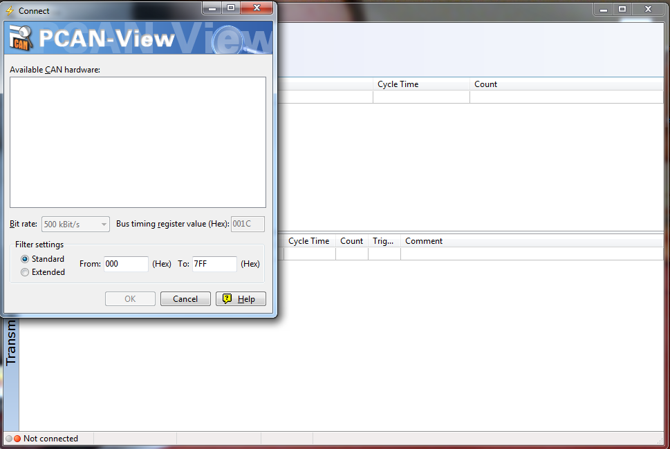
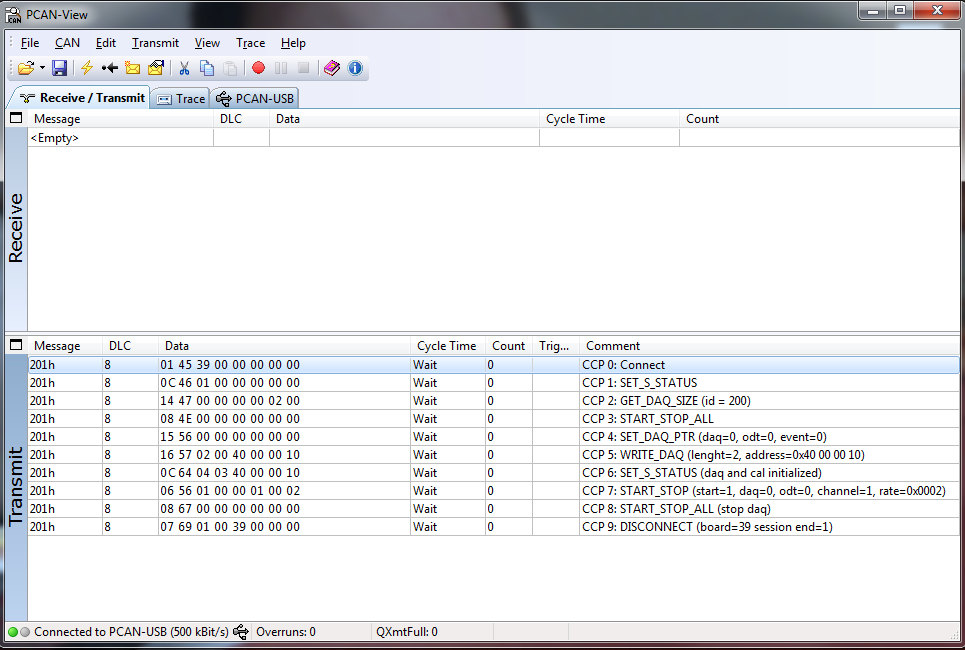

# Open-source CAN Calibration Protocol (CCP) implementation

<a id="Introduction"></a>

## Introduction

[Reference: CAN Calibration Protocol - Version 2.1. Author: H. Kleinknecht. Distribution: public] "The Controller Area Network CAN is a joint development of Robert Bosch GmbH and Intel
Corporation. CAN is used in many high-end automotive control systems like engine management as well as in industrial control systems. Controller chips for CAN are available
from various semiconductor manufacturers. The CAN Calibration Protocol is part of the ASAP standards. It was developed and introduced by Ingenieurbüro Helmut Kleinknecht, a manufacturer of calibration systems,
and is used in several applications in the automotive industry. The CCP was taken over by the ASAP working group and enhanced with optional functions."

<a id="Subset_of_the_standard_implemented"></a>

## Subset of the standard implemented

The implementation privided by Erika distribution is limited to the following subset of CCP commands:

- CONNECT 0x01
- EXCHANGE\_ID 0x17
- SET\_MTA 0x02
- DNLOAD 0x03
- DNLOAD\_6 0x23
- UPLOAD 0x04
- SHORT\_UPLOAD 0x0F
- GET\_DAQ\_SIZE 0x14
- SET\_DAQ\_PTR 0x15
- WRITE\_DAQ 0x16
- START\_STOP 0x06
- DISCONNECT 0x07
- SET\_S\_STATUS 0x0C
- GET\_S\_STATUS 0x0D
- START\_STOP\_ALL 0x08
- BUILD\_CHECKSUM 0x0E
- MOVE 0x19
- TEST 0x05

This implementation has been succesfully used by third party companies in conjunction with commercial suite (like ATI Vision)

<a id="Target_supported"></a>

## Target supported

The only target freely supported at this moment is the Freescale MPC5643L (Leopard). A demo showing a basic use-case of CCP protocol is available on the Erika kernel and can be chosen as template in RT-druid IDE.

<a id="Demo_application"></a>

### Demo application

To test the demo from RT-Druid IDE, please follow this sequence of operations:

- File -> New -> "Rt Druid Oil and C/C++ projects"
- Chose a name for your project and then press "Next"
- set a flag on "Create a project using one of these templates"
- Chose e200zx -> Leopard -> CCP\_demo
- Press "Finish"

<a id="Running_the_demo_with_PCAN-View"></a>

### Running the demo with PCAN-View

- The CAN-dongle currently adopted for Erika CCP demo is PCAN-USB developed by Peak-System. Useful details can be found at:

<http://www.peak-system.com/PCAN-USB.199.0.html?&L=1>

- In order to provide a easy to use setup to test the demo a PCAN-View configuration file is provided by Erika distribution. It can be found in the Erika distribution at:

/erika/examples/ppc/templates/leopard/CCP\_demo/PCAN\_CCP\_TEST\_LEOPARD\_ADC.xmt

Note: PCAN-View (the CAN tool provided by Peak System to monitor a CAN network) can be found at:
<http://www.peak-system.com/PCAN-View.242.0.html?&L=1>

- Additional information about the demo can be found in the related readme.txt file at: =

/erika/examples/ppc/templates/leopard/CCP\_demo/readme.txt

- Connection between PCAN-USB and Leopard EVB

details about connection are shown in the readme.txt file.

- On PCAN\_view side: chose 500Kb speed and then press "OK". The following snapshot shown the scenario.

[](../files/File_Ppp.png--2497.md)

- from PCAN-View interface press "Open File", then chose PCAN\_CCP\_TEST\_LEOPARD\_ADC.xmt file present in the CCP\_demo directory, press "OK"

A snapshot of the scenario with the configuration provided by .xmt file just mentioned is shown below.

[](../files/File_Ppp3.png--2499.md)

To send a message simply double-click on message-ID.

<a id="Testing_environment"></a>

## Testing environment

The environment adopted by third party companies is:

- ATI Vision 3.3 (Used as CCP Master tool);
- Kvaser USBCan II (but Peak System PCAN-USB is succesfully used too);
- MPC56XX EVB as Target board (with a MPC5643L on the doughter board)

Additional notes: a demo using Leopard and CCP protocol to monitor a variable can be found under "examples/ppc/templates/leopard/ccp\_leopard", while CCP implementation is under "contrib/Ccp"

<a id="Acknowledgements"></a>

## Acknowledgements

This work has been developed in collaboration with Piaggio & C. Spa and Evidence, and published in the Paper

```
Towards an Open Source Framework for Small Engine Controls Development
Paolo Gai, Francesco Esposito, Riccardo Schiavi, Evidence Srl; Marco Di Natale, Scuola Superiore S. Anna; Claudio Diglio, Michele Pagano, Carlo Camicia, Luca Carmignani, Piaggio & C SpA, SAE SETC 2014, Pisa, Italy, paper ID 2014-32-0070
```

---

## Archive provenance

- [Original page](http://erika.tuxfamily.org/wiki/index.php?title=Open-source_CAN_Calibration_Protocol_%28CCP%29_implementation) · [Archived source revision 5941](http://erika.tuxfamily.org/wiki/index.php?oldid=5941)
- Last source edit: 2014-11-13T09:29:01Z. Source retrieved on 2026-11-06; Markdown conversion completed on 2026-11-07.
- Original contributors recorded in exported history: Pj, Francesco.
- [Original MediaWiki source](../source/wikitext/2485.mediawiki) · [Original editing history](../source/history/batch-008.xml)
- [Attribution and licensing notice](../NOTICE.md). Original file-specific notices, where present, remain applicable.
